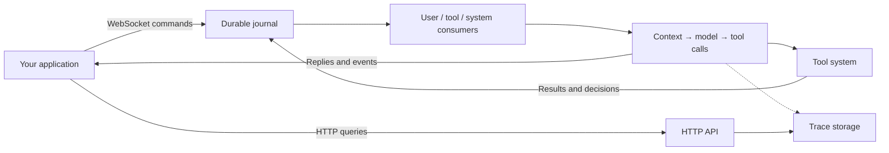

<p align="center">
  
</p>

<p align="center">
  <a href="LICENSE"></a>
  <a href="pyproject.toml"></a>
  <a href="https://github.com/HymioSpace"></a>
</p>

<p align="center">
  <strong>English</strong> · <a href="README.zh-CN.md">简体中文</a><br />
  <a href="#quick-start">Quick start</a> · <a href="#how-it-works">Architecture</a> · <a href="#documentation">Documentation</a> · <a href="#contributing">Contributing</a>
</p>

Oath is a Python runtime for agents that need to handle incoming messages, run tools, wait for approvals, and recover after interruptions. It brings execution state, context management, and tracing into one extensible foundation for your application.

Connect your client over WebSocket, add your tools and skills, and use HTTP APIs to inspect runs. Oath is part of [HymioSpace](https://github.com/HymioSpace) and can also run independently.

> **Early development.** Oath currently runs in a single process with local JSONL persistence. APIs may change; distributed execution and automatic supervision are not yet available.

## Why Oath?

- **Events drive execution.** User messages, tool results, and system decisions have separate queues. Each consumer decides when to wake the agent, so a pending approval does not have to hold up unrelated tool results.
- **State survives restarts.** An append-only journal records accepted inputs and execution state. Recovery preserves call identities and pending approvals; uncertain tool outcomes are reported explicitly rather than automatically repeated.
- **Tools have a lifecycle.** Schema validation, permissions, deadlines, cancellation, and terminal results are managed by the runtime. Built-in Bash runs through a replaceable execution environment.
- **Context stays manageable.** Large tool outputs are shortened with on-demand access to the original. Background and synchronous compaction preserve complete tool-call/result groups.
- **Runs are inspectable.** Follow input events, model requests and responses, causal links between steps, and timing metrics through traces modeled on OpenTelemetry spans.
- **Extensions stay simple.** Add Python tools, CLI commands, and Markdown skills through configured directories. Keep private extensions in the gitignored `extensions-local/` directory.

## Quick start

You need **Python 3.11+**, [uv](https://docs.astral.sh/uv/getting-started/installation/), Bash, and credentials for an OpenAI-compatible model endpoint.

### 1. Install

```bash
git clone https://github.com/HymioSpace/Oath.git
cd Oath
uv sync
cp oath.example.toml oath.toml
mkdir -p workspace
```

### 2. Configure and start

In `oath.toml`, set `model`, `api_base`, and `api_key_env` under `[agent.provider]` for your provider. The example uses `OPENAI_API_KEY`:

```bash
export OPENAI_API_KEY="your-api-key"
uv run python scripts/run_runtime.py --config oath.toml
```

Run commands from the repository root. This starts both services:

| Service | Default address | Purpose |
| --- | --- | --- |
| WebSocket | `ws://127.0.0.1:8765` | Messages, approvals, and streamed events |
| HTTP | `http://127.0.0.1:8766` | Trace queries and CLI commands |

The example is for local use: it includes a demo credential and the default tool policy allows all calls. Bash executes on the host; `workspace_root` is its default working directory, **not a sandbox boundary**. See the [tool permissions](spec/feature-tool-system.md) and [execution environment](spec/feature-bash-cli.md) designs before exposing it to other users.

### 3. Talk to the agent

In another terminal, from the same repository:

```bash
PYTHONPATH=. uv run python scripts/terminal_client.py \
  --url ws://127.0.0.1:8765 \
  --token demo-token
```

Try: `Use bash to list the files in the workspace.` The client prints replies and runtime events. Enter `:quit` to exit.

To inspect recent traces:

```bash
curl -H "Authorization: Bearer demo-token" \
  "http://127.0.0.1:8766/list_traces?limit=10"
```

Building your own client? The [integration guide](spec/manual.md) covers session binding, message payloads, approval decisions, reconnection, and trace queries. Design and protocol documentation is currently in Chinese.

## How it works



Each consumer buffers events and applies its own wake-up rule. When the agent wakes, it claims the available inputs from all three buffers in one durable operation. Model steps are serialized within a session; tools execute through their own lifecycle.

State is scoped by `user_id` and `session_id`, with run, step, and trace IDs for inspection. The journal drives recovery; traces provide an observable view of execution. Storage and execution environments are defined through interfaces, with local file storage and host execution supplied today.

## Extend Oath

Add capabilities to a configured extension directory and restart the runtime:

```text
extensions-local/
├── tools/
│   └── notes.py             # Tool subclasses
├── cli/
│   └── echo.py              # CLI command declarations and handlers
└── skills/
    └── research/
        └── SKILL.md         # Instructions and supporting resources
```

Tools are exposed to the model, skills provide reusable instructions, and CLI commands are available through `oath-cli <command>` inside Bash. Both `extensions/` and `extensions-local/` use the same loading rules.

Start with the [extension guide](spec/feature-extensions.md) and the included [CLI example](extensions/cli/echo.py).

## Documentation

| Guide | What you will find |
| --- | --- |
| [Architecture](spec/overview.md) | Components, boundaries, and recovery model |
| [Client integration](spec/manual.md) | WebSocket protocol, HTTP APIs, and examples |
| [Events and approvals](spec/feature-intake.md) | Scheduling, tool batches, and approval handling |
| [Durability](spec/feature-journal.md) | Journal, state persistence, and restart recovery |
| [Context compaction](spec/feature-compaction.md) | Tool output limits and history compression |
| [Tracing](spec/feature-trace.md) | Step relationships, model calls, and metrics |
| [Extensions](spec/feature-extensions.md) | Tools, CLI commands, and skills |

## Contributing

Bug reports, documentation improvements, and focused pull requests are welcome. For changes to execution semantics or public interfaces, open an [issue](https://github.com/HymioSpace/Oath/issues) to discuss the design first.

See [spec/](spec/) for the architecture and feature designs. To run the local checks:

```bash
uv sync
uv run ruff check .
uv run mypy .
uv run pytest tests/ -q
```

The default test run excludes slow tests. See [pytest configuration](pyproject.toml) for the full test setup.

## Part of HymioSpace

[Hymio](https://github.com/HymioSpace/Hymio) brings agents into everyday applications. [Nostalgia](https://github.com/HymioSpace/Nostalgia) manages personal context. Oath provides the runtime beneath them.

The name comes from [MONO’s *Oath*](https://monoofjapan.bandcamp.com/album/oath), and the commitment to carry work through interruptions.

## License

[MIT](LICENSE) © HymioSpace.
