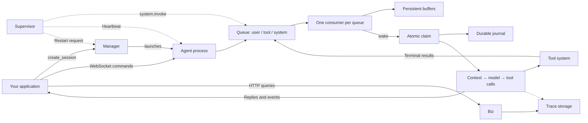

<p align="center">
  
</p>

<p align="center">
  <a href="LICENSE"></a>
  <a href="pyproject.toml"></a>
  <a href="https://github.com/HymioSpace"></a>
</p>

<p align="center">
  <strong>English</strong> · <a href="README.zh-CN.md">简体中文</a><br />
  <a href="#three-principles">Three principles</a> · <a href="#quick-start">Quick start</a> · <a href="#how-it-works">Architecture</a> · <a href="#documentation">Documentation</a> · <a href="#contributing">Contributing</a>
</p>

Oath is a Python agent runtime built around three principles: **event-driven execution, durable state, and independent supervision**. It provides the foundation for agents that handle incoming messages, run tools, wait for approvals, and continue work across interruptions.

Ask your service for a session, connect over WebSocket, add your tools and skills, and use HTTP APIs to inspect runs. Oath is part of [HymioSpace](https://github.com/HymioSpace) and can also run independently.

> **Early development.** APIs may change. Each session runs in its own process and the queue is external middleware, so an agent process can die and be restarted without losing accepted work; sharing one session across machines is outside its guarantees.

## Three principles

### Event-driven — respond as work arrives

User messages, tool results, and system decisions enter separate queues — external middleware that outlives any process. Each session runs its own agent process with one consumer per queue; each consumer decides when to wake the agent, so a pending approval does not have to hold up unrelated results.

### Durable — keep progress through interruptions

Incoming events land in a persistent buffer, not the journal: an append-only journal records only what the agent actually claimed, together with execution intent and state transitions. Recovery preserves step and tool-call identities, pending approvals, and recorded results. External actions with uncertain outcomes are reported explicitly, never blindly repeated.

### Supervisor — keep execution moving

Every session has its own supervisor process. It periodically publishes a `system.invoke` event — an event, not a call — that wakes the agent to re-examine buffered input, and it watches its agent's heartbeat and asks the manager to restart it with bounded backoff. Sessions are reclaimed on connection count alone. Empty buffers require no LLM call. See the [Supervisor design](spec/feature-supervisor.md).

Together, these principles define how Oath reacts to new work, preserves what happened, and identifies when execution needs intervention.

## Built in

- **Tools have a lifecycle.** Schema validation, permissions, deadlines, cancellation, and terminal results are managed by the runtime. Built-in Bash runs through a replaceable execution environment.
- **Context stays manageable.** Large tool outputs are shortened with on-demand access to the original. Background and synchronous compaction preserve complete tool-call/result groups.
- **Runs are inspectable.** Follow input events, model requests and responses, causal links between steps, and timing metrics through traces modeled on OpenTelemetry spans.
- **Extensions stay simple.** Add Python tools, CLI commands, and Markdown skills through configured directories. Keep private extensions in the gitignored `extensions-local/` directory.

## Quick start

You need **Python 3.11+**, [uv](https://docs.astral.sh/uv/getting-started/installation/), Bash, and credentials for an OpenAI-compatible model endpoint.

### 1. Install

```bash
git clone https://github.com/HymioSpace/Oath.git
cd Oath
uv sync
cp oath.example.toml oath.toml
mkdir -p workspace
```

### 2. Configure and start

In `oath.toml`, set `model`, `api_base`, and `api_key_env` under `[agent.provider]` for your provider, and put your service token in `service_credentials`. The example reads both from the environment:

```bash
export OPENAI_API_KEY="your-api-key"
export OATH_SERVICE_TOKEN="$(uuidgen)"
uv run python -m bootstrap.biz.process --config oath.toml
```

Run commands from the repository root. You need a Redis reachable at `middleware.redis_url`.

One process starts everything:

| Process | Default address | Purpose |
| --- | --- | --- |
| biz (with the session manager) | `http://127.0.0.1:8766` | `create_session`, trace queries, CLI commands |
| agent, one per session | `ws://127.0.0.1:<allocated>` | Messages, approvals, streamed events |
| supervisor, one per session | No listener | Forced wake-ups and agent health |

The manager allocates a port, signs a session credential, and launches the agent and supervisor pair. Queues and buffers live outside every process, so an agent can be killed and restarted without losing accepted input. The manager reclaims a session when its connection count stays at zero past the grace period.

The example is for local use: the default tool policy allows all calls. Bash executes on the host; `workspace_root` is its default working directory, **not a sandbox boundary**. See the [tool permissions](spec/feature-tool-system.md) and [execution environment](spec/feature-bash-cli.md) designs before exposing it to other users.

### 3. Talk to the agent

In another terminal, from the same repository:

```bash
uv run python scripts/terminal_client.py
```

The client asks the manager for a session and connects with the credential it gets back. Try: `Use bash to list the files in the workspace.` The client prints replies and runtime events. Enter `:quit` to exit.

To inspect recent traces, use that session's credential:

```bash
curl -H "Authorization: Bearer $SESSION_CREDENTIAL" \
  "http://127.0.0.1:8766/list_traces?limit=10"
```

Building your own client? The [integration guide](spec/manual.md) covers session binding, message payloads, approval decisions, reconnection, and trace queries. Design and protocol documentation is currently in Chinese.

## How it works



Events do not reach the journal when they arrive — they sit in a persistent buffer until the agent claims them, and that claim is the only thing that writes them down. Each consumer applies its own wake-up rule; the claim takes all three buffers in one durable operation. Model steps are serialized within a session; tools execute through their own lifecycle.

State is scoped by `user_id` and `session_id`, with run, step, and trace IDs for inspection. The journal drives recovery; traces provide an observable view of execution. Queue and buffer sit behind interfaces, with Redis Streams and local disk cache supplied today.

## Extend Oath

Add capabilities to a configured extension directory and restart the runtime:

```text
extensions-local/
├── tools/
│   └── notes.py             # Tool subclasses
├── cli/
│   └── echo.py              # CLI command declarations and handlers
└── skills/
    └── research/
        └── SKILL.md         # Instructions and supporting resources
```

Tools are exposed to the model, skills provide reusable instructions, and CLI commands are available through `oath-cli <command>` inside Bash. Both `extensions/` and `extensions-local/` use the same loading rules.

Start with the [extension guide](spec/feature-extensions.md) and the included [CLI example](extensions/cli/echo.py).

## Documentation

| Guide | What you will find |
| --- | --- |
| [Architecture](spec/overview.md) | Components, boundaries, and recovery model |
| [Client integration](spec/manual.md) | WebSocket protocol, HTTP APIs, and examples |
| [Events and approvals](spec/feature-intake.md) | Scheduling, tool batches, and approval handling |
| [Durability](spec/feature-journal.md) | Journal, state persistence, and restart recovery |
| [Supervisor](spec/feature-supervisor.md) | Independent process, heartbeats, wake-up signals, and restarts |
| [Context compaction](spec/feature-compaction.md) | Tool output limits and history compression |
| [Tracing](spec/feature-trace.md) | Step relationships, model calls, and metrics |
| [Extensions](spec/feature-extensions.md) | Tools, CLI commands, and skills |

## Contributing

Bug reports, documentation improvements, and focused pull requests are welcome. For changes to execution semantics or public interfaces, open an [issue](https://github.com/HymioSpace/Oath/issues) to discuss the design first.

See [spec/](spec/) for the architecture and feature designs. To run the local checks:

```bash
uv sync
uv run ruff check .
uv run mypy .
uv run pytest tests/ -q
```

The default test run excludes slow tests. See [pytest configuration](pyproject.toml) for the full test setup.

## Part of HymioSpace

[Hymio](https://github.com/HymioSpace/Hymio) brings agents into everyday applications. [Nostalgia](https://github.com/HymioSpace/Nostalgia) manages personal context. Oath provides the runtime beneath them.

The name comes from [MONO’s *Oath*](https://monoofjapan.bandcamp.com/album/oath), and the commitment to carry work through interruptions.

## License

[MIT](LICENSE) © HymioSpace.
