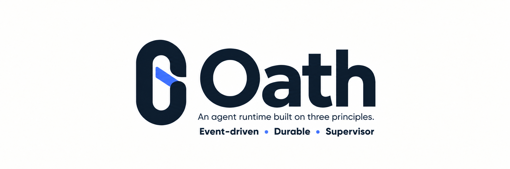
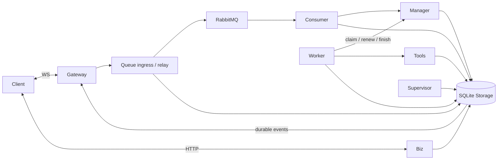

<p align="center">
  
</p>

<p align="center">
  <a href="LICENSE"></a>
  <a href="pyproject.toml"></a>
  <a href="https://github.com/HymioSpace"></a>
</p>

<p align="center">
  <strong>English</strong> · <a href="README.zh-CN.md">简体中文</a><br />
  <a href="#three-foundations">Three principles</a> · <a href="#quick-start">Quick start</a> · <a href="#architecture">Architecture</a> · <a href="#documentation">Documentation</a> · <a href="#contributing">Contributing</a>
</p>

Oath is an **event-driven, durable, independently supervised agent runtime** for personal agents that keep working when the user goes offline.

One user, one persistent agent. Connect over WebSocket, expose business capabilities over HTTP, and execute work through a bounded worker pool. Part of [HymioSpace](https://github.com/HymioSpace).

## Three foundations

- **Event-driven.** User input, tool results, and system decisions arrive through separate RabbitMQ queues. Consumers decide when to wake an agent; tool approvals do not block unrelated work.
- **Durable.** Journal, execution state, input buffers, and outbound events live in SQLite behind a Storage service. Stable identities, transactional outboxes, and fenced leases make interrupted work recoverable.
- **Supervised.** An independent Supervisor requests wake-ups for pending inputs. Empty buffers never trigger a model call. Process restart belongs to the deployment supervisor.

## Built in

- Tools with validation, approvals, deadlines and immutable terminal results; Bash through a replaceable execution environment.
- Tool-result truncation with on-demand detail access, background context compaction and synchronous compaction.
- OpenTelemetry-style traces with raw model requests/responses, causal step links and timing metrics.
- Public and private extensions: Python tools, CLI commands and Markdown skills.
- Durable streaming events, device-specific ACK cursors and ordered offline replay.

## Quick start

Requires Docker Compose, Python 3.11+ and [uv](https://docs.astral.sh/uv/getting-started/installation/).

```bash
git clone https://github.com/HymioSpace/Oath.git
cd Oath
scripts/oath-install
# Set model, api_base, credential and import_env in oath.toml.
# On first start, the launcher prompts for the model API key if import_env is unset.
scripts/oath-docker up
.venv/bin/python scripts/terminal_client.py
```

The installer creates a private `oath.toml` and local service credentials. Both local and Docker services read it. The model API key is stored in Vault under the configured alias; only the Worker has a Vault identity. The launcher's host process imports the key once, without an `.env` file. Compose runs Vault, RabbitMQ and each Oath service independently. Three ports are published, bound to localhost by default:

| Endpoint | Purpose |
| --- | --- |
| `ws://127.0.0.1:8765` | Messages, approvals, status, streaming events and replay |
| `http://127.0.0.1:8766` | Trace queries and CLI business APIs |
| `http://127.0.0.1:8200` | Local Vault operator endpoint |

No session creation is required. Authenticate with a user credential and a stable client ID. Disconnecting does not stop accepted work.

```bash
scripts/oath-docker status
scripts/oath-docker logs --follow
scripts/oath-docker set-secret  # rotate the configured model key
scripts/oath-docker down        # preserves data volumes
```

The terminal supports `/status`, `/retry`, `/cancel`, `/approve ID`, `/deny ID` and `/quit`. Use `--json` for raw protocol frames.

## Architecture



`user_id` is the isolation key. A worker holds a lease for one step; new inputs remain independently accepted and scheduled. There is no permanent per-user process or thread.

The default deployment uses **one SQLite owner, one RabbitMQ node and one Vault node**. Service boundaries support distributed deployment; database failover and broker clustering are deployment work, not guarantees of this single-host configuration. Host Bash and the current default allow policy are intended for trusted use, not untrusted multi-tenant sandboxing.

## Documentation

- [Architecture and invariants](spec/feature-distributed-personal-agent.md)
- [Client integration and operations](spec/manual.md)
- [Module overview](spec/overview.md)
- [Extensions](spec/feature-extensions.md)
- [Vault credential flow](spec/feature-vault.md)

Design documentation is currently in Chinese. The distributed-agent spec is the current architecture; older feature specs retain historical module designs and may describe superseded session and file-store behavior.

## Verification

```bash
# Real service processes, disposable RabbitMQ, SQLite, WS and HTTP model stub:
.venv/bin/python scripts/e2e_services.py --amqp-url <disposable-broker-url>
# Isolated Docker Compose environment; requires the locally built image:
.venv/bin/python scripts/e2e_docker.py
```

These checks use a deterministic model endpoint, not a paid model. See the [verification record](docs/verification-distributed-agent.md) for covered scenarios and remaining limits.

## Contributing

Discuss substantial changes in an issue first. Keep module contracts explicit and document feature designs under `spec/`. Private extensions belong in the gitignored `extensions-local/` directory.

## License

[MIT](LICENSE). The name comes from MONO’s *Oath*: a commitment to carry work through.
