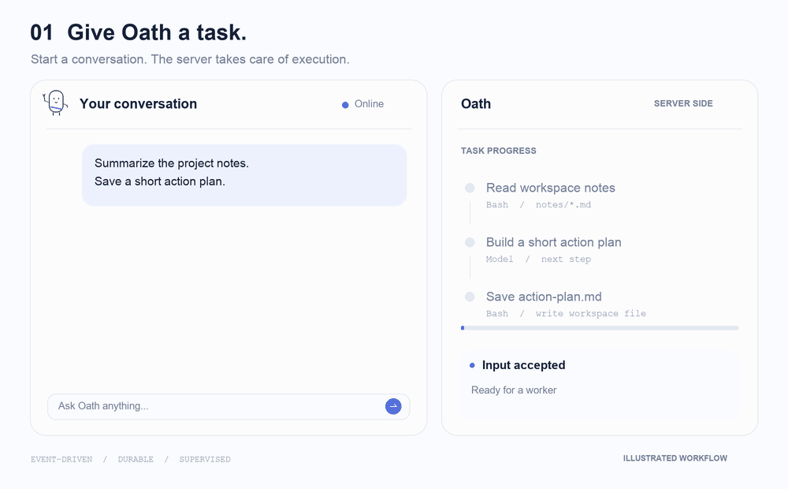

<p align="center">
  
</p>

<p align="center">
  <a href="LICENSE"></a>
  <a href="pyproject.toml"></a>
  <a href="https://github.com/HymioSpace"></a>
</p>

<p align="center">
  <a href="README.md">English</a> · <strong>简体中文</strong><br />
  <a href="#为什么做-oath">为什么做 Oath</a> · <a href="#三个底层机制">底层机制</a> · <a href="#快速开始">快速开始</a> · <a href="#接入自己的能力">扩展</a> · <a href="#文档">文档</a>
</p>

**Oath 是一个 personal agent runtime，让 Agent 在两次对话之间也能继续工作。**

交代任务，关掉客户端，回来查看进展。Oath 将用户通信与 Agent 执行分离：已接纳的工作继续在服务端推进，产生的事件持久保存，用户重连后收到错过的内容。

<p align="center">
  
</p>

<p align="center"><sub>合成内容的交互示意，非项目自带聊天 UI。</sub></p>

## 为什么做 Oath

Personal agent 的工作不该受聊天窗口开关限制。它需要在执行中接收新输入，等待某个授权时继续推进其他工作，也需要在断线或中断后保留进展。

Oath 为这些工作提供基座：

- **工作生命周期独立于连接。** 关闭 WebSocket 不取消已接纳任务。重连后按顺序补发持久事件，以明确的离线边界和每设备 cursor 管理交付。
- **全天可用，有事才执行。** 共享 Worker 池按事件运行推理步骤，不为每个用户保留常驻线程。Supervisor 检查空 buffer 不调用模型；任务仍受轮次和时间预算约束。
- **独立服务，一个 Docker 命令启动。** 通信、输入消费、调度、执行、工具、业务 API 和监督通过服务契约协作。当前单机部署可以用 `oath start` 在本机或云端 Docker 主机运行。

## 三个底层机制

### Event-driven

用户消息、工具结果、系统干预进入三条队列，各 consumer 独立判断何时唤醒。Brain 接收固定输入，构建 context、调用模型并提交后续动作。

**Tool result 也是 event。** Agent 的推进由到来的事件与持久 buffer 驱动，摆脱把整段工作绑在一个阻塞式 `while True` 推理循环里的限制。接入审批策略后，一个工具可以等待用户授权，其他已提交工具继续执行；可用结果可以推动下一步，后续批准或工具结果再通过事件系统进入。

### Durable

Append-only journal 记录执行事实。输入、工具状态、执行所有权和对外事件通过 Storage 服务持久化；事务 Outbox 和带所有权校验的租约将这些记录与消息交付、Worker 恢复连接起来。

恢复依据已有状态处理。对于无法确认的外部副作用，框架不承诺 exactly-once；需要幂等的工具仍应自行实现。

### Supervisor

Supervisor 是从旁观者视角观察 Agent 工作的独立服务，通过 system event 参与干预。目前它定期检查持久待办并请求唤醒，空 buffer 不调用模型。

这个观察者角色是后续能力的基础。基于 trace 的检查、恢复决策、模型辅助监督都是未来方向；当前进程重启由 Docker 或部署平台负责。

## Bash + CLI，减少模型往返

Oath 将核心 **Bash 工具**与 **`oath-cli`** 组合。应用把命令暴露为 HTTP API，Agent 通过 shell 调用；一次脚本可以组合多个命令，利用管道、过滤和聚合后交回有用结果。适合脚本编排的工作，可以减少逐项调用工具所需的模型轮次。

执行环境通过接口隔离，当前命令运行在 Tools 容器内。Biz 将用户当前的 context 交给 CLI 扩展，由应用实现业务行为和授权。

Core 同时提供工具 deadline 与审批、skills、工具结果截断和详情读取、context 压缩，以及原始模型输入输出、step 关联和性能指标的 trace。

## 快速开始

需要 Docker Compose、Python 3.11+ 和 [uv](https://docs.astral.sh/uv/getting-started/installation/)。启动 Docker 后执行：

```bash
git clone https://github.com/HymioSpace/Oath.git
cd Oath
scripts/oath-install
```

编辑 **`~/.oath/oath.toml`**，设置模型名、OpenAI 兼容接口 `api_base` 和 Vault `credential` 别名。安装器生成本地服务凭据，已有配置会被复用。

```bash
oath start
# 首次构建镜像；需要模型 API Key 时会安全提示输入。
# 服务健康后，打开内置调试客户端：
.venv/bin/python scripts/terminal_client.py
```

模型密钥存入 Vault，无需 `.env`。当前安装从源码构建 Docker 镜像，请保留仓库目录。

| 端点 | 用途 |
| --- | --- |
| `ws://127.0.0.1:8765` | 对话、审批、流式事件与离线补发 |
| `http://127.0.0.1:8766` | Trace 查询与 CLI 业务 API |

默认绑定本机。客户端用生成的用户凭据认证，调试客户端会从配置读取。一个 `user_id` 对应一段持续对话，无需创建 session。

```bash
oath status
oath restart   # 复用已保存的配置与扩展目录
oath stop      # 保留数据卷
```

`--config PATH` 可指定其他配置。调试客户端支持 `/status`、`/retry`、`/cancel`、`/approve ID`、`/deny ID` 和 `/quit`；`--json` 查看原始协议事件。

## 接入自己的能力

Core 负责执行语义与核心工具，应用能力交给扩展：**Python tools、HTTP CLI commands、Markdown skills**。这些目录可以在自己的仓库维护，启动时传入：

```bash
oath start \
  --skill /path/to/skills \
  --tool /path/to/tools \
  --cli /path/to/cli
```

各选项可重复。内置扩展默认加载，附加目录只读挂载到使用它的服务；工具或命令重名会导致启动失败。详见[扩展契约](spec/feature-oath-command.md)。

## 当前范围

Oath 仍在早期演进。默认是单机 Compose，使用一个 SQLite owner、一个 RabbitMQ 节点和一个 Vault 节点。独立服务边界为分布式部署提供基础，尚不包含数据库自动故障切换或 broker 集群。

当前 Bash 环境和默认 allow-all 工具策略面向受信任部署。审批执行路径已经存在，策略配置与更强的租户隔离仍需继续完善。

## 文档

- [模块总览](spec/overview.md)
- [分布式执行与恢复](spec/feature-distributed-personal-agent.md)
- [客户端协议与运维](spec/manual.md)
- [命令与扩展契约](spec/feature-oath-command.md)
- [Vault 密钥流转](spec/feature-vault.md)

设计文档以中文为主。先看 overview 与分布式 Agent spec；较早的 feature 可能描述已被替代的方案。

## 参与贡献

欢迎想法、问题与贡献。涉及执行语义的重要改动请先讨论，并在 `spec/` 记录契约。应用专属能力放在 extensions。

## License

[MIT](LICENSE)。[HymioSpace](https://github.com/HymioSpace) 的一部分。名字来自 MONO 的 *Oath*，也代表把工作持续推进下去的承诺。

## 应用鉴权

默认 `oath start` 不验证用户凭证：WS attach 提供外部 `user_id`，Biz HTTP 使用 `X-Oath-User-Id`。此模式只向本机或可信网关开放。

```bash
oath start --auth-mode remote \
  --auth-url http://hymio-backend:8080/internal/auth/verify \
  --auth-token-file /path/to/private/verifier-service-token
```

验证器接收服务凭据保护的 POST，body 为 credential，返回 user_id / expires_at。失败或不可用拒绝访问；WS 最迟每 30 秒复验且不越过过期时间，Biz 逐请求验证。退出只撤销访问，不取消已接纳任务。restart 保留启动参数。`--auth-mode static` 使用手工配置的 services.users；鉴权模式不写入 TOML。详见 [设计](spec/feature-authentication.md)。
