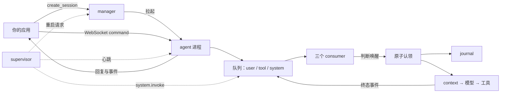

<p align="center">
  
</p>

<p align="center">
  <a href="LICENSE"></a>
  <a href="pyproject.toml"></a>
  <a href="https://github.com/HymioSpace"></a>
</p>

<p align="center">
  <a href="README.md">English</a> · <strong>简体中文</strong><br />
  <a href="#三个核心特性">三个核心特性</a> · <a href="#快速开始">快速开始</a> · <a href="spec/overview.md">架构</a> · <a href="spec/manual.md">接入文档</a> · <a href="#参与贡献">参与贡献</a>
</p>

Oath 是一个用 Python 构建的 agent runtime，围绕三个核心特性设计：**事件驱动、持久化、独立监督**。它为需要接收消息、执行工具、等待审批、在中断后继续工作的 agent 提供统一基座。

向服务要一个 session，用 WebSocket 接入，添加自己的工具和技能，通过 HTTP 查询执行情况。Oath 属于 [HymioSpace](https://github.com/HymioSpace)，也可以独立使用。

> **早期开发阶段。** 接口可能变化。每个 session 一个进程、队列在进程之外，agent 崩了可以重启且已接纳的输入不丢；同一个 session 跨机共享不在保证范围内。

## 三个核心特性

### Event-driven · 由事件推动执行

用户消息、工具结果和系统决策分别进入三条队列 —— 队列是进程之外的中间件，比任何进程都活得久。每个 session 一个 agent 进程，一条队列一个 consumer，各自决定何时唤醒 agent。某个工具等待批准时，其他结果仍可推动下一步。

### Durable · 中断之后保留进度

事件到达时不写 journal，先落进持久 buffer；agent 认领时的那次原子事务才把它写进去。恢复时保留 step 与工具调用身份、待审批请求和已保存的结果。无法确认结果的外部动作会明确报告，不会盲目重做。

### Supervisor · 独立监督执行

每个 session 一个 supervisor 进程。它定时往 system 队列投一条 `system.invoke` —— 那是一个事件，不是一次调用 —— 把 agent 叫醒看一眼 buffer 里攒着的输入；同时盯着自己那个 agent 的心跳，不在了就请 manager 按退避重启。scope 的回收只看连接数。空 buffer 不触发 LLM 调用。详见 [Supervisor 设计](spec/feature-supervisor.md)。

三个特性共同定义 Oath 如何响应新任务、保留执行事实，以及如何发现需要干预的运行状态。

## 内置能力

- **完整的工具生命周期。** 统一管理参数校验、权限、超时、取消和终态。内置 Bash 通过可替换的执行环境运行。
- **上下文管理。** 大段工具结果截断后可按需取回原文；异步与同步压缩保留完整的工具调用与结果组合。
- **可检查的执行过程。** 基于 OpenTelemetry span 模型组织 trace，查看输入事件、模型请求与响应、步骤间因果关系和耗时。
- **简单的扩展方式。** 通过目录加载 Python 工具、CLI 命令和 Markdown 技能；私有扩展可以放在已被 Git 忽略的 `extensions-local/` 中。

## 快速开始

需要 **Python 3.11+**、[uv](https://docs.astral.sh/uv/getting-started/installation/)、Bash，以及一个兼容 OpenAI API 的模型服务。

```bash
git clone https://github.com/HymioSpace/Oath.git
cd Oath
uv sync
cp oath.example.toml oath.toml
mkdir -p workspace
```

在 `oath.toml` 的 `[agent.provider]` 中配置 `model`、`api_base` 和 `api_key_env`，并在 `service_credentials` 里放服务级凭证。示例两者都从环境变量读。需要 `middleware.redis_url` 上有一个能连上的 Redis。然后从仓库根目录启动：

```bash
export OPENAI_API_KEY="your-api-key"
export OATH_SERVICE_TOKEN="$(uuidgen)"
uv run python -m bootstrap.biz.process --config oath.toml
```

一个进程就够 —— 它自己带 manager：

| 进程 | 默认地址 | 职责 |
| --- | --- | --- |
| biz（内含 manager） | `http://127.0.0.1:8766` | `create_session`、trace 查询、CLI 命令 |
| agent，每个 session 一个 | `ws://127.0.0.1:<现分配>` | 消息、审批、事件 |
| supervisor，每个 session 一个 | 不对外监听 | 强制唤醒、看住 agent |

manager 分配端口、签发 session 凭证、拉起那一对进程。队列和 buffer 都在进程之外，agent 被
`kill -9` 后重启，那条已接纳的输入还在。连接数连续为 0 超过冷却期，manager 回收这个 scope。

示例面向本地体验：默认工具策略允许所有调用。Bash 在宿主机执行，`workspace_root` 只是默认工作目录，**不是沙箱边界**。面向其他用户部署前，请阅读[工具权限](spec/feature-tool-system.md)和[执行环境](spec/feature-bash-cli.md)设计。

另开一个终端，在仓库根目录连接：

```bash
uv run python scripts/terminal_client.py
```

终端客户端自己调 `create_session` 换凭证，再连上那个 scope 的 WebSocket。试着发送「用 bash 看看
工作区有哪些文件」。终端会显示回复与 runtime 事件，输入 `:quit` 退出。

查询最近的 trace（用那个 session 的凭证）：

```bash
curl -H "Authorization: Bearer $SESSION_CREDENTIAL" \
  "http://127.0.0.1:8766/list_traces?limit=10"
```

## 工作方式与扩展

事件到达时只进持久 buffer，不落 journal —— 认领那次事务才写。三个 consumer 各自判断唤醒条件，
agent 被唤醒后一次性取走三个 buffer 里可用的输入。同一 session 的模型步骤串行执行，工具有独立
的执行生命周期。

状态按 `user_id` 和 `session_id` 隔离，通过 run、step 和 trace ID 关联执行过程。日志负责恢复，
trace 负责观察。队列与 buffer 在接口后面，当前提供 Redis Streams 与本地 disk cache 实现。

在扩展目录加入能力后重启即可加载：

```text
extensions-local/
├── tools/
│   └── notes.py
├── cli/
│   └── echo.py
└── skills/
    └── research/
        └── SKILL.md
```

工具直接暴露给模型，技能提供可复用的指令，CLI 命令通过 Bash 中的 `oath-cli <command>` 调用。`extensions/` 与 `extensions-local/` 使用同一套加载规则。

## 文档

- [整体架构](spec/overview.md)
- [客户端接入：WebSocket、HTTP、审批与重连](spec/manual.md)
- [事件处理与工具批次](spec/feature-intake.md)
- [持久化与恢复](spec/feature-journal.md)
- [Supervisor：独立进程、心跳与重启](spec/feature-supervisor.md)
- [上下文压缩](spec/feature-compaction.md)
- [Trace](spec/feature-trace.md)
- [扩展开发](spec/feature-extensions.md) · [CLI 示例](extensions/cli/echo.py)

## 参与贡献

欢迎提交问题、改进文档或发起范围明确的 PR。涉及执行语义或公共接口的变化，请先通过 [issue](https://github.com/HymioSpace/Oath/issues) 讨论设计。架构与功能设计位于 [spec/](spec/)。

```bash
uv sync
uv run ruff check .
uv run mypy .
uv run pytest tests/ -q
```

默认测试跳过 slow 测试，完整配置见 [pyproject.toml](pyproject.toml)。

## HymioSpace

[Hymio](https://github.com/HymioSpace/Hymio) 提供应用体验，[Nostalgia](https://github.com/HymioSpace/Nostalgia) 管理个人 context，Oath 提供运行基座。

名字来自 [MONO 的《Oath》](https://monoofjapan.bandcamp.com/album/oath)，也代表在中断之后仍把工作继续下去的承诺。

## 许可证

[MIT](LICENSE) © HymioSpace。

## 进程模型



agent 独占执行状态与 journal writer；biz 在自己的进程执行 CLI，只读 trace；supervisor 不碰
journal、不发输入、不看连接数，只投事件与看心跳。`bootstrap/` 按进程分目录，负责装配、
通信与进程生命周期。
