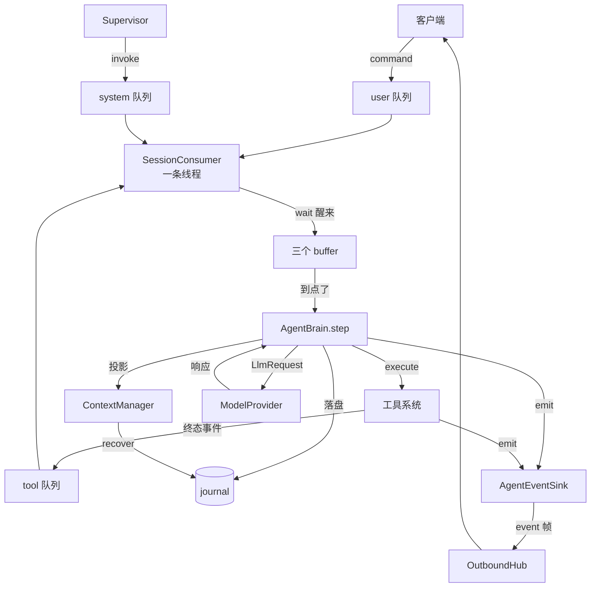

# Feature — Agent Runtime（让 Oath 跑起来）

状态：Implementing

前置：[feature-journal](feature-journal.md)、[feature-event-runtime](feature-event-runtime.md)、
[feature-tool-system](feature-tool-system.md)

## 1 背景与目标

骨架已经齐了：journal 存得住，队列排得下，工具系统跑得动，wire 协议说得清，但缺一条
把它们串起来的通路 —— 「一条用户输入」和「一次 `step`」之间该是什么关系，从没定清楚。

本 feature 把这几块接上，让 Oath 能接一句用户输入、回一段回答：

- **`Inbound`** —— 还没进对话历史的一件事。
- **`EventBuffer`** —— 攒批的持久化缓冲，跨过它崩溃就不丢。
- **`SessionConsumer`** —— 每个 session 一条线程，搬运三队列的内容、判断该不该醒。
- **`AgentBrain`** —— context build → LLM → 落盘 → 派发工具。
- **`ContextManager`** —— 把 `AgentState` + journal 投影成一次模型请求要的东西。
- **`AgentConfig`** —— 一份配置管住模型、system prompt、server、路径。

## 2 总览

### 2.1 一句话

**`Inbound` 先进队列，consumer 攒进 buffer，`AgentBrain.step` 把这一批落进 journal 再
调一次模型。等待期间模型吐出来的增量直推客户端，不落盘。** 三段分得很清：**队列管叫醒，
buffer 管不丢，brain 管什么算数。**

### 2.2 数据流向



**journal 只由 brain 写。** producer（ws、工具系统、Supervisor）只往队列里放东西。
「我发起了一个 toolcall」和「我收到了它的结果」都不是 brain 的视角 —— 工具系统知道
结果，但不知道这一轮是什么。只有 brain 知道，所以也只有 brain 写得动那些记录。

### 2.3 规则

1. **先落盘，再做下一步。** `assistant.message` 与 `tool.call` 一定先 append 进
   journal，再 emit / 派发。反过来做就会出现「客户端看到了、journal 里没有」。
2. **队列里的一切都没进对话历史。** 队列与 buffer 装的是「还没算数的事」，落盘是 brain
   的判断，不是传输层的副作用。
3. **buffer 是持久化边界。** 一个事实从队列移进 buffer 那一刻起就不再会丢。
4. **增量只走客户端，不落盘。** 一段增量在 journal 里是一句半话 —— 落它等于让记录
   说谎。兜底是完整的 `assistant.message`。
5. **每一条工具结果都落 `tool.result`。** 它能不能填回原来的槽位是投影的事，不是落盘
   的事 —— 落盘时顺手判断，就把「这条记录长什么样」和「这一批凑巧带上了什么」绑死
   在一起，重放一次不一定还成立。
6. **id 是算出来的，不是发出来的。** `step_id` 由这一批输入的身份算出，
   `invocation_id` 由 `step_id` 与序号算出。正文本该由 journal 的幂等指纹管。
7. **一个 session 一条消费线程。** `brain.step` 跑在那条线程上，阻塞的模型调用只挡住
   那一条会话。三条 buffer 要读写同一批记录，多线程就是真竞争。
8. **core 不认识任何 provider 的字段名。** `Message` 与 `ToolDefinition` 用通用名。
9. **模型给的 `tool_call_id` 原样透传，`invocation_id` 是 Oath 自己的。** 模型会重发
   同一个 id，那不该让同一个调用跑两次。
10. **凭证只走环境变量。** 配置里写 `api_key_env`，不写 `api_key`。

### 2.4 一个完整的例子

客户端问一句、agent 调一次工具。`#` 是 journal 的行号。

| # | 发生什么 | journal |
| --- | --- | --- |
| 1 | `session.open` 验 credential，回 `ack`；`user.message` 进 user 队列，consumer 被叫醒 | 不落盘 |
| 2 | 结果移进 user buffer，`brain.step` 落 user 输入与 `system.agent_step{start, trigger:user}` | 41、42 |
| 3 | `ContextManager` 把 41 投影成 user 消息，带上工具定义 → provider | — |
| 4 | 模型说要调 `weather` → 先落盘，再直推客户端 | 43 `assistant.message` |
| 5 | 每个 tool call 落一条记录，然后派发出去，立即返回 | 44、45 `tool.call` |
| 6 | 工具跑完 → 投递客户端 + 进 tool 队列 → consumer 被叫醒，移进 tool buffer | 不落盘 |
| 7 | `brain.step` 落 `tool.result` → 再调一次模型 → 落最终回答 | 46、47、48 |

第 7 步是循环的来源。模型这一轮不再要工具，就不会有 `tool.call`，下次没人叫醒，
这轮就停。

## 3 接口与数据

### 3.1 `Inbound` 与 `EventBuffer`

`Inbound` 是「还没进对话历史的一件事」：`kind` 是 `user` / `tool_result` / `invoke`，
`payload` 是它的原样内容。它不是 `Record` —— 还没落盘，没有游标、没有幂等键。

`EventBuffer` 是 consumer 侧的攒批缓冲，三条（user / tool / system），接口只有 scope
与四个动作：`put` / `snapshot` / `clear` / `scopes`。

**`snapshot` 不删除。** brain 跑完、落完盘，consumer 才 `clear`。中间崩了重启再读到
同一批，会重跑一次 `step` —— id 是算出来的，journal 的幂等键挡住重复写入。`scopes()`
是重启恢复的入口：起来时把每个 scope 没 clear 的那批捞回来，不等新的 `put` 来叫醒。

`FileEventBuffer` 是 v1 唯一的实现：per-scope 目录 + append，写失败 `ftruncate` 回原长度，
半行在**下一次写之前**截掉。**单进程单写者**这条取舍照抄 journal。

### 3.2 `SessionConsumer`

每个 session 一条线程，起来就 `queue.wait(scope)` 阻塞，谁往这个 scope 的队列 `put`
就唤醒谁。没有 tick 轮询。

醒来之后：**取光三条队列 → 按 kind 灌进对应 buffer → 把这一批交给 brain → brain 说处理
完了才 `clear`**。搬不进去的那几条放回队列。

**该不该醒、该不该清 buffer，全是 brain 说了算**，consumer 一概不判断。batch 里已经按
队列分好，brain 自己知道这批是什么。consumer 只管搬运和等。

### 3.3 `AgentBrain`

`AgentBrain(Brain)` 只有一个入口：`step(scope, batch) -> bool`。

**返回 False 表示现在还不该处理这批**，consumer 据此不清 buffer：batch 里只有 tool
结果，而这一轮还没齐。

| batch 里有 | 行为 |
| --- | --- |
| user 输入 | 一定处理 |
| tool 结果，且这一轮齐了 | 处理 |
| tool 结果，还没齐，且没到期 | 返回 False，什么都不做 |
| tool 结果，距第一个结果到达已过 n 秒 | 处理，缺的那些由投影补 `unresolved` 占位 |
| invoke | 处理（`Supervisor` 还没做，现在不会有） |

**时限从第一个结果到达起算，不是从派发起算。** 慢的是工具，不是 agent 决定等它；
从派发起算的话，一轮里最快回来的那个把时限吃光了，同批还在跑的那几个一个都等不到。
没回来的那几条不会往队列里 `put` 任何东西，所以到期这一条不是兜底，是这轮唯一的
出路 —— 没有它，这一轮永远停在 buffer 里，agent 再也不说话。

`step` 的顺序固定：落 user 输入与 `system.agent_step{start, trigger}` → build →
调模型 → 落 `assistant.message` → emit → 每个 tool call 落 `tool.call` → emit →
`tool_system.execute`。**每一步都先落盘再做下一步。**

落盘用的幂等键：`user.message` 用 `cmd:<command_id>`，`assistant.message` 用
`msg:<step_id>`，`tool.call` 用 `tool.call:<invocation_id>`，`tool.result` 用
`tool.result:<invocation_id>`，`system.agent_step` 用 `step:<step_id>:<phase>`。

**`step_id` 是这批输入的身份的哈希，`invocation_id` 是 `<step_id>-<序号>`。** 同一批输入
不管被交上来几次，算出来的都是同一组 id，幂等键因此把重放挡住：同一个命令重发不会调
第二次模型、不会派发第二次工具。

**重跑一步不是从头再来。** `step` 先扫一遍 journal：这一步的 `assistant.message` 还在，
就不重新问模型，直接拿它声明的 `tool_calls` 去补 `tool.call` 与派发。说过的话在
journal 里，那才是这一轮真正说过的话 —— 重新问一次会得到另一个答案，而两份互相矛盾
的回答都在日志里。

「这一轮派发了几个」不需要额外状态：`assistant.message` 里的 `tool_calls` 已经落盘，
投影时数一下就知道。「这一轮什么时候派发的」就是那些 `tool.call` 记录的 `commit_dt`。

### 3.4 context build

投影出的消息数组，**末尾如果是带 `tool_calls` 的 assistant 轮，就必须紧跟同样数量的
tool 消息，`tool_call_id` 一致** —— 这是 provider 的硬要求，缺一条那个数组交给谁都
是坏的。还没回来的补一条 `unresolved` 占位。

**槽位由 `assistant.message` 声明，不由 `tool.call` 记录决定。** 模型那一轮说了要调哪
几个工具，那些槽位就在那条消息之后挨着排好 —— 中间崩了、没来得及写 `tool.call`，
留下的数组照样是能交给 provider 的。`tool.call` 记录后来补上时认领同一个槽位。

**迟到的结果改不了历史，也不需要改历史。** 一个 tool 结果在它的槽位已经被填过之后才
到，投影不动那个槽位 —— 它是模型读过的记录，改它就是让记录说谎。真相在数组的最后，
作为一条补告：

```xml
<events>
<event_type=tool_result invocation_id="a1b2c3-0" tool="echo">之前 id 为 a1b2c3-0 的工具结果为：链路通了</>
</events>
```

它排在所有 `unresolved` 占位之后 —— provider 只认「assistant 的 tool_calls 后面紧跟
同样数量的 tool 消息」，插在中间会让整个数组失效。正文一律转义，工具返回里出现
`</>` 就该被读成文本，不是标签。

**「槽位关了没有」不需要额外状态。** `tool.call` 之后出现了一条 `assistant.message`，
就说明模型已经读过那个槽位了 —— 哪怕当时填进去的只是个 `unresolved` 占位。扫一遍
journal 就能得出两件事：这一轮还差谁、谁的槽位已经关了。关掉的那批结果照常落
`tool.result`（规则 5），只是投影的时候换一种说法告诉模型。

工具名从对应的 `tool.call` 查：`tool.result` 的 payload 里没有它。

`ContextManager.build` 只有两步，全是纯读：拿 `recovery.state` 里的快照，再把
`read_range` 出来的**全部**记录投影一次。分两次投影会在快照边界上把一次调用和它的
结果劈开：前半段看到 call 看不到 result，槽位被判成 `unresolved`；后半段看到 result
配不上任何槽位，只能被丢掉。system prompt 拼在第一条，`ToolDefinition` 原样挂上。

**不写快照。** 快照是加速恢复的，不是正确性来源。压缩器接口在，实现没写。

### 3.5 `ModelProvider`

`ModelProvider` 只有一个方法：`complete(request, *, on_delta=None)`。

`complete` 是**阻塞**的。请求带着 `messages` 与 `tools`，返回带着 `content` 与
`tool_calls`（两者可以同时非空）。provider 只回答「模型说了什么」，不回答「结果怎么用」
—— 换一个 provider 不改 `AgentBrain` 一行。

`OpenAICompatibleProvider` 是 v1 唯一的实现：`POST {api_base}/chat/completions`。`ToolCallRef`
的扁平 `{id, name, arguments}` 在这一层被包成 OpenAI 要的形状，`arguments` 从对象序列化
成字符串，进 core 时再解析回对象。

失败一律抛 `LlmError`：没有 api key、`api_base` 为空、网络错误、非 2xx、超时、响应体
形状不对，`arguments` 不是合法 JSON 也算 —— 当成空参数放过去，工具会拿着一个静默错误
的入参跑完。流里一个 `choices` 都没出现过同样算失败。

### 3.6 流式

**流的是等待过程，不是落盘。** `on_delta` 给了就走 SSE：每收到一段就交一次回调，攒完
仍返回一个和 `stream=false` 形状完全一致的 `LlmResponse`。落盘、`tool.call` 派发、
`system.agent_step` 收尾全在返回值之后，**两种模式下是同一段代码**。

三件事的粒度不一样：`content` 与 `reasoning` 边收边吐，两路分开，客户端要能把「正在想」
和「正在答」分开显示；`tool_calls` 攒完整再解析（`arguments` 是增量 JSON，中途不是合法
对象），**按 `index` 归并**，不靠顺序 —— OpenAI 切成好几段，MiniMax 一个 chunk 整段
发完，`index` 是唯一稳定的身份；回调里的异常吞掉，送不出去的一段增量不是模型调用失败。

增量以 `assistant.delta` 事件直推客户端，**不落盘**（规则 4）。

### 3.7 对外投递

`OutboundHub(OutboundTransport)`：按 scope 分流，每个 scope 一条有界 `deque`，`send`
把帧排进去，返回 `SendResult`。满了它**自己不断** —— 断连接是策略，由 sink 那一层决定。
队列用 `deque` 而不是 `asyncio.Queue`：判断「装不下了」必须同步发生在调用方那个线程里。

`WsEventSink(AgentEventSink)`：`emit` 把事件转成 `EventFrame` 再 `send`；收到
`QUEUE_FULL` 就 `close(scope, CloseReason.SLOW_CONSUMER)` 然后**继续** —— 事件已经送不出
去了，core 的流程不能因为一个慢客户端停住。

工具系统的终态事件有一个 relay：**先投客户端，再进 tool 队列**。反过来的话，消费线程
会被入队叫醒、抢在投递完成之前跑完这一步，界面上就出现一段先有 `assistant.message`、
后有 `tool.terminal` 的错位。投递失败照旧入队。它不落盘，那是 brain 的活。

## 4 实现方案

| 模块 | 位置 |
| --- | --- |
| 配置类型 | `core/protocol/datatype/config.py` |
| `Inbound` / 队列名 | `core/protocol/datatype/inbound.py`、`queue.py` |
| LLM 类型 / 接口 / 实现 | `core/protocol/datatype/llm.py`、`core/protocol/interface/llm.py`、`core/llm/` |
| `EventBuffer` 接口 / 实现 | `core/protocol/interface/buffer.py`、`core/buffer/` |
| ContextManager / 投影 | `core/context/`、`core/journal/messages.py` |
| `SessionConsumer` / relay | `core/consumer.py` |
| `AgentBrain` | `core/agent/brain.py` |
| 共享依赖包 | `core/runtime.py` |
| WebSocket 传输与 sink | `core/outbound/` |
| 装配、配置加载、ws server | `bootstrap/` |
| 演示工具 | `extensions/tools/` |
| 启动脚本、终端客户端 | `scripts/` |

**ws server 是 asyncio 的，core 不是。** 上行把 `Command` 转成 `Inbound` 放进队列就返回，
不做任何阻塞操作；下行是 `OutboundHub` 的发送队列。core 不 import `websockets`。

## 5 失败与恢复

| 场景 | 行为 |
| --- | --- |
| 模型调用失败（网络 / 超时 / 非 2xx / `arguments` 非法） | 抛 `LlmError`。不落 `assistant.message`，记 `system.agent_step{error}` |
| 流里一个 `choices` 都没出现过 | 判失败。HTTP 200 不等于模型答了 —— 当成空回答收下，用户那句话就没了 |
| 一段增量投递失败 | 吞掉，模型调用继续。完整消息照样落盘、照样到达 |
| 工具派发被拒 | 工具系统自己发终态事件，走 tool 队列回到 `Brain`。`Brain` 不管 |
| 客户端在 `step` 中途断开 | 不影响。落盘与派发都不经过连接 |
| 发送队列满 | `sink` 断开那条连接，事件丢掉，不阻塞 core |
| 同一 session 两条连接 | 后来的顶掉前一条，前一条收到 `close{session_replaced}` |
| 一批输入搬不进 buffer | 那几条放回队列。已经出队的东西没了就是没了 |
| 一次循环抛异常 | 记日志、等下一轮。抛出去就是消费线程死掉，这条 session 再也没有人消费 |
| 一步处理的是不合法的输入（`is_permanent`） | 丢掉这一批并记日志里的身份。不重试 —— 重试多少次都是同一个错，而留着它会把后来的输入一起拖住 |
| 崩溃时 buffer 里有东西 | `scopes()` 捞回来重跑那一步。id 是算出来的，幂等键挡住重复写，模型不必再问一次 |
| 工具结果永远不齐 | 距第一个结果到达 n 秒强制醒一次，缺的那些投影成 `unresolved` 占位 |
| 进程重启 | context 完全由 journal 重放恢复。**队列是空的** —— 还没进 buffer 的输入不补 |

## 6 跨仓库协议变更

帧格式没动：`assistant.message` / `tool.call` / `tool.terminal` / `assistant.delta` 的
信封与 payload、`command` 的信封与 payload，都不变。`assistant.delta` 的 `channel` 取
`content` 或 `reasoning`，客户端按 delta 追加渲染，断线重连以完整的
`assistant.message` 为准。

**`invocation_id` 的取值变了**：从序号变成了 `<step_id>-<序号>`。客户端只把它当作
一个不透明标识透传与去重，不解析它的内部结构 —— 这条要写进客户端的实现说明。

## 7 待决事项

- **Supervisor 与 `system.invoke`。** system 队列现在没有事件源。`run.cancel` 落成
  `system.cancel` 之后要有人周期性地来问「有没有待中止的 run」。
- **buffer 换 SQLite。** `EventBuffer` 的接口里没有路径，只有 scope。
- **压缩。** 接口在，实现没写；`compress_at_ratio` 与 `max_step_tokens` 都没有人读。
- **LLM 调用的重试与 fallback。** `outcome_unknown` 在工具侧有，模型侧还没有。
- **重启后队列里没消费的输入怎么重投**，见
  [feature-event-runtime](feature-event-runtime.md) 7。