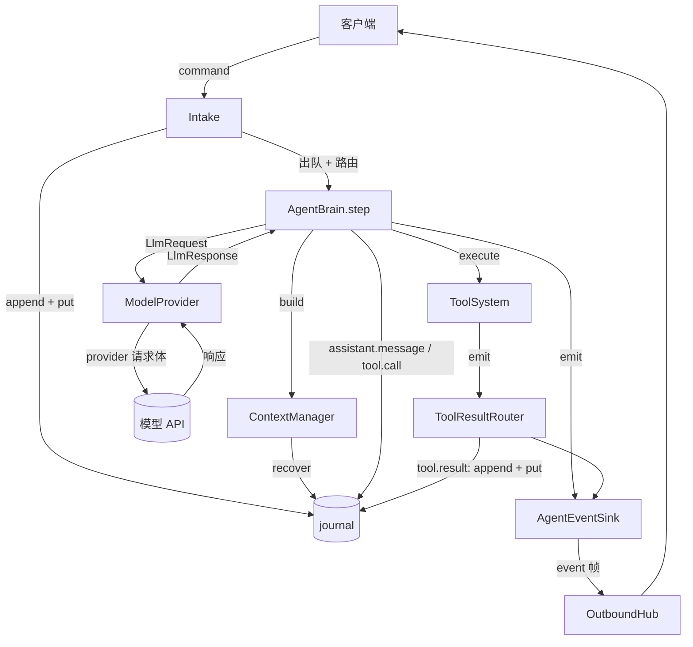

# Feature — Agent Runtime（让 Oath 跑起来）

状态：Implemented

前置：[feature-journal](feature-journal.md)、[feature-event-runtime](feature-event-runtime.md)、
[feature-tool-system](feature-tool-system.md)

## 1 背景与目标

骨架已经齐了：journal 存得住，三条队列排得下，工具系统跑得动，wire 协议说得清。但没有
一条命令能让它真的动起来 —— `Intake`、`Brain` 都还是接口，事件也送不出去。

本 feature 把这几块接上，让 Oath 能接一句用户输入、回一段回答：

- **`ContextManager`** —— 把 `AgentState` + journal 投影成一次模型请求要的东西。
- **`ModelProvider`** —— provider 无关的调用接口，加一个 OpenAI 兼容实现。
- **`AgentConfig`** —— 一份配置管住模型、system prompt、server、路径。
- **`AgentBrain`** —— context build → LLM → tool call，让 `Brain` 有实现。
- **`OutboundHub`** —— 按 scope 分流的有界发送队列，core 与 socket 之间唯一那座桥。

压缩、streaming、多轮重试、工具结果的复杂补齐都不在这一版 —— 位置留着，实现不写。

## 2 总览

### 2.1 一句话

**一条 `user.message` 走完的全程：入队 → 恢复 context → 调一次模型 → 落
`assistant.message` → 有 tool call 就落 `tool.call` 并交给工具系统。**

三段分得很清：**`Intake` 负责可靠，`ContextManager` 负责正确，`ModelProvider` 负责格式。**
core 自己拼的东西都是 provider 无关的（`Message` 用 `role`/`content`，
`ToolDefinition` 用 `name`/`description`/`input_schema`）；谁的字段名由 provider 适配层
翻译，core 不沾。

### 2.2 流程



`ToolResultRouter` 把工具系统的终态事件变成一条记录：先落 journal 再入 tool 队列，最后才推给
客户端 —— 落盘那条让下一次 `step` 能把它投影进对话，直推那条让客户端立刻看到状态。

### 2.3 规则

1. **先落盘，再做下一步。** `assistant.message` 与 `tool.call` 一定先 append 进 journal，
   再 emit / 派发。反过来做就会出现「客户端看到了、journal 里没有」，重放时这段对话凭空
   消失。
2. **core 不认识任何 provider 的字段名。** `Message` 与 `ToolDefinition` 用通用名；
   翻译成各家请求格式是 `ModelProvider` 的事。
3. **模型给的 `tool_call_id` 原样透传。** Oath 不生成、不改写、不解释它 —— 它只是 assistant
   轮与 tool 消息之间的配对值。`invocation_id` 另由 Oath 生成。
4. **一次 `step` 只调一次模型。** 模型说该调工具就派发出去，等结果回来由 `tool.result`
   触发下一次 `step`。不循环、不等工具 —— 一个工具挂住不会把这一轮卡死。
5. **压缩是接口不是实现。** `ContextCompressor` 留着位，v1 用不压缩的实现。
6. **凭证只走环境变量。** 配置里写 `api_key_env`，不写 `api_key`。

### 2.4 一个完整的例子

客户端问一句、agent 调一次工具。`line` 是 journal 的行号。

| # | 谁 → 谁 | 发生什么 | journal |
| --- | --- | --- | --- |
| 1 | 客户端 → `Intake` | `session.open`，验 credential | 不落盘 |
| 2 | `Intake` → 客户端 | `ack{session_id: "s-1"}` | — |
| 3 | 客户端 → `Intake` | `user.message{content: "北京天气怎么样"}` | 41 |
| 4 | `Intake` | 41 入 user 队列，出队 → `TO_BRAIN` | — |
| 5 | `AgentBrain` → journal | `system.agent_step{phase: "start"}` | 42 |
| 6 | `ContextManager` → journal | `recover()` → messages，把 41 投影成 user 消息 | — |
| 7 | `AgentBrain` → provider | 41 条消息 + 工具定义 | — |
| 8 | provider → 模型 API | 翻译成 OpenAI 兼容请求体 | — |
| 9 | `AgentBrain` → journal | 模型说调 `weather` | 43 `assistant.message` |
| 10 | `AgentBrain` → sink | 同上，直推客户端 | — |
| 11 | `AgentBrain` → journal | 每个 tool call 一条 | 44 `tool.call` |
| 12 | `AgentBrain` → 工具系统 | `execute(scope, [...])` 派发，立即返回 | — |
| 13 | 工具系统 → `ToolResultRouter` | 执行完，落盘 → 入队 → 推客户端 | 45 `tool.result` |
| 14 | `Intake` | **45 也入队** → 出队 → `TO_BRAIN` → 第二次 `step` | — |
| 15 | `AgentBrain` → journal | 最终回答 | 46 `assistant.message` |
| 16 | `AgentBrain` → journal | 这一轮结束 | 47 `system.agent_step{phase: "end"}` |

第 14 步是循环的来源：`tool.result` 本身就是一条输入。模型这一轮不再要工具，第 15 步就没有
`tool.call`，队列空下来，这轮就停。

第 9 步的 `assistant.message` 必须先落盘：它携带 assistant 轮的 `tool_calls`，投影要按
`invocation_id` 把 `tool.result` 填回 `tool.call` 占的位置，顺序反了这个槽位就填不上。

## 3 接口与数据

### 3.1 `AgentConfig` 与 `OathConfig`

一份配置管三块：模型、server、路径。全部 frozen dataclass，从 `oath.toml` 读，缺省值
保证最小可启动。

```
OathConfig
├── data_root: Path              journal / 权限存储的根目录
├── server: ServerConfig         host / port / 每连接发送队列长度 / 空闲超时 / 连接数上限
├── credentials                  credential → (user_id, session_id)
└── agent: AgentConfig
    ├── system_prompt / max_output_tokens / temperature
    ├── provider: ModelProviderConfig
    │   └── model / api_base / api_key_env / timeout_seconds / extra_params
    ├── context_window / compress_at_ratio      ← 压缩触发线，v1 只记录不触发
    ├── max_step_tokens                          ← 一步内最多调几次模型
    └── tool_timeout_seconds
```

**凭证只允许引用环境变量**（`api_key_env = "OPENAI_API_KEY"`）。配置文件进 git，把 key 写
进去等于把 key 公开。`extra_params` 透传给模型 API，模型特有的参数走它。

### 3.2 `ContextManager`

```python
class ContextManager:
    def build(self, scope: Scope, tools: tuple[ToolDefinition, ...]) -> Context: ...
```

`Context` 是 `(messages, tools, state)`，前两个都是 provider 无关的。`state` 原样带出去，
给压缩器用。

build 只有三步，全是纯读：

1. `journal.recover(scope)` 拿到自洽的 `(state, messages)` 与 `pending`。
2. `project(pending)` 补上快照之后的记录，接到 `messages` 后面 —— 恢复水位线之后的事件
   也是这一轮对话的一部分。
3. system prompt 拼在第一条，`ToolDefinition` 原样挂上。压缩器如果说要压，就在拼之前压。

**不写快照。** 状态快照是加速恢复的，不是正确性来源；这一版 context 完全由 journal 投影
出来，重启后照样能接着跑。

`ContextCompressor` 是个接口：`should_compress(messages, state)` 与 `compress(messages, state)`
返回新的 `(messages, state)`。v1 用 `NullCompressor` —— 两个方法都是恒等 / 恒假。接口留着
是因为压缩要同时改 messages 与 state，放进 `ContextManager` 里会让那一个类两个职责。

### 3.3 `ModelProvider`

```python
class ModelProvider(ABC):
    def complete(self, request: LlmRequest) -> LlmResponse: ...
```

`complete` 是**阻塞**的：一次调用一次返回，没有流式、没有回调。请求带着 `messages` 与
`tools`，返回带着 `content` 与 `tool_calls`（两者可以同时非空 —— 有的模型一边说话一边要调
工具，两样都要落进 assistant 那一轮）。`reasoning` 原样带回来，不加工。

`ModelProvider` 只回答「模型说了什么」，不回答「结果怎么用」。`AgentBrain` 拿到
`LlmResponse` 之后落盘、派发 —— 换一个 provider 不改 `AgentBrain` 一行。

`OpenAICompatibleProvider` 是 v1 唯一的实现：`POST {api_base}/chat/completions`，
`stream=false`，用 `httpx`。

`ToolCallRef` 的扁平 `{id, name, arguments}` 在这一层被包成 OpenAI 要的
`{id, type, function: {name, arguments}}`，`arguments` 从对象序列化成字符串，进 core 时再解析
回对象。core 里存的永远是扁平那份，所以 journal payload 与 `Message.extra` 永远逐字节相同。

一个工具都没有时 `tools` 整个键不出现 —— 有些厂家见到空数组会报错。失败一律抛 `LlmError`：
没有 api key、`api_base` 为空、网络错误、非 2xx、超时、响应体不是预期形状，`arguments` 不是
合法 JSON 也算 —— 当成空参数放过去，工具会拿着一个静默错误的入参跑完，失败点落在工具里，
看不出是这里出的问题。

### 3.4 `AgentBrain`

```python
class AgentBrain(Brain):
    def __init__(self, journal, tools, context, provider, config, sink, *, id_gen): ...
    def step(self, scope: Scope, record: Record) -> None: ...
```

`step` 的顺序固定：记 `system.agent_step{start}` → build → 调模型 → 落
`assistant.message` → emit → 每个 tool call 落 `tool.call` → emit → `tool_system.execute`。
**每一步都先落盘再做下一步。** 模型调用失败不落 `assistant.message`，抛出去由 `Intake`
记 `system.agent_step{error}`。

落盘用的幂等键：`assistant.message` 用 `msg:<step_id>`，`tool.call` 用
`tool.call:<invocation_id>`，`system.agent_step` 用 `step:<step_id>:<phase>`。同一
`step_id` 重跑不会写出两行。

**单线程假设。** 每个 session 一条消费线程，`step` 就跑在那条线程上 —— 阻塞的模型调用
只挡住那一条会话。`Brain` 自己不起线程，也不管理并发。

### 3.5 `JournalIntake`

`Intake` 的 v1 实现，一个 scope 一个消费线程：

```python
class JournalIntake(Intake):
    def handle(self, command, scope) -> None    # append → put
    def poll(self, scope) -> bool                # 出队 → router.route → brain.step / 规则处理
```

`handle` 的映射是一张表：command type → (record type, payload, 幂等键前缀)。`ping` 不产生
记录，直接回 `pong`。`run.cancel` 落成 `system.cancel` 进 system 队列。
`permission.decide` **抛 `WireProtocolError`** —— 它还没接进 journal，静默吞掉的话，客户端
点了「同意」什么也不会发生，也查不出是哪一环掉的。

`poll` 里三条队列的读取顺序固定 `user` → `tool` → `system`，每条最多取一条就处理，
让 `system` 队列的紧急指令尽快被看到。**取一条处理一条**：一次 `poll` 把三条队列全清空，
会让排在后面的 system 指令被一串模型调用饿死。

`EventRouter` 的 v1 实现 `TypeRouter`：`user.message` 与 `tool.result` → `TO_BRAIN`，其余
→ `BY_RULE`。`BY_RULE` 在 v1 里只有一条规则：`system.cancel` 记一笔
`system.agent_step{phase: "cancelled"}` —— 还没有 run 的概念，没有可中止的对象，记一笔是为了
让 trace 看得见这次控制面指令被消费过。

### 3.6 `ToolResultRouter`

```python
class ToolResultRouter(AgentEventSink):
    def emit(self, event: AgentEvent) -> None: ...  # 落盘 → 入队 → 递给下游
```

工具系统的终态事件是从工作线程里发出来的，谁都不负责把它变成一条记录。结果不落盘，下一次
`build` 就看不见这次调用发生过 —— agent 不知道工具跑了、也不知道跑成了什么。

它是 sink 的装饰器，装在工具系统那一侧，下游是真正对外的那个 sink。`tool.terminal` 之外的
事件原样穿过：`assistant.message` 与 `tool.call` 由 `AgentBrain` 自己落盘（它就是生产者），
这里再写一遍就是两条记录。

### 3.7 对外投递

`OutboundHub(OutboundTransport)`：按 scope 分流，每个 scope 一条有界 `deque`（长度由
`send_queue_size` 定），`send` 把帧排进去，返回 `SendResult`。满了它**自己不断** —— 断连接是
策略，由 sink 那一层决定。`attach` 顺带起一个 `pump` 任务把队列写出去；换连接就换一个
`pump`，`detach` 把它停掉。

队列用 `deque` 而不是 `asyncio.Queue`：判断「装不下了」必须同步发生在调用方那个线程里。跨线程
靠一个只用来叫醒的唤醒队列，帧不经过它。

`WsEventSink(AgentEventSink)`：`emit` 把事件转成 `EventFrame` 再 `send`；收到
`QUEUE_FULL` 就 `close(scope, CloseReason.SLOW_CONSUMER)` 然后**继续** —— 事件已经送不出
去了，但 core 的流程不能因为一个慢客户端停住。`NO_CONNECTION` 什么都不做。

""SessionAuthenticator` 的 v1 实现在 bootstrap：一段配置的 token 换固定身份。生产环境由
Hymio 提供。## 4 实现方案

| 模块 | 位置 |
| --- | --- |
| 配置类型 | `core/protocol/datatype/config.py` |
| LLM 类型与接口 | `core/protocol/datatype/llm.py` / `core/protocol/interface/llm.py` |
| OpenAI 兼容实现 | `core/llm/openai_provider.py` |
| ContextManager / Compressor | `core/context/` |
| AgentBrain | `core/agent/brain.py` |
| JournalIntake / TypeRouter / ToolResultRouter | `core/intake/` |
| WebSocket 传输与 sink | `core/outbound/` |
| 装配、配置加载、ws server | `bootstrap/` |
| 演示工具 | `extensions/tools/` |
| 启动脚本、终端客户端 | `scripts/` |

**ws server 是 asyncio 的，core 不是。** core 全是同步的、单进程加锁；WebSocket 的读写是
另一个世界。两个方向的桥各一处：上行把 `Command` 交给 `Intake.handle`，落盘要写文件，是阻塞
的，用 `asyncio.to_thread` 让开事件循环；下行是 `OutboundHub` 的发送队列。core 不 import
`websockets`。

## 5 失败与恢复

| 场景 | 行为 |
| --- | --- |
| 模型调用失败（网络 / 超时 / 非 2xx） | 抛 `LlmError`。不落 `assistant.message`，记 `system.agent_step{error}`。队列里这条已经出队，不会自动重试 |
| 模型返回的 `arguments` 不是合法 JSON | 抛 `LlmError`。不当成空参数 |
| 工具派发被拒（`BatchExecution` 里 `REJECTED`） | 工具系统自己发终态事件，走 tool 队列回到 `Brain`。`Brain` 不管 |
| 客户端在 `step` 中途断开 | 不影响。落盘与派发都不经过连接 |
| 发送队列满 | `sink` 断开那条连接，事件丢掉，不阻塞 core |
| 同一 session 两条连接 | 后来的顶掉前一条，前一条收到 `close{session_replaced}` |
| credential 不认 | `close{unauthorized}` 后断开，不回落到匿名 |
| 进程重启 | context 完全由 journal 重放恢复。**队列是空的** —— 已落盘但没被消费的输入不会自动重投 |

## 6 跨仓库协议变更

1. `AgentEvent` 的 `tool` / `tool_call_id` / `invocation_id` 变成可选（三个字段仍然存在，
   消息事件取 `None`）。`ToolEvent` / `PermissionEvent` 的形状不变。
2. 新增 `MessageEvent`（消息事件的类型），走同一个 `AgentEventSink`。
3. 新增事件 type `assistant.message` 与 `tool.call` 的对外投递：客户端要能处理
   `event_type` 为这两者的帧。

## 7 待决事项

- streaming。逐 token 推给客户端要新的 frame type 与 sink 语义（一条消息拆成多帧）。
- 压缩。接口在，实现没写；触发线 `compress_at_ratio` 与 `max_step_tokens` 都在配置里，
  但都没有人读 —— 上下文超长时模型报错，原样抛出去，模型与工具互相踢皮时也没有闸。
- 工具结果来不齐：`tool.call` 发出去了、结果没回来，run 就停在那。
- LLM 调用的重试与 fallback。`outcome_unknown` 在工具侧有，模型侧还没有。
- 重启后未消费的输入怎么重投，见 [feature-event-runtime](feature-event-runtime.md) 7。
- 多 provider 与按工具选模型，现在配置里只有一个 provider。