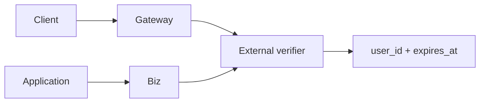

# 外部身份认证

状态：Implemented

## 总览

Oath 使用应用提供的 user_id，不创建账号。默认 none 模式接收受信调用方的 user_id；remote 模式通过外部 HTTP 验证器取得身份；static 模式用于手工配置 token 的本机接入。鉴权只影响访问，退出或过期不取消已接纳任务。

## 启动

`oath start --auth-mode remote --auth-url URL --auth-token-file FILE` 启用远程验证。FILE 是调用验证器的服务凭据，至少 32 字符；Compose 仅向 Gateway/Biz 挂载它，不传给工具或模型。参数与挂载位置写入私有 deployment record，restart 复用。默认不启用用户认证；鉴权参数不写入 oath.toml。直接运行服务时使用同名参数。

## 契约

验证器接收 POST，Authorization Bearer 携带服务凭据，JSON body 为 credential。成功返回 user_id 与 Unix 秒 expires_at；无效返回 401/403。请求有固定超时、禁止重定向、不缓存结果，网络错误拒绝访问。Remote 不接受客户端指定其他身份。none 的 WS attach 要求 user_id，HTTP 要求 X-Oath-User-Id。

Gateway 在线程池验证身份，不阻塞事件循环。attach 后每个命令重新验证，独立监视任务最迟 30 秒复验一次，且不越过 expires_at；失败关闭连接。重新登录使用新连接，不修改原连接身份。Biz 每次请求验证；内部 CLI 仍使用 Oath 自己签发的 capability，不能通过 none 模式伪造 CLI 身份。

## 边界

none 模式的端口仅向可信代理或本机开放。内部 RPC 身份继续使用内部服务凭据。user_id 是唯一执行隔离标识，登录标识不进入 Agent context。用户凭据与验证器服务凭据不进入 journal、Trace 或 Bash 环境。

跨仓库：Hymio Backend 实现验证器；Client attach 在 none 模式传 user_id，remote 模式传应用 access token。HTTP 的身份传输遵循同一选择。
