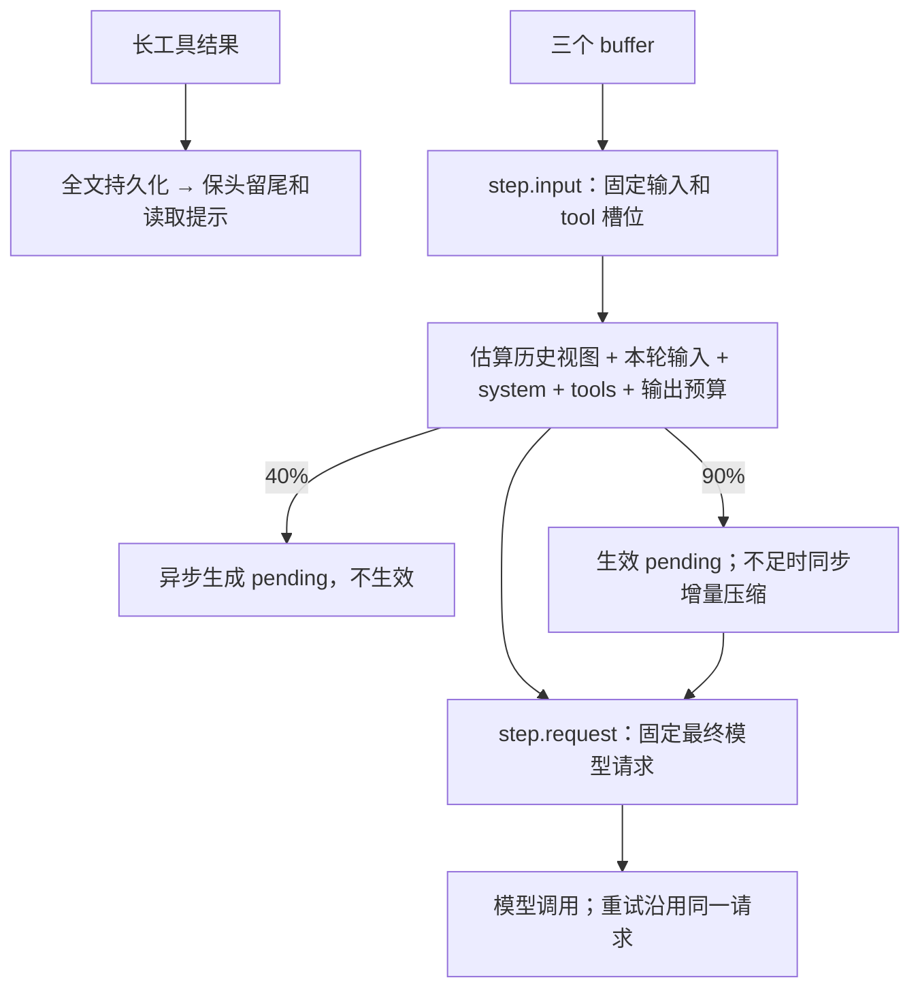

# Feature — Compaction：工具结果截断与历史压缩

状态：Implemented。当前事件与用户窗口设置见 [Event context and window policy](feature-context-events-window.md)。

## 总览

按 scope 分三级处理：工具结果截断、40% 异步备摘要、90% 同步生效。
DetailStore 保存长结果全文；journal 保存截断后的终态和全文引用。
历史摘要只改变模型视图，不删除 conversation。



规则：至少保留最近 N 条；tool call/result 不拆开；异步产物不自动生效；
模型调用不占事务锁；已经固定的请求和已保存响应不重复压缩。

## 1 工具结果与全文

结果超过 tool_result_detail_chars 时，先将全文写入 DetailStore，再生成头尾文本和
`detail_read(detail_key=...)` 提示。非字符串先编码为 canonical JSON。
终态带 detail_key / original_chars；正文此时是文本，不再是原 JSON 对象。

DetailStore 接口提供按 scope 的 put/get，文件实现置于 core/detail/impl。
put 成功返回表示全文已持久化。文件实现 fsync 临时文件、rename、fsync 目标目录；
创建目录时同步父目录。失败则保留完整结果，不发布全文引用。
写文件发生在工具终态事务之外；崩溃可能留下未引用文件，但不能发布未可靠保存的引用。

内置 detail_read 从当前 scope 读取全文，不接受文件路径。它的返回值豁免第一层截断；
已经进入历史的内容仍按历史摘要规则处理。未找到全文时报告工具失败，不返回空串。
备份 / 恢复必须同时包含 journal 与 details，journal 单独不包含被移出的全文。

## 2 合法切点

N 是至少保留的最近消息数，计入本步已经固定的输入。候选切点为 len(messages)-N，
遇到工具组内部则向更早的边界移动。assistant.tool_calls 之前是合法切点；
声明和所有 tool responses 之间不是。没有可压缩前缀时不压缩。

边界检查确认前缀没有未配对调用、后缀不从孤立 tool response 开始。
例如 `[user, assistant(call A), tool(A), assistant]`，保留 2 或 3 条均切在下标 1。

## 3 摘要范围与增量

产物保存原始 conversation 的覆盖条数 covers、替代消息 messages 和生成时间。
pending 为未生效产物，applied 为生效产物。conversation 只追加，因此覆盖位置稳定。
产物 covers 必须在范围内且落在合法边界；生效覆盖位置不能后退。

首次压缩输入是原始历史前缀。后续输入是：

```text
当前 applied 摘要 + conversation[applied.covers : 新切点]
```

不把已覆盖的原始全文重新发给压缩模型。新产物仍保存原始历史的新切点，
发给主模型的视图为 `applied.messages + conversation[applied.covers:]`。
没有新增可覆盖前缀时不重新压缩。迟到的异步产物不能覆盖已生效的更大范围。

## 4 请求准备与阈值

Brain 先检查有效唤醒、active step 和预算状态。新的 step.input 原子保存：
输入 IDs、固定 tool response 槽位、未经历史压缩的 request_draft。
请求草稿包含本轮输入、system prompt、工具定义和模型参数。

锁外运行压缩准备，然后 step.request 保存最终请求并释放草稿。
输入认领期间到达的新消息留在 buffer，不混入该草稿。
压缩期间崩溃恢复原草稿；最终请求已保存后，恢复和模型重试直接使用原请求。
已保存模型响应的 step 只补后处理，不运行压缩。

占用估算包括当前历史视图、本轮输入、system prompt、工具定义和 max_output_tokens。
字符启发式计量包括保留的 reasoning 与消息封装开销，不是 provider 的精确 tokenizer。
最终请求估算仍超窗口时明确暂停，不静默删除近期输入。

- 40%：同 scope 至多一个异步压缩任务。可用 pending 存在时不重复准备。
  任务只保存 pending，不修改当前请求。
- 90%：先应用可用 pending 并重算；仍超阈值时最多同步压缩一次，覆盖更多历史。
  同步调用在事务外；不循环压缩。

阈值取 `(0,1]` 且同步高于异步；1.0 表示达到 100% 时触发，不是禁用开关。
无法压缩、算法失败或摘要不更短时保留原视图。单条巨大输入、必须保留的尾段或 detail_read
全文本身超过窗口时，这套历史压缩无法保证请求可发送，需调用方限制输入或另设分页读取能力。

## 5 算法接口

```python
Compactor.compress(messages, *, budget_tokens) -> list[dict] | None
```

算法只生成替代消息，不决定阈值、切点、生效或持久化。返回 None 表示无法压缩。
LlmCompactor 对受模型容量约束的输入分段调用，将上一段摘要传给下一段，输出 XML：

```xml
<context_digest>
  <summary>已完成的进展。</summary>
  <facts><item>标识符、数字、用户约束、全文引用。</item></facts>
  <open><item>尚未完成的动作。</item></open>
</context_digest>
```

解析后以转义的 context_summary 包装为 user 消息。空摘要、无效 XML、不比输入短的摘要不保存。
工具执行状态仍以 RuntimeStore 为准，摘要不能授予权限或修改工具状态。

## 6 失败与恢复

- 全文写入失败：保留原结果；已经发布的引用随 journal 和 details 一起恢复。
- 异步任务中断：没有产物就重新准备；已保存 pending 重启后仍可用。
- 输入已认领但请求未保存：恢复固定草稿，继续准备；不重新 drain。
- 请求已保存：不重算摘要，不修改请求；模型响应已保存则只恢复后处理。
- 压缩模型失败：保留视图，记录错误；主模型失败仍遵守有限重试。

压缩通过独立 compaction lease 跨进程互斥并续租。全文分页、精确 tokenizer、摘要质量评估和文件回收仍是后续工作。

## 7 对外事件

Coordinator 注入 AgentEventSink，通过现有 WebSocket 发 context.compaction。
实际开始算法前发 started；产物提交后发 ready（异步）或 applied（同步 / 应用 pending）。
算法 / 存储失败发 failed，无有效缩短或被新产物取代发 skipped。
payload 包含 compression_id、status、mode、covers、reason，不含原文或异常正文。
通知通过 DurableEventSink 写入持久 Outbox。产物保存 covers、mode、context_window、input_tokens、output_tokens 与生成时间。

## 8 跨仓库影响

Hymio 根据 detail_key 展示完整结果入口；不能假定长结果仍为 JSON 对象。
Nostalgia 读取终态得到截断视图，全文需通过同 scope 的 DetailStore 读取。
工具终态字段新增 detail_key / original_chars；历史摘要不改变工具真实终态。
