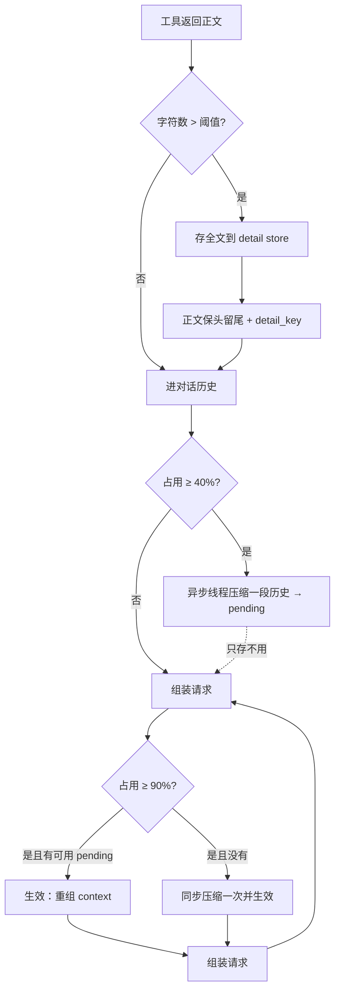

# Feature — Compaction：工具结果截断与历史压缩

状态：Implementing（单进程 JSONL）

前置：[Intake](feature-intake.md)、[工具系统](feature-tool-system.md)、[Agent Runtime](feature-agent-runtime.md)。
本 feature 定义「发给模型的内容比持久化的内容少」这条链路的契约：少了多少、少了的怎么找回来、
什么时候少、按什么边界少。

## 1 总览

**三级压缩，全部按 scope。前两级只影响发给模型的内容，journal 里始终是全文。**



贯穿全文的规则：

1. **截断在写入时做，不在读取时做。** journal 里的终态就是终态；投影路径保持纯读。
2. **切点必须合法。** 一次 `tool_calls` 声明和它的结果要么整段保留，要么整段丢掉。
3. **压缩是产物而不是动作。** 算出来的摘要先落成 `pending`，到点才生效；异步那条不阻塞任何请求。
4. **压不出来就保留原历史。** 压缩失败降级成「不压」，不报错、不丢内容。

## 2 工具结果截断

工具成功返回的正文超过 `tool_result_detail_chars`（默认 4000 字符）时：

- 全文写进 detail store，得到一个 `detail_key`；
- 落盘的 `content` 变成保头留尾的文本：头 `limit // 2`、尾 `limit - limit // 2`，
  中间换行放一行说明，指明省略了多少字符、`detail_key` 是什么；
- 终态 payload 额外带 `detail_key` 和 `original_chars`。

`detail_key` 形如 `<invocation_id>`，取回时必须带同一个 scope —— 跨 session 一律取不到。

非字符串结果（结构化 JSON）先按 canonical JSON 编码再截断，**截断后的 content 一律是文本**。
这意味着客户端只在「原结果本来超过阈值」时才会看到 `content` 从对象变成字符串。

降级规则：detail store 写失败时保留完整正文、`detail_key` 为空。**宁可多发一段长文本，
也不让 journal 里出现一个指向不存在内容的 key** —— 那条记录一旦落盘就撤不回来了。

`detail_read` 是内置工具，读一个 `detail_key` 的完整内容。它的结果不参与截断：
它存在的意义就是拿回被截断的东西，再截一次等于没做。它的历史与其他工具结果一样，
可能被第 3 节的压缩覆盖。

截断在工具执行的收尾处、事务之外完成：写 detail 是文件 I/O，不能在 scope 锁里做。

## 3 历史压缩：切点与保留量

压缩的输入是 `conversation.messages`（完整历史），输出是一个产物：

```python
{"covers": 12, "messages": [{"role": "user", "content": "<context_summary>…</context_summary>"}]}
```

`covers` 是它替换掉的开头消息条数。产物落进 `state["compactions"]` 的两个固定 key：
`pending`（备好未生效）与 `applied`（当前生效的）。固定 key 而不是自增 id ——
一个 scope 同时最多有一个生效产物和一个待生效产物，历史只增不减，不需要多版本。

### 3.1 合法切点

一条消息能当切点，当且仅当它既不是 `tool` role，也不带 `tool_calls`：

```python
def is_boundary(messages, index) -> bool:
    return messages[index]["role"] != "tool" and not messages[index].get("tool_calls")
```

理由在 [Intake](feature-intake.md) 6.1：provider 要求一次工具声明后面紧邻同数量的结果，
中间插一条摘要会让请求直接被拒。把切点落在组中间，等于把一次调用和它的结果劈成两半。

### 3.2 保留最近 N 条

`compress_keep_recent`（默认 12）是从尾部数的保留条数。从 `len - N` 出发向前找第一个
合法切点；**向前找会切得更靠后**，即多留几条，而不是把 N 减到刚好。

切点不存在（历史比 N 还短，或剩下的尾段没有合法切点）就不压。

### 3.3 产物什么时候还有效

历史只追加，不删除，所以 `covers` 指向的位置永远存在。新消息落在 `covers` 之后，
产物照样能用。唯一会失效的情况是 `covers` 越界或不再是合法切点 —— 发生后当没压过。

生效的条件：新产物的 `covers` **不小于**当前生效产物的 `covers`。不允许退回更少的历史。

## 4 触发

占用比例按「当前生效视图 + system prompt」估算。视图取自 `conversation.messages` ——
即已经完成的历史，不含本步刚认领的输入，所以第一步不会触发压缩。
`estimate` 是估算不是计数：ASCII 每 4 字符记 1 token，其余记 1 token。
真正的 token 数只有 provider 知道，阈值本来就是启发式的；要精确就换掉这个函数。

### 4.1 异步：40%

占用达到 `compress_async_at_ratio` 时，后台线程跑一次压缩，产物存进 `pending`，
**不生效**。下一个 step 仍用当前视图，直到 90% 那一级。

同一个 scope 同时只有一个在跑的异步压缩（进程内登记）。已经有可用的 `pending` 时不再起新的 ——
正在备的那份就是为这次准备的。

### 4.2 同步：90%

占用达到 `compress_sync_at_ratio` 时：

1. 有可用 `pending` → 直接生效，context 重组，不调用模型；
2. 没有 → 在 Brain 线程里同步压一次并生效；
3. 压不出来（没有合法切点、段太短、模型失败、摘要不比原文短）→ 保留原历史继续发，
   由 provider 报超长。

同步压缩是模型调用，**不能进事务**。它在认领事务之前完成，认领事务只做纯数据重组。

| 阈值配置 | 行为 |
| --- | --- |
| `compress_async_at_ratio = 1.0` | 永不异步 |
| `compress_sync_at_ratio = 1.0` | 永不同步 |

两个比例都是 `(0, 1]`，且 `compress_sync_at_ratio > compress_async_at_ratio`。
配错在构造时抛错，不留到运行时才发现压缩从来没触发过。

## 5 压缩算法

`Compactor` 是唯一的算法接口：

```python
Compactor.compress(messages: Sequence[Mapping], *, budget_tokens: int) -> list[dict] | None
```

输入是一段历史，输出是替代它的消息。切在哪、什么时候生效、失败怎么降级都不归它管。
返回 `None` 表示压不了，调用方保留原历史。当前实现 `LlmCompactor` 是一次模型调用，
输出用 XML 固定结构：

```xml
<context_digest>
<summary>已经完成的进展，按时间顺序。</summary>
<facts>
<item>订单号 1234，用户要求改地址到上海。</item>
</facts>
<open>
<item>detail_read(detail_key=...) 还没调用。</item>
</open>
</context_digest>
```

`facts` 收必须逐字保留的东西：标识符、数字、用户原话约束、未完成事项。
`open` 收还没闭环的动作。两条都是可选的，缺了不报错。

解析后的摘要作为**一条 `user` 消息**替换被压掉的前缀。不用 `assistant` role ——
那会伪造一段模型没说过的发言，而且部分 provider 要求首条非 system 消息是 user。
正文转义后包在 `<context_summary>` 里，让模型知道这是历史摘要而不是新指令。

解析失败、空摘要、摘要不比原文短，都当压不出来。

## 6 失败与恢复

- **detail store 写失败**：保留完整正文，无 `detail_key`。记录一条日志，不影响工具终态。
- **`detail_read` 取不到**：抛 `ToolExecutionError`，按普通工具失败处理。不返回空串。
- **压缩模型失败**：记日志，保留原历史。异步的失败只是没有 `pending`。
- **进程退出**：在跑的压缩线程随进程消失，没有产物落盘。重启后从当前历史重新判阈值。
- **产物不匹配当前历史**：`covers` 越界或不是合法切点时当没压过，不报错。
- **压缩后仍超限**：不循环压缩。一次请求只压一次，压完直接发。

## 7 跨仓库影响与范围

- **协议**：`tool.result` payload 新增可选 `detail_key` / `original_chars`。超阈值的结果
  `content` 是文本；客户端展示长结果时读 `detail_key`。
- **Hymio**：注册的业务工具不需要改。结果超过阈值时 tool 结果变小是预期行为。
- **Nostalgia**：从 journal 读到的是全文，压缩只发生在发给模型的那一步。
- **删掉 extensions 仍可运行**：`detail_read` 与 detail store 都在 core/ 内。

未实现：跨 scope 共享 detail、分页读取长结果、按 token 而非字符计量、压缩产物跨 session 复用、
多进程下同一 scope 的压缩互斥（当前保证只在单进程内成立）。
