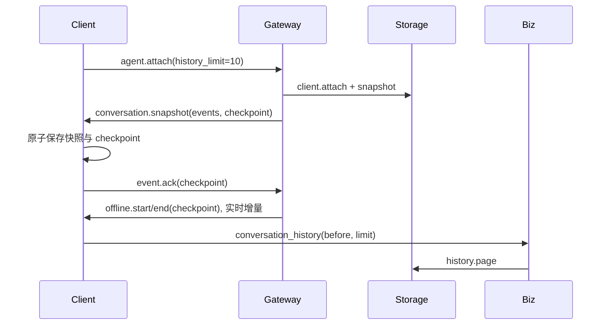

# Conversation snapshots and history

## 总览

连接先接收最近十轮的会话快照，再从 checkpoint 接实时事件；历史通过 Biz 分页读取。
不回放全部 token。Journal 与 Outbox 保留原始记录，展示快照不是模型 context 压缩。

## 读模型

Storage 维护按 user_id 隔离的 conversation_events、conversation_streams 和 checkpoint。
完整 assistant.message 替代流式 delta；未完成流按 step/attempt 合并，step.status 只保留
每步最后状态。原始 Outbox 不修改。首次从 Outbox 建立读模型，后续与 Outbox 同事务更新。
分页按 user.message 边界切十轮，避免从工具调用中间开始。未结束工具和未决授权作为快照
额外状态携带，即使其来源早于当前页也可见。

## 确认与恢复

客户端保存快照事件和 checkpoint 成功后才 ACK。Gateway 只接受本连接已发送的 cursor，
新快照与后续 Outbox 读取在同一个 checkpoint 衔接。崩溃后可重新取快照，不跳过未持久化事件。
实时 ACK 累计确认连续持久化进度。缓存中的重复事件不再次写盘。历史分页不推进实时 cursor。

## 边界

history_limit 为 1–20 轮，before 是不包含的事件序号；查询必须鉴权到对应 user。
投影/存储失败不得返回空快照伪装成功。大文件/工具详情仍使用已有详情接口。
