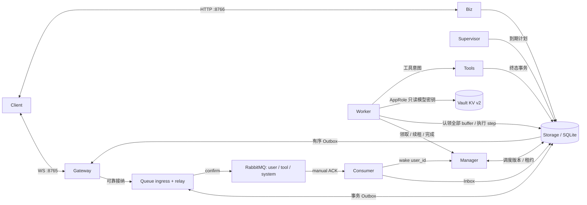
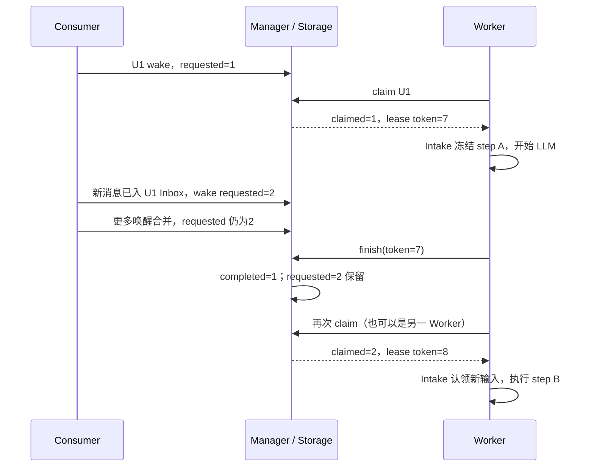

# 持续运行的 Personal Agent 基座

状态：Implemented；本文件取代旧文档中的 scope、session、每用户进程和 Redis 队列设计。

## 1. 结论

**用户身份只有 `user_id`。连接可以离线，Agent 的输入、执行和结果不能随连接消失。**
常驻服务负责接入、投递、调度和监督；有界 Worker 池按需执行，同一个用户最多一个可提交的 Brain step。
RabbitMQ 负责消息交付；SQLite 保存业务事实，通过独立 Storage 服务访问。



### 不变量

1. Queue、Consumer、Manager、Worker、Tools、Supervisor、Gateway、Biz 独立部署；bootstrap 只负责装配和启动。RabbitMQ、Storage 是独立基础服务。
2. 同一用户的 Brain 串行；不同用户并行；新消息接收、审批和工具执行不等待 Brain。
3. 所有可重试操作有稳定身份。消息是至少一次交付，状态转移按身份幂等；不承诺任意外部工具 exactly-once。
4. Journal、用户状态、认领输入的移除和相应客户端事件在同一个数据库事务提交。
5. SQLite 和 RabbitMQ 之间不做伪分布式事务：先写事务 Outbox，confirm 后标记已发布；Consumer 持久接纳后 ACK。
6. EventSink 只写持久 Outbox。Gateway 负责 WS；没有“在线就直接发、离线才存”的分支。
7. 用户没有永久线程或进程。执行池、Consumer 和压缩池的并发数有上限。

## 2. Consumer → Manager → Worker

### 2.1 每个用户的调度记录

`scheduling(user_id, requested, claimed, completed, ready_at)`：

- `requested`：已请求的唤醒版本。
- `claimed`：当前 / 最近一个 Worker 领取时的版本。
- `completed`：Worker 已处理完的版本。
- `leases(user_id, lane='brain', owner, token, expires)`：执行资格。`token` 每次重新领取递增。

**唤醒版本不是消息数量。** 尚未领取的多次唤醒可以合并。`wake` 设置
`requested = max(requested, claimed + 1)`；没有 Inbox 时普通 wake 无效。
显式 `step.retry` 可以强制调度已保存的 step。

### 2.2 第一次唤醒

1. Gateway 认证得到 `user_id`，将用户消息交给 Queue ingress。稳定 command ID 对应一条事务 Outbox 记录。
2. Relay 发布到 RabbitMQ，收到 publisher confirm 后标记 sent。
3. User Consumer 收到消息，领取短期 consumer 租约；更新 user-context、写入该用户 Inbox。
   用户输入的 Inbox 写入与唤醒版本更新同事务完成，避免“ACK 后还没有通知 Manager”的丢失窗口。
4. Consumer 向 Manager 请求唤醒；重复请求合并。然后 ACK RabbitMQ。
5. 空闲 Worker 调用 Manager `brain.claim`。Manager 找到 `requested > completed` 且没有有效 Brain 租约的用户；
   原子领取租约，并设置 `claimed = requested`。例如 `(1, 1, 0)`。
6. Worker 中的 Intake 读取三类 buffer，冻结 StepInput。事务提交 Journal 和 step，并删除本次认领的 Inbox 记录。
7. Brain 仅接收固定 step，不消费队列或 buffer。运行 context build → LLM → 保存 response → 工具提交 → 完成 step。
8. Worker 向 Manager 报告完成。Manager 设置 `completed = claimed` 并释放租约。

### 2.3 执行期间又来了消息



**Worker 结束时不扫描 Queue，也不自行决定有没有新事件。** 它确认已领取的调度版本；
Manager 保留更新的唤醒，Worker 池持续领取待办用户。输入恰好落在 claim 与 drain 之间时，
可能多一次空认领；Intake 返回空，不调用模型。这比误吞一个唤醒更安全。

### 2.4 三条队列的唤醒策略

| Consumer | 接纳与唤醒 |
| --- | --- |
| user | 覆盖 user-context 同名键，按消息身份防重；写 Inbox 后立即请求唤醒 |
| tool | 验证持久工具终态，写 Inbox；初次提交集合结果收齐或首结果固定截止到期才请求唤醒 |
| system | 审批、取消、retry 当场提交控制意图；invoke 只在 Inbox 非空时请求唤醒，不把自己放进 Inbox |

审批后执行的调用标记 `source=system`，不扩大批次的 `initial_submitted`。
批次已被 Brain 展示后，迟到结果立即请求新一轮；Context build 决定 tool role 或 user reminder。
定时复查读取持久 Inbox 和 batch deadline，不依赖进程内 timer。因此 Consumer 重启后不会丢超时唤醒。

## 3. RabbitMQ 与可靠交付

- 三条全局 quorum queue：`oath.user`、`oath.tool`、`oath.system`。每条启用 Single Active Consumer；多副本 Consumer 做故障接管。
- 消息带 `user_id` 和 Inbound。队列不按用户动态创建。每条 prefetch=1，消费者按交付顺序持久接纳。
- 持久消息、durable queue、mandatory publish、publisher confirm、手动 ACK。
- Relay 有持久租约，一次发布一个最早未发送记录；确认不明确时重发同一身份。
- Consumer 崩溃或连接断开，未 ACK 消息由 broker 重投。已进入 Inbox / Journal 的身份不再次认领。
- 格式非法的 envelope 明确 reject 到 `oath.dead.*`；运行故障保留消息，重连后重试，不静默丢弃。
- Broker 暂不可用时已接纳消息留在事务 Outbox，恢复后继续投递。

当前每类队列只有一个活跃接纳者，Brain / Tools 可并行。进一步扩展接纳吞吐时可按 `hash(user_id)`
做固定分区，并保持同用户路由稳定；本版不声称已经实现分区扩容。

## 4. 持久化模型

SQLite 文件只由 Storage 服务打开，启用 WAL、FULL synchronous、foreign keys 和 busy timeout。
本机 owner 文件锁拒绝第二个 Storage 打开同一数据库。业务服务通过闭集 HTTP 操作访问，不能传任意 SQL。

| 表 | 主键 / 约束 | 用途 |
| --- | --- | --- |
| users | user_id | 当前状态投影、CAS version、journal/event 序号、下次 invoke |
| journal_events | user_id + seq；幂等键唯一 | append-only 运行事实，每次状态提交保存变化 |
| commits | user_id + commit_id | 提交指纹，拒绝同身份不同内容 |
| broker_outbox | id；user_id + identity 唯一 | 原子写入的待发布消息及 sent 标记，不承担 broker 的消费职责 |
| relay_lease | 单例 id | 多 relay 实例的发布所有权 |
| inbox_events | id；user_id + identity 唯一 | 三个持久 buffer |
| scheduling | user_id | requested / claimed / completed / ready_at |
| leases | user_id + lane | Brain、Consumer、压缩的 owner / token / expires |
| steps | user_id + step_id | run、status、固定输入 / request / response / attempts |
| tool_invocations | user_id + invocation_id | 工具状态、截止、来源、终态 |
| tool_batches | user_id + batch_id | manifest、初次提交集合、buffer 截止、呈现状态 |
| outbox_events | user_id + seq；幂等键唯一 | 所有客户端可见事件，包含 streaming delta |
| client_cursors | user_id + client_id | acked、delivered、连接 generation |
| trace_spans | id；索引 user_id + trace_id | append-only span 版本，读取时按 span_id 取最新 |
| result_details | user_id + detail_id | 被截断工具结果的完整内容 |
| snapshots | id + user_id 索引 | 显式状态快照 |

权威 schema 在 `core/storage/schema.sql`。当前状态用 JSON 投影配合类型化调度表，Journal 保存每次变化；
没有每个用户一套表。CAS 回调只变换数据，冲突重读后重算，网络和工具副作用不能放进回调。

### 原子边界

- State commit：校验租约 → 校验 CAS version → Journal append → 更新投影 → 输入认领移除 → 派生 Outbox。
- 工具终态：call 终态 + tool 消息的 broker_outbox + 客户端 tool.terminal 同事务。
- 审批决策：裁定 + 工具 queued / terminal 同事务；执行池领取 queued 后才执行。
- 空输入不产生 Brain step；失败 step 保留原身份；已保存 response 的恢复只补后处理。

## 5. 断线与重放

连接认证得到 user_id，设备提供稳定 `client_id`。一个用户可以有多个设备，每个设备单独 ACK。
重连时在数据库事务内读取该设备 `A=acked` 与当前用户 `H=event_seq`，并递增连接 generation。

```text
offline.start(after_cursor=A, through_cursor=H)
(A, H] 内的持久 event，严格按 event_seq 排序
offline.end(through_cursor=H)
H 之后的新 event（在线流）
```

同一个 sender 顺序发送两段，在线事件不会插进补发段。ACK 不能超过当前连接已经发送的序号；
旧 generation 无权更新设备游标。发送成功不等于用户已消费，只有 ACK 推进恢复位置。
客户端应按 `(user_id,event_seq)` 去重；delta 还带 step_id、attempt、局部 seq。
新设备从 0 重放。首版不删除 Outbox 历史，后续保留策略必须提供 snapshot/resync 协议，不能静默跳过缺口。

## 6. 故障与恢复

| 断点 | 恢复行为 |
| --- | --- |
| DB 提交前 | 无成功 ACK；保留上一处的输入 |
| DB 提交后、broker publish 前 | Relay 扫描事务 Outbox |
| broker 已确认、sent 尚未写 | 允许重发；身份去重 |
| Consumer 写 Inbox 后、ACK 前 | broker 重投；不重复写上下文或认领 |
| Worker claim 后、step 创建前 | 租约过期重新领取，Inbox 仍在 |
| LLM 途中 Worker 崩溃 | 同 step 新 attempt；旧 token 不能提交，模型请求可能重复计费 |
| response 已保存、工具尚未提交 | 恢复后复用 response 与 batch/invocation ID |
| 工具执行中进程消失 | 不重新执行不可确认的副作用；到 deadline 产生明确 timeout，注明副作用可能发生 |
| WS 断开 / Gateway 重启 | 不改变执行状态；重连按 ACK 补发 |
| SQLite / RabbitMQ 暂不可用 | HTTP 失败或消费者重连；不确认未持久化工作 |

租约使用 Storage 的时间，Worker 定期续租；真正的拒绝条件在同一个写事务里校验。
网络分区可能让旧 LLM 请求继续运行，但不能让旧 Worker 提交新的运行状态。
工具不承诺跨外部系统 exactly-once；业务工具需用 invocation_id 做外部幂等。

## 7. 部署与范围

启动器初始化 / 解封 Vault 后，Compose 启动全部服务；Gateway 8765、Biz 8766、Vault 管理端点 8200 默认绑定宿主机 loopback。内部服务和 RabbitMQ 无公开端口。
Storage、RabbitMQ、workspace 分别使用独立 volume。服务有独立 restart policy，Supervisor 不内存干涉其他服务。
单独部署服务时由部署平台负责进程启动与重启，并提供 RabbitMQ 和 Vault。

这版实现分布式服务协议和故障恢复，不等于已经完成多机数据高可用：

- 默认 RabbitMQ 单节点 quorum queue，没有三节点容错能力；正式 HA 部署需要 broker 集群。
- SQLite 单 owner，暂不自动跨机接管；后续换数据库保持 StoragePort 与事务语义。
- 状态 JSON / 历史暂不做归档，大用户长历史的读写成本随数据增长；需要后续归档与投影拆分。
- 内置 HostEnvironment 及默认 allow 策略保留现有行为；它不是不可信多租户 sandbox。
- 首版用户凭据来自环境变量映射，业务登录和租户管理归应用层。

本次不迁移旧 session 文件数据，不改旧单元测试。提供独立 e2e 脚本验证新协议。
