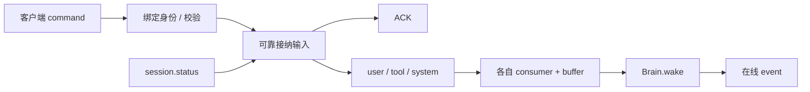

# Feature — 事件通路与客户端接入

状态：Implemented（WebSocket + 三条内部通知队列）。

## 总览

**输入先保存，队列只通知；三个 consumer 各自判断唤醒；在线推送失败可通过状态查询恢复视图。**

输入的可靠性属于 RuntimeStore；EventQueue 无持久化承诺。工具终态在工具系统同事务创建可靠输入，
不经过客户端 sink 再绕回 runtime。各模块共享 Journal，不等 Brain 决定是否落盘。

## 1 内部通路

| queue | 输入 | consumer |
| --- | --- | --- |
| user | user.message | 有 buffered 用户输入即 wake |
| tool | tool.terminal | 按 initial_submitted / presented / 固定 deadline 判断 |
| system | permission.decide、permission.expire、run.cancel、step.retry、system.invoke | 先执行控制动作；仅 invoke 直接 wake |

每条 queue 有独立 wait 和 revision；consumer 先读 revision，再 consume / evaluate / wait，
防止消息恰好在检查与睡眠之间到来。另一条 queue 非空不会使当前 consumer 忙循环。
Brain 认领和完成时 notify，要求 consumer 重查自身条件，notify 本身不是模型输入。

消费者同时扫描可靠 accepted 输入，queue 漏通知或重启丢失不丢事实。
SystemConsumer 应用控制动作后才保存 receipt；重复控制命令不会重复审批、取消新 run 或重置重试计数。
ToolConsumer 校验终态与 ToolSystem 保存的事实一致，无效消息单独 rejected 并报告，其他结果继续处理。

三个 consumer 各自维护 buffer；一次 Brain claim 收走当时三者全部 buffered 输入，详情见 [Intake](feature-intake.md)。

## 2 WebSocket 与身份

一条连接双向复用，首条 command 必须 session.open。服务端 SessionAuthenticator 将 credential 映射
为 user_id 和 session_id，客户端不能自称 user_id，后续 session_id 必须与连接绑定一致。
默认 TokenAuthenticator 是配置映射演示；生产认证由 Hymio 注入或另行装配。

core 不 import websockets。bootstrap 将上行解析成 Command，逐条 await 线程中的 Runtime.submit，
让 fsync 不占 event loop，并保持连接内 command 顺序。

## 3 接纳和回执

- session.open ACK 表示身份验证与 session 绑定成功。
- user.message、permission.decide、run.cancel、step.retry 先保存稳定命令身份和 payload，再回 ACK。
- ACK 不表示审批生效、工具完成或模型已经回复；实际状态由事件 / 查询表达。
- 同 kind + command ID + 内容重发只接纳一次；同 ID 不同内容报错。客户端所有命令仍应使用唯一 ID。
- 落盘失败不 ACK；写入成功但回执丢失时，客户端用原 ID 重发。

客户端只能提交 approved / denied。decided_by 从认证身份设置，不信任 payload 自称值。
调用必须属于绑定 scope，客户端不能通过审批替换工具和参数。

## 4 对外投递与重连

OutboundHub 为每个 scope 管理有界发送队列，慢客户端断开，不阻塞工具和 Brain。
同 session 新连接替换旧连接。事件不持久化重放，持久化状态仍由 Journal 保存。

| event_type | 含义 |
| --- | --- |
| assistant.delta | 生成中的文本 / reasoning，非持久化 |
| assistant.message | 已保存的完整模型响应，带 step_id |
| permission.requested | 待审批调用，可展示授权卡 |
| tool.terminal | 唯一真实终态的在线通知；通知可能重复 |
| step.status | 重试中、失败或预算暂停 |
| intake.rejected | 内部无效工具输入已隔离 |
| session.status | 当前 run / step、调用状态、固定对话视图、输入错误 |

session.status 不触发推理。重连后先绑定，再查询，从原 invocation 恢复授权卡和调用状态。
调用全部保留在当前快照，分页 / 历史增量读取另行实现。

## 5 失败与恢复

进程启动先从所有 journal scope 恢复工具与输入，重建三个 consumer，再恢复原 Brain step。
网络断开只影响展示；已经 ACK 的输入仍会处理。客户端恢复查询不等同于重新提交执行。

消费者异常保留输入并退避；工具和 Brain 各自有恢复策略。模型 / 调度永久失败暂停推理，
审批、执行状态和新消息仍可接纳，客户端显式 step.retry 重试原 step。

未知版本 / 帧结构错误回 error 后断开；已解析 command 的业务错误回 error，连接保留。
idle timeout 字段保留但服务端尚未启用空闲断开。部署 TLS、外部身份系统和限流属于应用接入层。

## 6 跨仓库影响

Hymio 客户端支持命令 ACK、permission.decide、step.retry、session.status，并按 invocation / event 身份 dedup。
审批来源与 tool result 的 source 是不同维度：前者是命令，后者标识该调用由 brain 初次接纳或 system 裁定。
连接协议和示例见 [接入手册](manual.md)。
