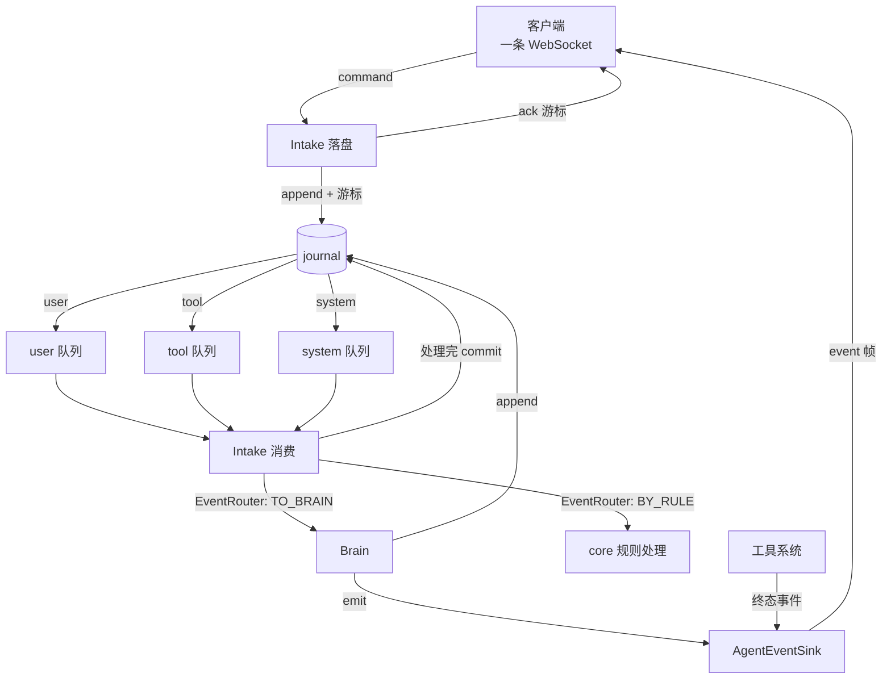

# Feature — 事件运行时（队列、Intake、Brain、对外投递）

状态：Implementing

## 1 背景与目标

journal 有了，工具系统有了，但两者之间没有通路：现在 agent 跑不起来，客户端也看不到
任何东西。本 feature 把 event-driven 的骨架搭出来。

- **三条队列**（`user` / `tool` / `system`）—— 输入从哪来。
- **`Intake`** —— 系统的入口：接收 command 落 journal，消费三条队列。
- **`Brain`** —— context build → LLM → tool call → compress，决定跑什么。
- **对外投递** —— 客户端经一条 WebSocket 发 command、收 event。

这一轮只搭通路。**判断是否给 agent、context 怎么 build、LLM 怎么调、怎么压缩，都不
实现** —— 这些是策略，保留 interface。

## 2 总览

### 2.1 一句话

**事件产生时就地分开两路：append 进 journal 是 Oath 的状态，`AgentEventSink.emit`
直推客户端。输入一律从 journal 取，不从内存传消息。**

投递不经过 journal。journal 是 Oath 存自己状态的地方，不是给客户端当消息总线用的；
客户端自己就是它已渲染内容的存储方。拿 journal 当投递通道，等于把投递能力绑死在日志
扫描吞吐上，还让 journal 为了一个 UI 永远长下去。

代价是断线期间的事件不补发。这是选下来的，不是漏掉的：补发要么把 journal 重新拽回
投递通道，要么再加一个 backlog —— 两者都要为「客户端短暂掉线」付长期成本。

### 2.2 流程



**落 journal 的是 Oath 需要记住的，推给客户端的是它需要看见的 —— 两次独立的调用。**
`tool.result` 两样都要：agent 要它当输入，客户端要它显示状态。`system.agent_step` 只要
后面一样。

### 2.3 六条规则

1. **journal 是 Oath 唯一的输入源与状态源。** 内存消息、进程内队列都不算数；进程重启
   后状态能从 journal 重建。
2. **队列只装输入，不装输出。** `assistant.message`、`tool.call` 是 `Brain` 和工具系统的
   产物：进 journal，不进任何队列。队列回答「现在该做什么」，不是「做了什么」。
3. **投递是活的，不重放。** 事件在产生的那一刻直推客户端，`event` 帧不带游标，断线期间
   发生的没有补偿。
4. **位置是游标，不是时间戳。** 墙钟会回拨，用它做位置标记会静默丢事件。
5. **游标归 `Intake`，决策归 `Brain`。** 前者失败语义是「没副作用、可以重来」，后者是
   「可能已经调过模型」。混在一个类里，游标何时推进就说不清了。
6. **推不动就断开，不阻塞 core。** 慢客户端的连接会被断开。它补得起自己的界面，补不起
   的是别人也被拖住的那段时间。

### 2.4 一个完整的例子

客户端问一句，agent 调一次工具。`line` 是 journal 的行号。

| # | 谁 → 谁 | 发生什么 | journal |
| --- | --- | --- | --- |
| 1 | 客户端 → `Intake` | `session.open`，验 credential，绑出 `scope = (u1, s1)` | 不落盘 |
| 2 | `Intake` → 客户端 | `ack{id: "c-0"}`，无游标 —— 这条命令不产生记录 | — |
| 3 | 客户端 → `Intake` | `user.message{content: "北京天气怎么样"}` | 41 |
| 4 | `Intake` → 客户端 | `ack{id: "c-1", cursor: line 41}`。传输层的帧，不过 journal | — |
| 5 | journal → `Intake` | user 队列取出 41 → `TO_BRAIN` → `Brain.step` 调模型 | — |
| 6 | `Brain` → journal | 模型要调工具 | 42 `assistant.message` |
| 7 | `Brain` → sink | 同一件事，直推客户端 | — |
| 8 | `Brain` → journal | 派发工具 | 43 `tool.call` |
| 9 | `Brain` → sink | 同上 | — |
| 10 | 工具系统 → journal | 执行完，终态事件落盘 —— agent 要它当输入 | 44 `tool.result` |
| 11 | 工具系统 → sink | 同一件事，直推客户端 —— 客户端要它显示状态 | — |
| 12 | journal → `Intake` | **44 也走 tool 队列** → `TO_BRAIN` → 再调一次模型 | — |
| 13 | `Brain` → journal | 最终回答 | 45 `assistant.message` |
| 14 | `Brain` → sink | 同上 | — |

三处值得看的地方：

- **41 没有 echo。** 客户端自己发的内容自己有，它要的是「落在哪儿」，`ack` 里的游标就够。
- **44 落盘与直推是两次调用。** 落盘那条给 agent 当输入，直推那条给客户端显示状态 ——
  后者不再需要扫 journal 找它。
- **断线就没有了。** 44 那步如果连接断了，客户端永远收不到这条；重连后 oath 也不补。

对应的帧：

```jsonc
// 3. 客户端 → oath
{"v": 1, "type": "user.message", "id": "c-1", "session_id": "s-1",
 "payload": {"content": "北京天气怎么样"}}

// 4. oath → 客户端：落盘了，落在 41
{"v": 1, "type": "ack", "id": "c-1", "cursor": {"kind": "line", "value": 41}}

// 11. oath → 客户端。注意没有 cursor
{"v": 1, "type": "event", "session_id": "s-1", "occur_dt": "2026-10-13T08:31:04Z",
 "event_type": "tool.result",
 "payload": {"tool_call_id": "t-1", "invocation_id": "i-1", "outcome": "completed",
             "content": "北京，晴，28℃"}}
```

**断线重连**：客户端重新 `session.open` 即可，中间丢的事件不补。要知道自己漏了什么，
客户端得自己记 —— 或者后续加一条「当前状态」查询，那属于读 journal，是另一个方向的事。

## 3 接口与数据

### 3.1 三个系统

| 名字 | 职责 | 依赖 |
| --- | --- | --- |
| `Intake` | 落 command 进 journal；消费三条队列：取记录 → 路由 → 处理 → 推进游标 | `Journal` / `EventRouter` / `EventFeed` / `Brain` |
| `Brain` | context build → LLM → tool call → compress | `Journal` / `ToolSystem` |
| `AgentEventSink` | 把 core 产生的事件直推给已连接的客户端 | `OutboundTransport` |

前两个是接口，v1 不实现。`AgentEventSink` 的实现也没有 —— 它就是那条对外通路的具体形状，
等渠道接入方式定了再写。

`Intake` 有两条通路，都只跟 journal 打交道：

- **落盘**：接收 command、append、把游标返回给传输层去 ack。到这一步就结束 —— 一条记录
  落盘时不带任何调度结论。
- **消费**：取记录，逐条问 `EventRouter` 走规则还是走 `Brain`，处理完一条 commit 一条。

它不解析帧：socket、握手、JSON 解码是传输层的事。

分工：**`Intake` 让事件可读且有序，`Brain` 让它有意义。**

`Intake` 没有外部副作用 —— append 按 command id 幂等，崩在中途不会留下半吊子的状态。
所以游标由它推进，`Brain.step` 返回之后才算处理完；返回之后再崩，记录已经 commit，
重放会重复调模型。

`EventRouter` 判断的是**记录**，不是原始 command：一条 `run.cancel` 落盘时和被读出来时
中间隔着别的记录，理由可能已经变了。返回值两个：`TO_BRAIN`（交给 agent 那条路）与
`BY_RULE`（core 自己处理掉 —— `run.cancel` 中止运行、审批回执入账）。v1 没有实现。

**`AgentEventSink` 只投递，不落盘。** 要落 journal 的一方自己 append —— 那是它自己的
状态，跟客户端看到什么无关。sink 只管「事件已经产生了，客户端该知道」，同步调用，
投递失败当场抛错：静默吞掉会把结果丢在内存里，而调用方永远不知道有过这么一次。

### 3.2 队列：`EventFeed`

三条内部队列是同一个东西的三种用法，只有「过滤哪些 type」不同。所以不写三个类，写一个
`EventFeed` 加一张 type 映射表。

| type | 进哪条队列 |
| --- | --- |
| `user.message` | user |
| `tool.result` | tool |
| `system.cancel` / `system.interrupt` | system |
| `assistant.message` | — |
| `tool.call` | — |
| `system.agent_step` | — |

映射表是显式的一张表，不从 type 前缀推：`system.agent_step` 归 system 但不进 system
队列，前缀规则表达不了这个。

哪些事件推给客户端不在这张表里 —— 那由产生事件的一方决定要不要调 sink，不由一张
`CLIENT_FACING` 之类的集合过滤 journal。产生的时候就知道要不要推。

```python
class EventFeed(ABC):
    def pull(self, scope: Scope, feed: str, *, limit: int | None = None) -> tuple[Record, ...]: ...
    def commit(self, scope: Scope, feed: str, cursor: Cursor) -> None: ...
    def position(self, scope: Scope, feed: str) -> Cursor: ...
    def reset(self, scope: Scope, feed: str | None = None) -> None: ...
    def wake(self, scope: Scope) -> None: ...
    def wait(self, scope: Scope, feed: str, *, timeout: float | None = None) -> bool: ...
```

- `pull` 从当前位置**之后**读，**不推进返回的记录** —— 处理完再 `commit`，`commit` 只
  允许前进。
- 途中**不属于这条 feed 的记录会跳过并推进位置，但只推到第一条命中记录之前**。少了
  后半句，一条 `system.agent_step` 会把消费方永久卡在它前面。
- `wake(scope)` 由写入方在 `append` 成功后调用 —— journal 是 pull 模型，没有通知。不让
  `EventFeed` 包一层 `append` 是因为幂等语义与指纹计算都在 journal 里。
- `wait` 是 `pull` 的阻塞版。唤醒按 scope 计**计数**而不是用 `Event`：后者被 notify 之后
  复位，两个等待者会互相唤醒不到。
- `limit` 限制读到多少条日志行，不是返回多少条。调用方要一直 `pull` 到返回空为止。

**位置只存内存。** v1 单进程，重启后游标回到起点、事件重放。重放安全（fold 是纯函数），
代价是重复处理 —— 与「快照省的是 state 重算」同一个代价。位置要持久化时，它本身也是一条
journal 记录，不另开存储。

### 3.3 对外 wire 协议

**一条 WebSocket 双向复用。** 客户端既是 command 发送方也是 event 接收方；拆成两条连接
只多一次握手和一份权限检查。

上行叫 **command**（要 oath 做一件事），下行叫 **event**（告诉客户端发生了什么）。一组
对偶：command 带副作用，要幂等键；event 已经是既成事实，不需要。

统一 envelope：`v` 是版本，`type` 是这一帧是什么。上行取 command 自己的类型，下行取
`event` / `ack` / `pong` / `error` / `close` —— 两套命名空间不重叠，一个字段就够。
**客户端遇到不认识的 `v` 应该断开重协商而不是猜**：猜出来的结果是「按旧版解析成功、
按新版执行失败」，失败点会落在某个看起来无关的地方。

command 类型（闭合集合，加新的按破坏性变更处理）：

| type | payload | 说明 |
| --- | --- | --- |
| `session.open` | `{credential}` | 绑定 session |
| `user.message` | `{content}` | 用户输入 |
| `permission.decide` | `{invocation_id, status, decided_by?, reason?}` | 审批裁定 |
| `run.cancel` | `{reason?}` | 取消当前 run |
| `ping` | `{}` | 心跳 |

每种 command 的 payload 有结构约束（`COMMAND_SCHEMAS`，与 journal 的 `PAYLOAD_SCHEMAS`
同一套语义）。**未知字段报错而不是忽略**：拼错 key 时静默忽略会得到「成功但什么也没
发生」。

**`ack` 回的是那条记录落在哪儿，不是它是什么。** 客户端发 `user.message` 时已经知道
自己发了什么，要的是「落盘了没有」—— 这句 ack 说的就是「进了 journal，跑不掉」。ack
本身就是传输层的一帧，不过 journal；把客户端自己的记录再推一遍既没有信息量，还多一份
要保持一致的状态。

**`event` 帧不带游标。** 它是活的投递，不是 journal 记录的转发 —— 帧里没有位置可以
续推，`session.open` 因此也没有 `resume_after`。

**`user_id` 由服务端从 `credential` 推导，客户端不能自称。** 隔离键一旦能被调用方伪造，
越权读就不是漏洞而是默认行为。`session.open` **不带 `session_id`** —— 要绑定的正是它，
先报了它就等于自称身份。`SessionAuthenticator` 是接口，v1 没有实现。

`error` 的 `message` 是给人看的，客户端逻辑只能依赖 `code`；版本不对与字段不对要分成两个
code —— 前者该重新协商，后者该修客户端。

### 3.4 背压

每个连接一个有界发送队列，在传输侧 —— socket 的写线程是传输的，队列也只能在传输里。
**满了就断开，不阻塞 core。** 但**满了之后怎么做是策略**，所以传输只报告 `QUEUE_FULL`，
断不断由 sink 的实现决定。

慢客户端拖住 core 的后果比断它严重得多：阻塞的 sink 会让所有 session 一起卡住。断的
时候带上原因（`slow_consumer`），客户端据此退避。

`NO_CONNECTION` 则什么都不用做 —— 事件就此丢掉，本来也没有别的地方可以补。

## 4 实现方案

`EventFeed` 的 v1 实现是 `core/feed/journal_feed.py`：一张
`dict[(user_id, session_id, feed), Cursor]` 加一把 `Condition` 锁。

传输层是 `OutboundTransport`（`send(scope, frame) -> SendResult` /
`close(scope, reason)`），v1 不实现 —— 具体是 WebSocket、SSE 还是别的，等接入渠道定。

**审批事件还没进 journal。** `permission.requested` / `permission.resolved` 现在只在
`permissions.jsonl` 里，所以这一版的 feed 看不到它们。要统一得把审批事件也写进 journal，
幂等键沿用 `perm.req:` / `perm.res:` 前缀 —— journal 的「同键异 payload 抛错」恰好就是
「两个人同时点同意，第二个人的裁定无效」。做完之后 `permissions.jsonl` 没有存在理由，它
承担的「裁定只生效一次」完全能由 journal 的幂等语义承担。

## 5 失败与恢复

| 场景 | 行为 |
| --- | --- |
| `credential` 无效 | 不绑 session，直接断开；不回落到匿名 |
| 同一 session 两条连接 | 后来的顶掉前一条。同一 session 只有一个活动 run |
| 慢客户端 | 发送队列满即断开，带 `slow_consumer` |
| 推送时客户端已断开 | 事件丢掉。`NO_CONNECTION` 不触发 `close` |
| 断线期间发生的事件 | **不补发。** 重连后从新事件开始 |
| `commit` 往回推 | 抛 `CursorError`。往回推会让已处理过的记录重来 |
| 内部队列游标丢了（重启） | 回到起点，事件重放。fold 是纯函数，重放安全 |
| `Intake` 消费中崩了 | 已 commit 的不重放，未 commit 的重放。属于 fold 幂等性，不在 core 保证范围 |
| `Brain.step` 抛异常 | `Intake` 不吞也不 commit：这条记录下次重来 |
| sink 投递失败 | 抛错给产生事件的一方，由它决定重试还是记失败。工具系统记 `outcome_unknown` |

## 6 跨仓库协议变更

1. `EventType` 新增 `system.cancel`、`system.interrupt`。加成员是破坏性变更，客户端要按
   未知 type 处理。
2. wire 协议是新的跨仓库契约：Hymio 与客户端都要实现同一套编解码，
   `core/protocol/datatype/wire.py` 是唯一来源。
3. `event` 帧没有 `cursor`，`session.open` 没有 `resume_after`。客户端不要设计补发逻辑。

## 7 待决事项

- 客户端漏收事件怎么办。当前是「丢了就丢了」；要补的话有两条路 —— 从 journal 重放，
  或者加一条「当前状态」查询。前者把 journal 拽回投递通道，后者是读而不是投，可以
  按需实现。
- 审批事件进 journal、`permissions.jsonl` 退场（见 4）。
- `OutboundTransport` 与 `AgentEventSink` 实现的具体形状，以及渠道接入时的鉴权方式。
- `Brain` 的 context build 策略、压缩触发条件、并发控制。
- `Intake` 与 `Brain` 都还只是接口。`Intake` 的落盘与取用逻辑不算策略，但它同时要依赖
  `SessionAuthenticator`、`EventRouter` 与权限系统，等第一个 `Brain` 落地时一起做。
- 内部队列游标的持久化时机 —— 现在位置丢了只是重放，等 `Brain` 跑起来后看代价。
