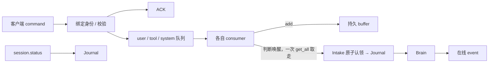

# Feature — 事件通路与客户端接入

> 部署、身份、持久化和传输以 [分布式 Agent 设计](feature-distributed-personal-agent.md) 为准；下文保留原模块设计背景。

状态：历史设计（模块思路保留；当前部署、身份与存储以 [分布式 Agent 设计](feature-distributed-personal-agent.md) 为准）。

## 总览

**输入到达不落 journal：先进队列，再进 buffer，被 Brain 认领时才写进去。
三个 consumer 各自判断唤醒；在线推送失败可通过状态查询恢复视图。**

**ACK 表示「已经投进队列」，不表示「已经记下来了」。** journal 里没有「收到但没处理」这一档：
没有记录的输入就是还没轮它处理，那份事实活在持久 buffer 里，进程重启也还在。
工具终态写在工具系统的同一个事务里，投递到队列发生在事务提交之后。

## 1 内部通路

| queue | 输入 | consumer |
| --- | --- | --- |
| user | user.message | 进 buffer 即 wake；附带同步 user_context |
| tool | tool.terminal | 进 buffer；按 initial_submitted / presented / 固定 deadline 决定是否 wake |
| system | permission.decide、permission.expire、run.cancel、step.retry | 进 buffer，先执行控制动作 |
| system | system.invoke | **不进 buffer**，只强制 wake |

`Inbound.kind` 恒等于队列名 —— 没有第二个来源给同一条输入分类。

每个 consumer 就是三步：收到事件 → `buffer.add` → 判断要不要 wake。**确认是逐条的，而且发生在
写进 buffer 之后** —— 一批里中间一条写失败就抛走，没写进去的那些还在中间件的 pending 里，
下一轮还会被投递；按批确认的话它们会被 ack 掉，从此既不在 buffer 里也不在队列里。
要 wake 就把 buffer 一次 `peek` 全读出来，交给 Brain 的 intake；落盘成功后 consumer 才按身份
逐条确认。另一条队列非空不会让当前 consumer 忙循环。

**ack 不进 Oath 的接口** —— 那是中间件自己的可用性保障，换成 Kafka 就是 Kafka 的消费组，
不重新定义。

SystemConsumer 应用控制动作后才认领输入；重复控制命令不会重复审批、取消新 run 或重置重试计数。
ToolConsumer 校验终态与工具系统保存的事实一致，无效消息单独 rejected 并报告，其他结果继续处理。

一次 Brain claim 收走当时三条队列的全部输入，详情见 [Intake](feature-intake.md)。

## 2 WebSocket 与身份

一条连接双向复用，首条 command 必须 session.open。**credential 恒等于 `(user_id, session_id)`**：
客户端不能自称 user_id，后续 session_id 必须与连接绑定一致。

每个 scope 一个 agent 进程，进程内只有一个 scope，所以 `SessionAuthenticator` 认的就是那一个
凭证 —— 它没有别的可认。session 凭证由 manager 签发，走 `OATH_SESSION_CREDENTIAL` 环境变量
注入子进程，不进配置文件、不进命令行。

core 不 import websockets。bootstrap 将上行解析成 Command，逐条 await 线程里的 `Agent.submit`，
让 fsync 不占 event loop，并保持连接内 command 顺序。

## 3 接纳和回执

- session.open ACK 表示身份验证与 session 绑定成功。
- user.message、permission.decide、run.cancel、step.retry 校验通过就投进对应队列，再回 ACK。
- ACK 不表示审批生效、工具完成或模型已经回复；实际状态由事件 / 查询表达。
- 同 kind + command ID + 内容重发只接纳一次；同 ID 不同内容报错。客户端所有命令仍应使用唯一 ID。
- 投队列失败不 ACK；投成功但回执丢失时，客户端用原 ID 重发。

客户端只能提交 approved / denied。decided_by 从认证身份设置，不信任 payload 自称值。
调用必须属于绑定 scope，客户端不能通过审批替换工具和参数。

## 4 对外投递与重连

OutboundHub 为每个 scope 管理有界发送队列，慢客户端断开，不阻塞工具和 Brain。
同 session 新连接替换旧连接。事件不持久化重放，持久化状态仍由 Journal 保存。

| event_type | 含义 |
| --- | --- |
| assistant.delta | 生成中的文本 / reasoning，非持久化 |
| assistant.message | 已保存的完整模型响应，带 step_id |
| permission.requested | 待审批调用，可展示授权卡 |
| tool.terminal | 唯一真实终态的在线通知；通知可能重复 |
| step.status | 重试中、失败或预算暂停 |
| intake.rejected | 内部无效工具输入已隔离 |
| session.status | 当前 run / step、调用状态、固定对话视图、输入错误 |

session.status 不触发推理。重连后先绑定，再查询，从原 invocation 恢复授权卡和调用状态。
调用全部保留在当前快照，分页 / 历史增量读取另行实现。

## 5 失败与恢复

进程启动先恢复这个 scope 的工具终态与未认领输入（buffer 读得回来），重建三个 consumer，
再恢复原 Brain step。网络断开只影响展示；已经 ACK 的输入仍会处理。客户端恢复查询不等同于
重新提交执行。

消费者异常保留输入并退避；工具和 Brain 各自有恢复策略。模型 / 调度永久失败暂停推理，
审批、执行状态和新消息仍可接纳，客户端显式 step.retry 重试原 step。

未知版本 / 帧结构错误回 error 后断开；已解析 command 的业务错误回 error，连接保留。
idle timeout 字段保留但服务端尚未启用空闲断开。部署 TLS、外部身份系统和限流属于应用接入层。

## 6 跨仓库影响

Hymio 客户端支持命令 ACK、permission.decide、step.retry、session.status，并按 invocation / event 身份 dedup。
审批来源与 tool result 的 source 是不同维度：前者是命令，后者标识该调用由 brain 初次接纳或 system 裁定。
连接协议和示例见 [接入手册](manual.md)。
