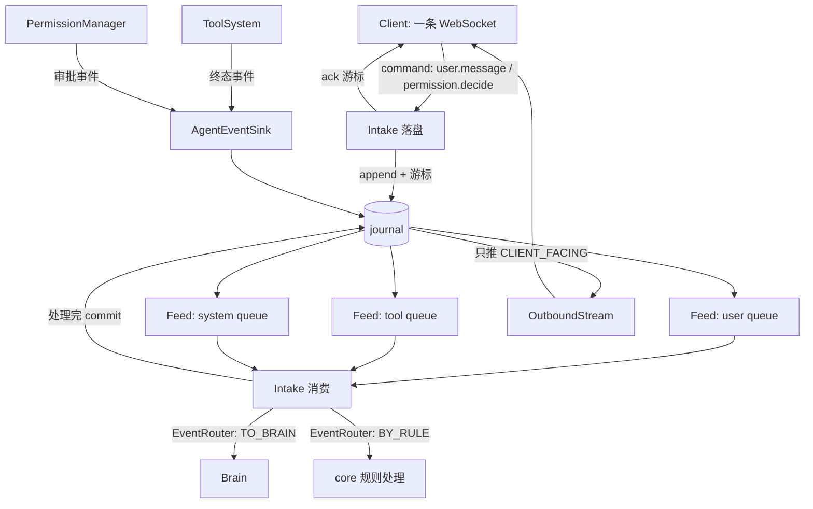

# Feature — 事件运行时（队列、Intake、Brain、对外 event 流）

状态：Implementing

## 背景与目标

journal 已经有了，工具系统也有了，但两者之间没有通路：现在 agent 跑不起来，客户端
也看不到任何东西。本 feature 把 event-driven 的骨架搭出来。

三件东西：

1. **三条队列**（user / tool / system）—— 输入从哪来。
2. **`Intake`** —— 系统的入口：接收入站 command 落 journal，同时消费三条队列。
3. **`Brain`** —— context build → LLM → tool call → compress，决定跑什么。

再加一条对外 event 流：客户端通过一条 WebSocket 既能发 user event，也能收 oath event。

这一轮只搭基础设施。**判断是否给 agent、context 怎么 build、LLM 怎么调、怎么压缩，
都不实现** —— 这些是策略，保留 interface 即可。

## 总览

一句话：**所有事件先落 journal，三条内部队列是 journal 上的游标视图、对外流直接读
journal；所有输入都从 journal 取，不从内存传消息。**



六条贯穿全文的规则：

1. **journal 是唯一入口与唯一出口。** 没有第二条通路：内存消息、进程内队列都不算数。
   断了重连能从游标续上，靠的就是这一条。
2. **对外流不是队列。** oath 内部没有消费方：没有「处理完才推进」，缓冲与重排是客户端
   自己的事。它记的读位置只是为了别每次 poll 重扫日志，不是记账。
3. **内部队列只装输入，不装输出。** `assistant.message`、`tool.call` 是 Brain 和工具
   系统的产物，它们进 journal 但不进内部队列 —— 队列回答的是「现在该做什么」，不是
   「做了什么」。
4. **队列位置是游标，不是时间戳。** 与 journal 一致：墙钟会回拨，做位置标记会静默
   丢事件。
5. **游标归 `Intake`，决策归 `Brain`。** 前者的失败语义是「没副作用、可以重来」，后者
   是「可能已经调过模型」。两者混在一个类里，游标什么时候推进就说不清了。
6. **推不动就断开，不阻塞 core。** 慢客户端的连接会被断开；因为有游标，重连能续上，
   丢的不是数据而是延迟。

## 接口与数据

### 三个系统

| 名字 | 职责 | 依赖 |
| --- | --- | --- |
| `Intake` | 接 command 落 journal；消费三条队列：取记录 → 路由 → 处理 → 推进游标 | `Journal` / `EventRouter` / 三条 `EventFeed` / `Brain` |
| `Brain` | context build → LLM → tool call → compress → fold 状态 | `Journal` / `ToolSystem` |
| `OutboundStream` | 把 journal 里的记录推给已连接的客户端 | `Journal` / `OutboundTransport` |

前两个是接口，v1 不实现 —— 这一轮搭的是通路，策略留到有第一个 `Brain` 时。

`Intake` 有两条通路，都只跟 journal 打交道：

- **落盘**：接收 command，append 进 journal，把游标返回给传输层去 ack。它到这一步就
  结束 —— 一条记录落盘时不带任何调度结论。
- **消费**：从三条队列取记录，逐条问 `EventRouter` 该走规则还是走 `Brain`，处理完一条
  commit 一条。

它不解析帧 —— socket、握手、JSON 解码是传输层的事，传输解析出 `Command` 再交给
`Intake`，core 不管自己是怎么被连上来的。

分工：**`Intake` 让事件可读且有序，`Brain` 让它有意义。**

`Intake` 没有外部副作用 —— append 按 command id 幂等，崩在中途不会留下半吊子的状态。
所以队列游标由它推进，`Brain.step` 返回之后才算处理完：返回之后再崩，记录已经 commit，
重放会重复调模型。

`EventRouter` 判断的是**记录**，不是原始 command：一条 `run.cancel` 落盘时和被读出来时，
中间隔着别的记录，理由可能已经变了。返回值只有两个：`TO_BRAIN`（交给 agent 的那条路）
与 `BY_RULE`（core 自己处理掉 —— `run.cancel` 中止运行、审批回执入账）。v1 没有实现。

### 队列：`EventFeed`

三条内部队列（`user` / `tool` / `system`）**是同一个东西的三种用法**，只有「过滤哪些
type」不同。所以不写三个类，写一个 `EventFeed` + 一张 type 映射表。

| type | 进哪条队列 | 进对外流 |
| --- | --- | --- |
| `user.message` | user | 否 |
| `tool.result` | tool | 是 |
| `assistant.message` | — | 是 |
| `tool.call` | — | 是 |
| `system.agent_step` | — | 是 |
| `system.cancel` / `system.interrupt` | system | 否 |

**对外流只推客户端没发过的记录。** `user.message`、`system.cancel`、`system.interrupt`
都是客户端自己发的，回声对它没有信息量；真正要的是「它落在哪儿」，而那个游标由
`ack` 帧回。

`tool.result` 两边都进：agent 要它作为输入，客户端要它显示工具状态。两边要的不是同一
件事，各走各的通路。

映射表是显式的一张表，不是从 type 前缀推的 —— `system.agent_step` 归 system 但不进
system 队列（前缀规则表达不了这个）。

```python
class EventFeed(ABC):
    def pull(
        self, scope: Scope, feed: FeedName, *, limit: int | None = None
    ) -> tuple[Record, ...]: ...
    def commit(self, scope: Scope, feed: FeedName, cursor: Cursor) -> None: ...
    def position(self, scope: Scope, feed: FeedName) -> Cursor: ...
    def wake(self, scope: Scope) -> None: ...
    def wait(self, scope: Scope, feed: FeedName, timeout: float | None = None) -> bool: ...
```

- `pull` 从当前位置**之后**读，**不推进返回的记录** —— 处理完再 `commit`，`commit`
  只允许前进。
- 扫描途中**不属于这条 feed 的记录会跳过并推进位置，但只推到第一条命中记录之前**。
  少了后半句，一条 `system.agent_step` 会把消费方永久卡在它前面。
- `wake(scope)` 由写入方在 `append` 成功后调用 —— journal 是 pull 模型，没有通知。
  不让 `EventFeed` 包一层 `append` 是因为 append 的幂等语义、指纹计算都在 journal
  里，多包一层只会多一处能写错的地方。
- `wait` 是 `pull` 的阻塞版。唤醒按 scope 计**计数**而不是用 `Event`：后者被 notify
  之后会复位，两个等待者会互相唤醒不到。
- `limit` 限制的是读到多少条日志行，截断时不会有多余的 `wake`。调用方要一直 `pull`
  到返回空为止。

**位置只存内存。** v1 单进程，重启后游标回到起点、事件重放一遍。重放是安全的
（fold 是纯函数），代价是重复处理 —— 这是「快照省的是 state 重算」的同一个代价。
位置要持久化时，它本身也是一条 journal 记录，不是另开一个存储。

### 对外 wire 协议

**一条 WebSocket，双向复用。** 客户端既是 command 的发送方也是 event 的接收方；拆成
两条连接只会多一次握手和一份权限检查。

上行叫 **command**（客户端要 oath 做一件事），下行叫 **event**（oath 告诉客户端发生了
什么）。一组对偶：command 是要求，带副作用，要幂等键；event 是通知，已经是既成事实，
不需要。

统一的 envelope：`v` 是协议版本，`type` 是这一帧是什么。上行 `type` 取 command 自己的
类型，下行取 `event` / `ack` / `pong` / `error` / `close` —— 两套命名空间不重叠，
一个字段就够表达「这是什么」，不需要先判方向再判种类。**客户端遇到不认识的 `v` 应该
断开重协商而不是猜**：猜出来的结果是「按旧版解析成功、按新版执行失败」，失败点会落在
某个看起来无关的地方。

```jsonc
// 上行：client → oath
{"v": 1, "type": "user.message", "id": "c-1", "session_id": "s-1", "payload": {...}}

// 下行：oath → client
{"v": 1, "type": "event", "session_id": "s-1", "cursor": {"kind": "line", "value": 42},
 "occur_dt": "2026-10-13T08:31:04Z", "record_type": "tool.result", "payload": {...}}

{"v": 1, "type": "ack", "id": "c-1", "cursor": {"kind": "line", "value": 41}}
```

**`ack` 回的是那条记录落在哪儿，不是它是什么。** 客户端发 `user.message` 时已经知道
自己发了什么，它要的是「落盘了没有、落在哪儿」—— 断线重连带的就是这个游标。回声会把
同一份内容再推一遍，没有信息量还多一份要保持一致的状态。

command 的类型（闭合集合，加新的按破坏性变更处理）：

| type | payload | 说明 |
| --- | --- | --- |
| `session.open` | `{credential, resume_after?}` | 绑定 session。`resume_after` 是断线重连时带的游标 |
| `user.message` | `{content}` | 用户输入 |
| `permission.decide` | `{invocation_id, status, decided_by?, reason?}` | 审批裁定 |
| `run.cancel` | `{reason?}` | 取消当前 run |
| `ping` | `{}` | 心跳 |

每种 command 的 payload 有结构约束（`COMMAND_SCHEMAS`，与 journal 的
`PAYLOAD_SCHEMAS` 同一套语义）。**未知字段报错而不是忽略**：客户端拼错 key 时静默
忽略会得到「成功但什么也没发生」。

`error` 的 `message` 是给人看的，客户端的逻辑只能依赖 `code`；版本不对与字段不对要分成
两个 code —— 前者该重新协商，后者该修客户端。

**`user_id` 由服务端从 `credential` 推导，客户端不能自称。** 与 journal 的
`ScopeError` 同一理由：隔离键一旦能被调用方伪造，越权读就不是漏洞而是默认行为。
`session.open` 因此**不带 `session_id`** —— 要绑定的正是它，先报了它就等于自称身份。
`SessionAuthenticator` 是接口，v1 没有实现。

**重连靠游标。** 客户端重连时在 `session.open` 里带 `resume_after`，服务端从那里
继续推。没带就从日志开头推：客户端要看到 agent 干了什么，跳不跳过历史是它自己的事 ——
拿不准就带游标来。

### 背压

每个连接一个有界发送队列，在传输侧 —— socket 的写线程是传输的，队列也只能在传输里。
**满了就断开这个连接，不阻塞 core。** 但**满了之后怎么做是策略**，所以传输只报告
`QUEUE_FULL`，断不断由 `OutboundStream` 决定。

慢客户端拖住 core 的后果比断它严重得多：断开的连接能带着游标重连续上，而阻塞的
dispatcher 会让所有 session 一起卡住。断的时候带上原因（`slow_consumer`），客户端
据此退避。

**对外流的位置不是记账。** 读到哪里就记到哪里，包括没能送出去的那几帧 —— 少了的那段
靠客户端自己带的 `resume_after` 补。oath 这边的位置只管「别每次 poll 都重扫日志」，所以
不属于 `CLIENT_FACING` 的记录照样推进，否则一批全是 `user.message` 的行会让 poll 空转
到把日志读完为止。

## 实现方案

`EventFeed` 的 v1 实现是 `core/feed/journal_feed.py`：一张
`dict[(user_id, session_id, feed), Cursor]` 加一把 `Condition` 锁。`pull` 从
`journal.read_range(scope, cursor, limit=...)` 读，按 `QUEUE_TYPES[feed]` 过滤，
位置只推进到「最后一条被跳过的记录」，且只在还没命中时推进。

`OutboundStream`（`core/outbound/stream.py`）持有订阅表，一个 dispatcher 线程按
journal 游标顺序推。它**不用 `EventFeed`** —— 对外流没有消费方，`pull` / `commit` /
`wait` 那套语义对它没有意义，直接 `journal.read_range` 加一个自己的读位置更直白。

传输层是 `OutboundTransport` 接口（`send(scope, frame) -> SendResult` /
`close(scope, reason)`），v1 不实现 —— 具体是 WebSocket、SSE 还是别的，等接入渠道确定
后再定。接口留在这里是因为 `OutboundStream` 的背压与游标逻辑和传输无关，不该绑死在
某一个传输上。

### 审批事件还没进 journal

`permission.requested` / `permission.resolved` 现在只在 `permissions.jsonl` 里，
所以这一版的 feed 看不到它们。`Brain` 消费审批结果时先直接问 `PermissionManager`。

要统一得把审批事件也写进 journal，幂等键沿用 `perm.req:` / `perm.res:` 前缀 ——
journal 的「同键异 payload 抛错」恰好就是「两个审批人同时点同意，第二个人的裁定无效」。
做完之后 `permissions.jsonl` 就没有存在理由了，它承担的「裁定只生效一次」完全能由
journal 的幂等语义承担。记在待决事项里。

## 失败与恢复

| 场景 | 行为 |
| --- | --- |
| 客户端连接时 `credential` 无效 | 不绑定 session，直接断开；不回落到匿名 |
| 同一 session 两条连接 | 后来的顶掉前一条。同一 session 只有一个活动 run，连接也不该有两个 |
| 慢客户端 | 发送队列满即断开，帧里带 `slow_consumer` |
| 断线重连带过期的游标 | 从该游标之后续推；游标指向日志末尾之后就是没有新事件，不是错 |
| 客户端没带 `resume_after` | 从日志开头推，不做特殊处理 |
| `commit` 往回推 | 抛 `CursorError`。往回推会让已处理过的记录重来 |
| 内部队列游标丢了（重启） | 回到起点，事件重放。fold 是纯函数，重放安全 |
| `Intake` 消费中崩了 | 已 commit 的记录不重放，未 commit 的重放。属于 fold 幂等性，不在 core 保证范围 |
| `Brain` 崩在半路 | 副作用已经发生的不重放。哪些不能重放是策略，`core` 不替它判断 |
| `Brain.step` 抛异常 | `Intake` 不吞也不 commit：这条记录下次重来 |

## 跨仓库协议变更

1. `EventType` 新增 `system.cancel`、`system.interrupt`，payload schema 与其余 type 同
   规格。加成员是破坏性变更，客户端要按未知 type 处理。
2. wire 协议是新的跨仓库契约：Hymio 与客户端都要实现同一套编解码（`core/protocol/
   datatype/wire.py` 是唯一来源）。
3. `Journal` 接口多了 `cursor_kind` 属性。仅 core 内部 —— feed 复位时要用它构造
   「第一条之前」，写死一个 kind 会让换存储实现时安静地读错区间。

## 待决事项

- 审批事件进 journal、`permissions.jsonl` 退场（见上）。
- `OutboundTransport` 的具体实现，以及渠道接入时的鉴权方式。
- `Brain` 的 context build 策略、压缩触发条件、并发控制。
- `Intake` 与 `Brain` 都还只是接口。`Intake` 的落盘与取用逻辑都不算策略，但它同时要
  依赖 `SessionAuthenticator`、`EventRouter` 与权限系统，等第一个 `Brain` 落地时一起做，
  否则会先写出一版路由策略再推翻。
- 内部队列游标的持久化时机 —— 现在位置丢了只是重放，等 `Brain` 真正跑起来后看代价。
