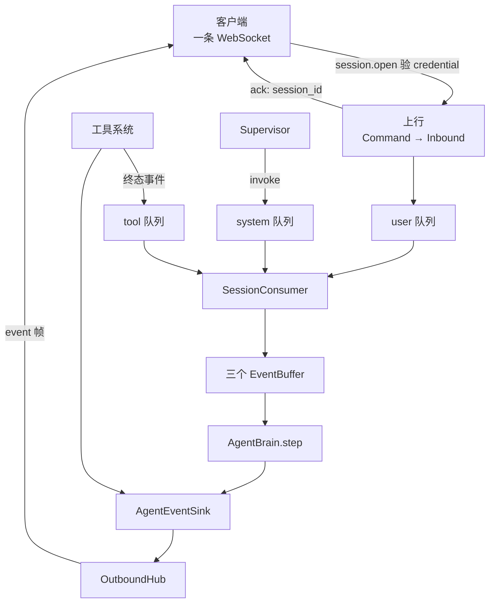

# Feature — 事件运行时（wire 协议、队列、对外投递）

状态：Implementing

## 1 背景与目标

客户端要能和 Oath 对话，运行时要有三条规矩：**输入怎么排队、输出怎么送出去、两端怎么
认出彼此**。这一版定这三条。

- **三条队列** —— `Inbound` 进来只管排队，排队这件事不碰 journal。
- **对外投递** —— 客户端经一条 WebSocket 发 command、收 event。
- **wire 协议** —— command 与 event 的信封、类型集合、错误码。

队列与 buffer 消费怎么落盘、context 怎么 build、调不调模型，都在
[feature-agent-runtime](feature-agent-runtime.md)。

## 2 总览

### 2.1 一句话

**上行 command 被解析成 `Inbound` 放进它该在的那条队列就走，不落盘；下行事件在产生的
那一刻直推客户端，也不落盘。落盘是 brain 的判断，不是传输层的副作用。**

队列是内存里的排队结构，不是 journal 的视图。**队列是刻意可丢的** —— 跨过它之后
consumer 把东西搬进持久化的 buffer，从那一刻起才不会再丢。

投递不经过 journal。journal 是 Oath 存自己状态的地方，不是给客户端当消息总线用的；
客户端自己就是它已渲染内容的存储方。拿 journal 当投递通道，等于把投递能力绑死在日志扫描
吞吐上，还让 journal 为了一个 UI 永远长下去。

代价是断线期间的事件不补发：补发要么把 journal 拽回投递通道，要么再加一个 backlog，
两者都要为「客户端短暂掉线」付长期成本。

### 2.2 流程



**上行只负责「排队 + 回执」，落盘归 brain。** 工具系统只有终态事件，它不知道那一轮是
什么 —— 所以它也不落盘。

### 2.3 五条规则

1. **队列只装输入，不装产物。** `assistant.message`、`tool.call` 是 brain 和工具系统的
   产物：不进任何队列。队列回答「现在该做什么」，不是「做了什么」。
2. **入队不等于送达。** `put` 返回只说明排上了，客户端这边什么都还没发生。
3. **决策在取出时做，不在接收时做。** 一条 `run.cancel` 收到时和被读出来时中间隔着别的
   事实，理由可能已经变了。
4. **投递是活的，不重放。** 事件在产生的那一刻直推客户端，`event` 帧不带游标，断线期间
   发生的没有补偿。
5. **推不动就断开，不阻塞 core。** 慢客户端的连接会被断开。它补得起自己的界面，补不起
   的是别人也被拖住的那段时间。

### 2.4 一个完整的例子

客户端问一句、agent 调一次工具。`#` 是 journal 的行号。

| # | 谁 → 谁 | 发生什么 | journal |
| --- | --- | --- | --- |
| 1 | 客户端 → 服务端 | `session.open`，验 credential | 不落盘 |
| 2 | 服务端 → 客户端 | `ack{session_id: "s-1"}` —— 客户端到这里才知道自己绑到了哪个 session | — |
| 3 | 客户端 → 服务端 | `user.message{content: "北京天气怎么样"}` | 不落盘 |
| 4 | 服务端 | 转成 `Inbound`，进 user 队列，consumer 被叫醒 | — |
| 5 | brain → journal | 模型要调工具 | 41 `assistant.message` |
| 6 | brain → sink | 同一件事，直推客户端 | — |
| 7 | brain → journal | 派发工具 | 42 `tool.call` |
| 8 | 工具系统 → sink | 执行完的终态事件直推客户端 | — |
| 9 | 工具系统 | 同一个事件进 tool 队列 | 不落盘 |
| 10 | brain → journal | 齐了，落结果再调一次模型 | 43 `tool.result`、44 `system.agent_step`、45 `assistant.message` |
| 11 | brain → sink | 最终回答 | — |

三处值得看的地方：**第 3、9 步都不落盘** —— 落盘是 brain 读完这一批之后的事，只有它
知道这一批算什么；**只有 `session.open` 有回执** —— 它是唯一一条客户端不知道自己
`session_id` 的 command，不回就发不出后面任何一条；**第 8、9 步是同一个事件干两件事**
—— 客户端要它显示状态，agent 要它当输入。

对应的帧：

```jsonc
// 1. 客户端 → oath：唯一一条不带 session_id 的 command
{"v": 1, "type": "session.open", "id": "c-0", "payload": {"credential": "token-1"}}

// 2. oath → 客户端：绑到了哪个 session。客户端现在才能发下一条
{"v": 1, "type": "ack", "id": "c-0", "session_id": "s-1"}

// 3. 客户端 → oath
{"v": 1, "type": "user.message", "id": "c-1", "session_id": "s-1",
 "payload": {"content": "北京天气怎么样"}}

// 6. oath → 客户端。注意没有 cursor
{"v": 1, "type": "event", "session_id": "s-1", "occur_dt": "2026-10-13T08:31:04Z",
 "event_type": "assistant.message", "payload": {"content": "", "reasoning": null,
 "tool_calls": [{"id": "t-1", "name": "weather", "arguments": {"city": "北京"}}]}}
```

**断线重连**：客户端重新 `session.open` 即可，中间丢的事件不补。要知道自己漏了什么，
客户端得自己记 —— 或者后续加一条「当前状态」查询，那属于读 journal，是另一个方向的事。

## 3 接口与数据

### 3.1 队列：`EventQueue`

三条队列是同一个东西的三种用法，只有「装哪种 `Inbound`」不同。所以不写三个类，写一个
`EventQueue` 加一张 kind 映射表。

```python
class EventQueue(ABC):
    def put(self, scope: Scope, item: Inbound) -> None: ...
    def drain(self, scope: Scope, queue: str, *, limit: int) -> tuple[Inbound, ...]: ...
    def pending(self, scope: Scope, queue: str) -> int: ...
    def wait(self, scope: Scope, *, timeout: float | None = None) -> bool: ...
    def close(self, *, wait: bool = True) -> None: ...
```

- `put` 按 `item.kind` 决定进哪条，`get_queue_of` 是唯一知道映射的地方。`Inbound` 只有
  三种 kind，所以这张表是闭合的 —— 不像记录表那样需要「产物干脆不列」。
- **`drain` 一次取光，`limit` 是上限而不是页大小。** 一轮里同时到的 20 条 tool 结果
  分 20 次取，就是 20 次可能被插队的机会。`limit` 只在防止无界批次时起作用。
- **`wait` 在这个 scope 任意一条队列非空时返回**，返回哪一条不保证。醒来之后别的消费
  方可能先取走了，所以返回 True 不保证 `drain` 一定拿得到东西。

`InMemoryEventQueue` 是 v1 唯一的实现：一张
`dict[(user_id, session_id, queue), deque[Inbound]]` 加一把 `Condition` 锁。判空与等待
在同一把锁里，所以 `put` 不会漏掉等待者。**单进程**：队列不共享，v1 就是单进程 runtime，
不为还不存在的部署形态付分布式队列的代价。

### 3.2 对外 wire 协议

**一条 WebSocket 双向复用。** 客户端既是 command 发送方也是 event 接收方；拆成两条连接
只多一次握手和一份权限检查。上行叫 **command**（要 oath 做一件事，带副作用，幂等键就是
`id`），下行叫 **event**（告诉客户端发生了什么，已经是既成事实，不需要幂等键）。

`id` 由客户端生成，**唯一性范围是 session，不是连接**：重连后从 1 重新编号会让新消息撞上
旧消息的键。真正的重发复用同一个 `id`，那是去重。

统一 envelope：`v` 是版本，`type` 是这一帧是什么。上行取 command 自己的类型，下行取
`event` / `ack` / `pong` / `error` / `close` —— 两套命名空间不重叠，一个字段就够。
**客户端遇到不认识的 `v` 应该断开重协商而不是猜**：猜出来的结果是「按旧版解析成功、
按新版执行失败」，失败点会落在某个看起来无关的地方。

command 类型（闭合集合，加新的按破坏性变更处理）：

| type | payload | 说明 |
| --- | --- | --- |
| `session.open` | `{credential}` | 绑定 session |
| `user.message` | `{content}` | 用户输入 |
| `permission.decide` | `{invocation_id, status, decided_by?, reason?}` | 审批裁定 |
| `run.cancel` | `{reason?}` | 取消当前 run |
| `ping` | `{}` | 心跳 |

每种 command 的 payload 有结构约束（`COMMAND_SCHEMAS`，与 journal 的 `PAYLOAD_SCHEMAS`
同一套语义）。**未知字段报错而不是忽略**：静默忽略会让客户端得到「成功但什么也没发生」。

**`ack` 是应用层回执，不是送达确认。** WebSocket 本身可靠有序，「command 到了」不需要
再说一遍；ack 回的是传输层看不见的事 —— 凭据验过了没有、绑到了哪个 session。

`session.open` 是必须的那一条：它是唯一一条客户端不知道自己 `session_id` 的 command，
不拿到回执客户端发不出后面任何一条。其余 command 不回执 —— 结果要么作为事件出现在
下行流里，要么失败时来一帧 `error`。

**`event` 帧不带游标。** 它是活的投递，不是 journal 记录的转发 —— 帧里没有位置可以
续推，`session.open` 因此也没有 `resume_after`。

**`user_id` 由服务端从 `credential` 推导，客户端不能自称。** 隔离键一旦能被调用方伪造，
越权读就不是漏洞而是默认行为。`session.open` **不带 `session_id`** —— 要绑定的正是它，
先报了它就等于自称身份。`SessionAuthenticator` 是接口，v1 没有实现。

哪些事件推给客户端不由一张 `CLIENT_FACING` 之类的集合过滤 journal：产生的时候就知道
要不要推。

`error` 的 `message` 是给人看的，客户端逻辑只能依赖 `code`；版本不对与字段不对要分成两个
code —— 前者该重新协商，后者该修客户端。

**帧本身不合法时服务端会回一帧 `error` 再断开**，不能只回错误继续收：解析不出来意味着
两端的认知已经分叉。command 解析出来、业务没办成时只回 `error`，连接继续。

### 3.3 背压

每个连接一个有界发送队列，在传输侧 —— socket 的写线程是传输的，队列也只能在传输里。
**满了就断开，不阻塞 core。** 但**满了之后怎么做是策略**，所以传输只报告 `QUEUE_FULL`，
断不断由 sink 的实现决定。

慢客户端拖住 core 的后果比断它严重得多：阻塞的 sink 会让所有 session 一起卡住。断的
时候带上原因（`slow_consumer`），客户端据此退避。

`NO_CONNECTION` 则什么都不用做 —— 事件就此丢掉，本来也没有别的地方可以补。

传输层是 `OutboundTransport`（`send(scope, frame) -> SendResult` /
`close(scope, reason)`），实现在 `core/outbound/`。

## 4 实现方案

上行把 `Command` 转成 `Inbound` 放进队列就返回，不做任何阻塞操作；下行是 `OutboundHub`
的发送队列。**ws server 是 asyncio 的，core 不是** —— core 不 import `websockets`。

队列的 `Condition` 与 session 的消费线程见
[feature-agent-runtime](feature-agent-runtime.md) 3.2。

**审批事件还没进 journal。** `permission.requested` / `permission.resolved` 现在只在
`permissions.jsonl` 里，所以这一版的 agent 看不到它们。要统一得把审批事件也写进 journal，
幂等键沿用 `perm.req:` / `perm.res:` 前缀 —— journal 的「同键异 payload 抛错」恰好就是
「两个人同时点同意，第二个人的裁定无效」。做完之后 `permissions.jsonl` 没有存在理由，它
承担的「裁定只生效一次」完全能由 journal 的幂等语义承担。

## 5 失败与恢复

| 场景 | 行为 |
| --- | --- |
| `credential` 无效 | 不绑 session，`close{unauthorized}` 后断开；不回落到匿名 |
| 帧不合法 | 回一帧 `error` 再断开 |
| command 收到但没办成 | 回一帧 `error`，连接继续 |
| 同一 session 两条连接 | 后来的顶掉前一条。同一 session 只有一个活动 run |
| 慢客户端 | 发送队列满即断开，带 `slow_consumer` |
| 推送时客户端已断开 | 事件丢掉。`NO_CONNECTION` 不触发 `close` |
| 断线期间发生的事件 | **不补发。** 重连后从新事件开始 |
| 进程重启 | **队列是空的。** 还没搬进 buffer 的输入不补；buffer 里有的照常捞回来重跑 |
| sink 投递失败 | 事件丢掉，不阻塞 core。完整消息仍会落盘 |

## 6 跨仓库协议变更

1. wire 协议是新的跨仓库契约：Hymio 与客户端都要实现同一套编解码，
   `core/protocol/datatype/wire.py` 是唯一来源。
2. `event` 帧没有 `cursor`，`session.open` 没有 `resume_after`。客户端不要设计补发逻辑；
   除 `session.open` 外也没有回执 —— 收到事件就是落盘的证据。
3. `assistant.delta` 的 `channel` 取 `content` 或 `reasoning`，两路分开。客户端按 delta
   追加渲染，断线重连时以完整的 `assistant.message` 为准。

接入细节见 [manual](manual.md)。

## 7 待决事项

- 客户端漏收事件怎么办。当前是「丢了就丢了」；要补的话有两条路 —— 从 journal 重放，
  或者加一条「当前状态」查询。前者把 journal 拽回投递通道，后者是读而不是投，可以
  按需实现。
- 审批事件进 journal、`permissions.jsonl` 退场（见 4）。
- `drain` 的 `limit` 取多少。默认 64，跑一段时间看看有没有真的接近过。
- 重启后队列里没搬进 buffer 的输入怎么办，见
  [feature-agent-runtime](feature-agent-runtime.md) 5。
