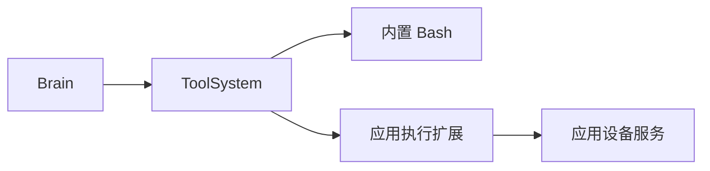

# 可替换核心执行工具

状态：Implemented

## 总览

Oath 保留核心 Bash，但允许部署方明确禁用内置 Bash 并注册自己的执行工具。
外置工具仍经过同一 ToolSystem：deadline、journal、审批、终态和批次唤醒不变。
设备绑定、供应商 API Key、账号和路由属于应用，不进入 core。

## 装配与上下文

`agent.builtin_bash = false` 禁用宿主机 Bash。外置工具可以声明名为 bash 的工具，
注册表仍禁止重名；禁用后没有外置 Bash 也不会自动回退宿主机。
工作区 prompt 只在内置 Bash 启用时加入；应用通过 system_prompt 和工具说明提供
设备清单获取方式、显式 device_id 与设备工作目录规则。

独立运行默认保留内置 Bash，device_id 固定为 oath_host，入参和输出明确标识。
外置多设备 Bash 的 device_id 必填，所有权限来自 ToolInvocation.user。
模型参数中的 user_id 不能改变调用身份。

## 边界

Oath 不管理设备会话，也不直接加载供应商 SDK。外部扩展通过已有 --tool / --skill
挂载。执行服务必须保证调用幂等、有界、失败不静默重跑；未知副作用返回明确结果。
Hymio 扩展与设备服务遵循 Hymio feature10；它们不成为 Oath 的运行依赖。
