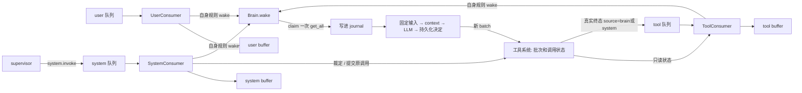
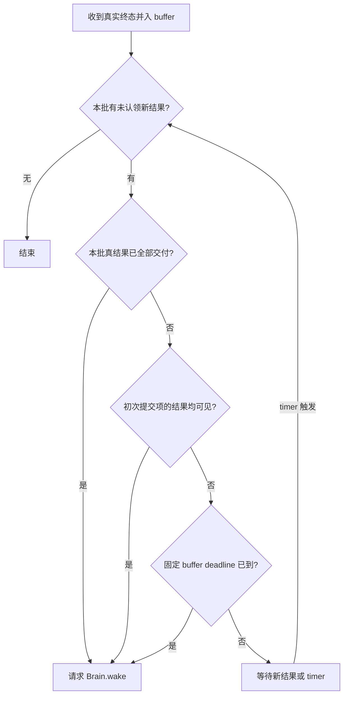

# Feature — Intake：独立消费、工具批次与 Brain 唤醒

状态：Implemented（每 scope 一个进程，队列与 buffer 在进程外）

前置：[Journal](feature-journal.md)、[工具系统](feature-tool-system.md)、[Agent Runtime](feature-agent-runtime.md)。
本 feature 定义消费、唤醒、审批执行与消息投影的执行契约。
推演见 [Intake cases](intake-cases.md)。本文不指定数据库，不实现多机 HA。

## 1 总览

**三条队列、三个 consumer、三个持久 buffer。consumer 分别判断唤醒；任意一个请求唤醒，
Brain 就在可执行时一次取走三条 buffer 当前全部输入。一个 scope 同时最多一个 step。**



贯穿全文的规则：

1. **唤醒判断属于各 consumer。** `Brain.wake` 不带内容，只负责串行执行与合并唤醒。
2. **输入到达不写 journal。** 它在队列里、再在 buffer 里，被认领的那次事务才落盘。ACK 只
   表示投进了队列。
3. **等待批准不是执行终态。** 不向 tool 队列发 `awaiting_approval` 终态；context 按状态补 reminder。
4. **批准直接提交原调用。** 保留 invocation / batch / 参数；真实终态标 `source=system`。
5. **首次工具唤醒等待初次提交的工具，或等待固定窗口到期。** system 来源不加入初次等待集合。
6. **`get_all` 是所有权转移。** 取走即移出 buffer；认领失败要原样放回去，新消息留在下一步。
7. **给模型的 tool response 只交付一次。** 填过的槽位不再改写；后到的真实结果继续落盘，通过
   user-role reminder 呈现。槽位里是提醒而非真结果时，这一条还不算交付。

## 2 批次与工具状态

### 2.1 工具系统拥有批次状态

一次模型响应声明一个完整 `tool_batch_id`，属于固定 scope、run 和 source_step。
`tool_call_id` 只用于模型消息配对；所有内部查询、审批与提交以 `invocation_id` 定位。
`tool_batch_id` 可由 source_step_id 派生；一次认领取走的那批输入叫 `StepInput`，不叫工具 batch。

ToolSystem 先登记所有成员、完成初次接纳并持久化，再启动 worker、发终态或展示审批请求。
完整成员和接纳 deadline 先随 batch 声明保存；接纳统一提交前不对外释放任何一项。
整批接纳提交时冻结 `initial_submitted`：初次由 brain 提交并被接纳执行的调用，含排队项。
ask 项不在集合中；立即拒绝的项直接形成终态；之后经 system 提交的项永不追加进这个集合。
初次判权限也有 deadline；判定失败逐项形成失败结果，不能让批次注册永久悬挂。

`batch_status(scope, batch_id)` 返回一致快照：成员、initial_submitted、每项状态与终态 event_id。
状态只有 ToolSystem 能修改；consumer 不复制一套执行状态机。跨 scope 不返回对象。

| 当前状态 | 后续动作 |
| --- | --- |
| waiting_approval | approved → queued；denied / expired / cancel → 真实终态 |
| queued | worker 获得执行资格 → running；执行 deadline / cancel → 真实终态 |
| running | succeeded / failed / timeout / outcome_unknown；取消按实际执行能力收尾 |
| 真实终态 | 不再提交、不改写；同 invocation 只有一个终态，重投使用原 event_id |

审批状态和执行状态分别保存。`approved` 表示裁定已生效，不表示执行已成功。终态携带
batch_id、invocation_id、tool_call_id、outcome、`source`、event_id；`source=brain` 表示初次
提交产生，`source=system` 表示审批后的提交或拒绝、过期产生。source 由 core 持久化，客户端
和业务 tool 不可自称。run_id 保留原调用归属；新 run 不自动丢弃旧结果，也不撤销旧审批。

### 2.2 批次呈现到哪里为止

`presented_by_step` 与 `delivered` 初始都为空，由 Brain 的输入提交记录推导，归消息消费状态，
不归工具执行状态。某次 step 固定了该批所有 tool response 槽位时，`presented_by_step` 记下这个
step；这些槽位**全是真结果**时再记 `delivered`。

**填过槽位不等于送到了。** 槽位里只有等待批准、尚未返回这类提醒时，批次仍要等真结果 ——
照着提醒继续往下走，真结果就永远进不了上下文。
用户消息、system invoke、别的工具批次唤醒，都可能导致这两个值变化。
呈现不取消任何工具、不撤销任何审批；它只结束该批的首次攒批约束。

## 3 三个 consumer 的边界

### 3.1 接收与唤醒分开

每个 consumer 只监听自己的队列，把事件放进自己的持久 buffer，再按自身规则请求 wake。
**ack 不进 Oath 的接口** —— 那是中间件自己的可用性保障（Redis 用消费组 + pending，
Kafka 用自己的 offset），换实现不改这里。
consumer 在 Brain 调模型期间继续工作；不持锁调用 Brain 或执行工具。

| consumer | 接收动作 | 默认唤醒规则 |
| --- | --- | --- |
| UserConsumer | buffer 用户输入，附带同步 user_context | 有新有效输入即 wake |
| ToolConsumer | buffer 真实终态，查询本批状态 | 按第 4 节 |
| SystemConsumer | 应用控制决定后再 buffer 已应用事件；`system.invoke` **不进 buffer** | 批准本身不 wake |

三个 consumer 是三条队列各一个线程。`system.invoke` 只置强制唤醒标记并叫醒 Brain ——
它是一次「看一眼」的信号，不是一个模型输入。
SystemConsumer 先应用控制动作再让该消息进入 buffer，防止 Brain 收到尚未生效的批准。
批准：原子记录裁定与执行意图，异步提交原调用。拒绝 / 过期：记录未执行终态，投递 tool 队列。
批准校验认证主体、scope、原工具与参数摘要；只改变执行资格，不接受客户端替换调用内容。
这些授权事件不自行 wake，避免绕过 A/B 的首次等待。终态由 ToolConsumer 决定何时通知模型。
cancel 先改变执行资格；是否让模型解释由该 system 事件类型决定，不靠 LLM 才能停止派发。

### 3.2 取走即移出

`EventBuffer.get_all` 是所有权转移，取走之后 buffer 里就没有它了。完成事务只确认本 step 那批
输入；不提供「把三个 buffer 清零」的调用 —— 那会删掉模型运行期间新来的消息。
ToolSystem 的提交意图由执行器完成；崩溃恢复依第 7 节处理，不由 LLM 重新生成调用。

## 4 ToolConsumer 唤醒规则

### 4.1 只检查出现新终态的批次

设 `N(b)` 为本批在 tool buffer 中尚未认领的新终态，`I(b)` 为 initial_submitted。
`visible(i)` 表示初次调用 i 的终态已经进入 buffer 或固定的 step 输入，不能只看 worker 已完成。
ToolSystem 给出终态 event_id，consumer 以「buffer 里有没有」判定 visible；缺投递由持久化结果重投。
查询失败不能当成 I 为空；保留输入、报告日志并退避重试。未知或伪造终态隔离，状态查询显示错误。

```text
should_wake(b, now):
    if N(b) 为空: return False
    if delivered(b) 已成立: return True
    if 每个 i ∈ I(b) 都 visible(i): return True
    return now >= buffer_deadline(b)
```

I(b) 为空并不会凭空 wake：必须先有 N(b)。因此全部 ask 时直接等审批；单个 ask 获批执行、
拒绝或过期后产生第一个真实终态，立即 wake。此时不等待同批其他审批或 system 执行项。
初次立即拒绝 / schema 错误也有真实终态；没有初次执行项时同样能推进。

`delivered` 之前：system 来源结果可加入 N(b)，可随认领取走，但不能独立绕过 I(b)。
`delivered` 之后：任何来源的新终态都可 wake；不重新等待已经送过的初次工具。
多批次分别计算；任意批满足条件可请求 wake，按约定那次认领会顺带取走其他批已入 buffer 的结果。

### 4.2 Buffer timeout

采用 **固定窗口**：第一个新真实终态进入本批 buffer 时，持久化 `first_buffered_at`、
`buffer_deadline = first_buffered_at + buffer_window` 与窗口长度本身。brain / system 来源都能
启动计时。后续结果不延长 deadline；它限制首个结果已经等了多久。该参数与工具 execution
timeout 分开。timer 丢失可据此重建，不取重放时刻。

timer 到期即使没有新消息也主动重新判定；N(b) 已被其他 wake 认领则旧 timer 无效。
这次认领呈现了本批后取消首次攒批 timer；后续结果直接 wake。
进程内用 monotonic 等待，重启由保存的绝对 deadline 恢复；过期立即处理，不重新给完整窗口。
跨重启依赖可信墙钟；剩余等待限制为已保存的窗口，回拨不能无限延长，过期按零处理。

**一条结果都没有时 buffer timer 不启动。** 工具执行 / 排队 deadline、审批 TTL、初次接纳 deadline
各自产生终态。终态已落盘但尚未入队时由重投恢复，不能依赖用户再次发消息。
上述 deadline / TTL 必须有限；buffer timeout 不终止工具，也不延长其执行期限。



## 5 认领与 Brain 串行执行

### 5.1 唤醒只提供执行入口

一个 scope 一个 Brain step owner。三个 consumer 同时 wake，合并为一次取输入的机会。
Brain 忙时只登记 pending wake，consumer 继续往 buffer 里收；不阻塞在模型网络调用上。
当前 step 结束后再检查一次 buffer；有就再走一轮，没有就停驻。
模型只说「等待」且没有新调用 / 输入时直接停驻，reminder 不产生新事件。run 的步数 / 时间预算
限制模型持续发起新调用的循环；预算耗尽暂停推理并显示状态，不丢弃审批或工具结果。

**唤醒不会丢。** `wake` 只置信号；consumer 先 `add` 再决定唤醒，所以「决定唤醒」这一刻数据
一定已经在 buffer 里。Brain 是 `wait → clear → claim → execute → 重新置信号`：执行期间到达的
输入，它的唤醒已经被这一轮用掉了，执行完必须补一次，否则要一直等到下一次外部唤醒才有人认领。

### 5.2 取走与落盘是一个事务的两半

认领分两步：

1. `get_all` 把三条 buffer 一次取空（取走即移出）。
2. 一个短的 scope 事务，`runtime.commit(reason=step.input)` 写入 `inputs`（状态 `claimed`）、
   step_id、trigger、请求草稿和固定槽位。

事务成功，这批输入归本 step，结束时标 `done`。事务失败或抛异常，**这批输入原样放回三条
buffer** —— 否则它们既不在 buffer 里也不在 journal 里，就永远没了。

锁外压缩后通过 `step.request` 保存最终请求。重试只读取已固定请求。
prepared step 崩溃后继续同一份输入，不重新取。完成时提交 `step.completed`，可重复执行；
当前不物理删除历史。

禁止「模型结束时 clear 当前整个 buffer」：那会删除模型运行期间新来的消息。
所有锁均不跨模型请求或工具 I/O。

## 6 Context build：槽位一次固定，后续结果追加

### 6.1 检查完整消息序列

每条 assistant.tool_calls 后，必须紧邻且只出现同数量、同 tool_call_id 的 tool 消息，之后
才能追加 user / assistant 消息。按原调用顺序拼接。配对内部键是 batch_id + invocation_id，
不能假设模型生成的 tool_call_id 在整个 session 唯一；provider 要求的 ID 原样透传。
同一 assistant 响应内 ID 缺失 / 重复属于无效模型输出；派发前拒绝并进入有限纠错，不能执行半批。

检查不能只依赖当前列表最后一条的 role：即将追加的用户消息前仍可能存在未闭合 toolcall。
对尚未呈现的 batch，在 step.input 提交时为每个成员固定一个槽位：

| 本步能看到的状态 / 输入 | 原 tool 槽位内容 |
| --- | --- |
| 已认领的真实终态 | 实际结果或拒绝 / 失败描述 |
| waiting_approval | “等待用户批准，尚未执行。”并带调用标识 |
| queued / running | “已提交，尚未收到执行结果。”并带调用标识 |
| ToolSystem 已有终态但消息尚未被本步认领 | “结果尚未进入本轮，将在收到后补充。” |
| 恢复中尚不能确认 | “执行结果待确认，不应据此重复执行。” |

reminder 是模型视图，不写成真实 tool.result、不把工具改成终态。审批通过本身不伪装为执行成功。
等待提醒须说明原调用仍有效、后续自动通知；模型不要为等待中的同一动作再发一份调用。

### 6.2 后到结果

某槽位被 step.input 固定后永久保留，即使模型响应尚未回来。真实结果到达仍记 tool.result；
下一步包装为 user-role reminder，带 event_id、batch_id、invocation_id、outcome 与结果，按原调用关联工具。
真实终态已用在原 tool 槽位的，不再追加同一份 user 通知；同一 event_id 至多呈现一次。
审批拒绝同理：槽位未固定且拒绝已被认领，用 tool role；已经固定则追加 user role。
system buffer 的审批记录用于 trace / 状态；若对应终态已经表达裁定，context 不重复讲一遍。

```text
assistant: tool_calls=[A, B]
tool(A): 查询结果
tool(B): 等待用户批准，尚未执行。
user: 后续用户输入或控制提醒
assistant: 下一轮回答
user: <tool_result batch_id="b1" invocation_id="B" outcome="succeeded">真实结果</tool_result>
```

模型请求失败重试沿用已固定消息。新结果不能回填进那次请求，否则同一个 step 会有不同输入。
正文转义，来源保留结构化元数据；user role 不意味着这些内容能授予权限。

## 7 Durable、失败与恢复

### 7.1 三个持久化边界

1. **投递输入**：用户命令与审批决定先投进队列。**可靠性的责任在中间件，不在 Oath** ——
   队列允许重复 / 重建，消费端按 event_id 去重。工具终态先写 journal 再发布，投递发生在
   事务提交之后。
2. **准备副作用**：批次初次提交、批准后提交，都先保存参数、deadline、source 和派发意图。
   权限裁定与唯一派发资格原子提交；提交资格以 invocation_id 去重，批准重发不会创建第二次执行。
3. **认领与完成**：step.input 固定消费所有权与消息投影；模型完整返回及后续 batch 意图先持久化，
   再派发；step.completed 保存进度。重放 reducer / 修复派发不重新问已经有完整响应的模型。

这些是存储契约。**只有 Brain 写输入与 step / 模型消息**（supervisor 投事件不改 journal，
它改不了 —— 它连 journal 的接口都没有）。工具与控制事实的保存不等待 Brain 唤醒。

### 7.2 重启顺序与边界

一个 scope 一个进程，重启就是新进程打开同一个目录：先从 journal 恢复批次、审批、派发状态、
step.input / completed，再从持久 buffer 读回还没认领的输入，最后开放接入。buffer 读得回来是
这里的核心断言 —— **已 ACK 的输入不能因为进程没了就不存在**。
已有完整响应的 step 补齐后处理；无响应的准备态恢复原请求，有限重试，不能并发启动第二个 step。
结果已持久化而未认领的，按同 event_id 重投；认领但未完成的，继续原 step；完成但未回收的只回收。

| 崩溃 / 故障位置 | 恢复动作 |
| --- | --- |
| 投递后、入 buffer 前 | 队列重投，按 event_id dedup |
| 批准已提交、尚未取到派发资格 | 恢复唯一原调用提交，source=system |
| worker 可能已执行、没有可靠终态 | 当前无外部对账 adapter，报告 outcome_unknown，不盲目重跑 |
| 已保存终态、尚未发布到队列 | 重投同一终态，重建固定窗口和唤醒判断 |
| 取走 buffer 之后、认领事务提交之前 | 事务没提交就是没认领；但那批输入已经不在 buffer 里 —— **放回去是这一步的唯一出路** |
| request 已发、响应未保存 | 模型结果未知；有限重试同一请求，可能重复计费，但不派发未记录的工具 |
| 模型响应已保存、工具尚未派发 | 使用已记录 batch / invocation 补齐派发，不能生成新调用身份 |
| LLM 永久失败 / 重试耗尽 | 记录 failed，结束本次执行；active step 和原输入保留，暂停该 session 推理 |

失败态须通知客户端；修复后显式 retry / resume 原 step。新输入继续入 buffer，审批、执行和
取消继续；不能把失败输入当作未认领输入自动唤醒，也不能越过失败 step 开始下一次模型请求。

queued 与 running 都有 deadline；不能以线程超时表示外部副作用未发生。执行器必须持久化开始标记，
只有确定尚未取得执行资格的提交意图可直接续发；已开始且不可查询 / 不幂等的调用按 unknown 收尾。
执行 deadline 覆盖排队与运行，审批有独立 TTL；重启不延长两者。
审批 TTL 到期产生 source=system 的未执行终态；裁定时再次检查有效期。已取消 / 终结调用拒绝批准。
取消与派发资格串行提交：取消先发生则不执行；已开始则按工具能力取消，无法确认停止时保留不确定性。
已确认写失败必须向上返回失败并退避；不 ACK、不清其他有效输入，不因队列非空而忙循环。

## 8 跨仓库影响与范围

Hymio / 客户端：审批绑定 scope + invocation_id；批准表示提交原动作，重复裁定无效，取消后不得执行。
重连查询待审批、执行与 step 状态；用原 invocation 恢复授权卡，不能只依赖在线推送找回请求。
工具与 trace 事件新增 batch_id、event_id、source；展示区分等待批准、已批准排队、实际完成。
模型 tool_call_id 不变；Nostalgia 消费结构化事实时不能把 reminder 当成真实执行结果。
用户 / system 的其它唤醒策略分别定义，不能通过新增统一 Intake scheduler 接管三个 consumer。
RuntimeStore 通过一条 runtime.commit 保存跨表变化：inputs、batches、calls、steps、meta、conversation、controls、compactions。
工具终态、裁定和 queued、claim 和槽位均各自原子提交，不另写权限文件。
**buffer 不写进 journal** —— 它是输入还没被认领期间的事实载体，取走即移出。
执行器暂不支持外部 operation 对账；日志裁剪、事务快照和多进程 fencing 另行实现。
压缩见 [Compaction](feature-compaction.md)：按 scope 判断，不改已固定的槽位。
