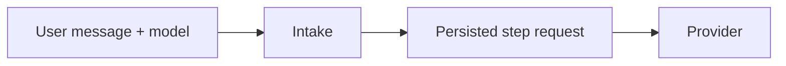

# Model selection

Status: Implemented

## Overview

A user message may select a model from `agent.selectable_models` plus the default provider model. All choices use the configured provider endpoint and Vault credential. Oath never accepts an arbitrary endpoint or credential from a client.

Selection is persisted per user when Intake claims input. Tool continuations keep that choice; a later user selection affects future steps only. Prepared requests retain their model across retry and recovery. Removed choices fall back to the configured default. Compaction uses its configured model.

Hymio owns the authenticated settings UI and injects the saved choice into user messages. Oath independently rejects unavailable model IDs at Gateway; Intake only applies allowed choices.
