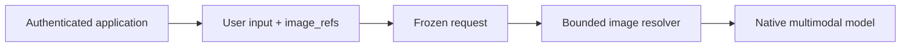

# Native image input

Status: Implemented

## Overview

Applications attach immutable image references to user inputs. Oath preserves references with
the fixed input and resolves them through a configured, authenticated application endpoint
immediately before a model request. Image bytes never enter runtime snapshots, journals or traces.

References contain IDs, never client-selected URLs or credentials. Resolution uses the execution
user identity, not an identity supplied in a message. The resolver must enforce ownership.
Text-only models remain available; application model policy decides whether to attach images.

Enable `supports_images = true` on each capable `agent.provider` or
`agent.model_providers.<choice>` entry. Configure `agent.image_resolver_url` and
`agent.image_resolver_token_file`, or use `oath start --image-resolver URL` together
with the context provider token file. An `OATH_IMAGE_RESOLVER_URL` Worker environment
override uses the mounted context provider token unless an explicit resolver token is configured.

## Model transport

`image_refs` is a list of opaque IDs. Input rendering preserves it alongside the event text.
Structured tool result content can also include `image_refs`. These images follow the completed
tool response slots in a user message, preserving tool-call ordering and native image support.
The configured resolver receives `{user_id, image_refs}` and returns `images`, an ID-to-data-URL
mapping. Requests and responses have bounded size, count and time. Missing or invalid images
fail explicitly; they are never silently treated as understood.

Only the most recent twelve distinct images are resolved in a request. Older references remain
in history with an explicit omission notice. Text-only choices receive the same notice and can
use an application image-analysis tool. The provider never executes tool syntax found inside
reasoning text; tool calls must be returned through the provider's structured tool-call fields.

OpenAI-compatible transport emits text and `image_url` content parts. Internal image references
and execution identity are not forwarded as provider fields. Compaction keeps text and references;
reference token accounting reserves image capacity separately from their short IDs.

## Cross-repository contract

Hymio validates attachment ownership at ingress, selects models with native vision, and provides
the private resolver. Existing document/audio tools remain independent. The service token and
endpoint are deployment configuration; neither appears in conversation data.
