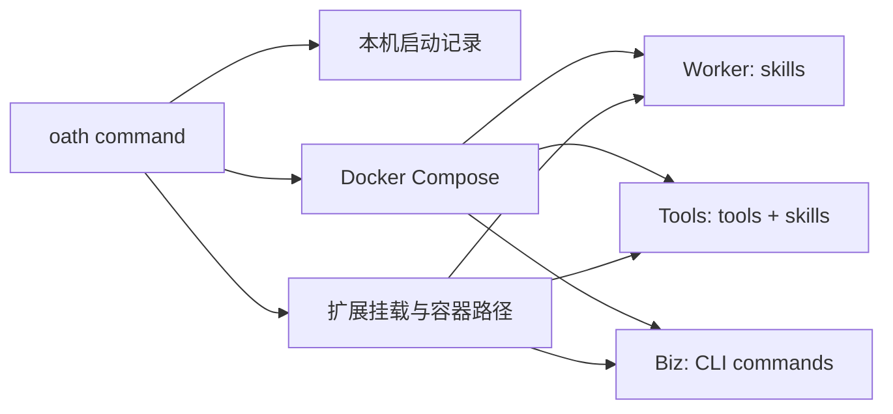

# Feature — `oath` 命令与外部扩展

状态：Implemented（单机 Docker）。

## 结论

安装后由 `oath` 管理本机 Docker 部署。Oath 自带 `extensions/` 始终加载；调用方可按类型追加外部 skill、tool、CLI 目录。`start` 等待服务健康并输出 WS、Biz 端口；`restart` 复用上次启动记录，`status` 查看服务与扩展，`stop` 停止服务但保留数据。

```text
oath start --skill ./skills --tool ./tools --cli ./cli
oath status
oath restart
oath stop
```



## 命令契约

`start` 默认读取 `~/.oath/oath.toml`；`--config` 可指定另一份已有 TOML。安装器在默认文件已存在时复用它；首次安装若仓库有旧 `oath.toml` 则迁移配置和本机 Vault 恢复文件，否则复制模板。`--skill`、`--tool`、`--cli` 可重复；每项必须是已有目录。skill 目录包含若干带 `SKILL.md` 的子目录，tool/CLI 目录包含可扫描的 `.py` 模块。路径在启动时转为绝对路径。额外目录按命令行顺序追加，不替换 Oath 内置扩展；工具或命令重名导致对应服务启动失败，不静默覆盖。

`--name` 可为同一宿主机上的独立部署指定名称，默认 `oath`；`restart`、`status`、`stop` 用相同名称选择实例。每个名称有独立 Compose project 与本机启动记录。

有效启动参数保存在本机私有状态目录，包含配置路径、外部目录和 Compose overlay 路径，不保存模型密钥。`restart` 按这份记录重新启动；没有记录则明确报错。`status` 与 `stop` 也使用同一记录。首次 `start` 会沿用 Vault 的密钥导入流程。`start`/`restart` 等待 Gateway、Biz 和依赖服务健康，失败时返回非零码与 Compose 状态，不声称已经可用。`stop` 保留数据卷；显式删除卷不属于此命令。

启动记录只在服务通过健康检查后更新；Compose overlay 以内容摘要命名，失败的再次启动不会改写上一次可用的目录映射。服务已经部分变化时仍需人工查看 Compose 状态；首版不承诺部署回滚。

安装脚本把项目安装到本机 Python 工具环境，注册 `oath` 可执行入口。首版 Docker 镜像从已安装命令所对应的 Oath 源码目录构建；安装源目录需要保留。Docker 与 Compose 是宿主机前置依赖。

旧的 `extensions-local/` 自动发现和本机启动脚本已移除。已有私有目录仍由 Git 忽略；需要加载时，按类型把其中的 `tools/`、`cli/`、`skills/` 显式传给 `oath start`。

## 扩展装配

内置根目录 `extensions/` 仍按 `tools/`、`cli/`、`skills/` 扫描。外部目录按类型直接扫描，不要求再包一层根目录。CLI 为每个目录分配固定容器路径，以只读方式挂到需要它的进程：tool 到 Tools，CLI 到 Biz，skill 到 Worker 与 Tools。路径列表作为启动配置传给对应进程。未挂载的服务不会加载该类扩展。

Python 装载器对内置根目录和外部类型目录使用同一模块扫描与重名检查。装载发生在进程启动时；改动源码后执行 `oath restart`。外部 Python 模块在 Oath 容器中执行，只应加载受信任代码；需要额外依赖的扩展应由调用方构建包含依赖的镜像，首版不隐式在线安装依赖。

## 边界

`oath` 是部署命令，不提供 Python SDK。业务数据与连接器授权仍属于上层应用；Oath 只暴露既有 WS、Biz HTTP。当前单机 Compose、SQLite、RabbitMQ、Vault 的可靠性边界不因新命令改变。Hymio 可在自己的仓库放扩展目录，由 Oath 命令装入，而不修改 Oath core。
