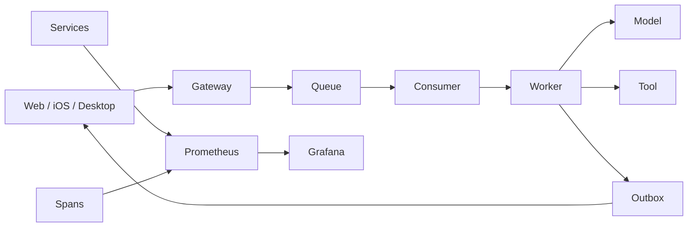

# Feature — Observability

状态：Implemented

## 总览

Oath 用 OpenTelemetry GenAI 语义组织 trace，用 Prometheus 暴露低基数运行指标。
Prometheus 和 Grafana 只消费派生观测数据，不参与恢复，也不成为执行事实来源。



贯穿规则：

- 指标标签只包含有限的渠道、服务、操作、模型、工具和结果，不使用 `user_id`、`trace_id`
  或 prompt 作为标签。
- `user_id` 和原始请求仍只存在于按用户隔离的 trace；聚合指标不携带业务正文。
- trace 写失败不影响执行；client telemetry 写失败不阻塞对话。
- 时间窗延迟统一用毫秒或秒的 duration histogram，不把绝对墙钟当耗时。

## 链路

一条用户消息的 trace 从 Gateway 接收命令开始。Gateway 生成 trace ID，经 Inbound
telemetry 随队列传递；Intake 创建 step 时使用这个 ID，而不是到 Worker 才重新生成。

固定节点：

| 节点 | 记录 |
| --- | --- |
| Gateway | 命令接收、校验、`queue.add` 接纳耗时 |
| Queue | Storage outbox 写入、broker publish、RabbitMQ 投递 |
| Consumer | 投递到 buffer、buffer 到唤醒延迟 |
| Manager | ready user 到 Worker claim 的等待 |
| Intake | 输入认领、step 创建和上下文准备 |
| Model | TTFT、首正文、总耗时、输入/输出 token、attempt、错误 |
| Tool | 排队、执行、终态耗时和结果；以 step 为 parent span |
| Delivery | Outbox 读取到 WebSocket 发送的延迟 |

跨服务 HTTP 的 span 和指标放在通用 RPC 边界；RabbitMQ 自身队列深度和积压使用其
Prometheus endpoint。工具 span 与 step 共用 `trace_id`，这样管理台能按 trace 统计
step 数、工具数、成功率和工具耗时。

## 指标

每个 Oath 服务在自身端口暴露 `/metrics`。指标名称使用 Prometheus 文本格式，至少包含：

- `oath_rpc_requests_total`、`oath_rpc_duration_seconds`
- `oath_queue_publish_delay_seconds`、`oath_queue_to_buffer_seconds`
- `oath_buffer_wake_delay_seconds`
- `oath_brain_claim_wait_seconds`、`oath_step_duration_seconds`
- `oath_llm_duration_seconds`、`oath_llm_ttft_seconds`、token counters
- `oath_tool_duration_seconds`、`oath_tool_terminals_total`
- `oath_delivery_delay_seconds`
- `oath_storage_lock_wait_seconds{mode}`、`oath_storage_transaction_seconds{mode,outcome}`
- `process_resident_memory_bytes`、`process_cpu_seconds_total`、`process_open_fds`
  （进程指标由支持的平台提供）
- `hymio_client_turns_total{outcome="stalled"}` 用于识别已发送但 30 秒内没有首个模型
  增量的客户端样本

服务指标不应在热循环中生成无界 label；未知维度使用 `unknown`，不能把请求正文或
异常正文塞进 label。

## 数学口径

设单次观测的起止时刻为 `t0`、`t1`。各 histogram 记录 `D=t1-t0`，单位秒：

```text
RPC          t_return          - t_enter
Gateway      t_ack_send        - t_frame_start
Publish      t_publish_confirm - t_occur
Consume      t_buffer_insert   - t_occur
Queue→claim  t_claim           - t_occur
Brain claim  t_brain_claim     - t_ready_at
Step         t_step_end        - t_trace_started
Model TTFT   t_first_delta     - t_request
Tool         t_terminal        - t_worker_start
Delivery     t_after_ws_send   - t_created_at
```

`Queue→claim` 是从 item 创建到 Worker claim 的累计值，包含 broker、buffer 与 claim
等待，不是 buffer 内部唤醒时间。工具审批等待不进入 `Tool`，排队时间由
`oath.tool.queue_ms` 单独记录。

模型 `TPOT=(D-TTFT)/(N_out-1)`，仅当 provider 报告的 `completion_tokens > 1` 时定义。
TTFT 的首增量包含 reasoning 与 content 通道。

服务端延迟 P95 使用 Prometheus 的 `histogram_quantile(0.95,{B_l})`，其中
`B_l=sum(bucket_l)`。该值是在有限 `le` 桶内插值得到的近似分位数，不对应原始事件
分位数。当前管理台折线使用进程启动以来的累计 bucket，不是 `rate` 时间窗 P95；
告警表达式单独使用 5 分钟或 10 分钟 `rate` 窗口。

Agent trace 计数：

```text
steps        = |{s.name=invoke_agent and s.parent_span_id=NULL}|
model_calls  = |{s.gen_ai.operation.name=chat}|
tool_calls   = |{s.name starts_with "execute_tool "}|
tool_success = |{tool_call and s.oath.tool.outcome=succeeded}| / tool_calls
```

`tool_success` 在分母为 0 时无定义。

## 查询与部署

Prometheus 默认抓取 Oath 全部服务与 RabbitMQ；Grafana 使用 OpenTelemetry/Prometheus
兼容数据源展示 p50、p95、p99、错误率和吞吐。Grafana 面板是运行观测入口，Hymio 管理台
保留面向产品与 trace 的聚合视图。

OpenTelemetry span 模型保持不变；OTLP 热导出是可替换的传输适配，不影响本地 trace
查询。管理台读取跨用户 trace 必须经内部服务凭据和显式 `user_id`，不能接受客户端
伪造的身份。

## 失败与恢复

- Storage 的读操作使用只读 WAL snapshot；写操作保留 `BEGIN IMMEDIATE` 和同事务
  fence 校验。首次访问才在独立写事务创建用户，不因查询历史或状态争抢写锁。
- RPC 的 JSON 解析与编码在工作线程执行；请求体在接收过程中限制大小。心跳存活不等于
  存储可用，需要同时观察 RPC 错误、锁等待、事务 busy 次数和进程内存。
- 完整执行状态仍随历史增长。锁隔离不能消除全量状态读写的开销，长期运行需继续拆分
  热状态与历史记录；不以删除历史或定时重启代替处理。
- 指标后端不可用：服务继续运行，只有监控数据缺失。
- trace 写失败：执行继续，缺失的 span 不补造。
- client telemetry 先进入客户端有界持久 outbox，后台有退避地重试；上传失败不阻塞
  消息发送。outbox 本身不可用时，下一次发送仍能产生新的样本。
- 队列或模型失败：记录错误维度和终态，不把失败样本排除出成功率与 latency 分布。
