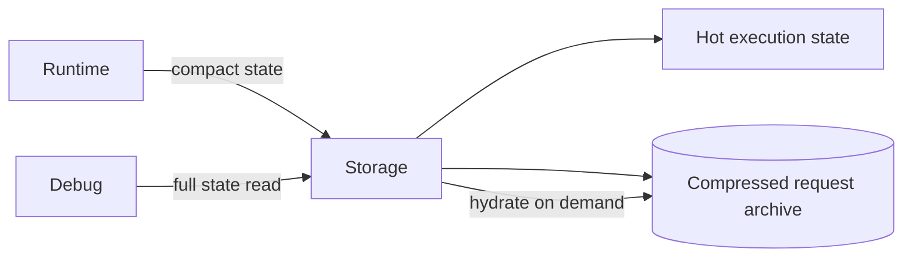

# Runtime request archives

状态：Implementing

## 总览

已完成 step 的模型请求存入 SQLite 压缩归档，执行状态只保存内容摘要引用。
请求、状态引用、Journal 和终态投递在同一事务提交；不删除历史请求。

只有 `completed` step 可归档。prepared、running、failed、paused step 保留完整请求，
保证恢复、重试和人工干预使用固定模型输入。归档按用户和 SHA-256 摘要寻址，
同一用户的相同请求只存一份，不跨用户共享。

## 读写

RuntimeStore 使用 `state.read(compact=true)`，历史 step 的 `request=null`，
`request_archive` 保存引用。模型执行只使用未完成 step 的完整 request。
默认 `state.read` 只从归档恢复 prepared、running、failed、paused 等未完成 step；
已完成 step 保持 `request=null`，避免普通状态读取重新膨胀热状态。需要显式检查历史
全文时，服务端可以用 `include_completed=true` 解压指定状态。

提交先验证版本和 fence，再将完成请求归档并比较紧凑状态。
已有数据库在 Storage 启动时逐用户归档，一次只处理一位用户，事务提交后才处理下一位。
失败回滚该用户的数据，不允许出现缺失归档的已提交引用。

## 观测

Storage 暴露热状态字节、归档压缩字节和原始字节的聚合值，以及锁等待和事务耗时。
采集不解析模型正文，不以用户或请求摘要作为指标标签。

## 边界

归档不替代 context compaction；当前会话内容、输入身份和工具状态仍属于执行状态。
请求归档没有自动删除策略，需与执行历史的保留策略一起设计。
该契约只影响 Oath 内部 Storage RPC，不改变 Hymio 的客户端协议。
