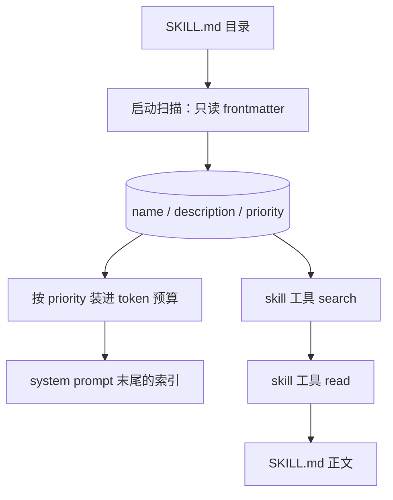

# Feature — Skill：技能索引与按需加载

状态：历史设计（模块思路保留；当前部署、身份与存储以 [分布式 Agent 设计](feature-distributed-personal-agent.md) 为准）。

## 总览

技能是一段只在需要时才进上下文的说明。core 在启动时把技能扫成一个索引：哪些技能
存在、叫什么、什么时候该用。全量正文永不进上下文 —— 索引里只有「名字 + 一句描述」，
正文靠 `skill` 工具在模型决定要用时才读回来。

技能分两层来源：

- **项目技能**：`extensions/skills/<name>/SKILL.md`。进 system prompt 末尾的技能索引。
- **发现技能**：coding agent 已经在用的技能目录（`~/.claude/skills`、`~/.codex/skills`
  等）。不进 system prompt，只能被 `skill` 工具搜到并读出。



规则：正文永远不进 system prompt；名字只在索引里查，不拼路径；索引按启动时的快照
固定，预算装不下时先丢低优先级；技能没有副作用，读正文不经过权限。

## 1 技能文件

一个技能是一个目录，目录里有 `SKILL.md`。文件是 YAML frontmatter 加 markdown 正文：

```markdown
---
name: pdf-fill
description: 填写 PDF 表单字段。触发词「填表」「表单」。
priority: 10
---
# 填写 PDF 表单

正文是模型读完索引后按需读回的完整说明……
```

`name` 和 `description` 必填 —— 没有它们，索引里就没有这个技能。`priority` 可选，
默认 0；`metadata.channels` 可选，用于声明只向哪些客户端渠道暴露。缺 `---` 围栏、frontmatter
不是映射、字段类型不对，都只丢这一个文件并记一条
warning：坏技能不能拖垮启动。同一目录下的其他文件属于技能自身的资源，本机制不读它们。

`priority` 是整数，越大越晚被丢掉。不写就是 0，也就是「没有声明优先」：项目自己写的
技能应当显式给一个正数，否则会被扫描进来的技能挤掉。

## 2 索引

`SkillSystem` 在构造时扫完目录，之后只读。每个技能留下 `name` / `description` /
`priority`、渠道范围和文件路径 —— **正文不进内存**，需要时再读文件。

扫描顺序即覆盖顺序：注入的技能目录在前，配置里的发现目录按给定顺序跟进，每个目录下的
子目录按名字排序。名字撞车时先扫到的赢，后来的一条记 warning：顺序是确定的，
「谁赢」不该取决于文件系统返回目录项的顺序。同一个文件被两条目录路径指到（符号链接）
算一次，不算撞名。

索引不可写，也没有增量更新。要看到新技能就重启 —— 技能是部署内容，不是运行状态。

## 3 list：注入 system prompt 的索引

`list(budget, channel=...)` 返回一段 markdown，追加在 system prompt 末尾，并过滤掉
不属于当前渠道的技能。预算以 token 计，
装不下就整条丢掉，装得下就按优先级从高到低逐条累加。

排序：`priority` 降序，同优先级按描述长度降序（先丢长的更省预算），再按名字升序
兜底。**至少要放得下第一条**，否则返回空串 —— 塞一半的索引比不塞更坏。

索引自带一行使用说明，指向 `skill` 工具。工具不存在时那行说明就是死路，但 `skill`
是 core 内置工具，删掉它索引本身就失去意义。

索引不参与 `tool.terminal` 的截断判定，也不进压缩产物：它固定在 system prompt 上，
和 system prompt 一起被预算估过一次。

## 4 find：按需发现

`find(query, limit, channel=...)` 在当前渠道可见的技能（含发现技能）里模糊查
`name` 与 `description`。

query 按空白切成若干词，**每个词都要出现**在同一个技能的 name 或 description 里
（缺一不算命中）。命中后按匹配质量排序：名字完全相等 > 名字包含 > 描述包含，
同级按 `priority` 降序、再按名字升序 —— 与索引的排序一致。检索不到就是空列表。

匹配是大小写无关的子串判定，不是语义检索：中文描述没有词边界，切词帮不上忙，
子串反而更准。代价是换个说法就搜不到 —— 描述写得具体一点比换个分词器有用。

返回 `limit` 条（默认 5），按相关度截断。模型看到名字和描述后自己决定读哪条。

## 5 load：读正文

`load(name, channel=...)` 按名字返回当前渠道可见的 SKILL.md 正文（不含 frontmatter）。名字只在索引
里查，**从不拼进路径**：路径是扫描时从目录项读出来的，模型给的字符串只当字典键用，
所以不存在穿越目录的可能。

`SkillSystem.load` 是 core 内部接口：名字不存在抛 `KeyError`，文件读不出来抛
`SkillError`。边界在 `skill` 工具那一侧 —— 两者都转成 `ToolExecutionError`，
再由[工具系统](feature-tool-system.md)写成 `failed` 终态。一个声明了却读不出来的技能
要让模型知道，不能当空字符串发出去。

正文不受 1 的截断约束。它本来就是「模型点名要看的东西」，截掉就没有意义。

## 6 skill 工具

内置工具，和 `detail_read` 一个理由：它读的是 core 自己索引的东西，删掉它索引就只剩
摘要没有正文。

```json
{"action": "search", "query": "pdf"}
{"action": "read", "name": "pdf-fill"}
```

`search` 返回命中技能的 `名字: 描述` 行；一条都没命中时如实说没有，不编。`read`
返回正文。入参缺字段或类型不对一律报工具失败。

权限：走和别的工具一样的执行前判定。技能正文是部署方写的内容，不是用户输入 ——
判定的是「这个工具能不能调」，不是「正文安不安全」。

## 7 目录来源

技能分两类来源，区别只在**谁来列举目录**：

- **注入目录** —— 每个扩展目录的 `skills/`，加上配置里的 `skill_dir`。由
  [扩展目录](feature-oath-command.md)的扫描决定，没有就是没有。这些是项目自己的技能，
  进 system prompt 索引。
- **发现目录** —— `skill_scan_dirs`，默认由装配层按 `Path.home()` 展开成别的 agent 也在用的
  位置。它们只能被 `find` / `search` 搜到，不进索引。

目录不存在就跳过，不报错，两类都一样。

## 8 失败与恢复

- 技能文件坏了：丢这一个文件，记 warning，其余技能照常索引。
- 正文读不出来：`load` 抛错，工具报失败。索引里的描述仍然可见，模型知道它存在。
- 扫描目录不存在：跳过。没有「必须存在」的目录。
- 索引超预算：按优先级丢，丢完为止。技能不会因为放不下而消失 —— 它们还在索引里，
  还能被 `find` 到。

当前索引只在启动时构建。热加载、多用户各自的技能集和技能之间的依赖关系尚未实现。

## 9 跨仓库影响

Hymio 可以在自己的业务技能目录里放 `SKILL.md`，不依赖 Oath 的接口。技能正文的
可见性由 `skill` 工具经过权限判定决定，客户端不需要为技能做任何适配。
