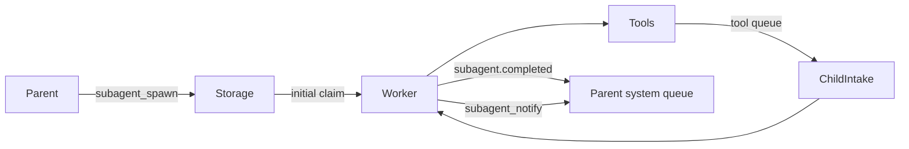

# Bounded subagents

Status: Implemented

## Overview

A personal agent can delegate a bounded assignment without blocking its own conversation. A child has an independent context, journal, tool batches and execution lease, owned by the same user. Children cannot delegate again. Completion and intermediate findings are durable events sent to the parent.

## Identity and execution

`user_id` remains the account/authorization identity. Optional `agent_id` selects a delegated execution. The storage partition is internal and cannot be supplied by business clients as a user ID. Public APIs always authenticate the owner. Tools receive the real owner plus the optional agent ID; the worker pool and tool engine are reused, without permanent child threads.

Only tool results can enter a child's queue after initial admission. User/system events, periodic invoke and permission controls are never routed to it. A child starts with a copied assignment and explicit success criteria, not the parent's conversation. User-context KV may be copied as a point-in-time snapshot for authorized application tools.

## Boundaries

Each child has a deadline, step budget, output bound and optional model choice from the configured allowlist. A completed response without tool calls ends execution. Failure, exhausted budget, cancellation or deadline ends it with a reason. Children never wait for new user input: unresolved ambiguity must be reported as a blocker. Delegation and task-management tools are denied in both model definitions and server policy for children.

`subagent_notify` produces `subagent.progress` in the parent's system queue; the final notification is `subagent.completed`. Both carry agent ID, title, state and bounded content. IDs make retries idempotent. Parent interruption, disconnect or restart does not discard these events.

## Durability and cancellation

Creation and initial wake are one Storage transaction. Existing Manager leases fence child execution just as root execution. Final state and parent event are committed together. Supervisor expires overdue children without an LLM call. Cancellation invalidates further Brain commits; already started external effects cannot be rolled back and are not automatically repeated. Tool terminal facts remain durable but cannot restart a finished child.

Query/list/cancel APIs enforce owner identity. Completed records and findings remain queryable. Context input excludes any pending parent buffers. First release does not implement child-to-child messaging or interactive child approval; a child requiring approval receives a denial and reports the blocker.

## Public contract

Authenticated Biz endpoints: `POST /subagents/{spawn,list,get,cancel}`. Owner comes from credentials.
Spawn takes request_id, title, objective, success_criteria and optional model/max_steps/timeout_seconds.
Get accepts agent_id or the original request_id. List is limited to 100 recent executions.
The inherited model selection and user-context KV are snapshots; history is never copied.

Default bounds: 40 steps, 15 minutes; configurable per spawn up to 100 steps / 1 hour.
At most eight running children per user; 100 findings of up to 4,000 characters; final text up to 16,000.
With two or more Workers, one slot accepts only main-Agent work, preserving responsiveness during delegation.
The initial tool-kind admission is inserted with the execution record; only genuine tool terminals continue it.
Cancellation marks the run durably so queued tools cannot start; an already running external effect may finish.

`subagent.progress` carries agent_id/title/note_id/content; `subagent.completed` carries
agent_id/title/status/result. These are semantic system inputs to the parent. `subagent.status`
is the corresponding client event. Parent notification and terminal state are committed together.

`POST /events` admits application semantic events into the authenticated owner's system queue.
It requires event_id, a type under `app.*`, and an object payload. It cannot issue runtime controls.
Applications can schedule work without storing a user's login credential; the configured external
identity provider may issue its own short-lived service credentials through the ordinary auth contract.

Storage partitions use an internal `user_id:agent_id` key for children. It is never accepted as a public
user_id or account. Runtime adapters preserve that target across leases, tool results, journals and CLI.
Application extensions always receive the real owner user_id and optional agent_id.

Extensions can declare `Tool.allow_subagent = False`. The registry filters child definitions and
the tool admission path rejects the same tools even when a model fabricates their names.
Application-specific tool names are not encoded in Oath core.

A final response without new calls terminates only after every earlier tool result has entered
the child's context. A batch-timeout reminder does not end a child that is still waiting for
work. Late results resume it normally. Approval-requiring tools are denied for children;
they cannot wait for user/system intervention. Deadline and budget remain the final bounds.
