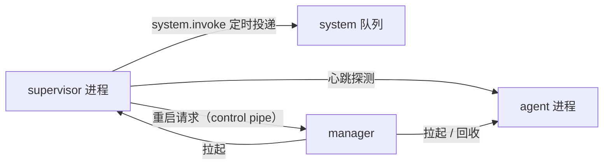

# Feature — Supervisor

状态：Implemented

## 1 总览

**每个 scope 一个 supervisor 进程。** 它站在那个 scope 的 agent 之外：观察它，判断现在
需不需要干预，需要就往队列里投事件。**干预的形式只有投事件这一种** —— 它不碰 agent 的
执行本身，也不替它做决定。

心跳探测与周期唤醒是**目前落地的两项能力，不是这个定位的全部**。这个定位说的是「谁站在
agent 外面判断」，不是「现在这两个定时器」。

规则：

1. **目前它不读 journal、不发输入、不看连接数。** 这是当前实现的边界，不是这个角色的
   边界。语义干预只有投事件这一种形式。
2. **`system.invoke` 是一个事件，不是一次调用。** 没有 invoke 接口，也没有进程需要
   保持在线才能被 invoke —— 队列本来就是异步的。
3. **这条事件不进 buffer，也不进模型上下文。** 它只是把 Brain 叫醒一趟。空 buffer
   不产生 step、不调用模型。
4. **它不重启自己。** supervisor 自己没了由 manager 换一个新的；agent 没了由 supervisor
   请 manager 重启 —— 两条路分开，谁都只有一个负责人。manager 换 supervisor 时只换
   supervisor：agent 那一个主人是 supervisor，manager 越过它去动就是两个主人。
5. **心跳证明的是进程，不是健康。** `/heartbeat` 走完真实的 accept 循环，回一帧连接数
   就断；它答得出「agent 还在接受连接」，答不出消费线程与 Brain 是否还活着。

## 2 两级干预的分工

| 谁 | 做什么 | 不做什么 |
| --- | --- | --- |
| supervisor | 定时强制唤醒；探测 agent 存活；请 manager 重启 agent | 不查连接数、不回收 scope、不碰 journal |
| manager | 拉起进程；分配端口；按连接数回收 scope；换掉死掉的 supervisor | 不探测 agent 存活、不投递事件 |

拆成两个是因为它们的判据不同：**agent 死没死看心跳，scope 还有没有人用看连接数。**
前者错了会让推理停住，后者错了只是白跑几个进程。

## 3 心跳与重启

心跳走 agent 的 `/heartbeat`，**必须经过 server 的处理循环** —— 旁路线程报活着证明不了
accept 还通。帧里带当前在线连接数，manager 收连接数用的是同一条路径，不另开一个旁路。

连续失败达到 `heartbeat_failures_before_restart` 次后，按指数退避往 manager 的 control
pipe 写一条重启请求。**退避在 supervisor 里，不在 manager 里** —— 请求发出去了 manager 就
该照做，节流的是这个请求的发出频率。

agent 还活着就不理这条请求：它自己比谁都清楚。重启失败继续退避，到 `restart_failure_limit`
次冷却一轮。启动和重启都有恢复等待时间，避免 journal 恢复期间被反复杀掉。

control pipe 是 manager → supervisor 的**单向**通道，只承载重启请求。它不传事件、context、
trace、CLI 或模型调用。

## 4 system.invoke 的效果

supervisor 投出去的 `Inbound(kind=system, source="system.invoke")` 被 system consumer 收到，
**不 add 到 buffer**，只置一个强制唤醒标记并叫醒 Brain。Brain 之后做的事与普通唤醒完全
一样：看 buffer 有没有东西。

invoke 可以提前结束 tool batch 的等待；尚未完成的工具补 reminder，真实结果到达后仍按
迟到结果的规则处理。ToolConsumer 自己的判断规则不变。

投递失败就是队列不可用 —— 异常抛出去，周期任务退避，不假装投成功了。

## 5 回收只看 WS

manager 每 `reap_interval_seconds` 探一次每个 agent 的连接数。**探不到与「0 条」是两件事**：
前者说明 agent 不在了，那是 supervisor 的活，manager 不抢；后者才进回收判断。

连接数连续为 0 且过了 `idle_grace_seconds`，就优雅停掉这个 scope 的两个进程。目录留在
原地 —— journal 与 buffer 都是重启能读的东西，下次有人来 `create_session` 同一个 session
就接着跑。

冷却期给重连留一段窗口：客户端断开重连是常事，立刻回收等于每次断线都丢一次 session。

## 6 失败与恢复

- invoke 丢失：下一轮检查。持久化输入和已认领 step 不受影响。
- agent 重启：由 journal 与 buffer 恢复；在飞的工具一律报 `outcome_unknown`，不重跑。
- supervisor 重启：manager 发现它不在了就换一个，不重放停机期间 tick。
- manager 重启：session 表没了，已存在的 scope 不会自愈 —— manager 是唯一知道进程组的
  地方。多机共享同一个 scope 的机制后续建设。
- 永久卡住的周期任务：不叠加新线程；其他任务照常，manager 换掉整个 supervisor 进程。
