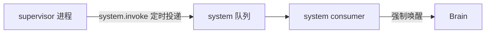

# Feature — Supervisor

状态：Implemented

## 1 总览

**每个 scope 一个 supervisor 进程。** 它站在那个 scope 的 agent 之外：观察它，判断现在
需不需要干预，需要就往队列里投事件。**干预的形式只有投事件这一种** —— 它不碰 agent 的
执行本身，也不替它做决定。

周期唤醒是**目前落地的唯一能力，不是这个定位的全部**。这个定位说的是「谁站在 agent 外面
判断」，不是「现在这一个定时器」。

规则：

1. **目前它不读 journal、不发输入、不看连接数、不看 agent 的存活。** 这是当前实现的边界，
   不是这个角色的边界。语义干预只有投事件这一种形式。
2. **`system.invoke` 是一个事件，不是一次调用。** 没有 invoke 接口，也没有进程需要
   保持在线才能被 invoke —— 队列本来就是异步的。
3. **这条事件不进 buffer，也不进模型上下文。** 它只是把 Brain 叫醒一趟。空 buffer
   不产生 step、不调用模型。
4. **投递失败不吞。** 队列不可用就让它抛出去，`Periodic` 退避重试 —— 假装投成功了等于
   静默丢掉这次唤醒。

## 2 system.invoke 的效果

supervisor 投出去的 `Inbound(kind=system, source="system.invoke")` 被 system consumer 收到，
**不 add 到 buffer**，只置一个强制唤醒标记并叫醒 Brain。Brain 之后做的事与普通唤醒完全
一样：看 buffer 有没有东西。

invoke 可以提前结束 tool batch 的等待；尚未完成的工具补 reminder，真实结果到达后仍按
迟到结果的规则处理。ToolConsumer 自己的判断规则不变。

## 3 失败与恢复

- invoke 丢失：下一轮检查。持久化输入和已认领 step 不受影响。
- 队列不可用：`Periodic` 退避后重投，中间的空档就是这一段没有强制唤醒。
- supervisor 退出：manager 下一轮发现它不在了，换一个新的，不重放停机期间 tick。
- **agent 崩了没有人拉起它。** supervisor 不看存活，manager 也不重启。回收只看连接数，
  而探不到的 agent 不是「0 条连接」—— 那个 scope 会一直空着，直到 biz 退出。
