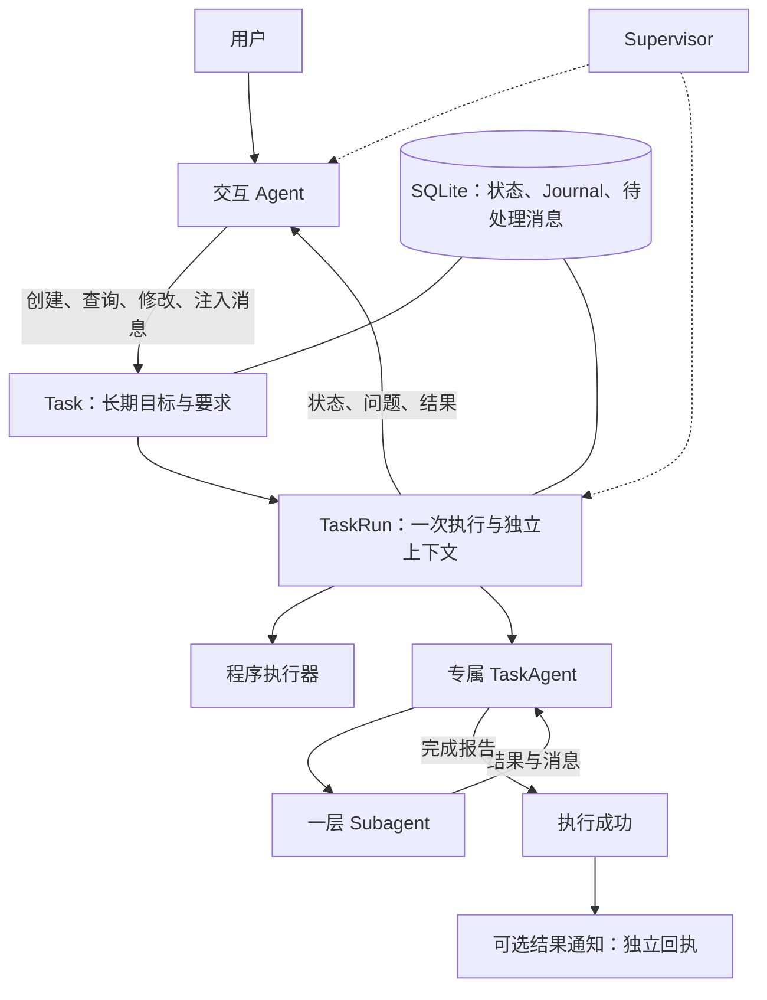
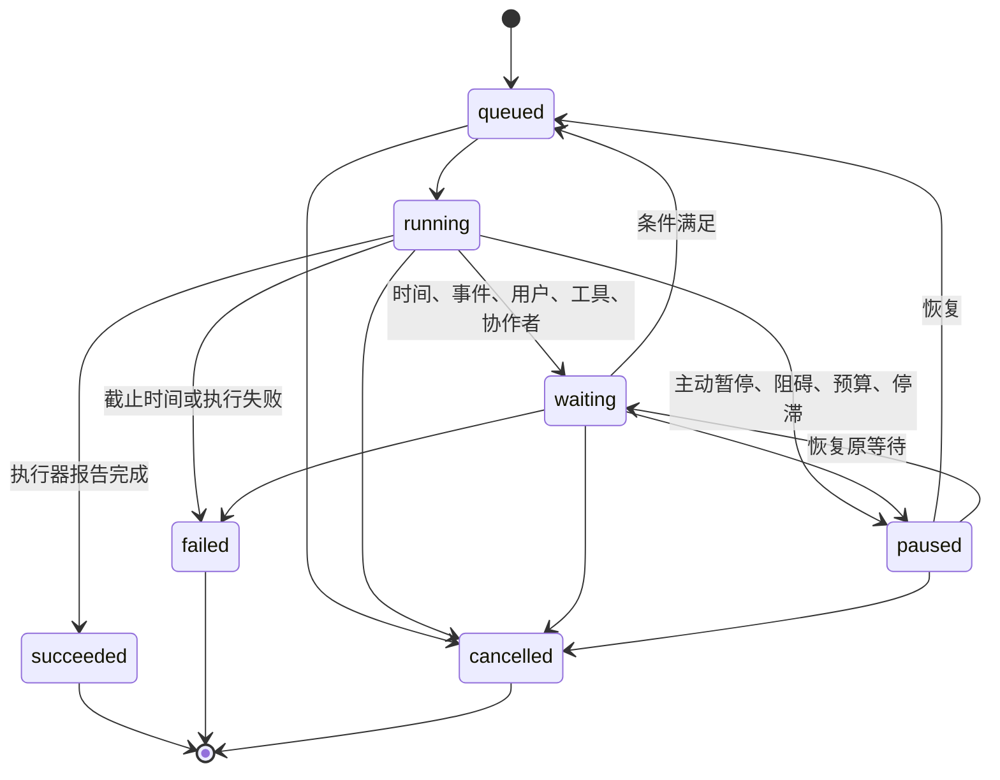
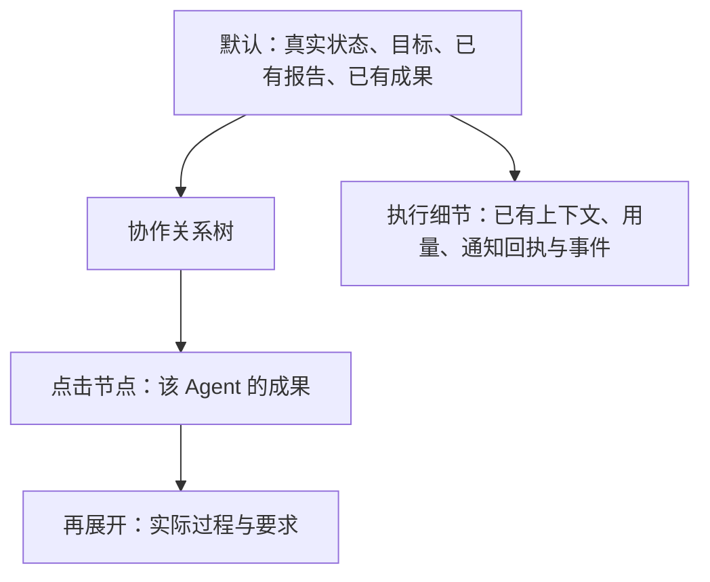

# Oath Task System：设计与实现

更新：2026-11-18。开发分支：`feature/task-system`。本文描述当前实现；取代此前强制验收和四阶段流程方案。唯一设计文档，机器接口以 `core/tasks/contracts.json` 为准。

## 1. 背景、目标与总览

Hymio 移除应用生成/运行功能，集中于个人 Agent 的持续工作。Oath 统一负责任务、执行和恢复；Hymio 负责会话、独立任务面板及通知接收。Nostalgia 的记忆服务保持既有边界。

**核心：交互 Agent 创建任务，程序或专属 Oath Agent 在后台执行，Supervisor 根据持久状态唤醒与恢复。任务完成由执行器报告；通知单独记录，不是通用审批流程。**



| 实体 | 职责与边界 |
|---|---|
| InteractionAgent | 交互与任务管理。即时问题直接回答；未来、长时间或适合独立推进的工作才创建任务。不等待后台任务完成。 |
| Task | 长期目标、完成标准、触发规则、上下文、权限、总预算、长期笔记及版本。周期任务完成一期后仍然有效。 |
| TaskRun | 某次执行的要求快照、检查点、等待条件、用量、结果和错误。同次执行睡眠后继续；新周期建立新 Run。 |
| TaskAgent | 一个 Run 绑定一个专属 Core 上下文。接收实际初始资料、已保存的工作历史和后续消息。负责自己的完成判断及协作结果整合。 |
| Subagent | TaskAgent 委派的有限协作。只能服务所属 TaskAgent，不能再委派、创建 Task 或报告父任务完成。继承任务权限，消耗同一 Run 的预算。 |
| ProgramExecutor | 确定动作，当前内置 `notify`，不调用模型。新增程序动作必须显式实现，不能把任意自然语言当作规则执行。 |
| Supervisor | 程序检查待处理输入、触发时间、等待条件、执行租约、预算和停滞。恢复过期租约、唤醒符合条件的工作；不轮询模型。 |
| TaskMessage / Journal | 持久消息与审计。不能用进程内回调替代恢复依据。 |

三种 Agent 共用 Oath Core；差别是角色 prompt、上下文、工具和执行边界。身份保持根账户下的独立 ID，不通过嵌套字符串扩大权限。

## 2. 执行、等待、完成与通知

### 2.1 一次复杂任务

1. 主 Agent 用 `task_create` 持久创建 Task，立即告知用户可在任务面板查看。
2. Supervisor 到期建立 Run，绑定专属 TaskAgent，注入目标、完成标准、资料、计划和长期笔记。
3. TaskAgent 自己推进，或委派一层 Subagent；等待时明确报告 `wait`，不持续占用模型。
4. 协作者结果先进入所属 TaskAgent 的持久收件箱。Supervisor 满足等待条件后继续同一个 Run。
5. TaskAgent 按目标完成所需检查，报告 `complete`。系统校验身份、状态、权限、版本及结构，在同一事务内将 Run 和专属 TaskAgent 标为成功，停止该上下文继续执行。Supervisor 也会修复旧版本中 Run 已成功但 Agent 仍显示运行的记录，不重复通知。
6. 如配置结果通知，在同一事务内创建通知记录；发送和回执独立推进。主会话收到完成事件，不需要再审批一次。

### 2.2 状态机

Task 的生命周期为 `active / paused / closed`。Run 的状态如下，不能把它们混同为四个固定工作阶段。



已完成 Run 不因附带通知缺少回执而回到等待或失败。失败重试创建新 Run，保留原执行、错误和预算记录；不能把外部效果未知直接当作未执行重跑。

### 2.3 完成判断的边界

- **不再提供通用 `task_review` 工具，不再有强制返回主 Agent 的验收门槛。** `acceptance` 仅保留 `criteria`。
- 内容是否符合目标，由执行器负责判断。系统不会把结构校验宣传成内容正确性验证。
- 任务要求测试、核对数据、运行检查时，TaskAgent 使用实际工具执行并记录真实结果；没有自动识别所有任务正确性的统一验证器。
- 需要用户决定时，TaskAgent 显式报告 `wait.kind=user` 和实际问题，用户回复经主 Agent 注入，再继续执行。
- 进展、下一步和依据来自 Agent 的结构化报告；没有独立的“从任意历史自动提取语义”服务。可选字段未知就省略，不能为 UI 填补文案。

### 2.4 通知与提醒的区别

| 场景 | 成功条件 |
|---|---|
| 分析/研究任务，附带通知 | TaskAgent 报告完成即执行成功；通知 `pending/inflight/accepted/unknown/failed/cancelled` 独立记录。 |
| 程序提醒，任务目的就是通知 | 持久接收端确认接收才是该程序动作成功。不调用模型，也不经过主 Agent 验收。 |

`notify.mode`：`result / changes` 在完成时排入结果通知；`attention / none` 不排入完成通知。当前 `changes` 不代表已经实现对所有中间变化的语义筛选。

`accepted` 仅说明 Hymio 已持久保存结果并提供回执，不代表设备已经收到、用户已读或已经服药。回执未知时先对账，避免盲目重复通知。

## 3. 目标、上下文与长期跟进

- Task 保存目标、计划与跨周期笔记；Run 保存本次要求快照、Core 上下文、检查点和结果。
- 交互 Agent 不把整个主会话复制给 TaskAgent。任务通过明确资料和引用建立初始上下文；委派叶子时也必须交给实际输入，不能只给一个不可读取的资料名。
- TaskAgent 的真实输入、模型调用、工具与后续消息进入 Core journal。同次执行恢复原上下文；下一周期读取 Task 长期笔记，建立新上下文。
- `task_message` 是补充输入，不是“下一步”摘要。运行中不替换活动租约；暂停期间保存至恢复；尚未启动或上一期结束时，绑定下一次执行，用 `message_bound` 记录避免重复交接。
- 永久调整目标、资料或计划使用 `task_update`。影响当前执行时采用暂停、等待工具结算、更新、恢复，避免旧动作继续按新要求执行。
- Supervisor 当前的目标跟进是检查点、等待、超时、预算及消息机制；尚无独立模型自动理解长期目标并评判进展。需要语义调整时由 TaskAgent 或交互 Agent 处理。

## 4. 存储、事务与恢复

**SQLite，由 Storage Service 统一写入，WAL + FULL synchronous + 外键 + 事务。** 复用 Core 的上下文、journal、租约、调度、工具幂等和 outbox。

| 表 | 关键数据与约束 |
|---|---|
| tasks | owner、目标、规则、context/plan/policy JSON、长期笔记、生命周期、revision、下次触发时间；用户级 intent_key 去重。 |
| task_runs | Task 外键、独立 run_id/context_id/agent_id、要求快照、状态、检查点、等待、用量、结果、错误、控制 epoch；周期执行各自留存。 |
| task_delegations | Run、父 TaskAgent、叶子 Agent 的关系，active/paused/closed；禁止跨任务管理和再次委派。 |
| task_signals | 来源、事件 ID、关联键及 payload；事件早于等待到达时也保留，按水位和消费记录去重。 |
| task_events | Task/Run 事件、版本、payload、时间及幂等键；消息绑定与信号消费可追溯。 |
| task_requests | 请求指纹与已保存响应；同 key 同参数重放，不同参数冲突。 |
| task_deliveries | 通知 payload、状态、租约、尝试次数、回执及去重键；允许已完成任务继续发送其结果通知。 |
| 已有 Core 表 | users/steps、journal_events、inbox_events、broker_outbox、leases、scheduling、工具记录等，负责执行恢复。 |

`task.event` journal 字段为 `task_id / run_id / kind / revision / data / state`；state 记录提交后的生命周期、Run 状态与版本。任务事件、状态和内部待处理消息在同一事务内提交。恢复依靠持久投影、消息、幂等记录和租约，不依赖内存；不会每次启动重放整个数据库。

暂停、恢复、取消按所属关系级联到协作者。模型步数、token 用量与执行时间计入所属 Run，叶子不能绕开同一预算；等待时间不当作活跃模型时间。金额上限没有价格配置，非空金额限制会被拒绝。

<details>
<summary>完整任务表 DDL（基础六表与协作关系表）</summary>

部分原有列如 `stage / next_review_at` 保留作数据库兼容；不再作为现行 API/UI 的工作阶段或验收机制。新 Run 的语义检查点默认为空对象。

```sql
-- 增量表；依赖 Oath 现有 users / subagents 表。
CREATE TABLE tasks (
  task_id TEXT PRIMARY KEY,
  user_id TEXT NOT NULL REFERENCES users(user_id),
  intent_key TEXT NOT NULL,
  parent_task_id TEXT,
  paused_by_task_id TEXT,
  revision INTEGER NOT NULL DEFAULT 1 CHECK(revision > 0),
  lifecycle TEXT NOT NULL CHECK(lifecycle IN ('active','paused','closed')),
  close_reason TEXT CHECK(close_reason IN ('achieved','cancelled','expired')),
  title TEXT NOT NULL,
  objective TEXT NOT NULL,
  completion TEXT NOT NULL CHECK(completion IN ('achieve','maintain')),
  acceptance_json TEXT NOT NULL CHECK(json_valid(acceptance_json)),
  plan_json TEXT NOT NULL DEFAULT '[]' CHECK(json_valid(plan_json)),
  context_seed_json TEXT NOT NULL CHECK(json_valid(context_seed_json)),
  trigger_json TEXT NOT NULL CHECK(json_valid(trigger_json)),
  executor_json TEXT NOT NULL CHECK(json_valid(executor_json)),
  policy_json TEXT NOT NULL CHECK(json_valid(policy_json)),
  memory_json TEXT NOT NULL DEFAULT '{"summary":"","refs":[]}' CHECK(json_valid(memory_json)),
  needs_attention INTEGER NOT NULL DEFAULT 0 CHECK(needs_attention IN (0,1)),
  next_due_at REAL,
  next_review_at REAL,
  event_cursor INTEGER NOT NULL DEFAULT 0,
  created_at REAL NOT NULL,
  updated_at REAL NOT NULL,
  UNIQUE(user_id, task_id), UNIQUE(user_id, intent_key),
  FOREIGN KEY(user_id, parent_task_id) REFERENCES tasks(user_id, task_id),
  FOREIGN KEY(user_id, paused_by_task_id) REFERENCES tasks(user_id, task_id),
  CHECK(parent_task_id IS NULL OR parent_task_id != task_id),
  CHECK((lifecycle = 'closed') = (close_reason IS NOT NULL)),
  CHECK((lifecycle = 'paused') = (paused_by_task_id IS NOT NULL))
);
CREATE INDEX tasks_owner ON tasks(user_id, lifecycle, updated_at DESC, task_id);
CREATE INDEX tasks_due ON tasks(next_due_at) WHERE lifecycle = 'active';
CREATE INDEX tasks_review ON tasks(next_review_at) WHERE lifecycle = 'active';
CREATE INDEX tasks_parent ON tasks(user_id, parent_task_id);
CREATE INDEX tasks_trigger ON tasks(user_id,
  json_extract(trigger_json, '$.source'), json_extract(trigger_json, '$.key'));

CREATE TABLE task_runs (
  run_id TEXT PRIMARY KEY,
  user_id TEXT NOT NULL,
  task_id TEXT NOT NULL,
  task_revision INTEGER NOT NULL,
  spec_snapshot_json TEXT NOT NULL CHECK(json_valid(spec_snapshot_json)),
  occurrence_key TEXT NOT NULL,
  retry_of_run_id TEXT,
  status TEXT NOT NULL CHECK(status IN
    ('queued','running','waiting','paused','succeeded','failed','cancelled')),
  stage TEXT NOT NULL DEFAULT 'execute' CHECK(stage IN ('execute','verify','deliver')),
  version INTEGER NOT NULL DEFAULT 1 CHECK(version > 0),
  control_epoch INTEGER NOT NULL DEFAULT 1 CHECK(control_epoch > 0),
  agent_id TEXT REFERENCES subagents(agent_id),
  context_id TEXT REFERENCES users(user_id),
  progress_json TEXT NOT NULL DEFAULT '{}' CHECK(json_valid(progress_json)),
  wait_json TEXT CHECK(wait_json IS NULL OR json_valid(wait_json)),
  resume_status TEXT CHECK(resume_status IN ('queued','running','waiting')),
  pending_revision INTEGER,
  pending_spec_json TEXT CHECK(pending_spec_json IS NULL OR json_valid(pending_spec_json)),
  result_json TEXT CHECK(result_json IS NULL OR json_valid(result_json)),
  error_json TEXT CHECK(error_json IS NULL OR json_valid(error_json)),
  worker_state_json TEXT NOT NULL DEFAULT '{}' CHECK(json_valid(worker_state_json)),
  usage_json TEXT NOT NULL DEFAULT '{"steps":0,"tokens":0,"active_seconds":0,"cost_microusd":0}' CHECK(json_valid(usage_json)),
  reserved_usage_json TEXT NOT NULL DEFAULT '{"steps":0,"tokens":0,"active_seconds":0,"cost_microusd":0}' CHECK(json_valid(reserved_usage_json)),
  signal_floor INTEGER NOT NULL DEFAULT 0,
  due_at REAL NOT NULL,
  next_check_at REAL,
  deadline_at REAL,
  last_progress_at REAL,
  lease_owner TEXT,
  lease_token INTEGER NOT NULL DEFAULT 0,
  lease_until REAL NOT NULL DEFAULT 0,
  created_at REAL NOT NULL,
  started_at REAL,
  finished_at REAL,
  UNIQUE(user_id, run_id), UNIQUE(user_id, task_id, run_id),
  UNIQUE(task_id, occurrence_key),
  FOREIGN KEY(user_id, task_id) REFERENCES tasks(user_id, task_id),
  FOREIGN KEY(user_id, task_id, retry_of_run_id)
    REFERENCES task_runs(user_id, task_id, run_id),
  CHECK((pending_revision IS NULL) = (pending_spec_json IS NULL)),
  CHECK(status != 'waiting' OR wait_json IS NOT NULL),
  CHECK((status IN ('succeeded','failed','cancelled')) = (finished_at IS NOT NULL)),
  CHECK((agent_id IS NULL) = (context_id IS NULL))
);
CREATE UNIQUE INDEX task_one_open_run ON task_runs(task_id)
  WHERE status IN ('queued','running','waiting','paused');
CREATE UNIQUE INDEX task_run_context ON task_runs(context_id) WHERE context_id IS NOT NULL;
CREATE INDEX task_runs_owner ON task_runs(user_id, task_id, created_at DESC, run_id);
CREATE INDEX task_runs_ready ON task_runs(status, due_at, lease_until);
CREATE INDEX task_runs_check ON task_runs(next_check_at)
  WHERE status IN ('queued','running','waiting');
CREATE INDEX task_runs_lease ON task_runs(lease_until) WHERE status = 'running';

CREATE TABLE task_signals (
  signal_id INTEGER PRIMARY KEY AUTOINCREMENT,
  user_id TEXT NOT NULL REFERENCES users(user_id),
  source TEXT NOT NULL,
  event_key TEXT NOT NULL,
  correlation_key TEXT NOT NULL,
  payload_json TEXT NOT NULL CHECK(json_valid(payload_json)),
  occurred_at REAL NOT NULL,
  received_at REAL NOT NULL,
  UNIQUE(user_id, signal_id), UNIQUE(user_id, source, event_key)
);
CREATE INDEX task_signals_match ON task_signals(user_id, source, correlation_key, signal_id);

CREATE TABLE task_events (
  event_id INTEGER PRIMARY KEY AUTOINCREMENT,
  user_id TEXT NOT NULL,
  task_id TEXT NOT NULL,
  run_id TEXT,
  signal_id INTEGER,
  event_key TEXT NOT NULL,
  type TEXT NOT NULL,
  task_revision INTEGER NOT NULL,
  run_version INTEGER,
  payload_json TEXT NOT NULL CHECK(json_valid(payload_json)),
  created_at REAL NOT NULL,
  UNIQUE(user_id, event_key), UNIQUE(run_id, signal_id),
  FOREIGN KEY(user_id, task_id) REFERENCES tasks(user_id, task_id),
  FOREIGN KEY(user_id, task_id, run_id) REFERENCES task_runs(user_id, task_id, run_id),
  FOREIGN KEY(user_id, signal_id) REFERENCES task_signals(user_id, signal_id)
);
CREATE INDEX task_events_history ON task_events(user_id, task_id, event_id);
CREATE INDEX task_events_usage ON task_events(user_id, type, created_at);

CREATE TABLE task_requests (
  user_id TEXT NOT NULL REFERENCES users(user_id),
  request_id TEXT NOT NULL,
  operation TEXT NOT NULL,
  fingerprint TEXT NOT NULL,
  response_json TEXT NOT NULL CHECK(json_valid(response_json)),
  created_at REAL NOT NULL,
  PRIMARY KEY(user_id, request_id)
);

CREATE TABLE task_deliveries (
  delivery_id TEXT PRIMARY KEY,
  user_id TEXT NOT NULL,
  task_id TEXT NOT NULL,
  run_id TEXT NOT NULL,
  dedupe_key TEXT NOT NULL,
  purpose TEXT NOT NULL,
  destination_ref TEXT NOT NULL,
  payload_json TEXT NOT NULL CHECK(json_valid(payload_json)),
  status TEXT NOT NULL CHECK(status IN
    ('pending','inflight','accepted','unknown','failed','cancelled')),
  attempt_count INTEGER NOT NULL DEFAULT 0,
  next_attempt_at REAL,
  lease_owner TEXT,
  lease_token INTEGER NOT NULL DEFAULT 0,
  lease_until REAL NOT NULL DEFAULT 0,
  receipt_json TEXT CHECK(receipt_json IS NULL OR json_valid(receipt_json)),
  created_at REAL NOT NULL,
  accepted_at REAL,
  UNIQUE(user_id, dedupe_key),
  FOREIGN KEY(user_id, task_id, run_id) REFERENCES task_runs(user_id, task_id, run_id)
);
CREATE INDEX task_deliveries_ready ON task_deliveries(status, next_attempt_at, lease_until);

CREATE TABLE task_delegations (
  user_id TEXT NOT NULL,
  task_id TEXT NOT NULL,
  run_id TEXT NOT NULL,
  parent_agent_id TEXT NOT NULL REFERENCES subagents(agent_id),
  agent_id TEXT PRIMARY KEY REFERENCES subagents(agent_id),
  state TEXT NOT NULL DEFAULT 'active' CHECK(state IN ('active','paused','closed')),
  created_at REAL NOT NULL,
  FOREIGN KEY(user_id,task_id,run_id) REFERENCES task_runs(user_id,task_id,run_id)
);
CREATE INDEX task_delegations_parent ON task_delegations(parent_agent_id,created_at);
CREATE INDEX task_delegations_run ON task_delegations(run_id);
```

</details>

实现位置：`core/tasks/{storage,entities,delegation,inbox,inspection,budget,migrations}.py`、`core/storage/{database,scheduling,runtime_transactions}.py`。

## 5. 工具 API 与实际 schema

工具与 Storage 共用 `core/tasks/contracts.json`，由 `schema.py` 为服务端保留规范定义、为模型展开具体参数字段；服务端再次校验，不相信模型一定遵守 schema。owner 来自身份，模型不能传入别人的 user_id。

| 工具 | 主要参数与效果 |
|---|---|
| task_create | request_id、intent_key、title、objective、completion、acceptance.criteria、trigger、executor、context、plan、policy；立即返回 Task/Run 信息。 |
| task_list | 生命周期、query、needs_attention、limit、cursor；分页只在当前 owner 范围。内部程序标志不包装成 UI 的语义标签。 |
| task_get | task_id、view=detail/run/runs/events、可选 run_id/cursor、include_execution；查询定义、当前执行、历史或事件。 |
| task_update | task_id、expected_revision、patch、apply_to=future/current_and_future、reason；检查版本和旧工具结算。 |
| task_message | task_id、expected_revision、content、refs、可选 run_id/reply_to；持久输入，回复问题时沿用问题 ID。 |
| task_pause/resume/cancel | task_id、expected_revision、reason；控制未来执行与所属协作者。 |
| task_retry | failed_run_id、task_id、expected_revision、reason；确认先前效果后重试，保留历史。 |
| task_report | 仅绑定该 Run 的 TaskAgent 可调用；decision=continue/wait/complete/blocked，checkpoint 可选；完成须带 result，等待须带 wait。 |

TaskAgent 的 `subagent_spawn/list/get/continue/cancel` 仅管理所属叶子；叶子只可用 `subagent_notify` 回传实际发现，不能报告整个 Task 完成。检查在工具暴露、准入与执行时共同生效。

完成报告示例（没有实际进展摘要或引用时不强迫编造）：

```json
{
  "decision": "complete",
  "result": {
    "summary": "2 + 2 = 4",
    "refs": [],
    "evidence": []
  }
}
```

等待协作者示例：

```json
{
  "decision": "wait",
  "wait": {
    "kind": "subagents",
    "reason": "等待指定协作者返回",
    "agent_ids": ["0123456789abcdef0123456789abcdef"]
  }
}
```

这些只是契约示例，不是实际任务数据。`continue` 必须有实际计划的 `checkpoint.next_step`，不能拿空报告作为心跳绕过停滞检查。

`task_get` 的 `execution` 返回执行器、TaskAgent、叶子、真实检查点、等待、用量、计划和最近事件；默认每节点最多 40 条活动、最近 50 条事件，完整事件走分页接口。列表调用 `include_execution=false`，选中详情才加载活动图。未发生的数据不补出语义或时间。

HTTP：Oath `/tasks/{list,get,pause,resume,cancel}` 供 Hymio 访问，写入要求幂等键；主 Agent 工具走内部 Storage。Hymio `/tasks` 只支持列表、详情与暂停/恢复/取消，不开放主动创建 GUI。

## 6. Hymio 展示与数据来源



- 不展示“需要关注”，不展示固定安排/执行/验收/交付阶段图。
- UI 不从用户消息、等待原因、工具状态推导“下一步”。语义进展只来自 Agent 的真实结构化报告。
- 成功后的旧检查点不再当作当前进展展示；结果与通知状态分开。
- 没有数据时不补“0 步”、当前时间、默认执行者类型或“已完成比较”等文案；可选信息省略，没有任务数据就显示空态。
- 依据是 Agent 提供的引用，不做“系统已验证”的徽章。通知状态在执行细节内逐级展开。
- 移除硬编码徒步任务预览。调试入口 `-HymioTaskPreview` 只读取显式传入的 `HYMIO_TASK_REVIEW_JSON`；未提供则空态。UI 测试夹具仅用于测试，不作为真实执行展示。
- Web 和 iOS 使用同一 Hymio 数据适配；Task 已关闭与 Run 本轮完成分开，周期任务下一次安排继续可见。

## 7. 升级、验证与边界

### 升级

数据库当前 **v4**。v1/v2 先补齐任务表与协作关系；v3→v4 移除定义和快照中的 `acceptance.review/require_delivery`，清除未报告过的默认进展，规范缓存响应。

已经报告完成但被旧自动验收/通知阶段挂住的 Agent Run，由 Supervisor 继续完成并按原去重键保留通知。原配置明确要求用户决定的任务保留真实 user wait 和问题 ID，不悄悄批准用户决定。程序提醒的持久接收确认继续保留。

旧 Hymio 任务离线导入工具仍默认 dry-run，显式导入后暂停并保留历史；不在升级时重放未知外部动作。未修改生产数据。

### 验证（2026-11-18）

| 验证 | 实际覆盖 |
|---|---|
| Oath 回归 | 328 项通过；新增直接完成、无语义字段、通知未知不回滚、关闭任务继续通知、关闭通知、周期完成、v3 结果恢复及保留用户决定。 |
| 跨仓库 HTTP | 实际 Hymio 路由 + Oath Storage；完成先于通知确认、详情协作树、列表按需加载、回执与重启补确认。 |
| 真实多进程 | RabbitMQ、Storage、Queue、Manager、Worker、Tools、Gateway、Biz：9 个场景通过；含委派、睡眠/唤醒、完成与独立通知、worker 崩溃、Storage 重启、旧租约拒绝。 |
| DeepSeek | 实际模型调用通过；即时问题不建任务，后台提醒自主创建，Agent 委派与等待后直接完成，不再调用 review。测试由程序驱动工具步骤；多进程运行循环独立使用确定模型验证，不能据此宣称任意任务语义判断都已验证。 |
| Hymio | 后端 171 项通过、3 项跳过；Web 类型检查与构建。 |
| iOS | Xcode 构建与 4 项任务界面测试通过，覆盖空数据不编造、协作逐级展开、无通用验收标志及任务视图切换。 |

真实模型仅使用环境里的密钥，隔离数据库与接收端，不发送真实用户通知。可将该真实执行的 Hymio DTO 输出到仓库外，交给模拟器查看；不以写死的进展作为功能证据。

### 当前明确边界

- 程序执行器只有 `notify`；模型 profile 只有 `default` 继承。
- 没有统一内容正确性验证器或自动历史语义提取服务；目标判断和所需具体检查由 Agent 负责。
- 没有精确请求前 token/费用预留；tokens 使用已完成调用的实际用量检查。账户级统一费用预算未新增。
- 现有权限沿用原工具体系，没有新增子 Agent 独立审批转交卡。
- 分页不是跨页数据库快照；活动图是有边界的当前视图，完整执行事实保存在 journal 和分页历史中。
- 本文的实现结论来自代码和上述验证，不以产品类比推断闭源产品的内部机制。
