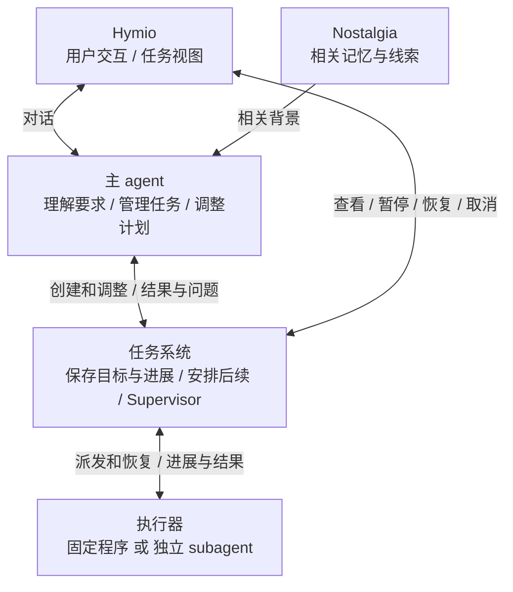
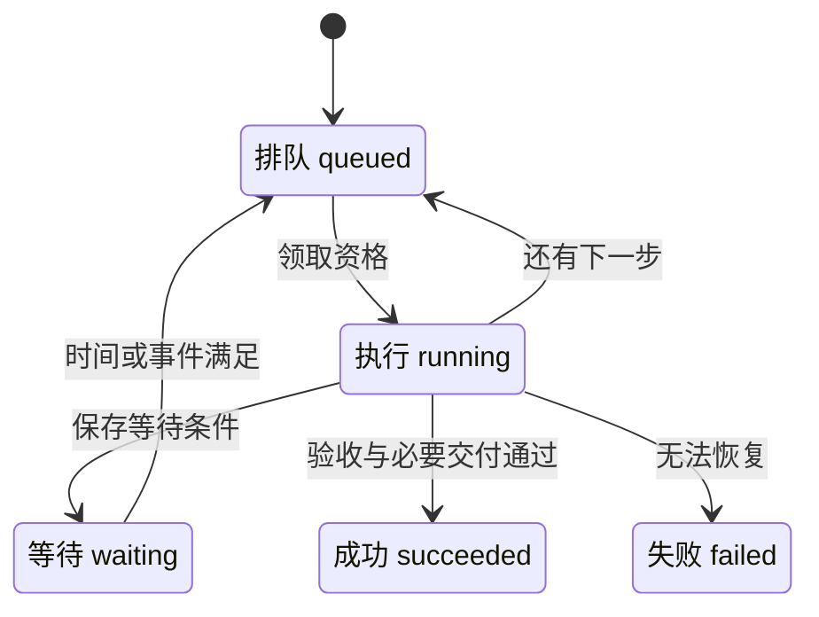
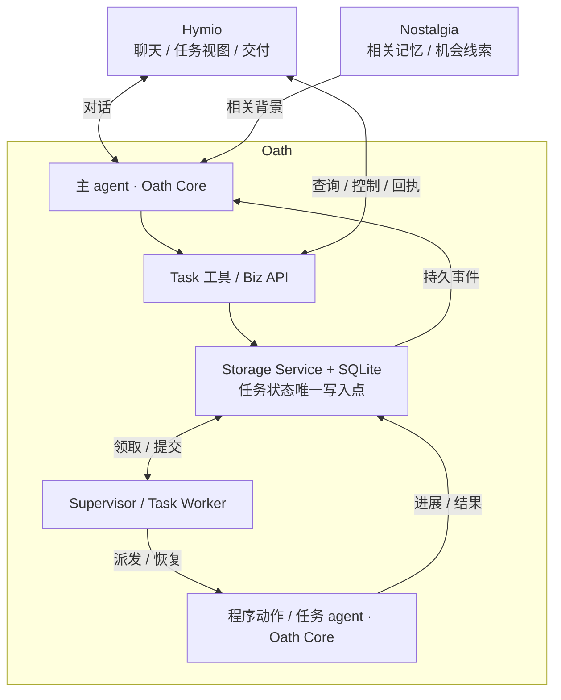
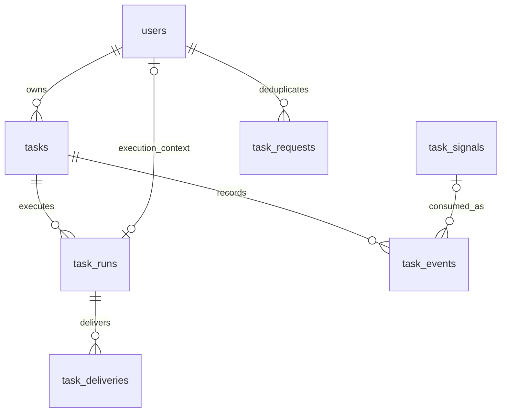

# Oath Task System：设计与实现方案

实现与验收中的技术方案。更新：2026-11-15。开发分支：`feature/task-system`；未修改生产数据。

**本次重构将“持续负责一件事”作为 Oath 的基础能力：主 agent 接受并管理任务，程序或 subagent 独立执行，Supervisor 按目标和状态持续跟进。Hymio 提供交互与结果展示，Nostalgia 提供相关记忆。**

文档分为两个层次：**第 1–4 节说明背景、目标和设计；第 5–9 节落实架构、数据库、接口、事务及迁移。** 完整 DDL 和 JSON Schema 保留在本文的可展开区块中，第 10 节列出调研依据。


## 实现状态与设计调整

背景、目标和总体设计见第 1–4 节，数据库与接口见第 5–9 节。完整 schema 仍在本文件内。

| 功能 | 当前实现 |
|---|---|
| 任务管理 | 创建、查询、分页、修改、补充、暂停、恢复、取消、失败重试；父子任务控制及版本冲突检查 |
| 执行与持续跟进 | 程序提醒、独立 Core 上下文、周期执行、时间/事件/用户/工具等待、进度停滞检查；主聊天保持可用 |
| 验收与交付 | `task_report` 报告结果，主 agent 用 `task_review` 校验；Hymio 保存交付收件箱与回执，重启后补确认 |
| 存储与迁移 | SQLite v1→v2 原子迁移；旧 Hymio 任务离线导入，默认暂停并保留历史，防止未知动作重跑 |
| 产品收敛 | Kits 服务、工具、技能、页面及部署移除；任务 GUI 保留查看与控制，创建/修改通过主 agent |

**测试后收敛的实现选择：**

- 程序动作当前内置 `notify`；Task Worker 的调度由现有 Supervisor/Storage 完成，模型执行复用现有 worker，不额外启动一套执行服务。
- 语义验收由主 agent 读取要求和证据后调用 `task_review`；时间、状态和程序通知回执由程序检查。`review=user` 须等待用户明确决定。
- 当前工作修改采用“暂停 → 等工具结算 → `current_and_future` 更新 → 恢复”，运行中直接修改返回明确状态错误；未来执行可直接修改。
- 额外权限沿用现有拒绝/授权规则：任务报告阻碍，主 agent 协调用户授权后恢复。尚未增加子 agent 独立审批卡的转交协议。
- `research_readonly` 只暴露读工具和有边界的 `task_fetch`；`default` 沿用既有权限体系。模型 profile 当前支持继承主 agent 的 `default`。
- steps、tokens 和执行时间在下一步准入时检查，父子任务累计限额共同生效；主 agent 的语义验收仍按主会话记账，账户级统一计费预留未在本轮新增；金额上限尚无价格配置，非空金额限制会被拒绝。tokens 检查依据已完成调用的真实用量，不能视为每次请求前精确预留的硬上限。
- 交付回执表示结果已进入 Hymio 的持久收件箱；设备推送为后续渠道。不能据此认定设备已收到、用户已读或已经服药。
- GUI 与 API 当前返回分页查询时点的数据；分页过程中任务变化可能需要刷新，不承诺跨页数据库快照。

以上选择优先于下文尚属后续扩展的专用 worker RPC、精确费用预留及独立审批转交细节。

## 1. 背景与目标

### 1.1 背景

- **产品方向收敛**：Hymio 移除 Kits 应用生成、运行与管理功能，开发投入集中于个人 agent 的持续工作能力。
- **任务能力分散**：目前 Hymio 管任务定义和调度，Oath 管 subagent 执行与上下文；跨服务轮询连接两者，长期任务的进展和控制缺少统一归属。
- **执行结束与目标达成需要区分**：现有 subagent 的一轮结束不能充分表达长期等待、阶段推进、计划调整和最终验收。

### 1.2 设计目标

| 目标 | 预期能力 |
|---|---|
| 异步、隔离 | 后台任务独立运行，主聊天保持可用；每项工作只获得相关上下文与工具 |
| 长期连续性 | 保存初始要求、演进上下文、进度与等待条件；中断或重启后可恢复 |
| 目标追踪 | 明确完成条件、阶段计划、进展依据和下一步；新情况出现时能够调整计划 |
| 按需使用模型 | 固定动作直接程序化；需要理解、研究、判断的工作使用 subagent |
| 主 agent 可管理 | 创建、查询、补充、修改和停止任务；通过事件接收结果与待决定事项 |
| 可见、可控、可靠 | 用户能看到当前进展并暂停；不重复执行，不无限重试，权限和预算有效 |

### 1.3 范围

首版覆盖一次性、周期和事件触发任务，支持程序执行、agent 执行、等待恢复、监督验收与结果交付。任务由主 agent 创建，GUI 提供展示和控制。目标与计划纳入 Task，任务间仅支持一层总任务与子任务关联。

本次同时移除 Hymio Kits。任意工作流图、递归委派、GUI 任务创建和独立 Goal 调度服务不在首版范围内。

## 2. 方案总览（Overview）

### 2.1 总体工作方式

**Task 持续保存用户委托；执行器推进工作；Supervisor 确保每项未完成工作都有下一步或明确等待条件。**



### 2.2 核心概念

| 概念 | 定义 | 生命周期 |
|---|---|---|
| **Task** | 用户委托及其目标、计划、要求和长期进展 | 一直保留到目标达成、到期或取消；周期工作持续有效 |
| **Run** | Task 的某一次具体执行 | 开始、推进、等待、恢复、验收和交付；每个周期分别记录 |
| **Context** | 执行所需的初始资料与逐步积累的工作历史 | 同一工作续用；新的周期执行读取长期笔记并建立自己的历史 |

Task 保存“要达成什么、目前如何推进”，Run 保存“这一次发生了什么”。执行器可以退出或恢复，Task 和进展仍然存在。

### 2.3 职责划分

| 角色 | 决策范围 |
|---|---|
| 主 agent | 理解用户意图，创建/修改任务，调整整体计划，处理跨任务安排和用户决定 |
| 任务 agent / 程序 | 在已给定范围内执行，提交进展、结果、等待条件和调整建议 |
| Supervisor | 检查运行健康与目标进展，安排继续/等待/恢复，检查完成条件，必要时交回主 agent |
| Task Service | 校验权限和版本，保存状态，保证调度、事件和控制动作一致 |

主 agent 与 subagent 共用 Oath Core。Supervisor 通常由程序检查，只有需要判断进展或结果时才调用模型。任务事件可以静默处理；需要用户关注时才形成通知。

## 3. 核心设计

### 3.1 任务类型：触发方式与执行方式独立

| 工作类型 | 触发方式 | 执行方式 | 结束方式 |
|---|---|---|---|
| 定时提醒 | 每天指定时间 | 固定程序，运行时零模型调用 | 本次交付完成，保留下次安排 |
| 周期分析 | 每天指定时间 | 独立 subagent | 本次报告验收并按约定交付，保留长期笔记 |
| 持续跟进一件工作 | 立即启动，之后按事件或等待条件续办 | 独立 subagent | 达到约定目标后关闭 |

Task 同时区分 `achieve`（达到目标后结束）和 `maintain`（持续负责）。普通即时问答不建立后台任务；需要未来执行、等待、跨多轮推进或长期跟进时才建立。

### 3.2 目标、计划与上下文

| 内容 | 设计规则 |
|---|---|
| 目标与完成条件 | 创建时明确，作为后续推进和验收依据；不能通过降低要求把未完成工作标成成功 |
| 当前计划 | 保存阶段、已取得的结果和下一步；工作范围内调整由执行者处理，整体安排变化交主 agent |
| 初始上下文 | 主 agent 交付相关要求、资料引用、约束和可用工具，不复制完整主聊天 |
| 演进上下文 | 同一工作保留关键决定、执行历史和待办；压缩时保留要求、证据与来源 |
| 跨周期记忆 | 每次执行保留独立过程，Task 笔记保存值得后续使用的发现；不自动混入其他任务或全局个人记忆 |

总任务通过关联子任务推进不同阶段，仍需检查总体目标。各子任务结束不能直接替代总体完成条件。

### 3.3 状态与持续执行



图示为主流程。任意未结束 Run 可暂停或取消；暂停保存 `resume_status`，恢复先检查原条件。Task 仅 `active / paused / closed`：周期 Run 成功不关闭 Task；achieve 达成后关闭；failed 不自动抹去长期责任，置 `needs_attention` 或安排有限恢复。

`stage=execute/verify/deliver` 记录内部阶段，避免把验收、交付都扩成对外状态。报告完成先进入 verify；必要交付尚未接受时进入 waiting，`wait.condition.kind=delivery` 由系统设置；回执后只继续验收收尾，不再重新做报告。

### 3.4 Supervisor：运行健康与目标进展都要检查

| 情况 | Supervisor 动作 |
|---|---|
| 明确下一步且仍在预算内 | 将原 Run 排队，继续原 Context |
| 等工具、外部事件或用户 | 保存 wait；释放运行资源，按条件恢复；等用户不周期调用模型 |
| 临时失败或租约丢失 | 核对工具结果和实际副作用，再有限恢复 |
| 重复无进展、无人推进、计划失效 | 用近期证据做一次受限判断；局部调整或向主 agent 发 `task.review_required` |
| 报告完成 | 先检查产物存在、工具真实终态和来源；语义要求需要时调用 Oath Core 复查；用户验收则形成待回答问题 |
| 停止、权限收回、超限 | 撤销行动资格，不派发新动作；已发生事实留档 |

任务报告不会直接写成功。验收依据必须能回查，模型输出的“已通过”不是测试回执。Supervisor 不代替权限检查，不自行扩大目标。主 agent 的计划复查事件携带任务摘要与证据，在现有主会话队列中处理；普通进展只留档，避免每次模型轮次都唤醒主 agent。

### 3.5 主 agent 与用户交互

- **任务入口**：主 agent 创建和管理任务；用户补充要求、询问进度时定位原任务，避免重复创建。
- **双向联系**：主 agent 向任务传递修改和资料；任务通过事件返回关键结果、阻碍及需要决定的问题。
- **用户视图**：展示目标、当前进展、等待原因、下一步、结果；提供暂停、恢复、取消，不提供主动创建入口。
- **通知与交付**：普通进展留档，重要变化再通知；结果产生与结果送达分别记录，每项结果只有一个交付负责人。
- **控制范围**：暂停整件事覆盖其后续安排和拥有的子任务；停止当前回复只影响当前回复。界面和工具明确区分范围。

## 4. 关键设计选择

| 选择 | 原因与取舍 |
|---|---|
| Task 与 Run 分开 | 长期要求保持稳定，每次执行可独立追踪；周期完成、恢复和重试有明确归属 |
| 共用 Core，分别配置上下文和工具 | 保持同一套模型调用、工具执行和恢复机制，同时隔离任务工作历史 |
| 目标与计划放在 Task 内 | 首版即可支持目标追踪，避免建立另一套调度与状态体系；复杂依赖图留待实际需求验证 |
| 事件驱动，定期扫描补漏 | 有新情况才推进；进程中断、漏唤醒和长期停滞仍能被发现，等待不持续调用模型 |
| 统一存储任务状态 | 调度、停止、版本更新和结果事件在同一事务中协调；以当前 SQLite 单 owner 能力为部署边界 |
| 执行结果与交付分别保存 | 通知失败可以单独恢复，已经完成的工作和外部动作不会因此重做 |

调研支持的方向是持续负责、独立上下文、可调整的计划、明确触发和有选择的通知。以上具体模块、数据库及接口属于本项目的设计决策，资料来源见第 10 节。

## 5. 实现架构与复用边界

**实现采用现有 SQLite，由 Storage Service 统一写入；新增六张业务表、十个主 agent 工具、任务汇报和只读资料获取工具。复用 Core、上下文、工具执行、租约与持久事件。**

下图展开第 2 节的任务系统，给出服务调用与状态写入关系；第 6 节继续展开数据库结构。



以下已核对实际代码：

| 现有能力 | 复用 / 改动 |
|---|---|
| [SQLite owner 与短事务](../core/storage/database.py) | 保留单 Storage owner、WAL、外键和 `BEGIN IMMEDIATE`；任务表加入同一数据库 |
| [现有表结构](../core/storage/schema.sql) | 复用 `users / subagents / journal_events / tool_invocations / leases / scheduling` |
| [持久事件](../core/storage/outbox.py) | 复用 outbox 与客户端游标；新增任务审计、输入留存和交付回执 |
| [子 agent 状态投影](../core/subagents/storage.py) | 任务型子 agent 不再因无工具回复直接成功，也不按旧的短时限结束长期任务 |
| [Supervisor](../core/supervisor/supervisor.py) | 从过期和输入唤醒扩展到任务调度、等待、进展检查 |
| [工具定义](../core/protocol/datatype/tool.py) | 模型工具使用 `task_create`；内部 RPC 使用 `task.create`，避免点号工具名违反现有规范 |
| [Hymio 任务存储](https://github.com/HymioSpace/Hymio) | 迁入 Oath，停用独立调度与跨服务轮询 |

首版不引入第二套数据库。SQLite 仅由本机 Storage 服务持有，其他进程使用 RPC；不以共享文件方式多机写入。未来需要多个 Storage owner 时再单独评估数据库迁移。

## 6. 存储结构

### 6.1 六张表及已有上下文



图中的 `users` 是现有 Core 存储：同一表包含主会话和独立子 agent 上下文。Task 的 owner 必须是根用户；Run 的 `context_id` 指向其独立上下文，程序任务为空。

| 表 | 作用与关键约束 |
|---|---|
| `tasks` | 当前任务定义；`(user_id,intent_key)` 防重复创建；父任务必须同账户，创建后不改父关系 |
| `task_runs` | 执行快照、状态、等待、预算和执行资格；同一 Task 最多一个未结束 Run；触发编号唯一 |
| `task_events` | 追加式变更历史、证据、输入消费与费用记录；修改定义时保存完整新旧版本，保留计划变更原因 |
| `task_signals` | 提前到达的事件、工具完成、用户回复；独立于可能被 Core 消费删除的 inbox |
| `task_requests` | 修改操作的请求指纹及原返回值；请求重试先查此表，再做版本检查 |
| `task_deliveries` | 通知内容、发送资格、重试和回执；避免交付失败导致整项工作重跑 |

`revision` 只随任务定义或生命周期改变；执行进度使用 `Run.version`。Task 的长期笔记是执行结果汇总，不把每次进度变化变成任务要求的新版本。`control_epoch` 用于撤销旧执行者的行动资格。

**JSON 字段有明确 schema**：`trigger_json → Trigger`、`executor_json → Executor`、`policy_json → Policy`、`acceptance_json → Acceptance`、`context_seed_json → ContextSeed`、`plan_json → PlanStep[]`、`memory_json → Memory`、`progress_json → Checkpoint`、`wait_json → WaitState`、`usage_json / reserved_usage_json → Usage`，定义见第 7 节。数据库检查 JSON 可解析，Storage 再检查结构及业务语义。

<details>
<summary><strong>展开：可执行的 SQLite 增量 DDL（六表、索引、唯一约束、外键）</strong></summary>

```sql
-- 增量表；依赖 Oath 现有 users / subagents 表。
CREATE TABLE tasks (
  task_id TEXT PRIMARY KEY,
  user_id TEXT NOT NULL REFERENCES users(user_id),
  intent_key TEXT NOT NULL,
  parent_task_id TEXT,
  paused_by_task_id TEXT,
  revision INTEGER NOT NULL DEFAULT 1 CHECK(revision > 0),
  lifecycle TEXT NOT NULL CHECK(lifecycle IN ('active','paused','closed')),
  close_reason TEXT CHECK(close_reason IN ('achieved','cancelled','expired')),
  title TEXT NOT NULL,
  objective TEXT NOT NULL,
  completion TEXT NOT NULL CHECK(completion IN ('achieve','maintain')),
  acceptance_json TEXT NOT NULL CHECK(json_valid(acceptance_json)),
  plan_json TEXT NOT NULL DEFAULT '[]' CHECK(json_valid(plan_json)),
  context_seed_json TEXT NOT NULL CHECK(json_valid(context_seed_json)),
  trigger_json TEXT NOT NULL CHECK(json_valid(trigger_json)),
  executor_json TEXT NOT NULL CHECK(json_valid(executor_json)),
  policy_json TEXT NOT NULL CHECK(json_valid(policy_json)),
  memory_json TEXT NOT NULL DEFAULT '{"summary":"","refs":[]}' CHECK(json_valid(memory_json)),
  needs_attention INTEGER NOT NULL DEFAULT 0 CHECK(needs_attention IN (0,1)),
  next_due_at REAL,
  next_review_at REAL,
  event_cursor INTEGER NOT NULL DEFAULT 0,
  created_at REAL NOT NULL,
  updated_at REAL NOT NULL,
  UNIQUE(user_id, task_id), UNIQUE(user_id, intent_key),
  FOREIGN KEY(user_id, parent_task_id) REFERENCES tasks(user_id, task_id),
  FOREIGN KEY(user_id, paused_by_task_id) REFERENCES tasks(user_id, task_id),
  CHECK(parent_task_id IS NULL OR parent_task_id != task_id),
  CHECK((lifecycle = 'closed') = (close_reason IS NOT NULL)),
  CHECK((lifecycle = 'paused') = (paused_by_task_id IS NOT NULL))
);
CREATE INDEX tasks_owner ON tasks(user_id, lifecycle, updated_at DESC, task_id);
CREATE INDEX tasks_due ON tasks(next_due_at) WHERE lifecycle = 'active';
CREATE INDEX tasks_review ON tasks(next_review_at) WHERE lifecycle = 'active';
CREATE INDEX tasks_parent ON tasks(user_id, parent_task_id);
CREATE INDEX tasks_trigger ON tasks(user_id,
  json_extract(trigger_json, '$.source'), json_extract(trigger_json, '$.key'));

CREATE TABLE task_runs (
  run_id TEXT PRIMARY KEY,
  user_id TEXT NOT NULL,
  task_id TEXT NOT NULL,
  task_revision INTEGER NOT NULL,
  spec_snapshot_json TEXT NOT NULL CHECK(json_valid(spec_snapshot_json)),
  occurrence_key TEXT NOT NULL,
  retry_of_run_id TEXT,
  status TEXT NOT NULL CHECK(status IN
    ('queued','running','waiting','paused','succeeded','failed','cancelled')),
  stage TEXT NOT NULL DEFAULT 'execute' CHECK(stage IN ('execute','verify','deliver')),
  version INTEGER NOT NULL DEFAULT 1 CHECK(version > 0),
  control_epoch INTEGER NOT NULL DEFAULT 1 CHECK(control_epoch > 0),
  agent_id TEXT REFERENCES subagents(agent_id),
  context_id TEXT REFERENCES users(user_id),
  progress_json TEXT NOT NULL DEFAULT '{"progress":"待执行"}' CHECK(json_valid(progress_json)),
  wait_json TEXT CHECK(wait_json IS NULL OR json_valid(wait_json)),
  resume_status TEXT CHECK(resume_status IN ('queued','running','waiting')),
  pending_revision INTEGER,
  pending_spec_json TEXT CHECK(pending_spec_json IS NULL OR json_valid(pending_spec_json)),
  result_json TEXT CHECK(result_json IS NULL OR json_valid(result_json)),
  error_json TEXT CHECK(error_json IS NULL OR json_valid(error_json)),
  worker_state_json TEXT NOT NULL DEFAULT '{}' CHECK(json_valid(worker_state_json)),
  usage_json TEXT NOT NULL DEFAULT '{"steps":0,"tokens":0,"active_seconds":0,"cost_microusd":0}' CHECK(json_valid(usage_json)),
  reserved_usage_json TEXT NOT NULL DEFAULT '{"steps":0,"tokens":0,"active_seconds":0,"cost_microusd":0}' CHECK(json_valid(reserved_usage_json)),
  signal_floor INTEGER NOT NULL DEFAULT 0,
  due_at REAL NOT NULL,
  next_check_at REAL,
  deadline_at REAL,
  last_progress_at REAL,
  lease_owner TEXT,
  lease_token INTEGER NOT NULL DEFAULT 0,
  lease_until REAL NOT NULL DEFAULT 0,
  created_at REAL NOT NULL,
  started_at REAL,
  finished_at REAL,
  UNIQUE(user_id, run_id), UNIQUE(user_id, task_id, run_id),
  UNIQUE(task_id, occurrence_key),
  FOREIGN KEY(user_id, task_id) REFERENCES tasks(user_id, task_id),
  FOREIGN KEY(user_id, task_id, retry_of_run_id)
    REFERENCES task_runs(user_id, task_id, run_id),
  CHECK((pending_revision IS NULL) = (pending_spec_json IS NULL)),
  CHECK(status != 'waiting' OR wait_json IS NOT NULL),
  CHECK((status IN ('succeeded','failed','cancelled')) = (finished_at IS NOT NULL)),
  CHECK((agent_id IS NULL) = (context_id IS NULL))
);
CREATE UNIQUE INDEX task_one_open_run ON task_runs(task_id)
  WHERE status IN ('queued','running','waiting','paused');
CREATE UNIQUE INDEX task_run_context ON task_runs(context_id) WHERE context_id IS NOT NULL;
CREATE INDEX task_runs_owner ON task_runs(user_id, task_id, created_at DESC, run_id);
CREATE INDEX task_runs_ready ON task_runs(status, due_at, lease_until);
CREATE INDEX task_runs_check ON task_runs(next_check_at)
  WHERE status IN ('queued','running','waiting');
CREATE INDEX task_runs_lease ON task_runs(lease_until) WHERE status = 'running';

CREATE TABLE task_signals (
  signal_id INTEGER PRIMARY KEY AUTOINCREMENT,
  user_id TEXT NOT NULL REFERENCES users(user_id),
  source TEXT NOT NULL,
  event_key TEXT NOT NULL,
  correlation_key TEXT NOT NULL,
  payload_json TEXT NOT NULL CHECK(json_valid(payload_json)),
  occurred_at REAL NOT NULL,
  received_at REAL NOT NULL,
  UNIQUE(user_id, signal_id), UNIQUE(user_id, source, event_key)
);
CREATE INDEX task_signals_match ON task_signals(user_id, source, correlation_key, signal_id);

CREATE TABLE task_events (
  event_id INTEGER PRIMARY KEY AUTOINCREMENT,
  user_id TEXT NOT NULL,
  task_id TEXT NOT NULL,
  run_id TEXT,
  signal_id INTEGER,
  event_key TEXT NOT NULL,
  type TEXT NOT NULL,
  task_revision INTEGER NOT NULL,
  run_version INTEGER,
  payload_json TEXT NOT NULL CHECK(json_valid(payload_json)),
  created_at REAL NOT NULL,
  UNIQUE(user_id, event_key), UNIQUE(run_id, signal_id),
  FOREIGN KEY(user_id, task_id) REFERENCES tasks(user_id, task_id),
  FOREIGN KEY(user_id, task_id, run_id) REFERENCES task_runs(user_id, task_id, run_id),
  FOREIGN KEY(user_id, signal_id) REFERENCES task_signals(user_id, signal_id)
);
CREATE INDEX task_events_history ON task_events(user_id, task_id, event_id);
CREATE INDEX task_events_usage ON task_events(user_id, type, created_at);

CREATE TABLE task_requests (
  user_id TEXT NOT NULL REFERENCES users(user_id),
  request_id TEXT NOT NULL,
  operation TEXT NOT NULL,
  fingerprint TEXT NOT NULL,
  response_json TEXT NOT NULL CHECK(json_valid(response_json)),
  created_at REAL NOT NULL,
  PRIMARY KEY(user_id, request_id)
);

CREATE TABLE task_deliveries (
  delivery_id TEXT PRIMARY KEY,
  user_id TEXT NOT NULL,
  task_id TEXT NOT NULL,
  run_id TEXT NOT NULL,
  dedupe_key TEXT NOT NULL,
  purpose TEXT NOT NULL,
  destination_ref TEXT NOT NULL,
  payload_json TEXT NOT NULL CHECK(json_valid(payload_json)),
  status TEXT NOT NULL CHECK(status IN
    ('pending','inflight','accepted','unknown','failed','cancelled')),
  attempt_count INTEGER NOT NULL DEFAULT 0,
  next_attempt_at REAL,
  lease_owner TEXT,
  lease_token INTEGER NOT NULL DEFAULT 0,
  lease_until REAL NOT NULL DEFAULT 0,
  receipt_json TEXT CHECK(receipt_json IS NULL OR json_valid(receipt_json)),
  created_at REAL NOT NULL,
  accepted_at REAL,
  UNIQUE(user_id, dedupe_key),
  FOREIGN KEY(user_id, task_id, run_id) REFERENCES task_runs(user_id, task_id, run_id)
);
CREATE INDEX task_deliveries_ready ON task_deliveries(status, next_attempt_at, lease_until);
```

</details>

### 6.2 快照、历史与数据保留

- Run 创建时保存完整 `Spec` 快照。当前任务修改默认只影响未来；明确修改当前执行时，在安全位置应用新快照，事件保留旧快照、新快照及原因。
- `context_id` 复用 `users`、Journal 与工具结果；`agent_id` 必须属于同一根用户并对应同一 `storage_id`，由 Storage 校验。Task Run 的 `run_id` 与 Core 的 runtime `run_id` 分开，Core metadata 使用 `task_run_id` 关联。
- 一次工作等待后继续原 Context。周期工作新建 Run/Context，读取任务笔记和必要的历史结果。明确重试已失败的 Run 时新建上下文，并引用原检查点和已确认结果。
- `task_events` 中任务创建/修改保存完整规范化 Spec，不能依赖模型摘要恢复版本。大型结果使用现有 `result_details` 或文件引用，正文只保留摘要及来源。
- 删除任务先做关闭/归档。未结束 Run、未确认请求、未消费事件和未完成交付不清理；清理前检查引用，信号保留时间不得早于有效 Run 的 `signal_floor`。

## 7. 主 agent 工具 API 与 schema

### 7.1 工具列表与返回类型

所有输入均为封闭对象，不接收调用方伪造的 `user_id / request_id / context_id / fence / control_epoch`。身份来自认证；工具请求编号使用 `invocation_id`。HTTP 客户端通过 `Idempotency-Key` 提供重试编号。

| 模型工具名 | 输入 schema | 成功 data | 用途 |
|---|---|---|---|
| `task_create` | `Create` | `MutationResult` | 创建独立后台任务；同一工作复用 intent_key。 |
| `task_list` | `List` | `ListResult` | 查询任务摘要；不轮询等待任务完成。 |
| `task_get` | `Get` | `GetResult` | 读取任务要求、指定执行或分页历史。 |
| `task_update` | `Update` | `MutationResult` | 按版本修改要求；明确影响未来还是当前工作。 |
| `task_message` | `Message` | `MutationResult` | 向原任务补充资料或回答待办问题，不修改任务目标。 |
| `task_pause` | `Control` | `MutationResult` | 暂停整个任务及其拥有的后续工作。 |
| `task_resume` | `Control` | `MutationResult` | 恢复已暂停任务，先重新检查原等待条件。 |
| `task_cancel` | `Control` | `MutationResult` | 取消整个任务；已经发生的外部动作不能撤销。 |
| `task_retry` | `Retry` | `MutationResult` | 为已失败的工作建立可追溯的新执行，保留原结果。 |
| `task_review` | `Review` | `MutationResult` | 验证结果证据，接受或退回修改；用户验收必须先得到用户决定 |
| `task_report` | `Report` | `ReportResult` | 报告自身任务的进度、等待或结果；不直接标记成功。 |

主 agent 的管理工具 `allow_subagent=False`。`task_report` 为 `subagent_only=True`，只能报告绑定到自己的 Run；任务 agent 的任务信息由上下文注入，不能查询其他任务。未绑定任务的临时 subagent 不能使用该工具。

**当前接口沿用现有 Oath 契约**：成功直接返回对应 Result；Storage RPC 外层为 `{"result":...}`，Biz 成功返回 Result，Biz 领域错误为 `{"ok":false,"error":{"code":...,"message":...,"retryable":...,"current_revision":...}}`。写入工具返回规范化后的任务版本、实际下一次时间和 `effect`，不能只说“创建成功”。共享 schema 还定义了 Envelope 作为适配契约；当前 Storage 沿用已有 RPC 外层；工具 adapter 成功时返回 ToolResult，失败时按 Oath 现有契约抛 ToolExecutionError，错误消息为上述 error 对象的紧凑 JSON，不能把业务失败记成工具成功。

### 7.2 JSON Schema 契约

下面是全部共享定义，采用 Oath 已使用的 JSON Schema 2020-12。`Create / Update / Control / Report` 等都是实际参数 schema，包含必填项、枚举、上限和条件约束。`TaskView / RunView / *Envelope` 定义输出；`Tick / Claim / Heartbeat / Decide / Signal / DeliveryAck` 定义内部请求。日期字段增加显式格式约束，服务端还需解析日期并检查真实时区；不能只依赖 JSON Schema 的 format 注释。

<details>
<summary><strong>展开：全部输入与输出 JSON Schema</strong></summary>

```json
{
  "$schema": "https://json-schema.org/draft/2020-12/schema",
  "$defs": {
    "Ref": {
      "type": "string",
      "minLength": 1,
      "maxLength": 512
    },
    "ContextSeed": {
      "type": "object",
      "properties": {
        "brief": {
          "type": "string",
          "minLength": 1,
          "maxLength": 12000
        },
        "refs": {
          "type": "array",
          "items": {
            "$ref": "#/$defs/Ref"
          },
          "maxItems": 30
        }
      },
      "required": [
        "brief",
        "refs"
      ],
      "additionalProperties": false
    },
    "Acceptance": {
      "type": "object",
      "properties": {
        "criteria": {
          "type": "string",
          "minLength": 1,
          "maxLength": 4000
        },
        "review": {
          "type": "string",
          "enum": [
            "automatic",
            "user"
          ]
        },
        "require_delivery": {
          "type": "boolean"
        }
      },
      "required": [
        "criteria",
        "review",
        "require_delivery"
      ],
      "additionalProperties": false
    },
    "PlanStep": {
      "type": "object",
      "properties": {
        "id": {
          "type": "string",
          "minLength": 1,
          "maxLength": 128,
          "pattern": "^[A-Za-z0-9_-]+$"
        },
        "title": {
          "type": "string",
          "minLength": 1,
          "maxLength": 240
        },
        "state": {
          "type": "string",
          "enum": [
            "todo",
            "doing",
            "done"
          ]
        },
        "evidence_refs": {
          "type": "array",
          "items": {
            "$ref": "#/$defs/Ref"
          },
          "maxItems": 20
        },
        "task_id": {
          "type": "string",
          "minLength": 1,
          "maxLength": 128,
          "pattern": "^[A-Za-z0-9_-]+$"
        }
      },
      "required": [
        "id",
        "title",
        "state",
        "evidence_refs"
      ],
      "additionalProperties": false
    },
    "Trigger": {
      "oneOf": [
        {
          "type": "object",
          "properties": {
            "mode": {
              "const": "now"
            }
          },
          "required": [
            "mode"
          ],
          "additionalProperties": false
        },
        {
          "type": "object",
          "properties": {
            "mode": {
              "const": "once"
            },
            "at": {
              "type": "string",
              "minLength": 1,
              "maxLength": 40,
              "format": "date-time",
              "pattern": "^\\d{4}-\\d{2}-\\d{2}T\\d{2}:\\d{2}:\\d{2}(?:\\.\\d+)?(?:Z|[+-]\\d{2}:\\d{2})$"
            },
            "timezone": {
              "type": "string",
              "minLength": 1,
              "maxLength": 80
            }
          },
          "required": [
            "mode",
            "at",
            "timezone"
          ],
          "additionalProperties": false
        },
        {
          "type": "object",
          "properties": {
            "mode": {
              "const": "daily"
            },
            "time": {
              "type": "string",
              "minLength": 1,
              "maxLength": 5,
              "pattern": "^([01][0-9]|2[0-3]):[0-5][0-9]$"
            },
            "timezone": {
              "type": "string",
              "minLength": 1,
              "maxLength": 80
            },
            "end_at": {
              "type": "string",
              "minLength": 1,
              "maxLength": 40,
              "format": "date-time",
              "pattern": "^\\d{4}-\\d{2}-\\d{2}T\\d{2}:\\d{2}:\\d{2}(?:\\.\\d+)?(?:Z|[+-]\\d{2}:\\d{2})$"
            }
          },
          "required": [
            "mode",
            "time",
            "timezone"
          ],
          "additionalProperties": false
        },
        {
          "type": "object",
          "properties": {
            "mode": {
              "const": "weekly"
            },
            "time": {
              "type": "string",
              "minLength": 1,
              "maxLength": 5,
              "pattern": "^([01][0-9]|2[0-3]):[0-5][0-9]$"
            },
            "timezone": {
              "type": "string",
              "minLength": 1,
              "maxLength": 80
            },
            "weekdays": {
              "type": "array",
              "items": {
                "type": "integer",
                "minimum": 0,
                "maximum": 6
              },
              "maxItems": 7,
              "minItems": 1,
              "uniqueItems": true
            },
            "end_at": {
              "type": "string",
              "minLength": 1,
              "maxLength": 40,
              "format": "date-time",
              "pattern": "^\\d{4}-\\d{2}-\\d{2}T\\d{2}:\\d{2}:\\d{2}(?:\\.\\d+)?(?:Z|[+-]\\d{2}:\\d{2})$"
            }
          },
          "required": [
            "mode",
            "time",
            "timezone",
            "weekdays"
          ],
          "additionalProperties": false
        },
        {
          "type": "object",
          "properties": {
            "mode": {
              "const": "event"
            },
            "source": {
              "type": "string",
              "minLength": 1,
              "maxLength": 128,
              "pattern": "^[a-z][a-z0-9_.:-]*$"
            },
            "key": {
              "type": "string",
              "minLength": 1,
              "maxLength": 256
            },
            "end_at": {
              "type": "string",
              "minLength": 1,
              "maxLength": 40,
              "format": "date-time",
              "pattern": "^\\d{4}-\\d{2}-\\d{2}T\\d{2}:\\d{2}:\\d{2}(?:\\.\\d+)?(?:Z|[+-]\\d{2}:\\d{2})$"
            }
          },
          "required": [
            "mode",
            "source",
            "key"
          ],
          "additionalProperties": false
        }
      ]
    },
    "Executor": {
      "oneOf": [
        {
          "type": "object",
          "properties": {
            "kind": {
              "const": "program"
            },
            "action": {
              "const": "notify"
            },
            "params": {
              "type": "object",
              "properties": {
                "text": {
                  "type": "string",
                  "minLength": 1,
                  "maxLength": 4000
                }
              },
              "required": [
                "text"
              ],
              "additionalProperties": false
            }
          },
          "required": [
            "kind",
            "action",
            "params"
          ],
          "additionalProperties": false
        },
        {
          "type": "object",
          "properties": {
            "kind": {
              "const": "agent"
            },
            "tool_profile": {
              "type": "string",
              "minLength": 1,
              "maxLength": 128,
              "pattern": "^[A-Za-z0-9_-]+$"
            },
            "model_profile": {
              "type": "string",
              "minLength": 1,
              "maxLength": 128,
              "pattern": "^[A-Za-z0-9_-]+$"
            }
          },
          "required": [
            "kind",
            "tool_profile",
            "model_profile"
          ],
          "additionalProperties": false
        }
      ]
    },
    "Budget": {
      "type": "object",
      "properties": {
        "max_steps": {
          "type": "integer",
          "minimum": 1
        },
        "max_tokens": {
          "type": "integer",
          "minimum": 0
        },
        "max_active_seconds": {
          "type": "integer",
          "minimum": 1
        },
        "max_cost_microusd": {
          "type": [
            "integer",
            "null"
          ],
          "minimum": 0
        }
      },
      "required": [
        "max_steps",
        "max_tokens",
        "max_active_seconds",
        "max_cost_microusd"
      ],
      "additionalProperties": false
    },
    "TaskBudget": {
      "type": "object",
      "properties": {
        "window": {
          "type": "string",
          "enum": [
            "lifetime",
            "day",
            "month"
          ]
        },
        "timezone": {
          "type": "string",
          "minLength": 1,
          "maxLength": 80
        },
        "limits": {
          "$ref": "#/$defs/Budget"
        }
      },
      "required": [
        "window",
        "timezone",
        "limits"
      ],
      "additionalProperties": false
    },
    "Notify": {
      "type": "object",
      "properties": {
        "mode": {
          "type": "string",
          "enum": [
            "result",
            "changes",
            "attention"
          ]
        },
        "destination_ref": {
          "$ref": "#/$defs/Ref"
        }
      },
      "required": [
        "mode",
        "destination_ref"
      ],
      "additionalProperties": false
    },
    "Policy": {
      "type": "object",
      "properties": {
        "run_budget": {
          "$ref": "#/$defs/Budget"
        },
        "task_budget": {
          "$ref": "#/$defs/TaskBudget"
        },
        "notify": {
          "$ref": "#/$defs/Notify"
        },
        "overlap": {
          "const": "skip"
        },
        "misfire": {
          "type": "string",
          "enum": [
            "skip",
            "latest"
          ]
        },
        "grace_seconds": {
          "type": "integer",
          "minimum": 1,
          "maximum": 86400
        },
        "run_deadline_seconds": {
          "type": [
            "integer",
            "null"
          ],
          "minimum": 1
        },
        "max_retries": {
          "type": "integer",
          "minimum": 0,
          "maximum": 10
        },
        "progress_timeout_seconds": {
          "type": "integer",
          "minimum": 30,
          "maximum": 86400,
          "default": 300
        }
      },
      "required": [
        "run_budget",
        "task_budget",
        "notify",
        "overlap",
        "misfire",
        "grace_seconds",
        "run_deadline_seconds",
        "max_retries"
      ],
      "additionalProperties": false
    },
    "Spec": {
      "type": "object",
      "properties": {
        "title": {
          "type": "string",
          "minLength": 1,
          "maxLength": 160
        },
        "objective": {
          "type": "string",
          "minLength": 1,
          "maxLength": 8000
        },
        "completion": {
          "type": "string",
          "enum": [
            "achieve",
            "maintain"
          ]
        },
        "acceptance": {
          "$ref": "#/$defs/Acceptance"
        },
        "trigger": {
          "$ref": "#/$defs/Trigger"
        },
        "executor": {
          "$ref": "#/$defs/Executor"
        },
        "context": {
          "$ref": "#/$defs/ContextSeed"
        },
        "plan": {
          "type": "array",
          "items": {
            "$ref": "#/$defs/PlanStep"
          },
          "maxItems": 30
        },
        "policy": {
          "$ref": "#/$defs/Policy"
        }
      },
      "required": [
        "title",
        "objective",
        "completion",
        "acceptance",
        "trigger",
        "executor",
        "context",
        "plan",
        "policy"
      ],
      "additionalProperties": false
    },
    "Create": {
      "type": "object",
      "properties": {
        "intent_key": {
          "type": "string",
          "minLength": 1,
          "maxLength": 128
        },
        "parent_task_id": {
          "type": "string",
          "minLength": 1,
          "maxLength": 128,
          "pattern": "^[A-Za-z0-9_-]+$"
        },
        "title": {
          "type": "string",
          "minLength": 1,
          "maxLength": 160
        },
        "objective": {
          "type": "string",
          "minLength": 1,
          "maxLength": 8000
        },
        "completion": {
          "type": "string",
          "enum": [
            "achieve",
            "maintain"
          ]
        },
        "acceptance": {
          "$ref": "#/$defs/Acceptance"
        },
        "trigger": {
          "$ref": "#/$defs/Trigger"
        },
        "executor": {
          "$ref": "#/$defs/Executor"
        },
        "context": {
          "$ref": "#/$defs/ContextSeed"
        },
        "plan": {
          "type": "array",
          "items": {
            "$ref": "#/$defs/PlanStep"
          },
          "maxItems": 30
        },
        "policy": {
          "$ref": "#/$defs/Policy"
        }
      },
      "required": [
        "intent_key",
        "title",
        "objective",
        "completion",
        "acceptance",
        "trigger",
        "executor",
        "context",
        "plan",
        "policy"
      ],
      "additionalProperties": false
    },
    "List": {
      "type": "object",
      "properties": {
        "lifecycle": {
          "type": "string",
          "enum": [
            "active",
            "paused",
            "closed",
            "all"
          ]
        },
        "query": {
          "type": "string",
          "minLength": 1,
          "maxLength": 160
        },
        "needs_attention": {
          "type": "boolean"
        },
        "cursor": {
          "type": "string",
          "minLength": 1,
          "maxLength": 1024
        },
        "limit": {
          "type": "integer",
          "minimum": 1,
          "maximum": 100
        }
      },
      "required": [],
      "additionalProperties": false
    },
    "Get": {
      "type": "object",
      "properties": {
        "task_id": {
          "type": "string",
          "minLength": 1,
          "maxLength": 128,
          "pattern": "^[A-Za-z0-9_-]+$"
        },
        "view": {
          "type": "string",
          "enum": [
            "detail",
            "runs",
            "events",
            "run"
          ]
        },
        "run_id": {
          "type": "string",
          "minLength": 1,
          "maxLength": 128,
          "pattern": "^[A-Za-z0-9_-]+$"
        },
        "cursor": {
          "type": "string",
          "minLength": 1,
          "maxLength": 1024
        },
        "limit": {
          "type": "integer",
          "minimum": 1,
          "maximum": 100
        }
      },
      "required": [
        "task_id",
        "view"
      ],
      "additionalProperties": false,
      "allOf": [
        {
          "if": {
            "properties": {
              "view": {
                "const": "run"
              }
            },
            "required": [
              "view"
            ]
          },
          "then": {
            "required": [
              "run_id"
            ]
          }
        }
      ]
    },
    "Update": {
      "type": "object",
      "properties": {
        "task_id": {
          "type": "string",
          "minLength": 1,
          "maxLength": 128,
          "pattern": "^[A-Za-z0-9_-]+$"
        },
        "expected_revision": {
          "type": "integer",
          "minimum": 1
        },
        "apply_to": {
          "type": "string",
          "enum": [
            "future",
            "current_and_future"
          ]
        },
        "reason": {
          "type": "string",
          "minLength": 1,
          "maxLength": 1000
        },
        "patch": {
          "type": "object",
          "properties": {
            "title": {
              "type": "string",
              "minLength": 1,
              "maxLength": 160
            },
            "objective": {
              "type": "string",
              "minLength": 1,
              "maxLength": 8000
            },
            "completion": {
              "type": "string",
              "enum": [
                "achieve",
                "maintain"
              ]
            },
            "acceptance": {
              "$ref": "#/$defs/Acceptance"
            },
            "trigger": {
              "$ref": "#/$defs/Trigger"
            },
            "executor": {
              "$ref": "#/$defs/Executor"
            },
            "context": {
              "$ref": "#/$defs/ContextSeed"
            },
            "plan": {
              "type": "array",
              "items": {
                "$ref": "#/$defs/PlanStep"
              },
              "maxItems": 30
            },
            "policy": {
              "$ref": "#/$defs/Policy"
            }
          },
          "required": [],
          "additionalProperties": false,
          "minProperties": 1
        }
      },
      "required": [
        "task_id",
        "expected_revision",
        "apply_to",
        "reason",
        "patch"
      ],
      "additionalProperties": false
    },
    "Message": {
      "type": "object",
      "properties": {
        "task_id": {
          "type": "string",
          "minLength": 1,
          "maxLength": 128,
          "pattern": "^[A-Za-z0-9_-]+$"
        },
        "expected_revision": {
          "type": "integer",
          "minimum": 1
        },
        "run_id": {
          "type": "string",
          "minLength": 1,
          "maxLength": 128,
          "pattern": "^[A-Za-z0-9_-]+$"
        },
        "reply_to": {
          "type": "string",
          "minLength": 1,
          "maxLength": 128,
          "pattern": "^[A-Za-z0-9_-]+$"
        },
        "content": {
          "type": "string",
          "minLength": 1,
          "maxLength": 12000
        },
        "refs": {
          "type": "array",
          "items": {
            "$ref": "#/$defs/Ref"
          },
          "maxItems": 30
        }
      },
      "required": [
        "task_id",
        "expected_revision",
        "content",
        "refs"
      ],
      "additionalProperties": false
    },
    "Control": {
      "type": "object",
      "properties": {
        "task_id": {
          "type": "string",
          "minLength": 1,
          "maxLength": 128,
          "pattern": "^[A-Za-z0-9_-]+$"
        },
        "expected_revision": {
          "type": "integer",
          "minimum": 1
        },
        "reason": {
          "type": "string",
          "minLength": 1,
          "maxLength": 1000
        }
      },
      "required": [
        "task_id",
        "expected_revision",
        "reason"
      ],
      "additionalProperties": false
    },
    "Retry": {
      "type": "object",
      "properties": {
        "task_id": {
          "type": "string",
          "minLength": 1,
          "maxLength": 128,
          "pattern": "^[A-Za-z0-9_-]+$"
        },
        "expected_revision": {
          "type": "integer",
          "minimum": 1
        },
        "failed_run_id": {
          "type": "string",
          "minLength": 1,
          "maxLength": 128,
          "pattern": "^[A-Za-z0-9_-]+$"
        },
        "reason": {
          "type": "string",
          "minLength": 1,
          "maxLength": 1000
        }
      },
      "required": [
        "task_id",
        "expected_revision",
        "failed_run_id",
        "reason"
      ],
      "additionalProperties": false
    },
    "Wait": {
      "oneOf": [
        {
          "type": "object",
          "properties": {
            "kind": {
              "const": "time"
            },
            "reason": {
              "type": "string",
              "minLength": 1,
              "maxLength": 1000
            },
            "at": {
              "type": "string",
              "minLength": 1,
              "maxLength": 40,
              "format": "date-time",
              "pattern": "^\\d{4}-\\d{2}-\\d{2}T\\d{2}:\\d{2}:\\d{2}(?:\\.\\d+)?(?:Z|[+-]\\d{2}:\\d{2})$"
            }
          },
          "required": [
            "kind",
            "reason",
            "at"
          ],
          "additionalProperties": false
        },
        {
          "type": "object",
          "properties": {
            "kind": {
              "const": "event"
            },
            "reason": {
              "type": "string",
              "minLength": 1,
              "maxLength": 1000
            },
            "source": {
              "type": "string",
              "minLength": 1,
              "maxLength": 128,
              "pattern": "^[a-z][a-z0-9_.:-]*$"
            },
            "key": {
              "type": "string",
              "minLength": 1,
              "maxLength": 256
            },
            "next_check_at": {
              "type": "string",
              "minLength": 1,
              "maxLength": 40,
              "format": "date-time",
              "pattern": "^\\d{4}-\\d{2}-\\d{2}T\\d{2}:\\d{2}:\\d{2}(?:\\.\\d+)?(?:Z|[+-]\\d{2}:\\d{2})$"
            }
          },
          "required": [
            "kind",
            "reason",
            "source",
            "key",
            "next_check_at"
          ],
          "additionalProperties": false
        },
        {
          "type": "object",
          "properties": {
            "kind": {
              "const": "user"
            },
            "reason": {
              "type": "string",
              "minLength": 1,
              "maxLength": 1000
            },
            "question": {
              "type": "string",
              "minLength": 1,
              "maxLength": 2000
            }
          },
          "required": [
            "kind",
            "reason",
            "question"
          ],
          "additionalProperties": false
        },
        {
          "type": "object",
          "properties": {
            "kind": {
              "const": "tool"
            },
            "reason": {
              "type": "string",
              "minLength": 1,
              "maxLength": 1000
            },
            "invocation_id": {
              "type": "string",
              "minLength": 1,
              "maxLength": 256
            }
          },
          "required": [
            "kind",
            "reason",
            "invocation_id"
          ],
          "additionalProperties": false
        }
      ]
    },
    "Evidence": {
      "type": "object",
      "properties": {
        "kind": {
          "type": "string",
          "enum": [
            "artifact",
            "tool_result",
            "external"
          ]
        },
        "ref": {
          "$ref": "#/$defs/Ref"
        },
        "summary": {
          "type": "string",
          "minLength": 1,
          "maxLength": 1000
        }
      },
      "required": [
        "kind",
        "ref",
        "summary"
      ],
      "additionalProperties": false
    },
    "Result": {
      "type": "object",
      "properties": {
        "summary": {
          "type": "string",
          "minLength": 1,
          "maxLength": 12000
        },
        "refs": {
          "type": "array",
          "items": {
            "$ref": "#/$defs/Ref"
          },
          "maxItems": 30
        },
        "evidence": {
          "type": "array",
          "items": {
            "$ref": "#/$defs/Evidence"
          },
          "maxItems": 30,
          "minItems": 1
        }
      },
      "required": [
        "summary",
        "refs",
        "evidence"
      ],
      "additionalProperties": false
    },
    "Checkpoint": {
      "type": "object",
      "properties": {
        "progress": {
          "type": "string",
          "minLength": 1,
          "maxLength": 4000
        },
        "next_step": {
          "type": "string",
          "minLength": 1,
          "maxLength": 2000
        },
        "note_delta": {
          "type": "string",
          "minLength": 1,
          "maxLength": 4000
        }
      },
      "required": [
        "progress"
      ],
      "additionalProperties": false,
      "minProperties": 1
    },
    "Report": {
      "type": "object",
      "properties": {
        "decision": {
          "type": "string",
          "enum": [
            "continue",
            "wait",
            "complete",
            "blocked"
          ]
        },
        "checkpoint": {
          "$ref": "#/$defs/Checkpoint"
        },
        "wait": {
          "$ref": "#/$defs/Wait"
        },
        "result": {
          "$ref": "#/$defs/Result"
        },
        "block_reason": {
          "type": "string",
          "minLength": 1,
          "maxLength": 2000
        }
      },
      "required": [
        "decision",
        "checkpoint"
      ],
      "additionalProperties": false,
      "allOf": [
        {
          "if": {
            "properties": {
              "decision": {
                "const": "continue"
              }
            },
            "required": [
              "decision"
            ]
          },
          "then": {
            "properties": {
              "checkpoint": {
                "required": [
                  "next_step"
                ]
              }
            }
          }
        },
        {
          "if": {
            "properties": {
              "decision": {
                "const": "wait"
              }
            },
            "required": [
              "decision"
            ]
          },
          "then": {
            "required": [
              "wait"
            ]
          }
        },
        {
          "if": {
            "properties": {
              "decision": {
                "const": "complete"
              }
            },
            "required": [
              "decision"
            ]
          },
          "then": {
            "required": [
              "result"
            ]
          }
        },
        {
          "if": {
            "properties": {
              "decision": {
                "const": "blocked"
              }
            },
            "required": [
              "decision"
            ]
          },
          "then": {
            "required": [
              "block_reason"
            ]
          }
        },
        {
          "if": {
            "properties": {
              "decision": {
                "const": "continue"
              }
            },
            "required": [
              "decision"
            ]
          },
          "then": {
            "not": {
              "anyOf": [
                {
                  "required": [
                    "block_reason"
                  ]
                },
                {
                  "required": [
                    "result"
                  ]
                },
                {
                  "required": [
                    "wait"
                  ]
                }
              ]
            }
          }
        },
        {
          "if": {
            "properties": {
              "decision": {
                "const": "wait"
              }
            },
            "required": [
              "decision"
            ]
          },
          "then": {
            "not": {
              "anyOf": [
                {
                  "required": [
                    "block_reason"
                  ]
                },
                {
                  "required": [
                    "result"
                  ]
                }
              ]
            }
          }
        },
        {
          "if": {
            "properties": {
              "decision": {
                "const": "complete"
              }
            },
            "required": [
              "decision"
            ]
          },
          "then": {
            "not": {
              "anyOf": [
                {
                  "required": [
                    "block_reason"
                  ]
                },
                {
                  "required": [
                    "wait"
                  ]
                }
              ]
            }
          }
        },
        {
          "if": {
            "properties": {
              "decision": {
                "const": "blocked"
              }
            },
            "required": [
              "decision"
            ]
          },
          "then": {
            "not": {
              "anyOf": [
                {
                  "required": [
                    "result"
                  ]
                },
                {
                  "required": [
                    "wait"
                  ]
                }
              ]
            }
          }
        }
      ]
    },
    "Memory": {
      "type": "object",
      "properties": {
        "summary": {
          "type": "string",
          "maxLength": 12000
        },
        "refs": {
          "type": "array",
          "items": {
            "$ref": "#/$defs/Ref"
          },
          "maxItems": 100
        }
      },
      "required": [
        "summary",
        "refs"
      ],
      "additionalProperties": false
    },
    "WaitState": {
      "type": "object",
      "properties": {
        "wait_id": {
          "type": "string",
          "minLength": 1,
          "maxLength": 128,
          "pattern": "^[A-Za-z0-9_-]+$"
        },
        "condition": {
          "anyOf": [
            {
              "$ref": "#/$defs/Wait"
            },
            {
              "type": "object",
              "properties": {
                "kind": {
                  "const": "delivery"
                },
                "reason": {
                  "type": "string",
                  "minLength": 1,
                  "maxLength": 1000
                },
                "delivery_id": {
                  "type": "string",
                  "minLength": 1,
                  "maxLength": 128,
                  "pattern": "^[A-Za-z0-9_-]+$"
                }
              },
              "required": [
                "kind",
                "reason",
                "delivery_id"
              ],
              "additionalProperties": false
            }
          ]
        },
        "signal_floor": {
          "type": "integer",
          "minimum": 0
        },
        "next_check_at": {
          "anyOf": [
            {
              "type": "string",
              "minLength": 1,
              "maxLength": 40,
              "format": "date-time",
              "pattern": "^\\d{4}-\\d{2}-\\d{2}T\\d{2}:\\d{2}:\\d{2}(?:\\.\\d+)?(?:Z|[+-]\\d{2}:\\d{2})$"
            },
            {
              "type": "null"
            }
          ]
        }
      },
      "required": [
        "wait_id",
        "condition",
        "signal_floor",
        "next_check_at"
      ],
      "additionalProperties": false
    },
    "Tick": {
      "type": "object",
      "properties": {
        "now": {
          "type": "number",
          "minimum": 0
        },
        "limit": {
          "type": "integer",
          "minimum": 1,
          "maximum": 128
        }
      },
      "required": [
        "now",
        "limit"
      ],
      "additionalProperties": false
    },
    "Claim": {
      "type": "object",
      "properties": {
        "owner": {
          "type": "string",
          "minLength": 1,
          "maxLength": 128
        },
        "ttl": {
          "type": "integer",
          "minimum": 5,
          "maximum": 120
        }
      },
      "required": [
        "owner",
        "ttl"
      ],
      "additionalProperties": false
    },
    "Heartbeat": {
      "type": "object",
      "properties": {
        "run_id": {
          "type": "string",
          "minLength": 1,
          "maxLength": 128,
          "pattern": "^[A-Za-z0-9_-]+$"
        },
        "owner": {
          "type": "string",
          "minLength": 1,
          "maxLength": 128
        },
        "lease_token": {
          "type": "integer",
          "minimum": 1
        },
        "control_epoch": {
          "type": "integer",
          "minimum": 1
        }
      },
      "required": [
        "run_id",
        "owner",
        "lease_token",
        "control_epoch"
      ],
      "additionalProperties": false
    },
    "Decide": {
      "type": "object",
      "properties": {
        "run_id": {
          "type": "string",
          "minLength": 1,
          "maxLength": 128,
          "pattern": "^[A-Za-z0-9_-]+$"
        },
        "owner": {
          "type": "string",
          "minLength": 1,
          "maxLength": 128
        },
        "lease_token": {
          "type": "integer",
          "minimum": 1
        },
        "control_epoch": {
          "type": "integer",
          "minimum": 1
        },
        "expected_version": {
          "type": "integer",
          "minimum": 1
        },
        "decision": {
          "type": "string",
          "enum": [
            "continue",
            "wait",
            "complete",
            "blocked"
          ]
        },
        "checkpoint": {
          "$ref": "#/$defs/Checkpoint"
        },
        "wait": {
          "anyOf": [
            {
              "$ref": "#/$defs/Wait"
            },
            {
              "type": "object",
              "properties": {
                "kind": {
                  "const": "delivery"
                },
                "reason": {
                  "type": "string",
                  "minLength": 1,
                  "maxLength": 1000
                },
                "delivery_id": {
                  "type": "string",
                  "minLength": 1,
                  "maxLength": 128,
                  "pattern": "^[A-Za-z0-9_-]+$"
                }
              },
              "required": [
                "kind",
                "reason",
                "delivery_id"
              ],
              "additionalProperties": false
            }
          ]
        },
        "result": {
          "$ref": "#/$defs/Result"
        },
        "block_reason": {
          "type": "string",
          "minLength": 1,
          "maxLength": 2000
        }
      },
      "required": [
        "run_id",
        "owner",
        "lease_token",
        "control_epoch",
        "expected_version",
        "decision",
        "checkpoint"
      ],
      "additionalProperties": false,
      "allOf": [
        {
          "if": {
            "properties": {
              "decision": {
                "const": "continue"
              }
            },
            "required": [
              "decision"
            ]
          },
          "then": {
            "properties": {
              "checkpoint": {
                "required": [
                  "next_step"
                ]
              }
            }
          }
        },
        {
          "if": {
            "properties": {
              "decision": {
                "const": "wait"
              }
            },
            "required": [
              "decision"
            ]
          },
          "then": {
            "required": [
              "wait"
            ]
          }
        },
        {
          "if": {
            "properties": {
              "decision": {
                "const": "complete"
              }
            },
            "required": [
              "decision"
            ]
          },
          "then": {
            "required": [
              "result"
            ]
          }
        },
        {
          "if": {
            "properties": {
              "decision": {
                "const": "blocked"
              }
            },
            "required": [
              "decision"
            ]
          },
          "then": {
            "required": [
              "block_reason"
            ]
          }
        },
        {
          "if": {
            "properties": {
              "decision": {
                "const": "continue"
              }
            },
            "required": [
              "decision"
            ]
          },
          "then": {
            "not": {
              "anyOf": [
                {
                  "required": [
                    "block_reason"
                  ]
                },
                {
                  "required": [
                    "result"
                  ]
                },
                {
                  "required": [
                    "wait"
                  ]
                }
              ]
            }
          }
        },
        {
          "if": {
            "properties": {
              "decision": {
                "const": "wait"
              }
            },
            "required": [
              "decision"
            ]
          },
          "then": {
            "not": {
              "anyOf": [
                {
                  "required": [
                    "block_reason"
                  ]
                },
                {
                  "required": [
                    "result"
                  ]
                }
              ]
            }
          }
        },
        {
          "if": {
            "properties": {
              "decision": {
                "const": "complete"
              }
            },
            "required": [
              "decision"
            ]
          },
          "then": {
            "not": {
              "anyOf": [
                {
                  "required": [
                    "block_reason"
                  ]
                },
                {
                  "required": [
                    "wait"
                  ]
                }
              ]
            }
          }
        },
        {
          "if": {
            "properties": {
              "decision": {
                "const": "blocked"
              }
            },
            "required": [
              "decision"
            ]
          },
          "then": {
            "not": {
              "anyOf": [
                {
                  "required": [
                    "result"
                  ]
                },
                {
                  "required": [
                    "wait"
                  ]
                }
              ]
            }
          }
        }
      ]
    },
    "Signal": {
      "type": "object",
      "properties": {
        "source": {
          "type": "string",
          "minLength": 1,
          "maxLength": 128,
          "pattern": "^[a-z][a-z0-9_.:-]*$"
        },
        "event_key": {
          "type": "string",
          "minLength": 1,
          "maxLength": 256
        },
        "key": {
          "type": "string",
          "minLength": 1,
          "maxLength": 256
        },
        "payload": {
          "type": "object",
          "maxProperties": 100
        },
        "occurred_at": {
          "type": "string",
          "minLength": 1,
          "maxLength": 40,
          "format": "date-time",
          "pattern": "^\\d{4}-\\d{2}-\\d{2}T\\d{2}:\\d{2}:\\d{2}(?:\\.\\d+)?(?:Z|[+-]\\d{2}:\\d{2})$"
        }
      },
      "required": [
        "source",
        "event_key",
        "key",
        "payload",
        "occurred_at"
      ],
      "additionalProperties": false
    },
    "DeliveryAck": {
      "type": "object",
      "properties": {
        "delivery_id": {
          "type": "string",
          "minLength": 1,
          "maxLength": 128,
          "pattern": "^[A-Za-z0-9_-]+$"
        },
        "owner": {
          "type": "string",
          "minLength": 1,
          "maxLength": 128
        },
        "lease_token": {
          "type": "integer",
          "minimum": 1
        },
        "status": {
          "type": "string",
          "enum": [
            "accepted",
            "failed",
            "unknown"
          ]
        },
        "receipt": {
          "type": "object",
          "properties": {
            "provider_id": {
              "type": "string",
              "minLength": 1,
              "maxLength": 256
            },
            "accepted_at": {
              "type": "string",
              "minLength": 1,
              "maxLength": 40,
              "format": "date-time",
              "pattern": "^\\d{4}-\\d{2}-\\d{2}T\\d{2}:\\d{2}:\\d{2}(?:\\.\\d+)?(?:Z|[+-]\\d{2}:\\d{2})$"
            },
            "detail_ref": {
              "$ref": "#/$defs/Ref"
            }
          },
          "required": [],
          "additionalProperties": false
        },
        "error": {
          "type": [
            "string",
            "null"
          ],
          "maxLength": 2000
        }
      },
      "required": [
        "delivery_id",
        "owner",
        "lease_token",
        "status",
        "receipt",
        "error"
      ],
      "additionalProperties": false,
      "allOf": [
        {
          "if": {
            "properties": {
              "status": {
                "const": "accepted"
              }
            },
            "required": [
              "status"
            ]
          },
          "then": {
            "properties": {
              "receipt": {
                "required": [
                  "provider_id",
                  "accepted_at"
                ]
              },
              "error": {
                "type": "null"
              }
            }
          }
        }
      ]
    },
    "TaskView": {
      "type": "object",
      "properties": {
        "task_id": {
          "type": "string",
          "minLength": 1,
          "maxLength": 128,
          "pattern": "^[A-Za-z0-9_-]+$"
        },
        "revision": {
          "type": "integer",
          "minimum": 1
        },
        "lifecycle": {
          "type": "string",
          "enum": [
            "active",
            "paused",
            "closed"
          ]
        },
        "close_reason": {
          "type": [
            "string",
            "null"
          ],
          "enum": [
            "achieved",
            "cancelled",
            "expired",
            null
          ]
        },
        "needs_attention": {
          "type": "boolean"
        },
        "title": {
          "type": "string",
          "minLength": 1,
          "maxLength": 160
        },
        "next_due_at": {
          "anyOf": [
            {
              "type": "string",
              "minLength": 1,
              "maxLength": 40,
              "format": "date-time",
              "pattern": "^\\d{4}-\\d{2}-\\d{2}T\\d{2}:\\d{2}:\\d{2}(?:\\.\\d+)?(?:Z|[+-]\\d{2}:\\d{2})$"
            },
            {
              "type": "null"
            }
          ]
        },
        "next_review_at": {
          "anyOf": [
            {
              "type": "string",
              "minLength": 1,
              "maxLength": 40,
              "format": "date-time",
              "pattern": "^\\d{4}-\\d{2}-\\d{2}T\\d{2}:\\d{2}:\\d{2}(?:\\.\\d+)?(?:Z|[+-]\\d{2}:\\d{2})$"
            },
            {
              "type": "null"
            }
          ]
        },
        "updated_at": {
          "type": "string",
          "format": "date-time"
        },
        "parent_task_id": {
          "type": [
            "string",
            "null"
          ]
        }
      },
      "required": [
        "task_id",
        "revision",
        "lifecycle",
        "close_reason",
        "needs_attention",
        "title",
        "next_due_at",
        "next_review_at"
      ],
      "additionalProperties": false
    },
    "RunView": {
      "type": "object",
      "properties": {
        "run_id": {
          "type": "string",
          "minLength": 1,
          "maxLength": 128,
          "pattern": "^[A-Za-z0-9_-]+$"
        },
        "task_id": {
          "type": "string",
          "minLength": 1,
          "maxLength": 128,
          "pattern": "^[A-Za-z0-9_-]+$"
        },
        "task_revision": {
          "type": "integer",
          "minimum": 1
        },
        "version": {
          "type": "integer",
          "minimum": 1
        },
        "status": {
          "type": "string",
          "enum": [
            "queued",
            "running",
            "waiting",
            "paused",
            "succeeded",
            "failed",
            "cancelled"
          ]
        },
        "stage": {
          "type": "string",
          "enum": [
            "execute",
            "verify",
            "deliver"
          ]
        },
        "progress": {
          "type": "string",
          "minLength": 1,
          "maxLength": 4000
        },
        "wait_reason": {
          "type": [
            "string",
            "null"
          ],
          "maxLength": 2000
        },
        "next_check_at": {
          "anyOf": [
            {
              "type": "string",
              "minLength": 1,
              "maxLength": 40,
              "format": "date-time",
              "pattern": "^\\d{4}-\\d{2}-\\d{2}T\\d{2}:\\d{2}:\\d{2}(?:\\.\\d+)?(?:Z|[+-]\\d{2}:\\d{2})$"
            },
            {
              "type": "null"
            }
          ]
        },
        "result": {
          "anyOf": [
            {
              "$ref": "#/$defs/Result"
            },
            {
              "type": "null"
            }
          ]
        },
        "error_code": {
          "type": [
            "string",
            "null"
          ],
          "maxLength": 128
        },
        "usage": {
          "$ref": "#/$defs/Usage"
        },
        "delivery_status": {
          "type": "string",
          "enum": [
            "none",
            "pending",
            "inflight",
            "accepted",
            "unknown",
            "failed",
            "cancelled"
          ]
        },
        "due_at": {
          "type": [
            "string",
            "null"
          ],
          "format": "date-time"
        },
        "started_at": {
          "type": [
            "string",
            "null"
          ],
          "format": "date-time"
        },
        "finished_at": {
          "type": [
            "string",
            "null"
          ],
          "format": "date-time"
        },
        "agent_id": {
          "type": [
            "string",
            "null"
          ]
        }
      },
      "required": [
        "run_id",
        "task_id",
        "task_revision",
        "version",
        "status",
        "stage",
        "progress",
        "wait_reason",
        "next_check_at",
        "result",
        "error_code",
        "usage",
        "delivery_status"
      ],
      "additionalProperties": false
    },
    "Usage": {
      "type": "object",
      "properties": {
        "steps": {
          "type": "integer",
          "minimum": 0
        },
        "tokens": {
          "type": "integer",
          "minimum": 0
        },
        "active_seconds": {
          "type": "number",
          "minimum": 0
        },
        "cost_microusd": {
          "type": [
            "integer",
            "null"
          ],
          "minimum": 0
        }
      },
      "required": [
        "steps",
        "tokens",
        "active_seconds",
        "cost_microusd"
      ],
      "additionalProperties": false
    },
    "EventView": {
      "type": "object",
      "properties": {
        "event_id": {
          "type": "integer",
          "minimum": 1
        },
        "type": {
          "type": "string",
          "minLength": 1,
          "maxLength": 80
        },
        "run_id": {
          "anyOf": [
            {
              "type": "string",
              "minLength": 1,
              "maxLength": 128,
              "pattern": "^[A-Za-z0-9_-]+$"
            },
            {
              "type": "null"
            }
          ]
        },
        "task_revision": {
          "type": "integer",
          "minimum": 1
        },
        "summary": {
          "type": "string",
          "minLength": 1,
          "maxLength": 4000
        },
        "refs": {
          "type": "array",
          "items": {
            "$ref": "#/$defs/Ref"
          },
          "maxItems": 30
        },
        "occurred_at": {
          "type": "string",
          "minLength": 1,
          "maxLength": 40,
          "format": "date-time",
          "pattern": "^\\d{4}-\\d{2}-\\d{2}T\\d{2}:\\d{2}:\\d{2}(?:\\.\\d+)?(?:Z|[+-]\\d{2}:\\d{2})$"
        }
      },
      "required": [
        "event_id",
        "type",
        "run_id",
        "task_revision",
        "summary",
        "refs",
        "occurred_at"
      ],
      "additionalProperties": false
    },
    "MutationResult": {
      "type": "object",
      "properties": {
        "task": {
          "$ref": "#/$defs/TaskView"
        },
        "run": {
          "anyOf": [
            {
              "$ref": "#/$defs/RunView"
            },
            {
              "type": "null"
            }
          ]
        },
        "effect": {
          "type": "string",
          "enum": [
            "applied",
            "pending",
            "queued",
            "recorded",
            "noop"
          ]
        },
        "replayed": {
          "type": "boolean"
        }
      },
      "required": [
        "task",
        "run",
        "effect",
        "replayed"
      ],
      "additionalProperties": false
    },
    "ListResult": {
      "type": "object",
      "properties": {
        "items": {
          "type": "array",
          "items": {
            "$ref": "#/$defs/TaskView"
          },
          "maxItems": 100
        },
        "next_cursor": {
          "type": [
            "string",
            "null"
          ],
          "maxLength": 1024
        }
      },
      "required": [
        "items",
        "next_cursor"
      ],
      "additionalProperties": false
    },
    "GetResult": {
      "type": "object",
      "properties": {
        "task": {
          "$ref": "#/$defs/TaskView"
        },
        "spec": {
          "$ref": "#/$defs/Spec"
        },
        "memory": {
          "$ref": "#/$defs/Memory"
        },
        "run": {
          "anyOf": [
            {
              "$ref": "#/$defs/RunView"
            },
            {
              "type": "null"
            }
          ]
        },
        "runs": {
          "type": "array",
          "items": {
            "$ref": "#/$defs/RunView"
          },
          "maxItems": 100
        },
        "events": {
          "type": "array",
          "items": {
            "$ref": "#/$defs/EventView"
          },
          "maxItems": 100
        },
        "next_cursor": {
          "type": [
            "string",
            "null"
          ],
          "maxLength": 1024
        }
      },
      "required": [
        "task",
        "spec",
        "memory",
        "run",
        "runs",
        "events",
        "next_cursor"
      ],
      "additionalProperties": false
    },
    "ReportResult": {
      "type": "object",
      "properties": {
        "accepted": {
          "type": "boolean"
        },
        "run_id": {
          "type": "string",
          "minLength": 1,
          "maxLength": 128,
          "pattern": "^[A-Za-z0-9_-]+$"
        },
        "run_version": {
          "type": "integer",
          "minimum": 1
        },
        "status": {
          "type": "string",
          "enum": [
            "queued",
            "running",
            "waiting",
            "paused",
            "succeeded",
            "failed",
            "cancelled"
          ]
        },
        "next_check_at": {
          "anyOf": [
            {
              "type": "string",
              "minLength": 1,
              "maxLength": 40,
              "format": "date-time",
              "pattern": "^\\d{4}-\\d{2}-\\d{2}T\\d{2}:\\d{2}:\\d{2}(?:\\.\\d+)?(?:Z|[+-]\\d{2}:\\d{2})$"
            },
            {
              "type": "null"
            }
          ]
        },
        "question_id": {
          "anyOf": [
            {
              "type": "string",
              "minLength": 1,
              "maxLength": 128,
              "pattern": "^[A-Za-z0-9_-]+$"
            },
            {
              "type": "null"
            }
          ]
        }
      },
      "required": [
        "accepted",
        "run_id",
        "run_version",
        "status",
        "next_check_at",
        "question_id"
      ],
      "additionalProperties": false
    },
    "Error": {
      "type": "object",
      "properties": {
        "code": {
          "type": "string",
          "enum": [
            "INVALID_ARGUMENTS",
            "NOT_FOUND",
            "FORBIDDEN",
            "REVISION_CONFLICT",
            "IDEMPOTENCY_CONFLICT",
            "INVALID_STATE",
            "ACTIVE_RUN_EXISTS",
            "UNSUPPORTED_TRIGGER",
            "BUDGET_EXHAUSTED",
            "LEASE_LOST",
            "OUTCOME_UNKNOWN",
            "TEMPORARY_UNAVAILABLE"
          ]
        },
        "message": {
          "type": "string",
          "minLength": 1,
          "maxLength": 2000
        },
        "retryable": {
          "type": "boolean"
        },
        "current_revision": {
          "anyOf": [
            {
              "type": "integer",
              "minimum": 1
            },
            {
              "type": "null"
            }
          ]
        }
      },
      "required": [
        "code",
        "message",
        "retryable",
        "current_revision"
      ],
      "additionalProperties": false
    },
    "MutationResultEnvelope": {
      "oneOf": [
        {
          "type": "object",
          "properties": {
            "ok": {
              "const": true
            },
            "data": {
              "$ref": "#/$defs/MutationResult"
            }
          },
          "required": [
            "ok",
            "data"
          ],
          "additionalProperties": false
        },
        {
          "type": "object",
          "properties": {
            "ok": {
              "const": false
            },
            "error": {
              "$ref": "#/$defs/Error"
            }
          },
          "required": [
            "ok",
            "error"
          ],
          "additionalProperties": false
        }
      ]
    },
    "ListResultEnvelope": {
      "oneOf": [
        {
          "type": "object",
          "properties": {
            "ok": {
              "const": true
            },
            "data": {
              "$ref": "#/$defs/ListResult"
            }
          },
          "required": [
            "ok",
            "data"
          ],
          "additionalProperties": false
        },
        {
          "type": "object",
          "properties": {
            "ok": {
              "const": false
            },
            "error": {
              "$ref": "#/$defs/Error"
            }
          },
          "required": [
            "ok",
            "error"
          ],
          "additionalProperties": false
        }
      ]
    },
    "GetResultEnvelope": {
      "oneOf": [
        {
          "type": "object",
          "properties": {
            "ok": {
              "const": true
            },
            "data": {
              "$ref": "#/$defs/GetResult"
            }
          },
          "required": [
            "ok",
            "data"
          ],
          "additionalProperties": false
        },
        {
          "type": "object",
          "properties": {
            "ok": {
              "const": false
            },
            "error": {
              "$ref": "#/$defs/Error"
            }
          },
          "required": [
            "ok",
            "error"
          ],
          "additionalProperties": false
        }
      ]
    },
    "ReportResultEnvelope": {
      "oneOf": [
        {
          "type": "object",
          "properties": {
            "ok": {
              "const": true
            },
            "data": {
              "$ref": "#/$defs/ReportResult"
            }
          },
          "required": [
            "ok",
            "data"
          ],
          "additionalProperties": false
        },
        {
          "type": "object",
          "properties": {
            "ok": {
              "const": false
            },
            "error": {
              "$ref": "#/$defs/Error"
            }
          },
          "required": [
            "ok",
            "error"
          ],
          "additionalProperties": false
        }
      ]
    },
    "Review": {
      "type": "object",
      "properties": {
        "task_id": {
          "type": "string",
          "minLength": 1,
          "maxLength": 128,
          "pattern": "^[A-Za-z0-9_-]+$"
        },
        "expected_revision": {
          "type": "integer",
          "minimum": 1
        },
        "run_id": {
          "type": "string",
          "minLength": 1,
          "maxLength": 128,
          "pattern": "^[A-Za-z0-9_-]+$"
        },
        "accepted": {
          "type": "boolean"
        },
        "reason": {
          "type": "string",
          "minLength": 1,
          "maxLength": 4000
        }
      },
      "required": [
        "task_id",
        "expected_revision",
        "run_id",
        "accepted",
        "reason"
      ],
      "additionalProperties": false
    }
  }
}
```

</details>

同一份定义生成服务端校验与模型工具描述。注册为现有 `ToolDefinition` 的方式如下；输出契约由 Task adapter 校验，不改变现有 ToolDefinition wire 字段：

```python
ToolDefinition(
    name="task_create",
    description="Create durable background work; reuse intent_key for the same intent.",
    input_schema={"type": "object", "$ref": "#/$defs/Create", "$defs": DEFINITIONS},
)
# 其余工具替换名称及根 $ref；输出按对应 *Envelope 校验。
# response.ok 为 false 时抛 ToolExecutionError(canonical_json(response["error"]))。
# 模型适配层按 provider 能力展开本地 $ref，并裁掉不可达定义；
# 不改服务端校验规则，不依赖模型一定遵守 schema。
```

<details>
<summary><strong>展开：task_create 完整调用示例</strong></summary>

```json
{
  "intent_key": "daily_stock_review_01",
  "title": "每日股票分析",
  "objective": "每天分析用户指定的股票，给出变化、来源和待跟进事项。",
  "completion": "maintain",
  "acceptance": {"criteria": "覆盖关注名单，使用当天可获得的最新数据，报告说明数据时间并列出来源。", "review": "automatic", "require_delivery": true},
  "trigger": {"mode": "daily", "time": "21:00", "timezone": "Asia/Shanghai"},
  "executor": {"kind": "agent", "tool_profile": "research_readonly", "model_profile": "default"},
  "context": {"brief": "按用户确认的关注名单开展分析。", "refs": ["resource_watchlist_demo"]},
  "plan": [],
  "policy": {
    "run_budget": {"max_steps": 60, "max_tokens": 40000, "max_active_seconds": 1800, "max_cost_microusd": null},
    "task_budget": {
      "window": "day",
      "timezone": "Asia/Shanghai",
      "limits": {"max_steps": 120, "max_tokens": 80000, "max_active_seconds": 3600, "max_cost_microusd": null}
    },
    "notify": {"mode": "result", "destination_ref": "channel_current"},
    "overlap": "skip",
    "misfire": "latest",
    "grace_seconds": 900,
    "run_deadline_seconds": 7200,
    "max_retries": 3
  }
}
```

示例中的 profile 和资源引用是占位名称，部署时须能解析并验证权限；工具不接受密钥或任意执行脚本。

</details>

### 7.3 schema 之外的业务约束

| 项目 | 必须校验的语义 |
|---|---|
| 目标与触发 | `maintain` 用于 daily/weekly/event；`achieve` 用于 now/once/event。事件型 achieve 首次成功后结束。日/周任务可设结束时间 |
| 计划与关联 | 同账户；最多一层总任务→子任务，父关系不可变、不成环；阶段完成必须有证据，总目标不能只根据子任务数量判定 |
| 执行与权限 | tool/model profile、资源与 destination 引用必须存在且获授权；请求权限不超过调用方已有授权和服务端限制 |
| 验收与交付 | 程序 notify 必须 `review=automatic`、`require_delivery=true`；主 agent 不能随意降低当前验收要求来宣告成功 |
| 修改 | `patch` 按顶层字段替换，嵌套对象必须完整提交；`future` 保持现 Run 快照。`current_and_future` 不能切换执行器或 completion 类型 |
| 用户输入 | `reply_to` 由系统创建并返回，必须匹配未解决问题；`task_message` 只补充背景/回答，不替代 `task_update` |
| 暂停与恢复 | 整个任务及其拥有的子任务生效；paused_by_task_id 记录暂停来源，恢复总任务只恢复被它暂停的子任务；父任务暂停时不能单独启动子任务；普通消息不恢复，取消不能 resume |
| 重试 | 仅 failed Run 可重试，Task 必须 active 且没有未结束 Run；原结果及副作用回执继续有效，预算不清零 |
| 时间与费用 | API 使用带时区 RFC3339，数据库使用 UTC epoch 秒；校验 IANA 时区。费用为整数微美元；run_budget 限单次，task_budget 限 lifetime/day/month 累计；achieve 必须 lifetime，金额限制需可靠定价 |
| 分页 | list 默认 active、limit=20；历史默认 limit=20；使用绑定账户和查询条件的游标；所有数据查询始终限定账户，游标不承担授权职责；并发变动时允许重新查询 |

`Get.view=detail` 返回当前 Spec、任务笔记、活动/最近 Run；`runs / events` 返回对应分页，另一集合为空；`run` 必须指定所属 Run。游标绑定查询条件。HTTP 的参数错误为 400、无权限为 403、资源不存在为 404、版本/状态冲突为 409、失去租约为 412、服务暂不可用为 503，正文保留同一 Error 结构；工具失败使用现有 error.kind=tool_error。

### 7.4 HTTP 与内部 RPC

| 调用方 | 接口 | 身份与限制 |
|---|---|---|
| 工具 adapter | Storage `task.create/list/get/update/message/pause/resume/cancel/retry/report` | 根用户或当前 task agent，依工具角色校验 |
| Hymio 用户界面 | Biz `POST /tasks/{action}`，action 白名单为 list/get/pause/resume/cancel | 用户凭据；不提供 GUI create；控制也经过同一 Task Service |
| 事件适配器 | Biz `POST /internal/task-signals` | 专用服务权限，绑定账户和已允许 source，不接受任意执行指令 |
| Hymio 交付器 | Biz `POST /internal/task-deliveries/ack` | 专用服务权限；只确认自己领取的 delivery，不可修改任务目标 |

认证用户不能调用以下调度操作；Storage 内部 RPC 同样按服务角色检查，不能仅靠接口名称隐藏：

| RPC | 输入要点 | 返回 / 原子动作 |
|---|---|---|
| `task.tick` | `Tick`，仅 Supervisor | 处理到期、等待、失联及复查；产生任务工作，不执行网络或模型调用 |
| `task.claim` | `Claim` | 无工作返回 null，否则返回 `run_id, stage, version, lease_token, control_epoch, spec`；领取 agent 派发、program 执行、verify 或 deliver 工作 |
| `task.heartbeat` | `Heartbeat` | 验证身份和租约后续期；不改变业务版本、不算业务进展 |
| `task.decide` | `Decide` | CAS 更新状态，记录事件并安排后续 |
| `task.signal` | `Signal` | 写 signal；按 source/key 匹配触发或等待，返回 signal_id |
| `task.delivery.claim/ack` | `Claim / DeliveryAck` | 领取发送或提交回执；结果不明进入 unknown |

`now / owner / ttl / version / epoch` 由内部调用链注入，不让模型决定。首版事件 payload 限 256 KiB，超限存已授权 detail 引用；原始 payload 不直接作为可执行指令。现有 RPC 共用 service token，须新增最小角色与操作白名单或专用内部路由；不能把尚不存在的服务角色授权当作已完成能力。

对外 outbox 使用 `task.*` 事件类型；唤醒主 agent 的 Inbound 使用 `app.task.*` source，兼容现有根会话的唤醒规则。提醒正常送达只写状态与回执，不额外唤醒主模型；需要处理失败或用户询问时才让主 agent 介入。

## 8. 执行适配、事务与恢复

### 8.1 Core 适配

1. Run 首次派发时建立子 agent 与 Context，metadata 绑定 `task_id / task_run_id / control_epoch`；初始背景只含任务要求和授权资料。
2. Core 每次模型调用和工具准入前检查 Task lifecycle、Run epoch、预算。工具准入时把 Task binding/epoch 固定写入已有 invocation body，adapter 通过可信存储读取，不从模型参数取值。Brain lease 继续保护 Core 状态；Run lease 保护调度决策，两者不能互相替代。
3. 修改 `subagents.project/expire`：绑定 Task 的 agent 由 Task 状态投影；普通临时 subagent 保留现行为。无工具回复只意味着本轮结束；缺少 report 时有限要求补报，仍无进展则转 needs_attention。
4. `scheduling.wake/claim_brain`、`runtime_transactions.enqueue` 与 `buffer.add` 同时适配任务续办消息，不能继续用“子 agent 只收 tool 结果”的规则拦截合法唤醒。
5. 每次续办重新计算剩余执行预算。旧的 15 分钟默认和单轮 deadline 不作为整个长期任务的期限；等待时间不计 active_seconds，显式 Run deadline 仍计自然时间。
6. 程序动作与验收工作由有界 Task Worker 执行；模型验收复用 Oath Core 的受限只读配置，持久化 review_context_id/request_id 到 worker_state，计入原 Run 预算，不创建新的用户 Task。
7. `task_report` 先持久保存待处理报告并返回 accepted；其工具结果被 Core 消费、当前批次到达安全位置后再应用等待/续办/验收，避免先停止 agent 导致报告工具结果无法消费。声明等待的后台工具可以继续运行；完成报告则要求所有相关工具已有明确结果。
8. 现有子 agent 将权限判断 ask 改成 deny。对任务型 agent 改为保存 `waiting_approval`，向主会话展示原操作审批，批准后继续原 invocation；普通子 agent 保持原规则。额外权限要求通过既有授权规则处理，`task_message` 的普通文字回复不直接授予工具权限。
9. 任务型子 agent 使用 `notify_parent=false`，统一由 Task 事件汇报；不向其暴露旧 subagent_notify，避免重复通知。工具调用提交时用 Brain lease 校验并固化 epoch，异步工具真正执行和报告时检查持久 invocation 身份与 epoch，不要求已经释放的 Brain lease 仍有效。

### 8.2 事务边界

**所有跨表变化在 Storage 短事务中提交，事务内不调用模型、网络或文件执行。**

| 操作 | 同一事务必须完成 |
|---|---|
| 创建 | 请求去重 → 授权/Spec 校验 → 写 Task → 保存完整 created 事件 → 必要时建 queued Run → 写 outbox/主输入 → 保存响应 |
| 周期/事件触发 | 锁定当前定义 → 校验 active 与发生点 → 唯一 occurrence_key 建 Run → 更新 next_due/event_cursor → 写派发事件 |
| 领取/恢复 | 检查自身及父任务状态、租约、epoch、预算 → 增加 lease_token → 记录预留额度与阶段 → 原子建/唤醒子 agent |
| 汇报/判断 | 验证 caller 与 epoch/租约/Run version → 更新进度或等待 → 写 task_events → outbox/队列 → 保存原返回值 |
| 暂停/取消 | 更新任务及拥有的子任务 → Run epoch 增加并撤销资格 → 写 Core 停止标记 → 取消未发送交付及未来派发 → 写事件 |
| 修改当前工作 | CAS Task.revision → 保存新 Spec → 设置 pending_revision → epoch 增加、停止新增动作 → 安全位置应用快照并记录版本切换 |
| 交付确认 | 验证 delivery 租约 → 写 accepted/failed/unknown 与回执 → 生成内部 delivery signal → 恢复等待交付的原 Run |

### 8.3 去重、旧执行者与外部动作

- 写请求先查 `(user_id,request_id)`：相同 operation+canonical payload 返回原结果；不同内容报 `IDEMPOTENCY_CONFLICT`。工具重放用同一 invocation_id；新调用通过 `intent_key` 防止重复创建同一任务，冲突时要求 update。
- `occurrence_key`：立即/一次使用稳定计划编号；周期包含计划 revision 和 UTC 发生点；事件包含 source/event_key；显式重试使用 `retry:request_id`。同一事务更新调度游标，避免漏跑与重复跑。
- 程序 worker 提交须同时匹配 owner/token/epoch/version；任务 agent 汇报由工具运行时提供可信 invocation_id，从持久调用记录读取绑定与原 epoch，不能在提交时换成最新 epoch。
- Run lease 用于短调度决策及 program/verify 工作。派发给 Core 后释放此租约，agent 运行健康由 Core 调度、工具状态与 next_check_at 判断；不能因 Run.lease_until=0 就认为 agent 失联。现有 Brain lease 继续保护模型步骤的提交。
- 每次实际模型调用/工具执行前还要检查 epoch。取消后的迟到结果可以记审计与真实回执，不改变终态、不发起下一步。外部动作不能依靠数据库事务保证 exactly-once：有服务端幂等键则复用，无回执且结果未知则核实或交用户处理。
- `future` 修改只影响未产生的发生点。`current_and_future` 等已有工具结算或明确未知后切换；返回 `effect=pending`，不能假装已生效。所有修改保留已发生事实。

Worker 进度提交使用类似以下 CAS；更新行数必须为 1，随后才在同一事务写事件。终态提交还需同步设置 finished_at：

```sql
UPDATE task_runs SET progress_json=:progress, version=version+1
WHERE user_id=:user AND run_id=:run AND status='running'
  AND version=:version AND control_epoch=:epoch
  AND lease_owner=:owner AND lease_token=:token AND lease_until>:now
  AND EXISTS (SELECT 1 FROM tasks
              WHERE tasks.task_id=task_runs.task_id AND lifecycle='active');
```

子 agent 的报告采用上述持久 invocation/epoch 检查，不直接复用这条 worker 租约 SQL。

### 8.4 不漏唤醒

- 外部信号先进入 task_signals；Run 创建时记录 signal_floor。登记等待和查询已有匹配信号在同一事务中进行。
- 消费使用 `(run_id,signal_id)` 唯一约束留在 task_events，不能用“最新消息”覆盖未消费消息。同一信号可用于不同任务，但每个 Run 只消费一次。
- `source + correlation_key` 必须精确匹配任务等待。工具结果先落现有工具表再产生信号；等待特定 invocation 时同时直接检查已存终态，即使早于 Run.signal_floor 也能恢复。
- 用户 wait 自动创建 question_id；task_message 的 reply_to 必须匹配该问题。waiting 中匹配即排队；paused 中仅保存，显式恢复才推进。
- 事件型新任务仅接收创建后的事件；暂停期间不补建周期 Run。已存在 Run 的等待信号保留，恢复时检查。没有事件或复查时间的未完成任务由 Supervisor 标记需要计划复查。

### 8.5 调度、预算与交付

- 沿用 IANA 时区和现有 DST 规则：不存在的当地时间跳过，重复时间只执行一次。默认同 Task 不重叠；上轮未结束则记录本轮 skipped，不能无界积压。misfire=latest 最多补最近一次且受 grace 限制。
- 本版仅内置 `notify` 程序动作：写 delivery → Hymio 交付器领取 → 向目标渠道发送 → 回传回执，全程不调用模型。稳定 delivery_id 贯穿重试；accepted 表示渠道已接受，不等于用户已读或已服药。
- 固定提醒只由交付器发送；复杂报告也有明确唯一交付负责人。主 agent 收到结果事件可以更新记忆和计划，不能再发送同一报告。通知条件 changes/attention 不强制每次汇报；若 acceptance.require_delivery=true，成功结果仍必须交付。
- 模型调用前预留最大 tokens/可估费用，工具开始前预留活动执行额度，结束后按真实 usage 结算；用 provider 调用 ID/工具 invocation ID 做费用事件去重。恢复不重置使用量，未知 usage 保留预留量直到核实。
- 单次 run_budget、Task/父 Task 的 task_budget、账户日/月限额共同检查；每个原始调用只累计一次，包含父任务自身执行，不能把父级汇总再加一次。日/月用配置时区计算窗口；账户总限额由服务端配置。金额限制要求可信模型价格，缺失则拒绝该配置；tokens、steps、active_seconds 始终有界。
- 单次或 lifetime 限额耗尽时暂停并标记 needs_attention；提高既有用户限额须有新的用户指令依据。day/month 额度暂不可用时保存等到重置时间，不空转；重置也不能恢复用户主动暂停的任务，超出 Run deadline 则失败。自动恢复和显式 retry 都不清零历史费用。
- 保留主聊天 worker 容量；Supervisor 的定期扫描只做程序检查。模型验收、计划复查也受同一事项预算约束。共享文件/外部对象写入使用独立资源版本或锁，上下文隔离不能代替写冲突控制。

## 9. 模块改动、迁移与验收

### 9.1 文件级实施清单

新增位置为拟实施文件，不表示已经存在。现有文件链接可直接核查。

| 文件/目录 | 改动 |
|---|---|
| 新增目录 `Oath/core/tasks/` | schema/tools：契约与工具；storage/transitions：事务与状态；schedule/signals：调度与唤醒；supervision/worker/actions：监督和执行 |
| [schema.sql](../core/storage/schema.sql)、[database.py](../core/storage/database.py)、[service.py](../core/storage/service.py) | 增量迁移、task.* RPC 及读写白名单、版本管理 |
| [subagent storage](../core/subagents/storage.py) | 任务型 agent 绑定与状态投影；保持临时委派兼容 |
| [scheduling](../core/storage/scheduling.py)、[runtime_transactions](../core/storage/runtime_transactions.py) | 任务唤醒、epoch 验证、原子队列与停止 |
| [brain](../core/agent/brain.py)、[tool system](../core/tool/impl/threaded_tool_system.py) | 模型/工具准入的任务权限、epoch、预算检查与使用量结算 |
| [permission manager](../core/tool/permission/manager.py) 及权限路由 | 任务型 agent 的审批等待、向根用户展示及原 invocation 续办 |
| [assembly](../bootstrap/common/assembly.py)、[tools process](../bootstrap/tools/process.py) | 上下文装配与 Task 工具注册，关闭重复的 Hymio tasks 工具 |
| [Biz server](../bootstrap/biz/server.py) | 用户 Task API、受限 signals/receipts 内部入口及结构化错误映射 |
| [RPC](../bootstrap/common/rpc.py)、[authentication](../bootstrap/common/authentication.py) | 内部服务角色、操作白名单；防止客户端调用调度/回执管理接口 |
| [watchdog](../bootstrap/supervisor/watchdog.py)，新增 `Oath/bootstrap/task_worker/` | 监督扫描与有界工作池；相应补配置、manager/compose 生命周期 |
| [Hymio 任务模块](https://github.com/HymioSpace/Hymio)、[工具扩展](https://github.com/HymioSpace/Hymio) 及前端 | 改读 Oath；交付事件和回执；删除 Kits 入口、构建/调用工具、注入及 Kit Host |

### 9.2 数据库与旧任务迁移

1. **先补迁移器**：现有 schema_version 有 `CHECK(version=1)`，不能直接 UPDATE 成 2。迁移器重建版本记录、在一次事务内应用增量 DDL 并写 version=2；数据库初始化也改成按版本迁移，不再每次强制检查等于 1。
2. **保留单 owner**：持有现有 owner lock；先备份 SQLite 及 Hymio 旧任务库。迁移执行使用显式事务，避免在 `Database.transaction()` 内调用会隐式提交的 `executescript` 破坏原子性。
3. **迁旧任务**：停止 Hymio 旧调度器；原 tasks→新 Task，generation→revision，原 runs→新 Run；request_id/intent_key、agent 关联、等待、历史结果和交付情况保留。已执行但结果不明的工作标 waiting/needs_attention，不重新派发。
4. **切换验收**：影子比较触发时间及状态，不执行动作；切换唯一调度入口，再启用工具与 GUI。旧 app.task.due / subagent.completed 适配器按旧编号去重，不让新旧工具同时创建。
5. **回退边界**：新系统执行外部动作后，不能简单启动旧调度器或恢复旧快照；先停新派发并对账，否则可能重复动作。旧服务在新 DB 版本上必须拒绝启动。

版本表迁移与第 6 节 DDL 放在同一显式事务内，版本写入放最后；新初始化流程读取 `WHERE id=1`，不再执行旧的固定版本 INSERT：

```sql
ALTER TABLE schema_version RENAME TO schema_version_v1;
CREATE TABLE schema_version (
  id INTEGER PRIMARY KEY CHECK(id=1),
  version INTEGER NOT NULL CHECK(version>=1)
);
INSERT INTO schema_version(id,version) VALUES(1,2);
DROP TABLE schema_version_v1;
```

### 9.3 实施阶段与验收

| 阶段 | 可交付内容 | 必须通过的验证 |
|---|---|---|
| 1. 存储/API | 六表、迁移、工具、查询/控制 | SQL 约束、跨账户拒绝、schema 错误、幂等与 revision 冲突 |
| 2. 执行 | notify 与 task agent、上下文绑定 | 提醒零模型调用；多任务不阻塞聊天；重试不重做已知副作用 |
| 3. 持续推进 | 等待、监督、验收、交付 | 提前事件、主消息与后台结果并发、重启恢复、迟到旧结果、交付未知 |
| 4. 切换 | Hymio 集成、旧任务迁移、Kits 删除 | 调度单一、历史可查、暂停覆盖关联工作、预算不能被拆任务绕过 |

新增针对真实边界的测试：重复触发只建一条 Run；两个 worker 只有一个能提交；取消后旧租约失效；有进度但目标未达成不能关闭；周期完成仍安排下一次；暂停期间不启动；失败回执不重做报告；未知副作用先核实。

## 10. 调研依据

产品行为依据官方资料，未做产品端到端实测；闭源内部算法不作推断。本文数据库和 API 是面向现有 Oath 的设计决策。

| 来源 | 采用的要点 |
|---|---|
| [Dots](https://learn.chatgpt.com/docs/dots/tasks-and-memory) | 独立上下文、按条件继续、持续负责 |
| [Muse](https://muse.ai/blog/how-we-designed-muse) | 目标计划与执行活动分开呈现，依据新情况调整计划 |
| [Grok Bot](https://docs.x.ai/grok-bot/skills-routines-and-automations) | 做法与触发分开，明确失败和交付方式 |
| [Grok Bot 主动性](https://docs.x.ai/grok-bot/initiative) | 新工作先作为建议，已授权工作持续推进 |
| [DeepSeek 研究原型](https://github.com/deepseek-ai/dsh-superagent-prototype) | 独立工作上下文与状态，后续消息继续原工作；原型不代表内部完整实现 |


## 11. 按功能 review

| 场景 | 应观察到的结果 | 验证入口 |
|---|---|---|
| 固定提醒 | 创建后立即返回；程序执行；交付回执后完成，零模型执行调用 | `tests/test_tasks_e2e.py`、`tests/test_hymio_task_bridge.py` |
| 复杂工作 | 独立上下文，报告完成先验收，再交付；主对话仍可使用 | `scripts/e2e_services.py`、`scripts/e2e_tasks_live.py` |
| 等待与续办 | 提前事件不丢失，用户回复回到原 Run，工具完成后继续 | `tests/test_tasks_e2e.py` |
| 周期任务 | 每次分别记录，保留下次安排与任务笔记 | `tests/test_tasks_e2e.py` |
| 暂停与控制 | 父任务控制拥有的子任务；单独暂停的子任务不被父恢复误启动 | `tests/test_tasks_e2e.py` |
| 故障与限额 | 重复请求不重复执行、旧 epoch 拒绝、步数耗尽暂停、交付回执可恢复 | `tests/test_tasks_e2e.py`、`scripts/e2e_services.py` |
| 旧数据导入 | 先检查数量，显式导入后保持暂停并保留历史，重跑不重复 | `tests/test_task_migration.py`、`scripts/migrate_hymio_tasks.py` |

在 Oath 仓库运行：

```sh
uv run pytest
# 真实多进程 + HTTP/WS + worker 崩溃/Storage 重启 + Task 完整链路
uv run python scripts/e2e_services.py --amqp-url "$OATH_AMQP_URL"
# 使用已有 DEEPSEEK_API_KEY；合成任务与隔离接收端，无真实用户通知
PYTHONPATH=. uv run python scripts/e2e_tasks_live.py
# 旧数据仅检查；加 --apply 才导入，先停旧调度并备份
PYTHONPATH=. uv run python scripts/migrate_hymio_tasks.py --source PATH_TO_HYMIO_DB --database PATH_TO_OATH_DB
```

已验证：Oath 单元/存储/HTTP/跨仓库集成，多进程 Core 任务链路，DeepSeek 真实工具创建、汇报和验收；Hymio 后端与部署测试；Web 类型检查与生产构建；Swift 语法解析。

环境限制：本机没有完整 Xcode，尚未做 iOS 完整编译和模拟器验证；未配置真实 APNs 渠道，没有声称推送已经到达物理设备。真实模型验证使用环境变量密钥，不写入仓库。
