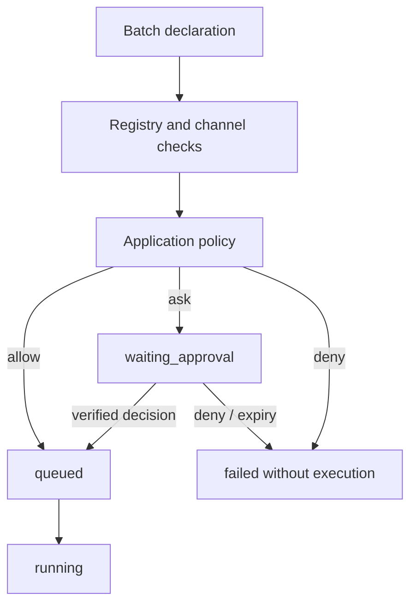

# Tool authorization

Status: Implemented

## Overview

ToolSystem owns the durable approval lifecycle, while an application-owned policy decides whether
an exact action is allowed, needs a person or is denied. Approval is separate from the execution
sandbox and never means success.



Rules:

- The policy sees the original user, invocation, run, channel, tool and arguments.
- An approval is bound to an action digest and cannot be reused for changed arguments or target.
- `deny` wins over `ask`, which wins over `allow`.
- Decisions, expiry and execution qualification are persisted in the same state machine.
- Approved is distinct from queued, running and succeeded.

## Policy contract

`PermissionPolicy.check(PermissionRequest)` returns `PermissionDecision | str`. String results
remain valid for core-only deployments; hosted applications should return the structured form:

```text
verdict          allow | ask | deny
reason           stable policy explanation
approval         trusted display and scope metadata for ask
grant_key        stable server-generated action class
policy_version   evaluator version
```

The approval object contains title, summary, risk, effects, target, scope options and optional
redacted details. Tool arguments remain the source of truth; model copy cannot override them.

`core.tool.permission.PermissionManager` validates the verdict and computes an `action_digest`
over user, delegated agent, run, invocation, tool, arguments, channel, policy version and grant
key. The digest is frozen into the call before the UI can decide.

## States and decisions

The call moves `admitting -> waiting_approval -> approved -> queued -> running -> terminal`, or
from waiting to denied/expired. A decision contains status, scope, deciding client, channel,
reason and action digest. The first valid decision wins; duplicate commands are idempotent.
Expiry is generated by the runtime watchdog and does not require a client decision.
Expiry is persisted as `permission=expired` and a terminal `failed` call with
`error.kind=permission_expired`; it never remains `waiting_approval`. Permission decisions forwarded
through the Tools service retain scope, action digest, deciding client, channel and reason.
The terminal payload also states `executed=false`, so an authorization timeout is never confused
with an execution timeout or an unknown external side effect.

An approval or denial that arrives after this terminal is a late decision. It never reopens or
rewrites the original call. The original `permission_expired` terminal remains the evidence already
shown to the model. Oath records `late_permission`, emits an idempotent
`permission.late_resolved` system event, and lets the Agent issue a new invocation with
`retry_of=<original invocation>`.

Late approvals for `once` create one short-lived retry credit bound to the exact grant key,
action digest and original run. The next matching invocation consumes it atomically and does not
ask again. Late `run` approvals create a same-run grant. Late `exact_rule` decisions use the
hosted whitelist when `policy_managed_grant=true`; Oath does not duplicate that rule. A late denial
creates no credit. A retry is still a new invocation, so the old event identity and terminal
remain immutable.

Scopes are `once`, `run` and `exact_rule`. A run grant applies only to the same grant key and run.
An exact rule is persisted in runtime state with an expiry and can be matched before a later
action gets a new approval. Revocation and a user-facing grant inventory remain application work.
Hosted policies that own a revocable whitelist may set `policy_managed_grant=true` in the approval
view model. Oath still validates the exact-rule decision and action digest, but does not duplicate
that rule in runtime grants; the application policy remains the source of truth.

## Events and reconnection

`permission.requested` carries the frozen approval metadata. `permission.resolved` carries the
decision metadata. `session.status` exposes pending and recently resolved approvals so reconnecting
clients do not depend on one online event.

Approval and cancellation compete in the RuntimeStore transaction. A cancelled call cannot later
be approved. Policy, digest, scope or version mismatch leaves the approval unresolved and never
starts execution.

## Policy service

`agent.permission_policy_url` enables a remote evaluator. The Tools service sends
`PermissionRequest` with `services.internal_token`; transport is HTTPS or private service HTTP,
without redirects or proxy environment. Timeouts, malformed responses and unknown verdicts fail
closed. With no URL, the built-in `AllowAllPolicy` remains available only for core development.
`agent.permission_notification_url` optionally sends an `attention` notification when an approval
is created. This callback is independent of an attached client socket, so a suspended App can
still be woken. The callback uses the same scoped internal service identity and is deduplicated by
`approval:<invocation_id>`.

## Failure and recovery

- A decision after cancellation is rejected as already resolved. An approval received after
  expiry does not revive the original call; it is recorded as a late decision and wakes the Agent
  with `permission.late_resolved` while retry safety remains explicit.
- Policy failure never becomes allow.
- TTL and decision metadata survive restart; pending calls are restored without a new invocation.
- Event loss is reconstructed from durable call state.
- A tool timeout or external failure after execution retains its own terminal; approval does not
  authorize a retry. The late-approval retry credit applies only when authorization expired and
  the tool never started.

This changes the public permission contract. Hosted Oath and Hymio Backend update together.
