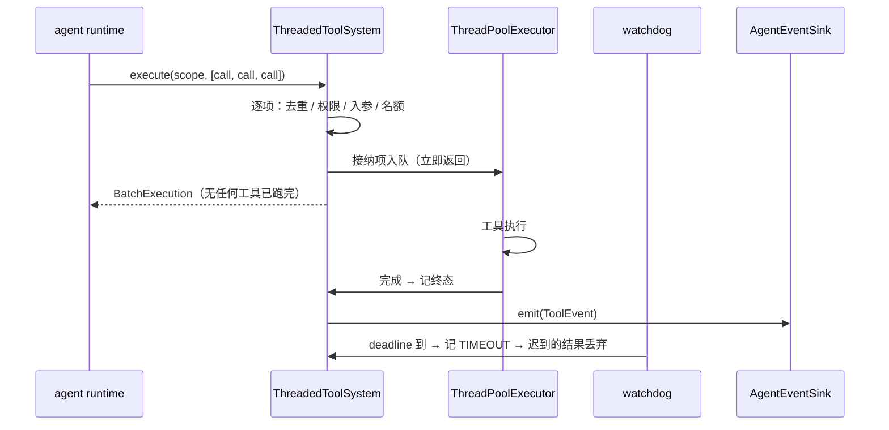

# Feature — 工具系统

状态：Implemented

## 背景与目标

agent 要动手就得调工具。LLM 只会返回「要调哪个工具、传什么参数」，真正把副作用
落到外部的是宿主。工具系统就是这段宿主能力：把可用的工具告诉模型、把模型点名的
调用跑起来、把每次调用的终态变成一条持久事件。

一次模型请求可能返回一批工具调用。这些调用互相独立（没有数据依赖），所以**一定
并行**，一个也不能串行等。模型线程不能被工具拖住 —— 工具可能跑几秒到几分钟，
所以派发接口立即返回执行标识，真正的执行在后台；每个调用跑完或超时，落一条终态
事件，后续由事件处理（下一步的 queue 协议）消费。

范围：

- 工具定义（provider 无关的 wire 形态）+ 汇总给 context 的接口。
- `Tool` 接口 —— 扩展作者实现它。
- 注册表 —— 收集 core 与 extensions 的工具，装配期填入。
- 批量并行派发（立即返回）+ 后台线程池执行 + 超时。
- 终态事件（本 feature 定义事件格式，投递实现留给下一步的 queue 协议）。
- 按 `(scope, invocation_id)` 查执行状态。
- **每次执行前的权限检查**（三值判定）与**待审批流**（记录 + 事件 + 有效期 +
  存储）—— 权限是工具系统的一个环节，不是可选配件，见下文「权限」。

不包含：

- 模型适配层把 `ToolDefinition` 转成各家 provider 的请求格式 —— 那是模型适配层
  的事，本 feature 只保证 provider 无关的形状稳定。
- 重试策略。终态事件已经能表达「跑过但结果未知」，重试判定需要业务语义（幂等性、
  副作用代价），留待后续；本 feature 的 `OUTCOME_UNKNOWN` 只用于**终态事件投递失败**，
  不用于表达超时（超时的语义见下文「超时」）。
- 跨重启的执行状态查询。执行表是内存派生设施，重启即丢；真相在 journal 的
  `tool.result` 记录里，由后续 feature 负责对账。
- 取消（CANCELLED）派发。事件枚举里保留 `cancelled` 是给后续 feature 用的，工具
  系统 v1 不产生它。
- **审批通过后由谁重新派发。** 裁定一律发事件给 agent，怎么接着走是 agent runtime
  的事（见 `spec/todo.md`）。
- 审批事件的对外投递实现（HTTP / WebSocket / 客户端推送）—— 见 `spec/todo.md`。
- 权限元数据扩展到 `ToolDefinition` 或 `Tool` 接口。权限是 core 侧策略，扩展不声明，
  与 `timeout_seconds` 挂在 `RegisteredTool` 上同一条理由。
- 策略本体的内容（Hymio 的权限模型）—— 应用侧实现 `PermissionPolicy`。

## 前置依赖与影响范围

- [feature-journal](feature-journal.md)：已实现。本 feature 直接复用它的
  `EventType.TOOL_RESULT` / `ToolOutcome` / `PAYLOAD_SCHEMAS`，终态事件的 payload
  就是 `tool.result` 的 payload —— 校验过、字段对齐，下一步的 sink 可以直接 append。
  工具系统**不**自己写 journal：投递是 core 的事，投递到哪里由注入的 sink 决定。
- [feature-journal](feature-journal.md) 的 `tool_call_id` / `invocation_id` 语义直接沿用
  （模型 API 的调用标识 / Oath 自己的调用标识），本 feature 不另立一套 id。`attempt_id`
  从 `tool.result` payload 里移除 —— 重试策略不归本 feature，一个执行只出一个终态，
  这个字段没有第二个取值。
- 协议影响：`core/protocol/datatype/tool.py`、`core/protocol/interface/tool.py`
  与 `core/protocol/error.py` 新增成员。按跨仓库契约处理 —— 形状稳定、字段变更按
  破坏性变更走。Hymio 的 biz 工具视图会读 `ToolExecution`，客户端 trace 视图会读
  终态事件 payload。
- 权限相关协议：新增 `core/protocol/datatype/permission.py`、
  `core/protocol/interface/permission.py`；`core/protocol/interface/tool.py` 里的
  `PermissionChecker` 删除，被 `PermissionPolicy` 取代。`PermissionEvent` 与
  `PermissionRecord` 跨仓库消费，字段变更按破坏性变更处理。跨仓库影响：客户端 trace
  视图会看到新的 `outcome: awaiting_approval`；Hymio 侧的 biz 要提供
  `PermissionPolicy` 与 `AgentEventSink` 的实现，否则 runtime 装不起来。
- 代码布局：`core/tool/`（机制，其中 `core/tool/permission/` 是权限环节）
  + `extensions/tools/`（业务工具）。

## 接口与数据

### 工具定义

provider 无关。字段名用通用名，不带任何一家的 provider 字段名（对照 `Message`
的 `role` / `content`）。

| 字段 | 类型 | 说明 |
| --- | --- | --- |
| `name` | `str` | 唯一标识，模型据此点名调用 |
| `description` | `str` | 给模型看的用途说明，模型的选工具依据全在这里 |
| `input_schema` | `JsonObject` | JSON Schema 对象（顶层 `"type": "object"`），既是给模型的参数说明，也是服务端入参校验的依据 |

`name` 的字符集 `^[a-z][a-z0-9_]{0,63}$`：多家 provider 拒收含点、连字符、空格或
大写的工具名（函数调用协议把它们直接拼进请求体）。校验在注册时做一次，不等到派发。

`ToolDefinition` 是 frozen dataclass，`to_dict()` 产出 wire 形态。

### 两个调用标识

一次工具调用牵两个标识，来源不同，**不能合并成一个**：

| 标识 | 谁生成 | 干什么 |
| --- | --- | --- |
| `tool_call_id` | **模型 API** | 组对话历史时对齐 assistant 轮的 `tool_calls[i].id` 与 tool 消息的 `tool_call_id` |
| `invocation_id` | Oath | 状态查询的键，也是 `tool.call` ↔ `tool.result` 的配对键 |

`tool_call_id` **原样透传，一个字符都不改**。assistant 轮里模型留下的
`tool_calls[i].id` 和 tool 结果消息里的 `tool_call_id` 必须逐字节相同，任何 provider
都靠这对值配对，对不上就拒收整条请求。Oath 不生成它、也不解释它的形态 ——
`toolu_...` 还是别的什么，由 provider 决定。

拿 `invocation_id` 去顶替 `tool_call_id` 是错的：那是 Oath 生成的串，provider 不认。
两个标识一起落 `tool.call` / `tool.result` 的 payload，投影才既能按 `invocation_id`
在多次结果之间挑终态，又能把模型认的那个 id 原样还回去。

`invocation_id` 只约束长度（`0 < len <= MAX_INVOCATION_ID_LENGTH`），**不约束字符集** ——
它由 Oath 生成，形态是实现细节。长度上限从 journal 的 `MAX_IDEMPOTENCY_KEY_LENGTH`
反推（`128 - len("tool.result:")`），因为它要拼进 `tool.result` 的幂等键。

`attempt_id` 已从 `tool.result` payload 移除：它原本用来区分同一 `invocation_id` 的
多次尝试，而重试策略不归本 feature，一个执行只出一个终态。没有第二个取值之前它
是纯开销。真要落重试，得重新设计「一个 invocation 多个终态」在对话历史里怎么表达，
而不是把这个字段留着。

### `Tool` —— 扩展作者的接口

```python
class Tool(ABC):
    @property
    @abstractmethod
    def definition(self) -> ToolDefinition: ...
    @abstractmethod
    def execute(self, invocation: ToolInvocation) -> ToolResult: ...
```

扩展只提供**业务动作**和**内容**。权限、超时、并发、状态迁移、投递都不在扩展这一侧：

- 权限由 core 在每次执行前检查（`PermissionManager`，见下文「权限」），扩展无权豁免。
- 超时是 core 的 deadline，扩展拿到的 `invocation.deadline` 只是自用的提示，
  工具系统不信任它、也不靠它终止线程。
- 状态迁移与事件投递在 core，扩展不产生事件、不写 journal。

`ToolInvocation`：`scope` / `invocation_id` / `arguments` / `deadline`
（monotonic 秒，`None` 表示无内部截止）。`deadline` 是给工具做自己 I/O 超时的参考，
core 到点就不再等待 —— 与工具自己是否收手无关。

`ToolResult`：只有 `content: JsonValue`。刻意只有一个字段 —— journal 的
`tool.result` payload 除了两个 id 与 `outcome` 之外只允许
`content` 和 `error`，扩展自己往结果里塞元数据会让「事件 payload 恰好是合法
`tool.result` payload」这条不变量破掉。

失败时扩展**抛 `ToolExecutionError`**，不是返回结果。返回值等于「成功」。

### 注册表

注册表是装配期构造的单例，收集 core 与 extensions 的全部工具：

- `register(tool, *, timeout_seconds=...)` —— 重名抛 `ToolRegistrationError`；
  定义不合法（名字字符集、schema 不是 object）同样抛。**注册期失败**，因为配错
  了工具就早暴露，远好过在模型第一次点名时才失败。
- `get(name)` / `require(name)` / `names()` —— 供派发与汇总用。
- `definitions()` —— 汇总出 `tuple[ToolDefinition, ...]`，**按名字排序**。顺序稳定
  是硬要求：同一份工具集在不同进程里必须序列化成逐字节相同的请求体，否则缓存、
  幂等指纹和 trace 对不上。

超时是 core 侧的策略（`timeout_seconds` 挂在注册项上），不是扩展声明的属性 ——
扩展说「我跑多久」等于让扩展自己决定自己什么时候被放弃。

### 派发

```python
class ToolSystem(ABC):
    def definitions(self) -> tuple[ToolDefinition, ...]: ...
    def execute(self, scope: Scope, requests: Sequence[ToolCallRequest]) -> BatchExecution: ...
    def status(self, scope: Scope, invocation_id: str) -> ToolExecution | None: ...
    def shutdown(self, *, wait: bool = True) -> None: ...
```

`execute` 的契约：

- **入参就是一批，没有单条路径。** 单个调用 = 长度为 1 的批次。串行是调用方排的队
  不是系统的选项 —— 同一批里的调用没有任何依赖，没有理由让第一个跑完再跑第二个。
- **立即返回。** 返回 `BatchExecution` 时没有一个工具已经跑完。返回值只回答
  「谁被接下了」和「谁当场被拒了」，不回答结果 —— 结果走事件。
- **逐项独立。** 一个项被拒不影响同批其他项。整批只有一个失败模式：入参本身不合法
  （批次为空、`invocation_id` 超长），这时抛 `ToolRequestError`，不产生任何执行。
  scope 不合法由 `Scope` 自己在构造时挡掉（`ScopeError`）。
- **并发有上限。** 执行中与排队中的总数超过 `max_pending` 时，后来的项当场被拒
  （`error.kind = "busy"`）。立即返回的接口不能阻塞，所以队列满只能拒；默默排队到
  无限长会让一个失控的模型请求把内存吃光。

`ToolCallRequest`：`tool` / `arguments` / `tool_call_id`（必填，来自模型 API 的
响应）/ `invocation_id`（可省，省了由工具系统生成）。派发的返回值：

| 字段 | 说明 |
| --- | --- |
| `invocation_id` | 一次逻辑调用的稳定标识。**它就是状态查询用的执行 id** |
| `tool` | 工具名 |
| `state` | `accepted` / `deduplicated` / `rejected` |
| `error` | 当场被拒时给出；`accepted` 时为 `None` |

`deduplicated`：同一个 `(scope, invocation_id)` 尚未终结时返回同一次执行，不再起第二个
线程。这是不重复执行外部副作用的那道闸 —— 模型重发、agent 重放、上层重试都会撞上它。

### 执行状态

```python
class ToolStatus:
    PENDING  # 已接纳，线程还没拿到
    RUNNING  # 工具正在执行
    SUCCEEDED  # 终态
    FAILED  # 终态
    TIMEOUT  # 终态
    OUTCOME_UNKNOWN  # 终态
    AWAITING_APPROVAL  # 终态
    TERMINAL: frozenset[...]  # is_terminal() 用
```

| 终态 | 何时进入 |
| --- | --- |
| `SUCCEEDED` | 工具正常返回 |
| `FAILED` | 权限被拒 / 工具不存在 / 入参不合 schema（这三种在**接纳时**就判完，不进线程池）；或 `execute` 抛了 `ToolExecutionError` / 任何其他异常 |
| `TIMEOUT` | core 到 deadline，工具还没返回 |
| `OUTCOME_UNKNOWN` | 工具**跑过了**，但终态事件投递失败 —— 结果确实存在过，只是没送出去 |
| `AWAITING_APPROVAL` | 工具**没执行**：权限判定为 `ask`，在等人批（见下文「权限」）。它不是失败 —— 没有东西出错；但必须是终态，否则模型那个 tool call 就没有配对的 tool result |

`OUTCOME_UNKNOWN` 不能被别的状态顶替：把「投递失败」记成 `FAILED` 或 `TIMEOUT` 会让
上层以为工具没跑过而重试一个可能已经生效的副作用。

`ToolExecution` 是状态查询的返回值：`scope` / `invocation_id` / `tool_call_id` /
`tool` / `arguments` / `status` / `result` / `error` / `submitted_dt` / `started_dt` /
`finished_dt`。时间戳是展示与排查用，**不参与判定** —— 墙钟会回拨
（对照 [feature-journal](feature-journal.md) 的水位线不存时间戳）。

查询键是 `invocation_id`（Oath 的调用 id），**不是** `tool_call_id`：后者只是透传
回对话历史的配对值，不是一个可查询的标识。

`status(scope, invocation_id)` 查不到返回 `None`，不抛异常 —— 这是查询，不是命令。
**跨 scope 一律查不到**：用 `u1/s2` 去问 `u1/s1` 的执行 id 返回 `None`，不泄露
「这个 id 存在」。journal 里已经因为越权读修过一次 bug，这里是同一条边界。

**当场被拒的调用没有执行记录可查。** 没有东西被执行过，执行表里留一条记录只会让
「这个 id 跑过什么」和「这个 id 跑成了什么」混为一谈。拒绝原因看 `execute` 的返回值
与终态事件。

### 终态事件

本 feature 只定义事件的格式，投递实现是下一步的 queue 协议。事件类型一个：

```python
class ToolEventType:
    TERMINAL: Final = "tool.terminal"
```

```python
@dataclass(frozen=True, slots=True)
class ToolEvent:
    type: str  # ToolEventType.TERMINAL
    scope: Scope
    tool_call_id: str  # 模型 API 给的，原样透传
    invocation_id: str
    tool: str
    outcome: str  # ToolOutcome.*
    payload: JsonObject  # tool.result 的 payload
    idempotency_key: str  # f"tool.result:{invocation_id}"
    occur_dt: str
```

`payload` 就是 `{tool_call_id, invocation_id, outcome}`（+ 成功时的 `content`，失败时
的 `error: {kind, message}`），**逐字段对齐 `PAYLOAD_SCHEMAS[(tool.result, 1)]`**，
并由测试逐条验证。sink 拿到事件可以直接 `journal.append(type=EventType.TOOL_RESULT,
payload=event.payload, idempotency_key=event.idempotency_key)`，不用翻译。

投递接口是**系统层面的那一个**（见「事件投递口」），不是工具系统独占的。

`emit` 抛错 = 这条事件没送出去，对应执行的状态转 `OUTCOME_UNKNOWN`。sink 是同步调用：
投递失败必须当场知道，静默吞掉会把执行结果丢在内存里。

**不变量：每个进入 `execute` 的项恰好产生一个终态事件**（投递失败时事件不存在、
状态是 `OUTCOME_UNKNOWN`）。当场被拒的项也发 —— agent 拿不到 `tool.result` 就没法填
上模型留下的 `tool_calls` 空位，对话数组交给任何 provider 都是坏的。

### 权限

**每次工具执行前检查** —— Supervisor 不是权限系统，也不代替它。判定是**三值**的：
`allow` 直接跑，`deny` 当场失败，`ask` 不跑、转成一条待审批请求当场发到外部并给它
一个有效期。工具系统只在接纳时问 `PermissionManager.authorize()` 一句。

`ToolSystem` 的构造参数**没有默认值**：不给 `PermissionManager` 就构造不出来。默认放行
等于把「每次执行前检查」这条约束变成一个默认关闭的开关，靠记得传参来保证安全性。

#### 判定

```python
class PermissionPolicy(ABC):
    @abstractmethod
    def check(self, scope: Scope, tool: str, arguments: JsonObject) -> str: ...
```

返回 `PermissionVerdict` 的三值之一：`allow` / `deny` / `ask`。

**拒绝不是异常，是返回值。** 「要问人」和「拒绝」在这个接口里都是正常结果，用异常
区分它们会让调用方必须靠 `except` 才能知道发生了什么。

**抛异常意味着策略实现自己出错了**（读不到配置、连不上策略服务）。core fail closed：
转成 `PermissionDeniedError`，按拒绝处理。宁可误杀不可误放。

`check` **不接收** `invocation_id` / `tool_call_id`：它回答的是「这个主体能不能调
这个工具」，而不是「这一次具体调用行不行」。审批是后一层，它在判定为 `ask` 之后
才存在。

#### 审批事件

```python
class PermissionEvent:
    type: str  # permission.requested / permission.resolved
    scope: Scope
    tool_call_id: str  # 模型 API 的调用标识，原样透传
    invocation_id: str  # Oath 自己的调用标识
    tool: str
    status: str  # pending / approved / denied / expired
    payload: JsonObject  # 与落盘记录同形，投递到存储不需要翻译
    idempotency_key: str  # perm.req:<invocation_id> / perm.res:<invocation_id>
    occur_dt: str
```

两个标识与工具系统一致：`tool_call_id` 由模型 API 返回、必须原样回到对话历史；
`invocation_id` 是 Oath 自己的，是审批查询与去重的键。

幂等键前缀刻意取短（`perm.req:` / `perm.res:`，9 字符）：键长上限 128 是 journal 定的，
而 `invocation_id` 的长度上限是从**最长的那个前缀**（`tool.result:`，12 字符）反推的。
权限前缀更短，所以不收紧那个上限。

#### 审批记录

```python
class PermissionRecord:
    scope: Scope
    tool_call_id: str
    invocation_id: str
    tool: str
    arguments: JsonObject  # 判权限时看到的那些入参
    status: str  # pending / approved / denied / expired
    requested_dt: str
    expires_dt: str
    decided_by: str | None
    decided_dt: str | None
    reason: str | None
```

`arguments` 存的是**判权限时看到的那份**。批注的人要看的就是它们；工具真正跑的时候
参数可能又被上层改过，那时这条记录描述的仍是当初被问的那一次。

#### 审批存储接口

```python
class PermissionStore(ABC):
    def record(self, record: PermissionRecord) -> None: ...
    def resolve(self, record: PermissionRecord) -> bool: ...
    def get(self, scope: Scope, invocation_id: str) -> PermissionRecord | None: ...
    def pending(self, scope: Scope) -> tuple[PermissionRecord, ...]: ...
```

- **只保证「当前状态」，不保证历史。** 想追问「这个调用当时被判成什么、后来谁改的」
  去读文件，这个接口不承诺。
- **裁定只生效一次。** 同一条请求被裁定两次，第二次返回 `False` 且不写盘。这是迟到
  裁定与重放下的唯一安全语义。
- **跨 scope 查不到。** 用别的 session 去问一个 `invocation_id` 得到 `None`，不泄露
  它存不存在。
- 业务状态不在这儿 —— 那是 journal 的事。这个存储记的是运行时协调状态。

审批事件走系统层面那一个投递口（见「事件投递口」），不另开一个。

### 事件投递口

```python
class AgentEventSink(ABC):
    def emit(self, event: AgentEvent) -> None: ...
```

**系统层面只有一个 sink。** 工具终态与审批事件是同一件事的两头 —— `tool.result`
给 agent runtime 接着往下走，`permission.requested` 给外部审批通道，
`permission.resolved` 回到 agent。分成两个投递口只会让实现方写两份几乎一样的代码，
而下游拿到的事件流还是同一条。

`AgentEvent` 是所有事件的基类，只承载所有事件都有的那几个字段（`type` / `scope` /
两个调用标识 / `tool` / `payload` / `idempotency_key` / `occur_dt`）。**基类一改，
所有已发出去的事件形状就都变了**，所以新增事件类型时加子类（`ToolEvent` /
`PermissionEvent`），不要往基类上加字段。

投递是同步的，`emit` 抛错必须当场知道：工具系统据此把状态转成 `OUTCOME_UNKNOWN`，
权限系统直接把错误抛给发起派发的那一方。实现内部可以排队、可以重试，但**失败信号
必须同步传回** —— core 用它判断「对方到底知不知道这件事发生过」。

### 异常

全部挂在 `ToolError(ProtocolError)` 下，与 `JournalError` 平级：

| 异常 | 何时 |
| --- | --- |
| `ToolRegistrationError(ToolError)` | 重名、定义不合规 |
| `ToolNotFoundError(ToolError)` | 按名取工具但不存在（`get` 返回 `None`，`require` 抛） |
| `ToolRequestError(ToolError)` | 整批入参本身不合法（空批次等） |
| `ArgumentValidationError(ToolError)` | 入参不符合 `input_schema` |
| `PermissionDeniedError(ToolError)` | 权限判定为拒绝，或策略出错后 fail closed |
| `ToolExecutionError(ToolError)` | **扩展抛的**，表示业务失败 |
| `PermissionError(ProtocolError)` | 权限这一步没得出结论（策略实现自己出错、返回了未约定的判定、`decide` 收到非终态） |
| `PermissionStoreError(PermissionError)` | 存储层：重复记录、记录与所在 scope 不符、写入失败 |

`PermissionDeniedError` 的语义被收窄了：它现在是「判定为拒绝」这条通道，**不是**
「策略说不行」的通道（那是返回值）。

注意「工具不存在 / 权限被拒 / 入参不合法」三者在派发里**不是异常而是返回值**：
它们是某一项的正常结局，不是调用方的 bug。整批入参不合法才抛
`ToolRequestError`。scope 不合法由 `Scope` 自己在构造时挡掉（`ScopeError`）。

## 实现方案

### 模块职责

```text
core/protocol/datatype/tool.py    ToolDefinition / ToolCallRequest / ToolResult /
                                  ToolInvocation / ToolExecution / BatchExecution /
                                  ToolHandle / ToolErrorInfo / ToolStatus /
                                  ToolErrorKind / ToolEventType / ToolEvent
core/protocol/datatype/permission.py   PermissionVerdict / PermissionStatus /
                                       PermissionEventType / PermissionEvent /
                                       PermissionRecord / PermissionRecordDict
core/protocol/datatype/event.py   AgentEvent（所有事件的基类）
core/protocol/interface/event.py  AgentEventSink（系统层面唯一的投递口）
core/protocol/interface/tool.py   Tool / ToolSystem
core/protocol/interface/permission.py  PermissionPolicy
core/protocol/error.py            ToolError 及其子类、PermissionError 一族
core/tool/registry.py             ToolRegistry
core/tool/impl/threaded_tool_system.py   ThreadedToolSystem
core/tool/permission/store.py     PermissionStore（接口）
core/tool/permission/impl/jsonl_store.py  FilePermissionStore（只用标准库）
core/tool/permission/manager.py   PermissionManager（判定 → 记录 → 发事件 → 过期）
extensions/tools/                 业务工具（扩展作者参考实现）
```

`core/protocol` 承载跨仓库契约的部分；注册表与线程池是 core 的机制，不是契约。

### 执行链路



接纳阶段的检查顺序固定为**去重 → 工具存在 → 权限 → 入参 schema → 名额**：先便宜的、
再判定性的，最后才占用稀缺资源。权限排在入参前面 —— 权限检查的语义是「这个主体
能不能调这个工具」，拿不合法参数去问权限没有意义，而且可能把参数内容泄给不该看它的
策略实现。

### 超时机制

超时是 **core 不再等待**，不是 **core 终止线程**。Python 没有安全的线程终止手段，
强杀会让 `finally` 不跑、锁不释放、连接不关。任何「到点就杀掉线程」的实现都是在
假装能取消。

具体机制：

- 接纳时算 `deadline = time.monotonic() + timeout_seconds`，存进执行项。
- 一个 **watchdog 线程**持条件变量，按 deadline 排序等待最近的一个；到点把该执行
  项标成 `TIMEOUT`、发终态事件，然后继续等下一个。v1 是单队列单 watchdog —— 加了
  并行维度就再拆。
- 工具线程正常返回时，在锁内检查执行项是否已有终态：有就**丢弃返回值**，绝不改写
  终态。所以「超时后结果姗姗来迟」不会把 `TIMEOUT` 变成 `SUCCEEDED`。
- 还没开始跑的排队项到点后，worker 取到它时发现已有终态，直接跳过不执行。
- 超时事件的含义因此是：**core 在这一刻不再知道这个工具有没有生效**。工具线程可能
  还活着、可能已经改完外部系统。是否可重试由上层按工具的副作用性质判断，工具系统
  不替它决定 —— 这也是为什么超时记 `TIMEOUT` 而不是 `SUCCEEDED`，以及为什么绝不
  自动重试。

工具系统**不承诺**能停掉正在跑的线程。这一点写进契约，是因为上层如果假设「超时 =
没发生」，就会建在一个假保证上。

### 权限的实现

#### 为什么代码上独立成子模块

权限的复杂度（外部裁定、时间线、定时器、独立的存储与事件出口）与工具执行本身没有
重叠。塞进 `core/tool/impl/` 会让「执行一个工具」这个一件事的文件同时承担协调多个
外部审批方的时间线。独立成 `core/tool/permission/` 后，工具系统只在接纳时问它一句：

```python
verdict = self._permission.authorize(scope, tool, tool_call_id, invocation_id, arguments)
```

依赖方向仍然是单向的：`core/tool/impl/` → `core/tool/permission/` →
`core/protocol/`。权限模块不 import 工具系统，也不反向查找任何东西。**它是工具系统的
一个环节，但不是一个可选配件** —— 所以 `ToolSystem` 的构造参数没有默认值。

#### 判定 → 记录 → 发事件 → 起定时器

`PermissionManager.authorize()` 的分支，各自的失败方式不同所以分开放：

1. **已关闭** → 抛 `PermissionDeniedError`。
2. **已有记录** → 回放上次的结果（见下文「重发」）。
3. **调策略**。抛异常 → `PermissionDeniedError`（fail closed）。返回未约定的值 →
   `PermissionError`（接口违约，不能猜成哪个）。
4. **`ask`** → `_open_request`：落记录 → 压堆 → 发 `permission.requested`。
   **当场就发**，不等后面任何东西 —— 一个等人批的请求如果没被告知出去，就永远等不到。

`_open_request` 里「先压堆再发事件」是刻意的：事件投递方完全可能同步回一个裁定回来，
那时 watchdog 醒来必须已经看到这条请求不再需要管，否则它会拿一条过期裁定盖掉人的
同意。

#### 重发

同一个 `invocation_id` 第二次来的时候不重新问策略，回放记录里的结果：

| 记录状态 | 回放为 |
| --- | --- |
| `approved` | `allow` —— 批过了就该跑，而且不该再去问一次策略（审批窗口里策略可能变了，而人批的是**这一次具体调用**） |
| `pending` | `ask` —— 重发不该产生第二个审批请求，那是两条互相矛盾的记录 |
| `denied` / `expired` | `deny` —— 没批就是不能跑 |

同一个 `invocation_id` 换工具或换 `tool_call_id` = 两件不同的事，抛 `PermissionError`。
存储顺带当了决策缓存，approve → 重新派发这条路径因此不需要额外的状态。

#### 有效期

TTL 是 core 侧策略（构造参数 `ttl_seconds`，默认 300 秒），与 `timeout_seconds`
同一理由：谁来批、批多久由宿主决定，不由实现自己的节奏决定。

过期由 watchdog 判，**不靠每次查询时比时间** —— 那样一个没人再碰的请求会永远挂着，
而挂着就等于「随时可能被批准」。watchdog 与工具系统同一套形状：`_Deadline` 最小堆 +
`Condition.wait(remaining)`，每次醒来 prune 一次（否则堆只增不减），到期动作在锁外做。

`_expire` 判过期前会**重新读一次存储**，已被裁定的直接返回：终态不可被改写。

墙钟与 monotonic 分开是有意的：`expires_dt` 是墙钟（要给人看、要和 `requested_dt`
对得上），watchdog 用 monotonic 调度。墙钟会回拨，所以它只用来展示和记录，真正决定
过期的是 watchdog 那一刻醒来的时机。

#### 存储布局

```text
<root>/<user_id>/<session_id>/permissions.jsonl
```

每行是一次写入：先是 `requested`，后是 `resolved`（可能没有）。**当前状态是打开时
顺序 fold 出来的内存索引**，所以「裁定只生效一次」这个语义由 fold 保证，不由写入
路径保证 —— 重放一份日志得到的最终状态和当初跑出来的一致。fold 与写入共用同一条
`_absorb` 路径，两边语义不会分家。

落盘照抄 journal 的几条硬做法：`O_APPEND | O_CREAT` 打开、`canonical_json` + `\n`、
返回前 fsync、写失败 `ftruncate` 回原长度（半行留在文件里会被下一次写入接在后面，
把两条记录粘成一条垃圾）、只有最后一行可能是截断的、损坏的中间行抛错而不是跳过
—— 跳过的正是「谁批过什么」。

内存索引与记录条数线性相关，所以这是个小存储付得起的代价：它的规模是「等人批的
次数」，不是对话轮数。

**只支持单进程单写者**，这里不加文件锁。审批从另一个连接进来的场景需要多进程，那时
这个存储不成立（换 MySQL 实现，见「已知限制与后续」）。

#### 工具系统接入

`_accept` 的权限分支是三条路：

| 判定 | 结论 |
| --- | --- |
| `allow` | 继续走入参校验与名额检查 |
| `deny` | `_reject(permission_denied)` |
| `ask` | `_await_approval` |

`_await_approval` 发一条终态事件：`outcome = awaiting_approval`，
`content = "这个工具调用正在等待人工批准，批准后才会执行。"`，然后返回
`ToolHandleState.PENDING_APPROVAL`。

**不进执行表、不占 worker、不占 `max_pending` 名额。** 没有东西被执行过，「这个 id
跑成什么」暂时无从谈起；审批状态查 `PermissionManager`，不查工具系统。待审批的
调用占不到任何稀缺资源 —— 一个塞满待审批的系统不该因此完全瘫痪，它们的总量由审批
存储与 TTL 约束。（这一条与最初的设计稿不同：设计稿说待审批应当占名额，改成不占是
因为名额的本义是「保护 worker 与内存里的执行表」，而待审批两者都不占。）

接纳顺序见上文「执行链路」。`authorize` 抛的异常在派发里被分成两类：

| 异常 | 当场结论 |
| --- | --- |
| `PermissionDeniedError` | `permission_denied` —— 判定为拒绝（含策略出错后的 fail closed） |
| 其他 `PermissionError` | `permission_error` —— 这一步**没能完成** |

分开是为了让上层能区分「换个工具再试」与「系统本身出问题了」。两者都折成**这一项**
被拒而不是往外抛：抛出去的最差结果是同批其他项已经接纳、已经在跑，调用方却拿不到
它们的 id —— 那违背了「一批里的每一项独立」。

### 并发与队列

`max_concurrency` 决定线程池大小，`max_pending` 决定「执行中 + 排队」的上限。默认
`max_concurrency=8`、`max_pending=32`。一批 10 个调用在默认配置下全被接纳。

默认值的取舍：agent 的并行工具调用典型是个位数，8 路给足了并发又不至于让一个会话
的几十个工具把线程池吃满；`max_pending` 留 4 倍余量吸收突发批次。

### 入参校验

`input_schema` 用 `jsonschema` 校验（加进 `pyproject.toml` 依赖）。同一份 JSON Schema
既给模型看结构、又做服务端校验，两处不会走偏。校验放在接纳阶段，不放在 worker 里 ——
不合法的参数没有资格占线程。

### 执行表

`dict[(user_id, session_id, invocation_id), ToolExecution]`，锁保护。键带 scope，
所以跨 scope 查询天然查不到，不用额外判权限。

进程重启后表是空的：`status` 对执行过的调用返回 `None`。这是**已知的、声明过的**
限制，不是 bug —— 执行状态是派生视图，journal 的 `tool.result` 才是真相。对账是
下一步 feature 的事。

### 业务工具扩展

`extensions/tools/` 下放两个纯本地、无外部依赖的参考实现，让扩展作者有一个可直接
对照的最小形状：

- `current_time` —— 返回当前 UTC 时刻。展示「工具如何把内容映射成 `ToolResult`」。
- `render_template` —— 按 `{{name}}` 占位符渲染模板字符串。展示「入参经 schema 校验后
  如何使用」。

**刻意不交付**联网类工具。一个能发 HTTP 请求的工具必须同时解决出网限制、SSRF、
响应体大小上限、重定向策略与超时，这些在权限层成型之前写进仓库就是留一个洞。
第一个副作用类工具等权限策略定型后再加。

判据自检：删掉 `extensions/`，工具系统仍能启动（只是 `definitions()` 为空），
且不影响任何 durability —— 执行状态本来就是内存派生设施。

## 失败与恢复

| 场景 | 行为 |
| --- | --- |
| 工具不存在 | 接纳时拒绝，`FAILED` + `kind=unknown_tool`，发终态事件 |
| 权限被拒 | 接纳时拒绝，`FAILED` + `kind=permission_denied`，发终态事件 |
| 权限这一步没能完成（存储故障 / 策略返回没约定的判定） | 接纳时拒绝，`FAILED` + `kind=permission_error`，发终态事件。**不抛出去** —— 一批里的每一项独立 |
| 权限判定为 `ask` | 不执行，`AWAITING_APPROVAL` + `content=「正在等待批准」`，发终态事件，不进执行表 |
| 权限系统已关闭 | 抛 `PermissionDeniedError` → 当场拒绝 |
| `permission.requested` 投递失败 | 抛错，调用方立刻知道有一条审批请求没送出去。**不重试** —— 送不出去时重试只会反复失败 |
| 同一审批请求被裁定两次 | 第二次返回 `False`，不写盘、不发事件 |
| 裁定来自别的 scope | 返回 `False`，不泄露该 `invocation_id` 是否存在 |
| `decide` 收到非终态 | 抛 `PermissionError`（调用方的 bug，不是「还没定」） |
| 审批到期但已被裁定 | `_expire` 重新读存储，已终结就什么都不做 —— 终态不可被改写 |
| 审批存储文件损坏（中间行） | 抛 `PermissionStoreError`，不静默跳过 |
| 审批存储文件末尾半行 | 打开时丢弃并截断（崩溃时正在写的那一行） |
| 入参不合 schema | 接纳时拒绝，`FAILED` + `kind=invalid_arguments`，发终态事件 |
| 批次为空 / scope 非法 | 抛 `ToolRequestError` / `ScopeError`，不产生任何执行 |
| 队列满 | 接纳时拒绝，`FAILED` + `kind=busy`，发终态事件 |
| 同一 invocation 重复派发且尚未终结 | 返回 `deduplicated`，不重复执行 |
| 工具抛 `ToolExecutionError` | `FAILED` + `kind=tool_error`，发终态事件 |
| 工具抛其他异常 | `FAILED` + `kind=unexpected`（记异常类型与消息，**不记 traceback**），发终态事件 |
| 工具超时 | `TIMEOUT`，发终态事件；迟到的返回值丢弃 |
| 终态事件投递失败 | 本地状态 `OUTCOME_UNKNOWN`，无事件。**不重试投递** —— 重试也送不出去时只会反复失败；这条执行的结果由上层对账 journal 处理 |
| 进程重启 | 执行表清空。执行中调用的结果未知，由 journal 的 `tool.result` 记录对账（下一步 feature）。待审批的请求还在 `permissions.jsonl` 里，重新打开时 fold 出来，但**watchdog 不会去追那些「重启前就在等」的请求** |

重启这一行是本 feature 最大的已知缺口：v1 不做启动时的悬挂调用对账，因为对账需要
「哪些 `tool.call` 还没有对应 `tool.result`」的扫描语义，那属于 journal 消费侧。审批
侧同理 —— 只给本次进程开的请求起定时器，重启前就在等的那些要靠 `expires_dt` 判断，
而 v1 没有启动时的过期扫描。

## 实施步骤

1. `core/protocol/datatype/tool.py` + `error.py` 增补 —— 契约先立。
2. `core/protocol/interface/tool.py` —— `Tool` / `ToolSystem`；
   `core/protocol/interface/event.py` —— 系统层面唯一的 `AgentEventSink`。
3. `core/tool/registry.py` —— 注册、去重、汇总排序、定义校验。
4. `core/tool/impl/threaded_tool_system.py` —— 接纳、线程池、watchdog、状态表、事件。
5. `extensions/tools/` —— 两个参考工具。
6. `core/protocol/datatype/permission.py` + `interface/permission.py` + `error.py`
   —— 权限契约（`PermissionPolicy` / `PermissionError`），
   删除 `PermissionChecker`。
7. `core/tool/permission/store.py` + `impl/jsonl_store.py` —— 审批存储接口与 JSONL 实现。
8. `core/tool/permission/manager.py` —— 判定、记录、发事件、裁定、过期 watchdog。
9. `core/protocol/datatype/journal.py` / `tool.py` —— `awaiting_approval` outcome、
   `AWAITING_APPROVAL` status、`PENDING_APPROVAL` handle state；
   `threaded_tool_system.py` 接入三分支。
10. 测试 + 手工 e2e，回填实施记录。

## 验收与验证

单元与集成测试覆盖：

- 定义校验：重名、非法人名、schema 不是 object。
- `definitions()` 排序稳定，且与注册顺序无关。
- 派发立即返回：调用返回时没有工具跑完（用阻塞工具断言）。
- 批量并行：一批 N 个阻塞工具同时处于运行态（用屏障断言，不靠 sleep）。
- 超时：`TIMEOUT` 终态 + 事件；迟到结果不覆盖终态；排队未开始的任务到点后不执行。
- 权限：拒绝时不进线程；`ask` 时不进执行表且当场出 `awaiting_approval` 终态事件；
  策略抛错 fail closed；权限这一步失败只拒一项、不丢整批；`ToolSystem` 缺权限管理器
  构造不出来。
- 入参：不合 schema 在接纳阶段被拒，不占线程。
- 去重：同一 invocation 并发派发两次只执行一次。
- 名额：`max_pending` 用尽后新项被拒且不影响执行中的项。
- 事件不变量：每个被接纳的项恰好一条终态事件；当场被拒的项也发。
- 事件 payload 逐条通过 `PAYLOAD_SCHEMAS[(EventType.TOOL_RESULT, 1)]` 校验。
- sink 抛错 → 状态 `OUTCOME_UNKNOWN` 且不再改写。
- `status` 跨 scope 返回 `None`。
- 异常分类：每种失败映射到预期的 `ToolErrorKind`。
- 扩展工具：两个参考工具的正常路径与失败路径。

权限侧的套件：

- **审批存储契约**（`tests/conformance/test_permission_conformance.py`，跑在
  `PermissionStore` **接口**上，不碰实现细节）：当前状态的读写、`pending` 只列还在等的、
  重复记录抛错、裁定只生效一次、跨 scope 查不到、同一个 `invocation_id` 在两个 scope
  里各自独立。
- **审批存储 JSONL 实现**（`tests/test_permission_store_jsonl.py`）：重开即重建当前
  状态、一次写入一行、每 scope 一个文件、末尾半行被丢弃并截断、中间行损坏抛错、
  scope 不符 / 未知字段 / 时间戳解析不了都抛错、20 线程并发写的每一行都完整。
- **审批管理器**（`tests/test_permission_manager.py`）：allow / deny 不留痕、ask 立刻发
  事件并带有效期、策略抛错 fail closed、未约定的判定抛错、关闭后拒绝一切、四种回放
  映射、换工具 / 换 `tool_call_id` 抛错、裁定发事件、重复裁定无效、跨 scope 裁定无效、
  `decide` 收到非终态抛错、TTL 到点自己过期、过期不覆盖既有裁定、同步回裁定时结果
  站得住。
- **工具系统侧的权限接入**：`ask` 的调用不进线程、不进执行表、当场出
  `awaiting_approval` 终态事件、该事件的 payload 逐条通过
  `PAYLOAD_SCHEMAS[(TOOL_RESULT, 1)]` 校验、不占 `max_pending` 名额、权限这一步失败
  只拒同批的那一项；`recover()` 在一批 allow / deny / ask 之后投影出三条 tool 消息且
  没有一条是 `unresolved`、`tool_call_id` 与 assistant 轮里的逐字节对齐。

并发相关的断言全部用 `threading.Event` / `Barrier` 而不是 sleep —— sleep 断言的是
「等了这么久应该跑完了」，`Event` / `Barrier` 断言的是「它们确实同时在跑」。

检查项：

```bash
uv run ruff format --check .
uv run ruff check .
uv run mypy .
uv run pytest tests/ -q
uv run pytest tests/ -m "" -q
```

## 迁移与发布

无数据迁移：审批记录不跨版本读，`permissions.jsonl` 的 schema 只有 v1。

**破坏性变更**，五处，都在同一个 PR 内：

1. `ToolOutcome` 新增一个取值 `awaiting_approval`，并入 `ToolStatus.OUTCOMES`。下游
   读到不认识的值应当按未知值处理（不要当成 `succeeded`），Hymio 与客户端需要在本 PR
   合入前同步。`tool.result` 的 payload **字段**没变，所以 `PAYLOAD_SCHEMAS` 不需要改
   版本。
2. `ToolErrorKind` 新增 `permission_error`。显式枚举了错误分类的地方（trace 视图、
   重试判定）要同步。
3. 投递口合并成系统层面的一个：`ToolEventSink` 与 `PermissionEventSink` 都不复存在，
   由 `AgentEventSink` 取代，`emit` 收的是基类 `AgentEvent`。应用侧原来要实现两个
   sink，现在实现一个。工具系统与权限管理器注入的是同一个实例。
4. `ThreadedToolSystem` 的构造签名变了（`PermissionChecker` → `PermissionManager`），
   装配代码同步改；不给权限管理器构造不出来，这是刻意的。
5. `tool.call` / `tool.result` 的 payload 加 `tool_call_id` 为必填、去掉 `attempt_id`。

新增依赖：`jsonschema`（运行时）、`types-jsonschema`（开发）。

## 实施记录

- 实际改动：
  - `core/protocol/datatype/tool.py` —— 工具系统的数据类型。`ToolDefinition`
    （provider 无关的 wire 形态）、`ToolEvent`（终态事件）、`ToolStatus` /
    `ToolErrorKind` / `ToolEventType` / `ToolHandleState`（闭合常量集合）、
    `ToolCallRequest` / `ToolInvocation` / `ToolResult` / `ToolExecution` /
    `ToolHandle` / `BatchExecution`（接口返回值）、`TOOL_NAME_PATTERN` /
    `is_valid_tool_name` / `is_valid_invocation_id` / `RESULT_KEY_PREFIX` /
    `MAX_INVOCATION_ID_LENGTH`。
  - `core/protocol/interface/tool.py` —— `Tool`（扩展实现）、`ToolSystem`
    （调用面）。投递口是系统层面的 `AgentEventSink`。
  - `core/protocol/datatype/event.py`（新增）—— `AgentEvent`，工具终态与审批事件的
    共同基类。
  - `core/protocol/interface/event.py`（新增）—— `AgentEventSink`，系统层面唯一的
    投递口，取代原先分开的 `ToolEventSink` / `PermissionEventSink`。
  - `core/protocol/datatype/permission.py` —— `PermissionVerdict` /
    `PermissionStatus` / `PermissionEventType` / `PermissionRecordType` /
    `PermissionRecordDict` / `PermissionEvent` / `PermissionRecord` /
    `expired()`（只用于展示的墙钟判断）。
  - `core/protocol/interface/permission.py` —— `PermissionPolicy` /
    `AgentEventSink`。
  - `core/protocol/error.py` —— `ToolError` 及其子类，与 `JournalError` 平级；
    新增 `PermissionError` / `PermissionStoreError`，`PermissionDeniedError` 的
    语义收窄为「判定为拒绝」。
  - `core/tool/registry.py` —— 注册表：去重、定义形状校验、汇总按名字排序、
    超时作为 core 侧策略挂在注册项上。
  - `core/tool/impl/threaded_tool_system.py` —— 接纳（去重 → 工具存在 → 权限 →
    入参 → 名额）、线程池、watchdog、执行表（按 scope + invocation_id）、终态事件
    与投递失败处理、终态历史淘汰、权限三分支与 `_await_approval`、构造参数换成
    `PermissionManager`（无默认值）。
  - `core/tool/permission/store.py`、`impl/jsonl_store.py`、`manager.py`（新增）。
  - `core/protocol/datatype/journal.py` —— `ToolOutcome` 加 `awaiting_approval`；
    `tool.call` / `tool.result` 的 payload schema 加 `tool_call_id` 为必填、去掉
    `attempt_id`（两处破坏性变更）。
  - `core/journal/messages.py` —— 投影按 `invocation_id` 配对，但填进 tool 消息的
    `tool_call_id` 取自对应的 `tool.call` 记录。
  - `extensions/tools/` —— `current_time` 与 `render_template` 两个参考实现。
  - `pyproject.toml` —— 新增依赖 `jsonschema`（运行时）与 `types-jsonschema`（开发）。
  - `spec/todo.md`（新增）—— queue 实现、对外 eventsink、context 如何处理
    tool result 来不齐，三条各一行。
- 验证证据：
  - `uv run ruff format --check .` → 61 files already formatted。
  - `uv run ruff check .` → All checks passed!
  - `uv run mypy .` → Success: no issues found in 54 source files。
  - `uv run pytest tests/ -q` → 164 passed, 3 deselected。
  - `uv run pytest tests/ -m "" -q` → 167 passed（含 slow）。
  - 新增测试 107 个：注册表 22、工具系统 35、扩展 7、journal 对接 4、审批存储契约 11、
    审批存储 JSONL 9、审批管理器 19。另有 3 个既有的两值权限用例改写为三值语义。
  - 手工 e2e 之一（`/tmp/oath_tool_e2e.py`，未入库）：模型点了三个工具（两个已注册、
    一个名为 `http_get` 的未注册工具），`execute` 在 **1.00 ms** 内返回，两项
    `accepted`、一项 `rejected(未知工具)`，返回时没有一个工具跑完；事件日志里三条
    `tool.call` 之后接三条 `tool.result`（两条带 `content`、一条带 `error`）；
    提交快照后 `recover()` 投影出 3 条 tool 消息，失败那条的 `outcome` 是 `failed`
    而不是 `unresolved`。
  - 标识分离的手工验证：同一轮里模型的 `toolu_01AbC-xY9` 原样出现在
    `tool.call` / `tool.result` payload 与投影出的 `tool_call_id` 上，而状态查询走的是
    Oath 自己的 `inv-1`；两个值在日志里逐行可对照，没有互相顶替。
  - 手工 e2e 之二（`/tmp/oath_permission_e2e.py`，未入库）：一批三个调用（`current_time`
    / `rm_rf` / `pay`，策略分别给 allow / deny / ask），`execute` 在 **0.87 ms** 内
    返回，三项 `accepted` / `rejected` / `pending_approval`；待审批那个 `status()` 是
    `None`（不进执行表）。`pay` 当场发出 `permission.requested`（status=pending）与
    `tool.result{outcome: awaiting_approval}`，后者 content 是
    「这个工具调用正在等待人工批准，批准后才会执行。」；记录里的 `expires_dt` 比
    `requested_dt` 晚 0.5 秒（脚本里 TTL 设的 0.5s）。不调 `decide` 直接等 TTL 到点
    → 收到 `permission.resolved{status: expired}`，`reason = "0.5s 内没有裁定"`；
    过期之后再 `decide(approved)` 返回 `False`，事件数不变、记录仍是 `expired`。
    审批通过后用同一个 `invocation_id` 重新派发 → `accepted` 且工具真的跑完
    （`outcome=succeeded`），策略此刻仍返回 `ask`，放行完全靠存储里的裁定。
    `permissions.jsonl` 4 行，两条 `requested` 两条 `resolved` 逐行对应；重开存储后
    `pending` 为空、`inv-retry` 仍是 `approved` / `decided_by=me`。
- 已知限制与后续：
  - 重启后执行中的调用状态全丢，不做启动对账（见「失败与恢复」）。
  - 终态历史按接纳顺序淘汰最老的记录，默认保留 1024 条；再老的查询返回 `None`。
  - 工具名必须匹配 `[a-z][a-z0-9_]{0,63}`：函数调用协议把名字直接拼进请求体，
    含点或连字符的名字会被 provider 拒收。所以扩展工具叫 `current_time` 而不是
    `clock.now` —— 这个约束在注册期就挡住了。
  - 重启后「重启前就在等」的审批请求不会被 watchdog 追着判过期：v1 只给本次进程开的
    请求起定时器。恢复时 `get()` / `pending()` 查得到它们，但要有人显式处理（启动扫描
    过期，或让 TTL 判定交给查询侧）。这一条要等 agent runtime 层接上再定。
  - 审批通过后重新派发由 agent runtime 负责（裁定事件里带 `invocation_id` 与
    `tool_call_id`，重新派发时 `_replay_verdict` 会放行）。
  - 审批存储是单进程单写者的 JSONL 文件。多进程部署（例如审批回调走独立服务）需要
    换成有并发控制的实现 —— 接口已经立好了，换实现只动 `impl/`。
  - `PermissionPolicy` 与 `AgentEventSink` 没有参考实现（它们是应用侧的东西）。
    runtime 装配层接上之前，这里只有测试夹具里的假实现。
  - 没有内置工具、没有联网工具、没有重试，理由见「待决事项与参考」。

## 待决事项与参考

- **内置工具**：v1 core 不带内置工具，注册表只是它们的一个来源。第一个内置工具
  该选什么取决于 agent runtime 的规划（候选：`journal.read` 查自己的历史），未定。
  `core/tool/` 因此不建 `builtin/` 子目录 —— 空目录加一句承诺是负债。
- **工具数量与描述长度上限**：各家 provider 对一次请求里的工具数、name 长度、
  description 长度有上限。本 feature 只保证名字字符集符合函数调用协议，不做数量
  限制。跟模型适配层一起定。
- **`ToolResult.content` 的体积**：状态查询会带回完整结果。大结果会撑爆 trace 视图
  和内存。截断策略（截断 + 标记 / 只回摘要）与 blob 外置，等 journal 的 blob 引用
  方案一起定。
- **重试策略**：`OUTCOME_UNKNOWN` 的判定规则、可重试性怎么声明，属于后续 feature。
- **provider 适配**：`ToolDefinition` → 各家请求格式的转换在模型适配层，本 feature
  不含。
- **失败结果给模型看的样子**：`tool.result` 没有 `content` 时，journal 的投影会把
  整个 payload 序列化成一段 JSON 塞进 tool 消息。模型读到的是
  `{"tool_call_id":...,"invocation_id":...,"outcome":"failed","error":{...}}` 而不是一句
  「这个工具不存在」。改法有两条 ——
  投影层识别 `error` 字段渲染成人话，或失败时也填一段可读的 `content`。前者改的是
  journal 的投影规则，后者改的是本 feature 的 payload 构造；等模型适配层一起定。
- **待审批的调用要不要占 `max_pending` 名额**：本次定为**不占**（理由见「工具系统
  接入」）。如果线上出现一次模型请求生成几百个待审批调用的情形，再回来讨论要不要加
  一个独立的待审批上限。
- **`decided_by` 是自由字符串**（人 id / 服务名 / "system"）。等 Hymio 的身份模型定了，
  可能要换成结构化的主体引用。
- **审批请求要不要支持「一个请求、多个审批人、需要全票」**：v1 是单点裁定，`resolve`
  的「只生效一次」就是为它准备的。需要多方会签时这层要重新设计。