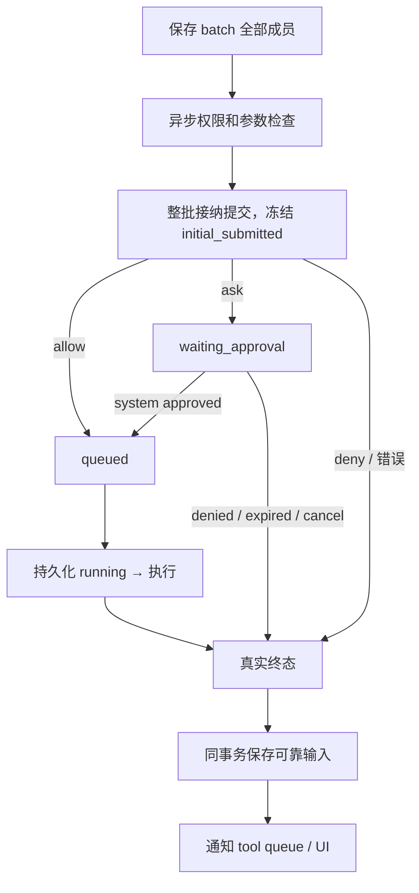

# Feature — 工具系统

状态：历史设计（模块思路保留；当前部署、身份与存储以 [分布式 Agent 设计](feature-distributed-personal-agent.md) 为准）。

## 总览

**先登记完整批次，再裁定接纳；提交资格、执行状态和真实终态都先保存。**
业务工具只提供定义与 execute，权限、deadline、通知和恢复由 core 管理。



贯穿全文的规则：原调用身份和参数不变；一个 invocation 一个终态；等待批准不占执行线程；
在线通知失败不改写结果；未知外部结果不能自动重跑；工具异常止于 `failed` 终态。

## 1 接口与身份

ToolRegistry 校验定义与 timeout，definitions 按名称排序并按当前客户端渠道过滤。Tool 提供：

```python
definition: ToolDefinition
expose_channels: frozenset[str] | None   # None = all channels
subagent_only: bool                      # hidden from main-Agent definitions/admission
execute(invocation: ToolInvocation) -> ToolResult
```

ToolInvocation 包含 scope、invocation_id、原参数与 monotonic deadline；工具可据此设置自己的
I/O timeout。正常返回为成功，业务异常使用 ToolExecutionError。

**`execute` 的异常不越过工具边界。** 执行器接住工具抛出的任何异常，写成 `failed` 终态
（`error.kind` 为 `tool_error` 或 `unexpected`），不会向上冒泡打断 Brain。工具只需要把自己的
失败说清楚，不需要收住自己所有可能的异常 —— 那不是工具该操心的事。

ToolSystem 提供 submit_batch、execute、batch_status、status、apply_permission、cancel、recover_scope。
`submit_batch` 要求完整、非空且身份唯一的批次；返回登记回执，不等待权限检查或执行完成。
相同 batch_id + manifest 返回原批次；不同内容或侵占已有 invocation_id 报错。
`execute` 是独立调用入口，可生成缺省 invocation_id；Brain 使用显式稳定身份的 submit_batch。

scope 固定为 user/session，模型 tool_call_id 仅用于消息配对。
外部客户端审批和查询使用 invocation_id；source 由 core 决定，不接受客户端声明。

## 2 接纳与初次集合

batch 声明先保存所有成员及 admission_deadline。权限策略在锁外异步返回 allow / deny / ask，
参数用注册时同一份 JSON Schema 校验。策略线程数有界，异常、容量不足和接纳超时变为逐项失败。
整批接纳提交之前不执行工具，也不展示部分授权卡。

接纳时一次冻结 initial_submitted：初次由 brain 提交的 queued 项。它包含排队尚未运行的项，
不含 ask、立即拒绝和随后 system 提交的项。工具状态变化不改写这个集合。
批次成员、状态和终态 event_id 可通过 batch_status 一致读取。

## 3 审批与执行

PermissionManager 使用同一个 RuntimeStore；不另建审批文件。ask 保存 waiting_approval、
pending 和 approval_deadline，持久化之后发 permission.requested 给 UI。

system consumer 将裁定交 apply_permission：

- 同一 command_id 幂等；已结束 / 已裁定调用不重复获得执行资格。
- 重新检查 TTL 和 run 取消状态。
- approved：裁定与 queued + execution deadline + source=system 原子保存。
- denied / expired：保存裁定与真实失败终态，source=system。

批准执行原 invocation 和原参数，不经模型重新生成 toolcall。批准本身不唤醒 Brain。
ToolConsumer 收到终态后按自己的批次规则判断；system 提交项不改变首次等待集合。

worker 取得物理执行槽位后，先保存 running 再执行。工具定义若与接纳时快照不同则不执行。
排队和运行共用有限 execution deadline；审批等待用独立 TTL。
线程无法安全强杀，timeout 后物理槽位仍占用到该线程返回，避免不断产生挂起线程。

## 4 唯一终态与可靠通知

终态取 succeeded、failed、timeout、cancelled、outcome_unknown。
终态包含 invocation_id、tool_call_id、batch_id、run_id、source、event_id、outcome 与结果 / 错误。
事件身份固定为 `result:<invocation_id>`。

成功结果的正文超过阈值时先落 detail store，终态里的 `content` 换成保头留尾的文本，
另带 `detail_key` 与 `original_chars`。全文由内置工具 `detail_read` 取回，它的结果不截断。
内置工具 `skill` 同理不截断：它读的是 core 自己索引的技能正文，模型点名要的东西截掉就没有意义了。
规则见 [Compaction](feature-compaction.md)。

一次事务同时更新调用终态和 accepted 输入；没有“结果保存了，但不知道该投递什么”的空隙。
通知可重复，consumer 按 event_id dedup；没有 receipt 的终态继续重投。投递到 UI 失败只影响在线展示。
晚到 worker 返回不能改写 timeout / cancelled / unknown，也不能发第二个终态。

工具状态查询和重新连接的 session.status 是当前事实来源；UI 不依赖授权卡在线推送是否恰好收到。
工具事件是执行事实；reminder 是 Brain 固定的消息视图，两者不能互相覆盖。

## 5 失败与恢复

启动枚举 journal 所有 scope，恢复批次、调用、审批、输入与 deadline，包括没有 buffer 的待审批 session。

| 持久化状态 | 恢复 |
| --- | --- |
| admitting | 等已保存的接纳决定；缺失决定由 admission deadline 有限收尾 |
| waiting_approval | 恢复原请求和 TTL；过期命令经 system queue 裁定 |
| queued | 原调用尚未取得执行资格，可在 deadline 内派发 |
| running | 外部结果无法确认，保存 outcome_unknown，不自动再执行 |
| 终态 | 只重投尚无 receipt 的原事件，不改结果 |

cancel 先保存 run 标志；未开始调用 cancelled，运行中调用 outcome_unknown。
取消与取得执行资格在 scope 事务里有顺序；已开始的第三方副作用不承诺撤回。

维护线程按 scope 退避故障，其他 scope 可继续；consumer 自身重查可靠输入，漏通知不导致永久等待。
存储失败不返回虚假成功。Journal 关闭后旧线程不能重新打开写入。

## 6 限制与跨仓库影响

执行器使用有界 daemon threads，不是可强杀沙箱。外部 operation 查询 / 对账接口尚未接入，
因此 running 恢复统一使用保守 unknown。外部 exactly-once 需要工具和第三方系统共同支持。

Hymio 审批卡显示原工具、参数、有效期和 invocation；重连查询恢复状态。批准 ACK 仅表示命令接纳，
不能显示“执行成功”。Nostalgia 和 trace 消费方读取 runtime.commit 中保存的终态事实或状态 API。
