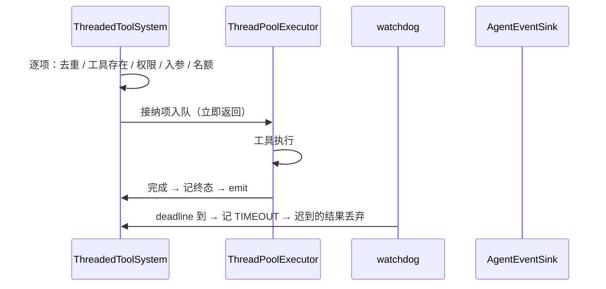

# Feature — 工具系统

状态：Implemented

## 背景与目标

agent 要动手就得调工具。工具系统是这段宿主能力：把可用的工具告诉模型、把模型点名的
调用跑起来、把每次调用的终态变成一条持久事件。

一次模型请求可能返回一批调用，它们互相独立，所以**一定并行**，一个也不能串行等。
工具可能跑几秒到几分钟，所以派发接口立即返回执行标识，真正的执行在后台。

不包含：provider 请求格式的转换（模型适配层）、重试策略、启动时的悬挂调用对账、
审批通过后由谁重新派发（agent runtime）、审批事件对外投递的实现（`spec/todo.md`）。

## 接口与数据

### 工具定义与调用标识

`ToolDefinition`（wire 形态，provider 无关）：`name` / `description` /
`input_schema`。`name` 必须匹配 `^[a-z][a-z0-9_]{0,63}$` —— 函数调用协议把名字直接拼进
请求体，含点或连字符的名字会被 provider 拒收。校验在注册期做一次。

一次调用牵两个标识，来源不同，不能合并：

| 标识 | 谁生成 | 干什么 |
| --- | --- | --- |
| `tool_call_id` | 模型 API | 对齐 assistant 轮的 `tool_calls[i].id` 与 tool 消息 |
| `invocation_id` | Oath | 状态查询的键，也是 `tool.call` ↔ `tool.result` 的配对键 |

`tool_call_id` **原样透传，一个字符都不改**：provider 靠这对值配一对不上就拒收整条
请求。拿 `invocation_id` 顶替它是错的 —— 那是 Oath 生成的串，provider 不认。
`invocation_id` 由 Oath 生成，只约束长度（要拼进 `tool.result` 的幂等键）。

### `Tool` —— 扩展作者的接口

```python
class Tool(ABC):
    @property
    @abstractmethod
    def definition(self) -> ToolDefinition: ...
    @abstractmethod
    def execute(self, invocation: ToolInvocation) -> ToolResult: ...
```

扩展只提供业务动作和内容。权限、超时、并发、状态迁移、投递都在 core 那一侧。业务
失败**抛 `ToolExecutionError`**（返回值等于成功）。`ToolResult` 只有 `content` 一个
字段 —— `tool.result` payload 除两个 id 与 `outcome` 外只允许 `content` 与 `error`，
让扩展自己塞元数据会破掉「事件 payload 恰好是合法 `tool.result` payload」。

超时挂在注册项上（`registry.register(tool, timeout_seconds=...)`），不是扩展声明的
属性 —— 扩展说「我跑多久」等于让扩展决定自己什么时候被放弃。`definitions()` 按名字
排序：同一份工具集在不同进程里必须序列化成逐字节相同的请求体。

### 派发

```python
class ToolSystem(ABC):
    def definitions(self) -> tuple[ToolDefinition, ...]: ...
    def execute(self, scope: Scope, requests: Sequence[ToolCallRequest]) -> BatchExecution: ...
    def status(self, scope: Scope, invocation_id: str) -> ToolExecution | None: ...
    def shutdown(self, *, wait: bool = True) -> None: ...
```

- **入参就是一批。** 单个调用 = 长度为 1 的批次。
- **立即返回。** 返回时没有一个工具跑完。返回值只回答「谁被接下、谁当场被拒」。
- **逐项独立。** 一项被拒不影响同批其他项。整批只在一个地方抛异常：入参本身不合法
  （空批次、id 超长）。
- **并发有上限。** 超过 `max_pending` 的项当场被拒（`kind=busy`）。立即返回的接口
  不能阻塞，默默排到无限长会让一个失控请求吃光内存。

`deduplicated`：同一个 `(scope, invocation_id)` 未终结时返回同一次执行，不再起第二个
线程 —— 这是不重复执行外部副作用的那道闸。

### 状态与终态

| 终态 | 何时 |
| --- | --- |
| `SUCCEEDED` | 工具正常返回 |
| `FAILED` | 接纳阶段判完（未知工具 / 权限拒 / 入参不合 schema），或 `execute` 抛异常 |
| `TIMEOUT` | core 到 deadline，工具还没返回 |
| `OUTCOME_UNKNOWN` | 工具**跑过了**，但终态事件投递失败 |
| `AWAITING_APPROVAL` | 工具**没执行**：权限判定 `ask`，在等人批 |

`OUTCOME_UNKNOWN` 不能被别的状态顶替：记成 `FAILED` 或 `TIMEOUT` 会让上层以为工具
没跑过而重试一个可能已经生效的副作用。

`status()` 查不到返回 `None`（这是查询不是命令），**跨 scope 一律查不到**。当场被拒
的调用没有执行记录 —— 没有东西被执行过。

### 事件与投递口

```python
class AgentEvent(ABC):      # type / scope / tool_call_id / invocation_id /
                            # tool / payload / idempotency_key / occur_dt
class ToolEvent(AgentEvent): outcome
class PermissionEvent(AgentEvent): status

class AgentEventSink(ABC):
    def emit(self, event: AgentEvent) -> None: ...
```

**系统层面只有一个 sink。** 工具终态与审批事件是同一件事的两头，分成两个投递口只会
让实现方写两份几乎一样的代码，下游拿到的事件流还是同一条。投递是同步的，`emit` 抛错
必须当场知道 —— 实现内部可以排队可以重试，但失败信号必须同步传回。

`ToolEvent.payload` 逐字段对齐 `PAYLOAD_SCHEMAS[(tool.result, 1)]`，sink 可以直接
`journal.append(...)`，零翻译。基类 `AgentEvent` 一改所有已发事件形状就都变了，所以
加事件类型时加子类，不要往基类加字段。

**不变量：每个进入 `execute` 的项恰好产生一个终态事件。** 当场被拒的项也发 ——
agent 拿不到 `tool.result` 就填不上模型留下的 `tool_calls` 空位。

### 权限

`PermissionPolicy.check(scope, tool, arguments) -> str` 返回 `allow` / `deny` / `ask`。

**拒绝不是异常，是返回值。** 「要问人」和「拒绝」都是正常结果。抛异常意味着**策略实现
自己出错了**，core fail closed 转成拒绝 —— 宁可误杀不可误放。`check` 不接收
`invocation_id`：它回答「这个主体能不能调这个工具」，不是「这一次具体调用行不行」。

`ask` 的结果是一条**永久历史**：LLM 的 message 数组里每个 tool call 必须配一条 tool
result，而 context 是 append-only 的。所以「正在等待批准」当场就是终态结果，审批回来
之后**不再补第二条 tool result**，结论以一条 user message 追加在后面。

审批记录（`PermissionRecord`）含 `arguments` / `status` / `expires_dt` /
`decided_by` / `reason`，存的是**判权限时看到的那份参数** —— 批注的人要看的就是它们。

`PermissionStore`（`record` / `resolve` / `get` / `pending`）只保证**当前状态**、
**裁定只生效一次**、**跨 scope 查不到**。

## 实现方案

### 执行链路



接纳顺序固定为 **去重 → 工具存在 → 权限 → 入参 → 名额**：先便宜的、再判定性的，
最后才占稀缺资源。权限排在入参前面 —— 权限问的是「这个主体能不能调这个工具」，
拿不合法参数去问没有意义，还可能把参数泄给不该看它的策略实现。接纳阶段判完的失败
不进线程池。

### 超时：core 不再等待，不终止线程

Python 没有安全的线程终止手段，强杀会让 `finally` 不跑、锁不释放、连接不关。任何
「到点就杀掉线程」的实现都是在假装能取消。

- 一个 watchdog 线程持条件变量，等最近的那个 deadline。到点判 `TIMEOUT`、发终态事件。
- 工具线程正常返回时在锁内检查执行项是否已有终态：有就**丢弃返回值**。终态落下后不可
  改写，所以「超时后结果姗姗来迟」不会翻成 `SUCCEEDED`。
- 排队未开始的项到点后，worker 取到它发现已有终态，直接跳过。

所以 `TIMEOUT` 的含义是**core 在这一刻不知道这个工具有没有生效**。能不能重试由上层
按副作用性质判断，工具系统不替它决定。

### 权限的实现

`core/tool/permission/` 独立成子模块：外部裁定、时间线、定时器、独立存储与事件出口
与「执行一个工具」没有重叠。依赖方向单向 `core/tool/impl/` → `core/tool/permission/`
→ `core/protocol/`。它是工具系统的一个环节，不是可选配件 —— 所以 `ToolSystem` 的
构造参数没有 `PermissionManager` 就构造不出来。

`authorize()` 的分支：

1. 已关闭 → 抛 `PermissionDeniedError`。
2. 已有记录 → 回放上次结果。
3. 调策略。抛异常 → `PermissionDeniedError`（fail closed）；返回未约定的值 →
   `PermissionError`（接口违约，不能猜）。
4. `ask` → 落记录 → 压堆 → **当场发** `permission.requested`。一个等人批的请求没被
   告知出去就永远等不到。先压堆再发事件是刻意的：投递方可能同步回一个裁定，那时
   watchdog 醒来必须已经看到这条请求不再需要管，否则会拿过期裁定盖掉人的同意。

**重发**同一个 `invocation_id` 不重新问策略，回放记录：`approved → allow`（人批的是
这一次具体调用，不该再去问一次变了没变的策略）、`pending → ask`（否则产生两条互相矛盾
的记录）、`denied`/`expired → deny`。换工具或换 `tool_call_id` 抛 `PermissionError`。
存储顺带当了决策缓存。

**有效期**由 watchdog 判，不靠查询时比时间 —— 否则一个没人再碰的请求永远挂着，而挂着
就等于「随时可能被批准」。`_expire` 判之前重新读一次存储，已裁定的直接返回。`expires_dt`
是墙钟（要给人看），watchdog 用 monotonic 调度。

**存储布局** `<root>/<user_id>/<session_id>/permissions.jsonl`，每行一次写入。当前状态
是打开时顺序 fold 出来的内存索引，所以「裁定只生效一次」由 fold 保证 —— 重放日志得到
的最终状态和当初跑出来的一致。落盘照抄 journal 的硬做法：`O_APPEND | O_CREAT`、
`canonical_json` + `\n`、返回前 fsync、写失败 `ftruncate` 回原长度、只有最后一行可能
截断、损坏的中间行抛错而不是跳过（跳过的正是「谁批过什么」）。**单进程单写者**，不加
文件锁。

### `ask` 的调用不占任何名额

不进执行表、不占 worker、不占 `max_pending`。没有东西被执行过，「这个 id 跑成什么」
暂时无从谈起；审批状态查 `PermissionManager`。名额的本义是保护 worker 与执行表，
待审批两者都不占。

## 失败与恢复

| 场景 | 行为 |
| --- | --- |
| 未知工具 / 权限拒 / 入参不合 schema / 队列满 | 接纳时 `FAILED`，发终态事件，不进线程池 |
| 权限这一步没能完成（存储故障 / 策略违约） | 接纳时 `FAILED` + `kind=permission_error`，发终态事件。**不抛出去** |
| 权限判定 `ask` | 不执行，`AWAITING_APPROVAL`，发终态事件，不进执行表 |
| 策略抛异常 | fail closed 按拒绝处理，原始原因进错误消息 |
| 同一审批被裁定两次 | 第二次返回 `False`，不写盘不发事件 |
| 裁定来自别的 scope | 返回 `False`，不泄露该 id 是否存在 |
| `decide` 收到非终态 | 抛 `PermissionError`（调用方的 bug） |
| 审批到期但已被裁定 | `_expire` 重新读存储已终结就什么都不做 |
| 终态事件投递失败 | 状态 `OUTCOME_UNKNOWN`，无事件。**不重试** |
| 存储文件末尾半行 / 中间行损坏 | 丢弃并截断 / 抛 `PermissionStoreError` |
| 进程重启 | 执行表清空；待审批请求还在文件里，但 watchdog 不追「重启前就在等」的 |

后两行是本 feature 最大的已知缺口：v1 不做启动对账（需要「哪些 `tool.call` 还没有对应
`tool.result`」的扫描语义），也不做启动时的过期扫描。

## 迁移与发布

无数据迁移。**破坏性变更**五处：

1. `ToolOutcome` 新增 `awaiting_approval`。下游读到不认识的值应按未知值处理，不要当成
   `succeeded`。
2. `ToolErrorKind` 新增 `permission_error`，与 `permission_denied` 分开：前者「判定为
   拒绝」，后者「这一步没能完成」。两者都折成该项被拒不往外抛。
3. 投递口合并：`ToolEventSink` / `PermissionEventSink` 由 `AgentEventSink` 取代，
   `emit` 收基类。应用侧原来实现两个 sink，现在实现一个。
4. `ThreadedToolSystem` 构造参数从 `PermissionChecker` 换成 `PermissionManager`，无默认值。
5. `tool.call` / `tool.result` 的 payload 加 `tool_call_id` 为必填、去掉 `attempt_id`。

## 实施记录

只记结果，不记过程。

- 实际改动：`core/protocol/`（datatype: tool / permission / event；interface: tool /
  permission / event；error）、`core/tool/`（registry、impl/threaded_tool_system、
  permission: store / impl/jsonl_store / manager）、`core/journal/messages.py`（投影按
  `invocation_id` 配对、填回模型给的 `tool_call_id`）、`extensions/tools/`（两个参考
  工具）、依赖 `jsonschema`。
- 验证：`ruff format --check` / `ruff check` / `mypy` 全过（56 source files）；
  `pytest tests/ -q` 164 passed, 3 deselected；含 slow 167 passed。
- 已知限制：重启后执行状态全丢；审批存储单进程单写者（多进程部署要换实现，接口已立）；
  `PermissionPolicy` 与 `AgentEventSink` 没有参考实现（应用侧的东西）。

## 待决事项

- **待审批要不要单独设上限**：本次不占 `max_pending`。线上出现一次请求生成几百个待审批
  调用时再回来讨论。
- **重试策略**：`OUTCOME_UNKNOWN` 的可重试性怎么声明。
- **`ToolResult.content` 的体积**：截断策略与 blob 外置，等 journal 的 blob 方案。
- **失败结果给模型看的样子**：`tool.result` 没有 `content` 时投影会塞整段 JSON。改投影
  层渲染人话，还是失败时也填一段可读 `content`，等模型适配层一起定。
- **审批会签**：`decided_by` 是自由字符串，等 Hymio 身份模型定。v1 是单点裁定，多方会签
  要重新设计。