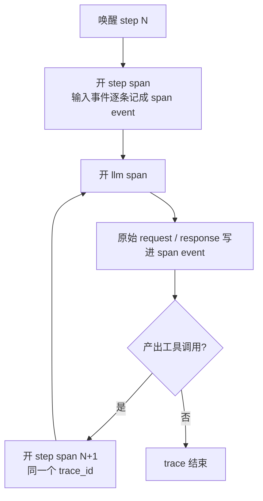

# Feature — Trace：一次 ReAct 循环的可观测记录

> 部署、身份、持久化和传输以 [分布式 Agent 设计](feature-distributed-personal-agent.md) 为准；下文保留原模块设计背景。

状态：Implemented（单进程，文件后端）。

## 总览

一次用户输入不是一个请求，是一串「模型 → 工具 → 模型 → …」直到模型不再要工具。
**trace 记的是这一整串，span 记的是其中的一步。**

core 在每次 step 认领时开一个 span，在每次模型调用时开一个子 span，把原始输入、
原始请求原始响应和耗时都写进去。什么时候算「一串」的下界：**上一个 step 产出工具调用，
它的结果唤醒下一个 step —— 那是同一个 trace 的延续；上一个 step 没有产出工具调用，
它就是这条 trace 的最后一个 step，下一个 step 开新 trace。**

数据形状采用 OpenTelemetry 的 span 模型：trace_id / span_id / parent_span_id /
name / kind / start / end / attributes / status / events / links。**这不是 OTLP 的
线上编码** —— 以后接导出时要补一层映射（属性类型、`status` 的 code 与 message、
trace state）。



贯穿全文的规则：trace 是 scope 维度的，`Scope` 是每个接口方法的必填参数；trace 不参与
恢复，写失败只丢 span 不影响推理；span 只追加不修改，同一个 span_id 最后一条赢；
时间戳是 unix 纳秒，耗时是单调时钟量出来的差。

## 1 Span

`Span` 是 frozen dataclass，字段与 OTel 一一对应：

| 字段 | 含义 |
| --- | --- |
| `trace_id` / `span_id` / `parent_span_id` | 32 / 16 位小写 hex；`parent` 为 `None` 表示顶层 span |
| `name` | 给人看的一行，如 `chat gpt-4o-mini` |
| `kind` | `internal` 或 `client` |
| `start_unix_nano` / `end_unix_nano` | 绝对时间；`end` 为 `None` 表示这个 span 还没结束 |
| `status` | `unset` / `ok` / `error` |
| `attributes` | 键值对，取值只放标量与字符串数组 |
| `events` | span 内部按时间排的事件 |
| `links` | 有因果但不在父链上的 span，见下 |

id 的长度在构造时校验 —— Brain 用 step_id 前 16 位当 span_id，写错了当场报错，
而不是等读 trace 的人对着一个不合法的 id 发呆。

`SpanEvent` 三件套：`name` / `unix_nano` / `attributes`。

`SpanLink` 三件套：`trace_id` / `span_id` / `attributes`。trace_id 不可省 —— 被指向的
span 常常不在自己这条 trace 里。

原始请求与响应是 span event，不是 attribute：一个 attribute 应该是小标量，
一整份报文属于「那一刻发生的事」。

**trace 里没有 root span。** 多个 step span 平级，靠 `trace_id` 归到一条 trace ——
它们本来就是先后发生而不是嵌套的，套成一个 root 会让每一步的耗时读成到整个循环结束。
step 之间的因果用 `links` 补：每次认领时，每条工具结果各指向产出它的那一步的 span。
用户消息和工具结果被认领进同一个 step 时（用户新消息必开新 trace），link 自带的
`trace_id` 就是跨回上一条 trace 的唯一线索。

## 2 属性与事件命名

属性名分两段：`gen_ai.*` 是 OpenTelemetry GenAI 语义约定里已有的，不改；`oath.*`
是我们自己的。约定的语义照抄，OTel 没定的地方才自己起名。

step span（`name = "invoke_agent"`）：

| 属性 | 含义 |
| --- | --- |
| `gen_ai.operation.name` | 恒为 `invoke_agent` |
| `oath.step.id` / `oath.step.status` | step 身份与终态 |
| `oath.run.id` | 这一串属于哪次 run |
| `oath.step.triggers` | 唤醒它的输入队列名 |
| `oath.step.input_count` / `oath.step.llm_calls` | 本 step 的输入条数与模型调用次数 |
| `oath.step.duration_ms` | step 耗时 |

step 的每条输入各占一个 span event，名字是 `oath.input.<queue>`，
attributes 里放这条 `Inbound` 的原始 JSON —— 用户说了什么、上一个 step 的工具返回了
什么，一字不改。

三个阶段节点各占一个 span event，带时刻：`oath.stage.request_prepared`（压缩判定与
请求冻结完成）、`oath.stage.tools_submitted`（工具批次提交完成）、`oath.stage.completed`。
只有一个 step 总耗时是不够的：模型调用有自己的 span，剩下的时间全挤在 step span 里，
慢的时候要能一眼看出慢在模型前还是模型后。节点攒在内存里，等 step span 到终态时
一次写出 —— 进程崩了就只剩认领时那条没有 `end` 的 span，阶段节点随它一起没有。

llm span（`name = "chat <model>"`）：

| 属性 | 含义 |
| --- | --- |
| `gen_ai.operation.name` | 恒为 `chat` |
| `gen_ai.request.model` / `gen_ai.request.temperature` / `gen_ai.request.max_tokens` | 这次请求的参数 |
| `gen_ai.usage.input_tokens` / `gen_ai.usage.output_tokens` | provider 报的用量；没报就不写 |
| `gen_ai.response.finish_reasons` | 模型为什么停下来 |
| `oath.step.id` | 父 step |
| `oath.llm.ttft_ms` / `oath.llm.tpot_ms` / `oath.llm.duration_ms` | 耗时 |

两个 span event：`gen_ai.request` 与 `gen_ai.response`，各带一个 `body` 属性，
内容是这次请求与这次响应的 canonical JSON。

**原始指的是 core 冻结的那一份，与 provider 无关**：Brain 用哪个 `LlmRequest`、
收到哪个 `LlmResponse`，trace 里就是哪一个。provider 的 wire 报文不在 trace 里 ——
那要改 `ModelProvider` 的返回值形状才拿得到，代价大于收益。

## 3 TraceStore

存哪不定，所以定接口：

```python
append(scope, span)          # 追加
trace_ids(scope) -> tuple    # 这个 scope 里的 trace，最近写入的排前面
spans(scope, trace_id)       # 一个 trace 的 span，按开始时间
```

三个方法都带 `Scope`：trace 是 scope 维度的，不存在「全局 trace」。
`trace_id` 是 uuid4 的 hex（32 位），不拼路径也不接受模型给的字符串。

**只追加，不修改。** 一个 step 的 span 会写两次 —— 认领时写一次（`end` 为 `None`，
`status` 为 `unset`），到终态再写一次完整的。读的时候同一个 `span_id` 只认最后一条。
这样进程崩在一个 step 中途时，trace 里留下的是一条没有 `end` 的 span —— 正是想看到的。

`append` 失败**不上抛**：trace 是派生的观测数据，journal 才是事实来源。
Brain 记一条 warning 就继续跑。

## 4 文件后端

布局与 journal、detail 一致，按 scope 分目录，一个 trace 一个文件：

```
<data_root>/traces/<user_id>/<session_id>/<trace_id>.jsonl
```

一行一条 span，`trace_ids` 列目录项，`spans` 读一个文件。

**不 fsync。** trace 不参与恢复，写到页缓存就算成功；崩溃丢几条 span 比推理被 fsync
拖住划算。

## 5 trace 的边界

认领 step 的事务里读两个 meta 字段：

- `trace_id`：当前开着的 trace。
- `trace_step`：上一个**产出了工具调用**的 step_id，没有就是 `None`。

同一个 run 内：上一个 step 没有产出工具调用 → `trace_step` 是 `None` → 新开 trace；
产出了 → 续用 `trace_id`，并把这个 step 记成新的 `trace_step`。

**用户新输入一律开新 trace。** 新输入同时开新 run，两个信号一致，没有例外。理由是
工具还在跑的时候插一句话，那句话和工具结果会被认领进同一个 step —— 把它挂进旧
trace 会让新的意图埋在一轮旧循环里。这条边界不会切断因果：认领时按结果里的
`batch_id` 找到产出它的那一步，写成一条 span link（见 §1）。

判断依据只有「有没有工具调用」和「是不是新 run」，不靠时间：模型说完了就是这一串的
结尾，工具结果回来了就是下一轮，中间没有第三种情况。

step 的 `trace_id` 和 `trace_started` 一起写进 step 状态，重启后仍能对上号。
当前开着的 `trace_id` 另存在 `meta` 里，step 结束后不清 —— 客户端查刚跑完的那一轮
靠的就是它。

## 6 耗时怎么量

- **step 耗时**：`end - start`，两个都是 `time.time_ns()`。跨线程跨进程可比。
- **llm duration / ttft**：`time.monotonic()` 的差。ttft 是第一段增量到达的时刻，
  非流式调用没有增量，ttft 与 tpot 都不写。
- **tpot**：`(duration - ttft) / (输出 token 数 - 1)`。输出 token 数取 provider 报的
  `completion_tokens`，没报就用估算值；小于等于 1 时不写。
- **trace 累计耗时**：读的时候算，`max(end) - min(start)`，不单独存 ——
  存下来就等于存了第二份真相。

## 7 查询

biz 只管这一件事 —— `biz/trace/api.py`，把 span 文件变成能直接返回的对象：

```
list_traces(store, scope, limit, offset) -> 该 scope 的 trace 列表一页，每条带 step 数与累计耗时
query_trace(store, scope, trace_id)     -> 一条 trace 的全部 span，含每条 span 的耗时
```

两个函数只吃 `TraceStore`，不认识 agent —— 换后端不用改调用方。会话身份、输入接纳、
状态快照都在 agent 那侧，biz 不碰。

**agent 写，biz 读。** trace 是与 journal 分离的一组只追加文件，写一半的尾行读出来是坏行、
只丢那一条，所以两个进程各读各的即可，不需要协调，也不碰 journal 那把 writer 锁。查询因此
完全在 biz 内完成 —— agent 只负责 span 的产生。

`query_trace` 返回的 span 顺序按开始时间，`parent_span_id` 指向 llm span 的父 step，
`links` 指向唤醒这一步的上一轮 step —— 一次完整的 ReAct 循环在返回值里读起来是
「平级的一串 step，每一步下面挂一次模型调用，每一步往前指一步」。trace 找不到返回
空列表，不区分「不存在」和「无权查看」。

客户端的入口是 `session.status` 里的 `trace_id` —— step 认领时就定了，之后不变；
step 结束后这个字段保留最后一次的值，不清空。
查询面是 biz server 里的两个端点，在 `bootstrap/biz/server.py`：`GET /list_traces` 与
`GET /query_trace`，参数走 query string。这两个端点不碰运行状态，agent 停了照常答。
**path 是动作名，不套 RESTful 的资源命名** ——
trace 不是 CRUD 里的资源，客户端要的就是「列」「查」两个动作。查询不在 WebSocket 上：
它不产生 ACK、不改状态，也不是 command。身份是那个 session 的凭证，每个请求自己带、
自己验。

分页在 biz 层，不在传输层：`list_traces` 收 `limit` / `offset`，回 `total`，上限与
默认值由调用方定。翻过头是空页而不是报错。

`offset` 分页拿不到一致性快照：排序看的是文件修改时间，翻页期间被追加的 trace 会挤进
已经翻过或还没翻到的位置。按 cursor 稳定翻页尚未实现 —— v1 的量级下用 offset 够，
真要「翻到底不重不漏」再换。

## 8 失败与恢复

- 写 trace 失败：丢这条 span，记 warning，推理照常。
- 进程崩溃：没写完的 step 留下 `end = None` 的 span，阶段节点随之没有。没有补写的打算 ——
  trace 不参与恢复。
- 目录不存在：自动建，与 detail 一致。
- 文件损坏：坏行跳过，其余照常读。读不出来就当这一条没有。
- 工具结果找不到来源 step：少写一条 link，其余照常。不猜来源。

**原始输入输出记到 core 冻结的那一层**：`LlmRequest` / `LlmResponse`。provider 内部
怎么转成 wire 报文、怎么解析响应，trace 看不到 —— 拿那一层要改 `ModelProvider` 的
接口形状，是跨仓库的破坏性变更，代价大于收益。排查适配层问题时看 provider 的日志。

热导出到 OTLP collector、按 trace_id 跨 scope 检索、按 cursor 的稳定翻页、trace 与运行
状态的一致性检查尚未实现。

## 9 跨仓库影响

trace 的数据形状是跨仓库契约：Hymio 与客户端按 `gen_ai.*` 读属性，
换字段名要同步。协议字段改动属破坏性变更。

新增 `session.status.trace_id` 字段与两个 trace 查询端点。前者是 WebSocket 事件里
多一个字段，后者是新的 HTTP 面 —— 客户端按未知字段 / 未知端点忽略处理即可。
span 新增 `links` 字段，客户端读 span 时同样按未知字段忽略处理。
