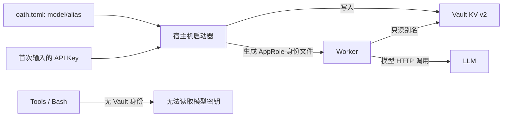

# Vault 密钥接入

状态：Implemented（单机基础版）。

## 结论

`oath.toml` 是唯一配置入口，模型凭据只以别名出现。宿主机启动器把首次提供的 API Key 写入 Vault KV v2；Worker 内的 Model Provider 用 AppRole 身份读取。Tools 不挂载该身份，不接收模型 Key。Brain 只调用 Provider。

## 启动与恢复

`scripts/oath-docker up` 启动文件存储的 Vault。首次运行初始化一个 unseal key 与 root token，保存在宿主机 `data/private/vault-bootstrap.json`（0600）；后续启动用它解封。启动器配置 KV v2、只读 policy 和 Worker AppRole，把 role ID 与 secret ID 写入只挂载给 Worker 的文件。它检查别名是否已有值：有则不覆盖，没有才从 `import_env` 或终端输入获取并写入。`set-secret` 才显式覆盖。

Worker 每次模型请求通过 Vault 读取 Key，认证 token 失效时重新 AppRole 登录。取不到密钥则调用失败，不降级读取进程环境变量。工具系统只收到调用意图与结果；模型 Key 不进 Journal、Trace、模型 context 和 Bash 环境。

## 首版边界

Vault 通过宿主机 loopback HTTP 供启动器访问，通过 Compose 内网 HTTP 供 Worker 访问。Vault 的单节点 file storage 与本机 bootstrap 文件均需备份。服务间的内部鉴权与 RabbitMQ 凭据仍由私有 `oath.toml` 保存；因此 `oath.toml` 不应公开或提供给不可信工具环境。首版适合受信任的个人部署，不宣称多租户隔离或多机 HA。
