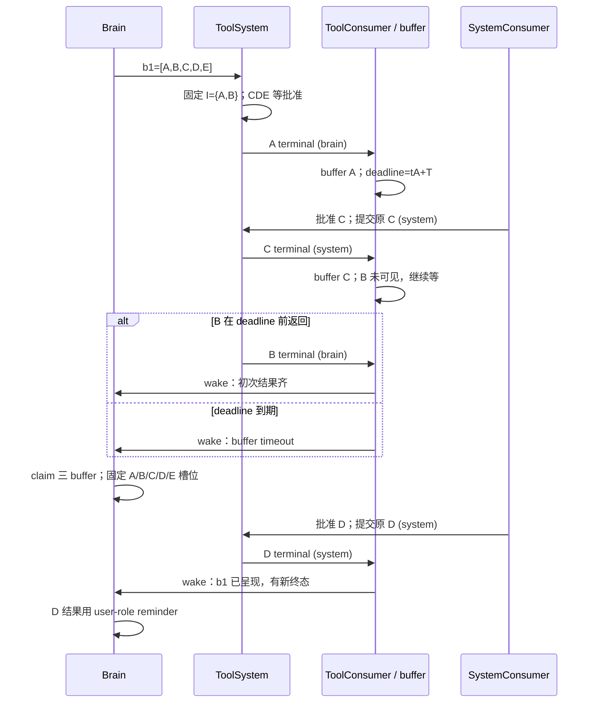

# Intake cases

状态：Implemented（场景约束）；是 [feature-intake](feature-intake.md) 的场景展开。

## 1 读法

A/B 表示一个 invocation，b1 表示一次模型响应的工具批次；`brain` / `system` 是真实终态来源。
`presented` 表示某次 step.input 已固定该批 tool response 槽位；不表示工具已经完成。
下文 T 是 batch_buffer_timeout，例子采用首个结果进入 buffer 起固定窗口。

## 2 单工具

### 2.1 无审批

```text
brain 声明 b1=[A] → 工具系统登记 I(b1)={A} → 提交 A
A 终态(source=brain) → ToolConsumer buffer → 初次结果齐 → wake
Brain claim 三 buffer → tool(A)=真实结果 → LLM
```

### 2.2 需要批准，期间没有其它唤醒

```text
brain 声明 b1=[A] → waiting_approval，I(b1)={} → UI 授权卡
没有真实 toolresult，ToolConsumer 不 wake，也不开 buffer timer
system queue 收到批准 → SystemConsumer 保存裁定 / 原调用提交意图 → 提交 A
A 终态(source=system) → ToolConsumer buffer → I 为空且有新结果 → wake
Brain 第一次固定 b1 槽位 → tool(A)=真实结果
```

批准本身不调用 LLM；不会创建 A2。原始参数经过校验且不可修改。审批 TTL 是没人操作时的退出路径。

### 2.3 拒绝或过期

system 先保存裁定并令 A 进入未执行终态，终态 source=system 进 tool queue。
如果没有其他 step 呈现过 b1，Brain 将拒绝放进 tool(A)。
如果用户早已发过消息并触发 Brain、tool(A) 已固定为等待提醒，这次拒绝用 user-role reminder。
同一审批的拒绝与同意竞争，只允许一个持久化裁定生效。

### 2.4 用户先插话，然后批准

用户消息由 UserConsumer wake，Brain 收三个 buffer，在用户消息前补 tool(A)=等待批准。
之后批准仍然提交原 A，真实结果用 user-role reminder。插话本身不会取消旧请求；
如果用户明确取消，SystemConsumer 先取消调用，之后批准必须被拒绝。

## 3 五工具：A/B 初次提交，C/D/E 等批准



| 到达顺序 | 第一次工具唤醒时刻 | 该步呈现 |
| --- | --- | --- |
| A → B，CDE 都待批 | B buffer 完成时 | A/B 真实结果；CDE 等批准 |
| A → C(system) → B | B buffer 完成时 | A/B/C 真实结果；D/E 等批准 |
| C(system) → A → B | B buffer 完成时，或更早的 tC+T | system 首个结果也能开 timer；C 不能提前绕过 A/B |
| A → C(system)，B 一直没回 | tA+T | A/C 真实结果；B 执行中；D/E 等批准 |
| C/D/E 全完成，A/B 均未回 | 首个 system 结果入 buffer 后 T | CDE 真实结果；A/B 执行中 |
| B 已执行完，但终态仍在 queue | B 入 buffer 前不算齐；最多等 timer | 不依赖执行表中的 completed 提前漏掉 B |
| A → 用户消息 → B | 用户消息先唤醒 | A 结果、B 执行中、CDE 等批准；后到 B 独立 wake 并用 user role |
| A → C 被拒绝 → B | B 或 tA+T | C 拒绝先随 buffer 等待，不从 system 偷跑一次 wake |
| b1 等 B，另一批 b2 已满足唤醒 | b2 可以 wake | 三 buffer 全取，b1 也会被呈现；之后 b1 的新结果独立通知 |

b1 的约束只限制 b1 通过 ToolConsumer 触发首次 wake。用户消息和其它 consumer 的合法唤醒
仍能提前取走 b1 的已缓存结果；这是三个 buffer 全量 drain 的直接结果。

## 4 全部等待批准与零结果

| 场景 | 行为 |
| --- | --- |
| b1=[C,D,E] 全部 ask | I={}，N={}，不 wake；UI 显示审批，各自有 TTL |
| C 先批准执行成功，DE 仍待批 | C 终态到达立即 wake；DE 用等待提醒 |
| C 已批准但运行很慢，D 先批准并完成 | D 终态即可 wake，不把 C 加入初次等待集合 |
| C 拒绝，DE 待批 | C 未执行终态到达即 wake；DE 继续待批 |
| 所有审批都不操作 | 到期后各自产生 expired 终态，事件可合并进一个 step |
| 单个 A 被初次权限策略直接 deny | 未执行终态 source=brain；I={} 且 N 非空，立即 wake |
| A/B 初次执行全部挂住，没有任何结果 | buffer timer 不启动；各自执行 / 排队 deadline 负责产出 timeout |
| 初次判权限卡住，batch 尚未注册完成 | 接纳 deadline 使失败项终结；不能发布半个初次集合并提前执行 |
| 原工具返回后，尚未发布的最后结果丢通知 | 持久化终态重投；不新建 invocation 重跑 |
| reminder 后模型回答“等批准”，没有新调用 | 没有新输入就停驻，不把 reminder 再送 queue 自己唤醒自己 |
| 模型持续产生新工具调用 | run 步数 / 时间预算耗尽暂停推理，显示原因；审批与结果继续保存 |

## 5 三 buffer 竞争与投影

### 5.1 三个 consumer 同时 wake

```text
user buffer={u1}，tool buffer={rA}，system buffer={invoke1}
三个 consumer 各自判定，均请求 wake
Brain 原子提交 step.input s2={u1,rA,invoke1}，三个请求被同一步覆盖
LLM 运行时 rB 到达，留在 tool buffer；旧 s2 的 complete 不能删除 rB
ToolConsumer 为 rB 请求下一次 wake，s2 结束后认领它
```

### 5.2 结果在 context build 与模型回答之间到达

s2 已固定 B=执行中，HTTP 尚未返回时 B 成功。s2 不回填真实结果；s3 用 user reminder 告知。
“是否已经有下一条 assistant 输出”不是判据，step.input 提交才是投影固定时刻。
如果 s2 HTTP 失败，重试仍用同一份投影；rB 留待后续输入，不改 s2 的身份。

### 5.3 结果与 claim 同时发生

终态进入 buffer 的提交先于 claim cutoff，则这一步包含它；晚于 cutoff，则下一步处理。
即使 ToolSystem 的状态已经是 succeeded，只要结果事件未被本步认领，也不能偷偷当成本步已消费。
三个 buffer 各有 cutoff，认领事务固定整组 cutoff；之后到来的消息不会因另一 buffer 较晚读取而插入。
若 B 在 cutoff 后、presented 提交前入 buffer，它可能先判断“未齐”；presented 提交通知
ToolConsumer 重查，此时已有新结果且本批已呈现，立即请求下一次 wake，不漏掉这次状态变化。

### 5.4 快速批准与取消

授权卡发布前先持久化批次成员及初次接纳；收到批准时 batch / invocation 必须已存在。
取消若先于执行资格提交，后续批准不能启动 worker；执行已开始时只能按实际能力取消。
工具仍可能在外部生效，禁止把“模型停止等待”显示成“外部动作肯定撤回”。

## 6 崩溃推演

| 中断位置 | 重启后的行为 | 防止的问题 |
| --- | --- | --- |
| u1 已接纳，UserConsumer 尚未 buffer | 重投 u1；稳定 event_id 去重 | 用户消息丢失 |
| 批次已注册，A 尚未取得执行资格 | 续发已记录的原调用 | 新 ID 重复调用 |
| A 已取得资格，可能已执行，无结果 | 查 operation；无法确认则 unknown | 对外副作用重复 |
| 批准 C 已落盘，意图尚未派发 | 恢复原 C 的唯一 source=system 意图 | 批了却不执行 / 执行两次 |
| A 结果已落盘，入 queue 前 | 重投同一终态 | 永远等不到结果 |
| A 已 buffer，deadline 未到 | 恢复原 deadline；已过期立即判定 | 每重启一次就重等完整窗口 |
| claim 只准备了部分数据，提交记录未落盘 | 这次认领不存在，三 buffer 都仍可取 | 三 buffer 部分丢失 |
| step.input 已提交，模型还未发请求 | 恢复相同请求与 reminder | 改变历史 / 重复认领 |
| 模型返回已保存，后处理未完成 | 只补已记录的 batch / 提交意图 | 重新推理出另一组动作 |
| step.completed 已保存，buffer 未清理 | 只按完成记录回收 | 已消费结果再唤醒 |
| 审批 pending，TTL 在停机时到期 | 重建 timer，生成一次 expired 终态 | 重启后永久可批准 |
| 所有 buffer 都空，但还有审批 / 执行意图 | 仍恢复该 scope 和对应 timer / 对账 | 只扫描 buffer 导致遗忘后台任务 |
| 模型持续失败或配置错误 | 有限重试后进入可查询失败状态，保留输入、释放 owner | 无限循环 / 永久占锁 |
| consumer 崩溃 | 从 receipt / buffer / batch / timer 重建，重复事件 dedup | 进程活着但会话永远不再消费 |

模型失败后只暂停推理，原 step 仍持有输入；三个 consumer 和工具继续运行。用户看到失败状态，
修复后显式 retry / resume。新消息不会将失败输入反复自动重试，也不会越过失败 step。

重复批准、重复终态、重复 timer / wake 都不新增逻辑操作；同一 invocation 的冲突终态报错并审计，
不计作第二份结果。取消后旧批准无效；审批和过期竞争时按持久化裁定与 deadline 得出唯一结果。

## 7 需要明确接受的行为

- 批准按最新机制自动提交原调用；只有显式取消 / 失效能撤销执行资格，普通聊天不会自动撤销。
- system 来源工具不阻塞初次集合，也不组成新的全体等待集合；first result 可以单独通知已呈现批次。
- 其它 queue 提前 wake 会呈现未完成工具的 reminder；无需等 tool consumer 同意才 drain。
- 工具结果的 source 不决定模型 role；是否已固定原槽位决定 tool role 或 user role。
- 批次 buffer timeout 只结束这次等待；执行 deadline 决定工具何时停止被等待，两者不可混用。
- 没有可靠外部查询或幂等机制时，执行后的崩溃只能安全地报告 unknown，不能保证自动完成所有副作用。
