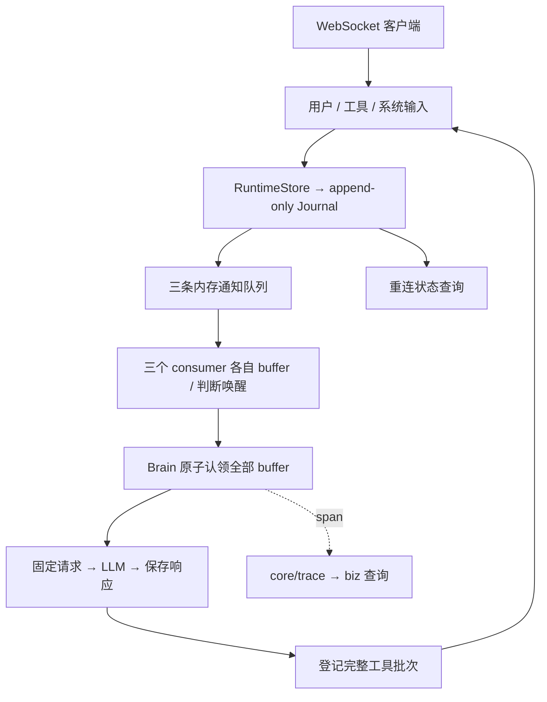

# Oath 整体架构

状态：单进程运行链路、三级压缩、技能索引与 trace 已实现；Supervisor、多机 HA 待实现。

## 定位

Oath 是持久化、事件驱动的 agent runtime。core 负责执行语义、工具生命周期、context build
和模型请求；extensions 提供业务工具、skill 和 context 来源；bootstrap 装配并连接客户端。
账号、订阅、渠道采集和 Kit 业务逻辑属于 Hymio。

## 运行链路

**三个 consumer 独立判断唤醒；Brain 串行执行。** 一次 step 固定一次输入和请求，不在
模型循环里阻塞等待整批工具。工具结果、用户输入和控制决定分别经各自队列处理。

## 模块边界

| 模块 | 职责 |
| --- | --- |
| core/protocol | datatype、接口和错误契约 |
| core/journal | 追加日志、RuntimeStore 原子提交与恢复 |
| core/queue | 三条按 scope 隔离的内存通知队列 |
| core/buffer | 持久化输入接纳、receipt、输入阶段 |
| core/consumer.py | user / tool / system 各自消费和唤醒规则 |
| core/agent | 固定请求、模型调用、持久化响应与后处理 |
| core/context | 固定 tool 槽位、迟到结果通知；journal 查询视图 |
| core/compaction | 历史压缩：切点、阈值、产物生效 |
| core/detail | 超阈值结果的全文存储、截断与 detail_read |
| core/skill | 技能索引、优先级预算与 skill 工具 |
| core/tool | 注册、完整批次、权限裁定、执行资格、deadline 与真实终态 |
| core/llm | provider adapter，当前支持 OpenAI-compatible API |
| core/trace | 按 scope 记录 ReAct 循环的 span，OpenTelemetry 形状 |
| core/outbound | 在线事件与客户端背压 |
| bootstrap | 配置、认证装配、启动恢复；WebSocket server 与 biz server |
| biz | runtime 对外暴露的功能，当前只有 trace 的读模型 |
| extensions | 业务能力扩展 |

biz 只放 runtime 需要暴露给上层的能力，一个能力一个子目录（当前是
`biz/trace/`），不放协议与生命周期 —— 那两样在 `bootstrap/`：一个 WebSocket server 收 command，
一个 biz server 供查询。整个 biz 一个端口，每条查询是其中一个 path。
依赖单向 `biz` → `bootstrap` → `core`。

core 不依赖具体客户端和业务；扩展可缺省，删除业务扩展仍能恢复状态。
Journal 是事实来源，队列和内存状态可重建；各模块共用 RuntimeStore，不另建审批 / buffer 持久化文件。

## 身份与隔离

- user_id + session_id 是两级隔离，同 session 内至多一个 active Brain step。
- run_id 关联一段运行；新用户输入开始新 run，旧调用结果与审批仍保留原归属。
- step_id 在认领事务中保存；batch_id 标识一次响应的完整工具批次，当前取 step_id。
- invocation_id 由 Oath 生成，用于审批、状态和恢复；tool_call_id 由模型生成，仅用于消息配对。
- trace_id 关联一段 ReAct 循环；上一个 step 产出过工具调用就续用，否则开新的。
- cursor 表达 Journal 顺序，runtime.commit.version 表达事务顺序；不使用时间戳排序。

不引入 runtime_id。user_id 来自认证主体，跨 scope 不泄露调用是否存在。

## 三个核心原则

1. **Event-driven**：各 consumer 独立处理输入；不是每条事件都调用 LLM。批准直接提交原调用，
   工具终态由 ToolConsumer 按初次提交集合、presented 与固定 deadline 决定何时唤醒。
2. **Durable**：输入先保存再 ACK；执行意图先保存再派发；一次原子 claim 固定三个 buffer 的输入、
   tool 槽位和请求草稿，压缩后另行固定最终请求。重启沿用原请求和调用身份，已保存响应不重新生成。
3. **Supervisor**：计划作为独立观察与恢复模块，基于日志产生可审计控制命令；当前尚未实现。

## 恢复与限制

RuntimeStore 用单条 JSONL runtime.commit 保存跨表变化，只有一个进程 writer。
启动枚举所有 journal scope，恢复审批、工具、buffer 和 step，再接入客户端。
queued 原调用可以续发；running 无可靠结果时报告 outcome_unknown，不自动重做外部动作。

模型失败有限重试，预算耗尽或永久错误暂停原 step；客户端显式 step.retry。
重连通过 session.status 恢复视图，在线 delta 不重放。线程执行器不承诺终止外部副作用。

当前全量日志恢复和状态复制适合原型规模；事务快照、分页、外部 operation 对账与多进程 fencing
后续建设。压缩产物落在一张表里，一个 scope 同时只有备好的和生效的两份。单机 JSONL 不等于多机高可用，不承诺第三方副作用 exactly-once。

详见 [Intake](feature-intake.md)、[工具系统](feature-tool-system.md)、[Agent Runtime](feature-agent-runtime.md)、
[Compaction](feature-compaction.md)、[Skill](feature-skill.md)、[Journal](feature-journal.md)、
[Trace](feature-trace.md)、
[客户端接入](manual.md) 与
[场景推演](intake-cases.md)。
