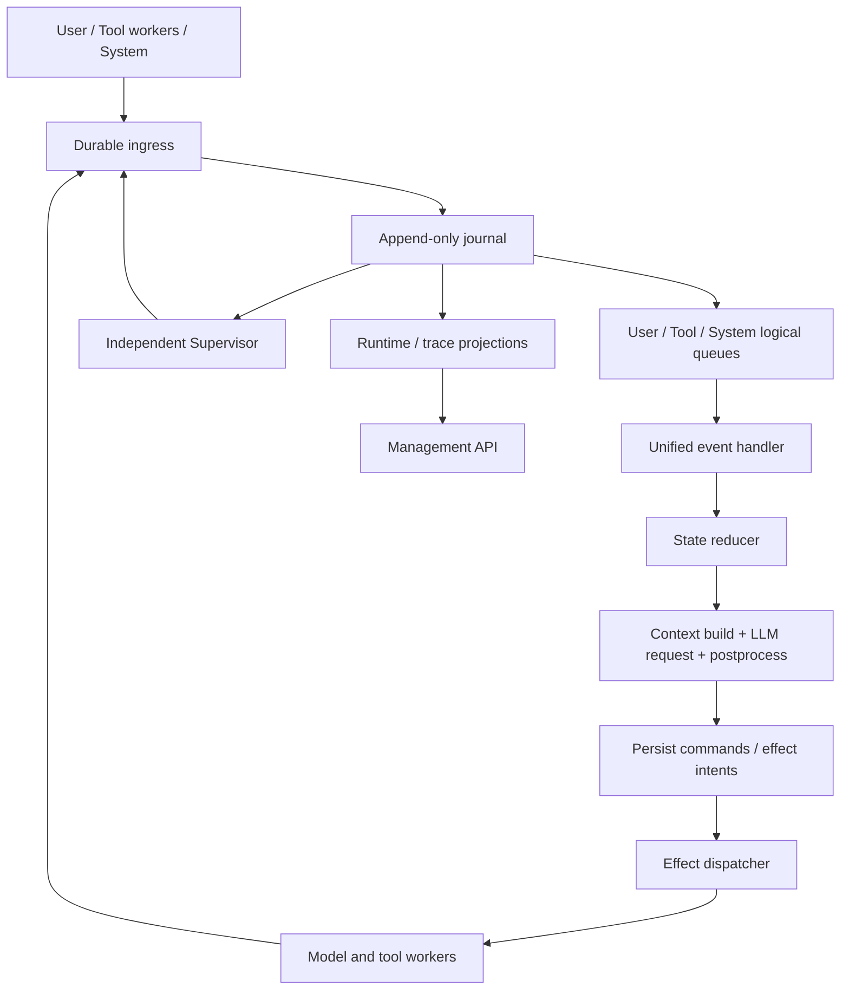

# Oath 整体架构

状态：Draft v0.1；这是实现前的设计基线，不代表能力已实现。

## 定位与边界

Oath 是长期运行的 agent runtime。core 负责执行语义、持久化、调度、工具生命周期；extensions 提供业务 tool、业务 skill 和额外 context 来源；bootstrap 负责装配。biz 提供客户端可用的操作与查询 API。账号、订阅、渠道采集和 Kit 业务逻辑属于 Hymio。

三个设计原则：event-driven、durable、独立 Supervisor（运行监督与恢复）。Supervisor 负责监督 runtime 进程并在异常时发出可审计的恢复命令，它不是用户审批工具的权限系统；权限策略仍在每次工具执行前检查。

## 目录

```text
core/            机制：事件、状态机、agent step、工具系统、恢复
core/protocol/   契约：datatype 与 interface。跨仓库消费，纯数据无 I/O
  datatype/      Scope / Message / AgentState / Cursor + journal 专属的数据类型
  interface/     按模块分文件的接口（journal.Journal）
core/utils/      工具：编码与时间处理，与 protocol 同级，不构成契约
core/journal/    独立追加日志模块，供所有模块统一写入和读取
core/journal/impl/  存储后端（v1 为 JSONL）
extensions/      业务扩展：业务 tool、业务 skill、额外 context 来源
bootstrap/       装配与入口：读配置、实例化、注入 CoreRuntime
biz/             runtime 操作、状态和 trace 查询
spec/            整体架构、feature 实现方案、决策与验收条件
```

依赖方向一律指向 `core/`；core 不反向依赖任何一层。core 内部单向依赖
`core/protocol`。

`extensions/` 可缺省 —— 判据是**删掉它，runtime 仍能启动**，只是没有业务能力。
core 自带落盘 journal，所以这条判据对 durability 没有任何让步。只有 `bootstrap/` 必需。

core 不禁止第三方库：需要什么就 import 什么，装在 `pyproject.toml` 里。

目前只有 journal 有代码，其余目录等有对应实现再填。

## 运行链路



队列是持久化事件的投递视图，不要求一开始部署三个消息中间件。唯一业务状态来源是 journal；broker、快照、索引都是可恢复的派生设施。事件决定下一步，不以显式的 `while true → model → tools` 驱动 agent；队列消费器内部使用循环不违背这一约束。

## 执行单元

- `user_id`：第一层隔离；`session_id`：用户内第二层隔离与串行化边界。所有资源以 `(user_id, session_id)` 定位，同名 session 不得跨用户混用。
- `run_id`：session 内每次运行的稳定标识，用于关联输入、模型请求、工具、日志与 trace。恢复同一次运行保留 run_id；新运行分配新 run_id，重试用 attempt_id 区分。run 不是第三层权限隔离。
- `step_id`：一次固定 context / 配置下的模型请求及后处理。
- `invocation_id`：一次逻辑工具调用；`attempt_id`：其中一次实际尝试。
- `epoch`：会话 owner 的 fencing 代数；`cursor`：journal 内定位一条日志记录的位置（JSONL 为行号，MySQL 为自增 id），在同一 scope 内严格单调递增，是状态快照的水位线；`state_version`：仅执行状态提交递增的版本，用于并发控制。

日志记录的顺序由 `cursor` 表达，**不由时间戳表达**。`occur_dt` / `commit_dt` 只用于展示与排查，正确性不依赖它们——墙钟会回拨、会撞精度，做水位线会静默丢数据。详见 [feature-journal](feature-journal.md)。

当前不引入部署实例身份作为隔离维度。队列、工具映射、幂等键、快照、lease、查询 cursor 和 blob 引用都继承 user/session scope；user_id 来自认证主体或授权委托，不接受调用方任意伪造。

同一 `(user_id, session_id)` 仅一个有效执行状态 owner，但多个模块可以同时向独立 Journal 追加输入、结果与观察记录；Journal 负责原子写入和排序。可以同时有多个工具 worker；不同 session 并发。初期同 session 只允许一个活动 run，后来的用户消息默认排队，显式 steer / interrupt 才改变当前 run。主状态由 reducer 从已提交的状态记录重建；所有时间、随机 ID、模型返回及外部查询结果都必须作为持久化输入，重放不重新生成。状态的形状（一个大 KV 对象）和对话消息的组装规则见 [feature-journal](feature-journal.md)。

## 独立 Journal 模块

[core/journal](../core/journal/) 提供统一的追加与读取接口，agent、工具、队列、Supervisor、biz 和扩展都能在自身流程中写记录，无需经主 agent 转发。Journal 是模块边界，首版不要求独立服务部署。输入记录触发处理，状态提交驱动恢复，观察记录用于 trace；三者共用日志但写权限和消费语义不同。

`core/protocol/` 单独承载记录格式，因为它是**跨仓库契约**——Hymio 的 biz 查询、客户端的 trace 视图、Nostalgia 都要读它，所以它必须与任何具体存储实现解耦，可以脱离 Python 独立描述。

恢复的水位线是状态快照携带的游标，不是时间戳。快照是全量 KV，恢复时取最后一条完整快照并把游标之后的记录作为 pending 交回调用方折叠；fold 是不产生外部副作用的纯函数，所以重放不会重做工具调用。详见 [feature-journal](feature-journal.md)。

## 三个核心约束

1. **事件驱动**：用户输入、模型返回、工具返回、timeout、cancel、恢复命令统一进入事件处理。不是每条事件都调用 LLM；进度、重复或过期结果只更新审计/视图。
2. **Durable**：影响后续行为的输入、决定、effect intent、结果与状态迁移追加持久化。先落盘再 ACK / 派发 / 呈现；持久化失败时停止接收新工作。重放只重建状态，不重做外部副作用。
3. **Supervisor**：独立进程订阅日志、租约和心跳，产生可审计恢复命令。规则优先，未来可用 agent 提议优化；修改 prompt / 架构必须经过版本化评估与发布流程。

这些约束不提供跨第三方系统的 exactly-once。对于执行过但结果丢失的调用，必须允许 `outcome_unknown`，不可一律重试。

## 实施顺序

先完成内存模型与持久化适配器的同一套契约，再做单机 crash recovery；随后独立 Supervisor、biz 查询与多进程 owner failover。HA 依赖具备原子追加和 fencing 能力的共享存储，不能把单机 JSONL 宣称为多机高可用。

详见 [feature 清单](README.md)。语言、存储引擎、模型 SDK、broker、快照频率、租约时长均为待决事项；接口约束先确定。
