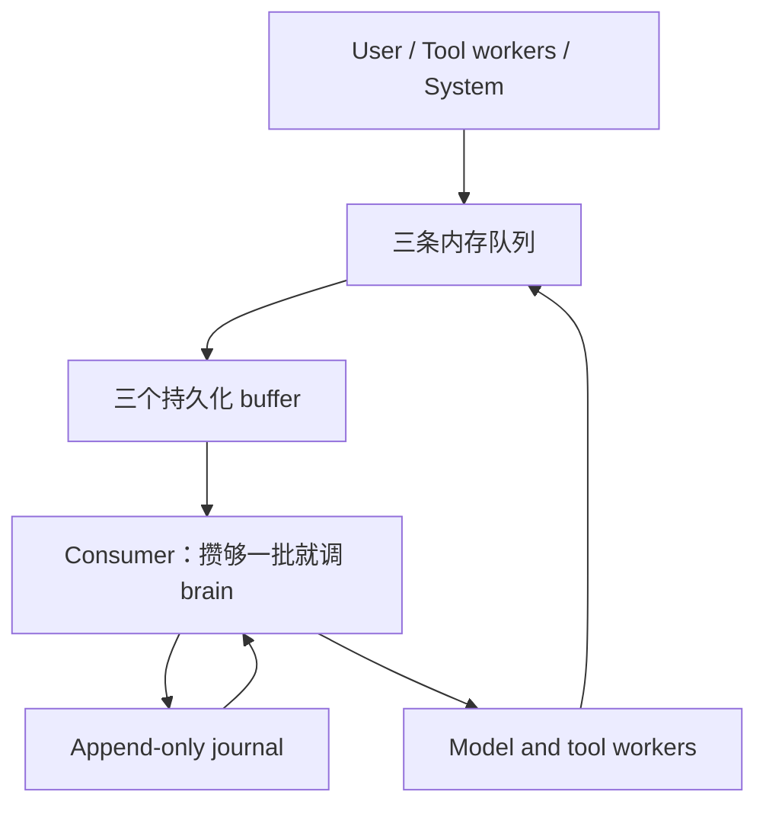

# Oath 整体架构

状态：Draft v0.2；目录里有代码的部分已实现，未列出的设计仍是意图。

## 定位与边界

Oath 是长期运行的 agent runtime。core 负责执行语义、持久化、调度、工具生命周期；extensions 提供业务 tool、业务 skill 和额外 context 来源；bootstrap 负责装配。账号、订阅、渠道采集和 Kit 业务逻辑属于 Hymio。

## 目录

```text
core/            机制：事件、状态机、agent step、工具系统、恢复
core/protocol/   契约：datatype 与 interface。跨仓库消费，纯数据无 I/O
  datatype/      Scope / Message / AgentState / Cursor + journal 专属的数据类型
  interface/     按模块分文件的接口（journal.Journal）
core/utils/      工具：编码与时间处理，与 protocol 同级，不构成契约
core/journal/    独立追加日志模块，供所有模块统一写入和读取
core/journal/impl/  存储后端（v1 为 JSONL）
core/tool/       工具系统：注册表、批量并行派发、执行状态、终态事件
core/tool/impl/  执行后端（v1 为线程池）
core/queue/      三条内存队列（user / tool / system），只管叫醒
core/buffer/     consumer 侧的持久化攒批缓冲（v1 为 per-scope 文件）
core/agent/      agent step：context → 模型 → 落盘 → 派发
core/consumer.py 每 session 一条消费线程：取队列 → 灌 buffer → 调 brain
core/context/    把 journal 投影成一次模型请求要的东西；压缩接口留着
core/llm/        provider 无关的模型调用接口 + OpenAI 兼容实现
core/outbound/   对外投递：按 scope 分流的有界发送队列与事件 sink
extensions/      业务扩展：业务 tool、业务 skill、额外 context 来源
bootstrap/       装配与入口：读配置、实例化、注入 CoreRuntime
spec/            整体架构、feature 实现方案、决策与验收条件
```

依赖方向一律指向 `core/`；core 不反向依赖任何一层，core 内部单向依赖 `core/protocol`。

`extensions/` 可缺省 —— 判据是**删掉它，runtime 仍能启动**，只是没有业务能力。
core 自带落盘 journal，所以这条判据对 durability 没有任何让步。只有 `bootstrap/` 必需。

core 不禁止第三方库：需要什么就 import 什么，装在 `pyproject.toml` 里。

journal、工具系统、队列与 agent runtime 已有实现，下一步是 Supervisor 与查询接口。HA 依赖具备原子追加和 fencing 能力的共享存储，不能把单机 JSONL 宣称为多机高可用；语言、存储引擎、模型 SDK、broker、快照频率、租约时长均为待决事项，接口约束先确定。

## 运行链路



队列管叫醒，buffer 管不丢，journal 管什么算数 —— 三件事分在三处。唯一业务状态来源是 journal；broker、快照、索引都是从 journal 恢复出来的 derived 设施。事件决定下一步，不以显式的 `while true → model → tools` 驱动 agent；队列消费器内部使用循环不违背这一约束。

## 执行单元

- `user_id`：第一层隔离；`session_id`：用户内第二层隔离与串行化边界。所有资源以 `(user_id, session_id)` 定位，同名 session 不得跨用户混用。
- `run_id`：session 内每次运行的稳定标识，用于关联输入、模型请求、工具、日志与 trace。恢复同一次运行保留 run_id；新运行分配新 run_id。run 不是第三层权限隔离。
- `step_id`：一次固定 context / 配置下的模型请求及后处理。
- `tool_call_id`：模型 API 返回的工具调用标识，组对话历史时原样透传，assistant 轮的 `tool_calls[i].id` 与 tool 消息的 `tool_call_id` 必须逐字节相同。
- `invocation_id`：Oath 自己的一次逻辑工具调用标识。工具状态查询的键，也是 `tool.call` 与 `tool.result` 的配对键；不作为查询键使用时它就是日志里的一个关联 id。
- `epoch`：会话 owner 的 fencing 代数；`cursor`：journal 内定位一条日志记录的位置（JSONL 为行号，MySQL 为自增 id），在同一 scope 内严格单调递增，是状态快照的watermark；`state_version`：仅执行状态提交递增的版本，用于并发控制。

日志记录的顺序由 `cursor` 表达，**不由时间戳表达**。`occur_dt` / `commit_dt` 只用于展示与排查 —— 墙钟会回拨、会撞精度，做 watermark 会静默丢数据。

同一 `(user_id, session_id)` 仅一个有效执行状态 owner，也就是一条消费线程；Journal 负责原子写入和排序，**但只有 brain 往里写** —— 工具结果、模型输出、状态迁移都由 brain 在 `step` 里追加。可以同时有多个工具 worker，不同 session 并发。主状态由 reducer 从已提交的状态记录重建；所有时间、随机 ID、模型返回及外部查询结果都必须作为持久化输入，重放不重新生成。

恢复的 watermark 是状态快照携带的游标：快照是全量 KV，恢复时取最后一条完整快照并把游标之后的记录作为 pending 交回调用方 fold；fold 是纯函数，重放不会重做工具调用。状态形状与消息组装规则见 [feature-journal](feature-journal.md)。

[core/journal](../core/journal/) 提供统一的追加与读取接口。扩展的 tool 通过 `execute` 的返回值把结果交给 core，不自己往里写。输入记录触发处理，状态提交驱动恢复，观察记录用于 trace。

`core/protocol/` 单独承载记录格式，因为它是**跨仓库契约**——Hymio 的查询接口、客户端的 trace 视图、Nostalgia 都要读它，所以它必须与任何具体存储实现解耦，可以脱离 Python 独立描述。当前不引入部署实例身份作为隔离维度：队列、幂等键、快照、lease 与 blob 引用都继承 user/session scope，`user_id` 来自认证主体，不接受调用方自称。

## 工具系统

[core/tool](../core/tool/) 收集 core 与 extensions 的工具定义交给 context，把模型点名的调用派发出去。派发接口**只收批次、一定并行、立即返回执行 id**：同一批里的调用互不依赖，模型线程不能被工具拖住，真正的执行在后台线程池里跑。每个调用跑完或超时，发一条终态事件：直推客户端，同时进 tool 队列等 brain 去落盘 —— 工具系统不知道这一轮是什么，所以它不写 journal。

超时是「core 不再等待」而不是「终止线程」：线程跑到哪儿算哪儿，迟到的结果一律丢弃、不改写已发的终态。因此 `TIMEOUT` 的含义是「core 此刻不知道这个工具有没有生效」，能不能重试由上层判断。执行状态表是内存里的 derived 设施，重启即丢，真相始终是 journal 的记录。详见 [feature-tool-system](feature-tool-system.md)。

## Agent Runtime

输入先进内存队列，每个 session 一条消费线程把它搬进持久化的 buffer。**搬进去的那一刻它才不会再丢** —— 之前崩了就丢了。

一次 `step` 只调一次模型：落这一批的输入 → build context → 调模型 → 落 `assistant.message` → 有 tool call 就落 `tool.call` 并派发。工具的终态事件回到 tool 队列，成了下一次输入，循环就是这么来的。不等工具、不循环：一个工具挂住不会把这一轮卡死。详见 [feature-agent-runtime](feature-agent-runtime.md)。

## 事件通路

三条内部队列（`user` / `tool` / `system`）是同一个东西的三种用法，只有 `Inbound` 的 kind 过滤不同，所以只有一个 `EventQueue` 加一张映射表。**队列只装输入，不装输出**，且**队列层完全不碰 journal** —— 落盘是 brain 读完这一批之后的判断。

对外投递**不是队列，也不经过 journal**：`AgentEventSink` 在事件产生时直推客户端，断了不补发。对外是一条双向 WebSocket，`user_id` 由服务端从 credential 推导，客户端不能自称。详见 [feature-event-runtime](feature-event-runtime.md)。

## 三个核心约束

1. **事件驱动**：用户输入、模型返回、工具返回、timeout、cancel、恢复命令统一进入事件处理。不是每条事件都调用 LLM；进度、重复或过期结果只更新审计/视图。
2. **Durable**：影响后续行为的输入、决定、结果与状态迁移追加持久化；先落盘再派发，重放只重建状态。
3. **Supervisor**：独立进程订阅日志、租约和心跳，产生可审计恢复命令。规则优先，未来可用 agent 提议优化；修改 prompt / 架构必须经过版本化评估与发布流程。

这些约束不提供跨第三方系统的 exactly-once。对于执行过但结果丢失的调用，必须允许 `outcome_unknown`，不可一律重试。
