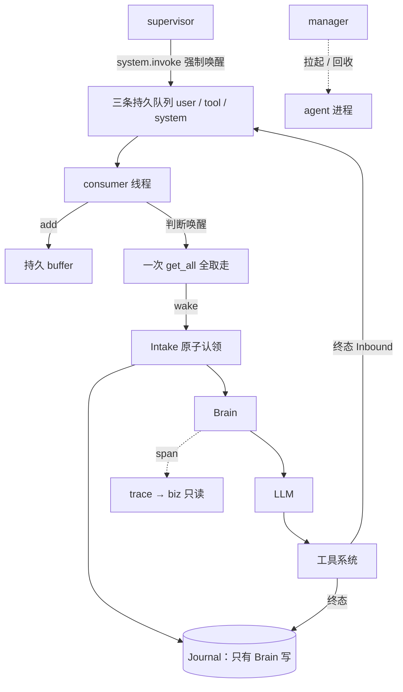

# Oath 整体架构

状态：每 scope 一进程、队列与 buffer 外置、manager 管 session 生命周期已实现；多机 HA 待实现。

## 定位

Oath 是持久化、事件驱动的 agent runtime。core 负责执行语义、工具生命周期、context build 和
模型请求；extensions 提供业务工具、skill 和 context 来源，由扩展目录在启动时扫出来；bootstrap
装配并连接客户端。账号、订阅、渠道采集和 Kit 业务逻辑属于 Hymio。

## 进程模型

**一个 scope（user_id + session_id）一套进程。** 没有任何进程同时服务两个 scope：

```
  biz（单例，进程内带 manager）
    ├── agent 进程 × N     每个 scope 一个：3 个 consumer 线程 + 1 个 Brain 线程 + WS server
    └── supervisor 进程 × N 每个 scope 一个：周期投 system.invoke
              queue（Redis Streams，独立于任何进程）
```

队列是进程外的中间件，任何进程都能往里投，消费端不在队列这一侧。scope 因此可以单独崩、单独
重启：进程没了，队列里的输入还在，等新进程接上。
## 运行链路



**输入到达不落 journal。** 它先进队列、再进 buffer，被 Brain 认领时才写进去 —— journal 里
没有「收到但没处理」这一档。**只有 Brain 写输入与 step**：工具终态写在它自己的事务里，
投递到队列发生在事务提交之后；supervisor 连 journal 的接口都没有，它只是投一条事件。

## 模块边界

| 模块 | 职责 |
| --- | --- |
| core/protocol | datatype、接口和错误契约 |
| core/journal | 追加日志、RuntimeStore 原子提交与恢复 |
| core/queue | `EventQueue` 接口与 Redis Streams 实现 |
| core/buffer | `EventBuffer` 接口与 diskcache 实现 |
| core/consumer.py | user / tool / system 各自的收、buffer、唤醒规则 |
| core/intake | 原子认领三个 buffer，把输入固定成一次 step |
| core/agent | 固定请求、模型调用、持久化响应与后处理 |
| core/context | 固定 tool 槽位、迟到结果通知；journal 查询视图 |
| core/compaction | 历史压缩：切点、阈值、产物生效 |
| core/detail | 超阈值结果的全文存储、截断与 detail_read |
| core/skill、core/shell、core/llm | 技能索引；bash 与执行环境；provider adapter |
| core/trace、core/outbound、core/supervisor | span 记录；在线事件与背压；周期调度 |
| bootstrap/agent | 单个 scope 的进程装配、WS server、service 端点 |
| bootstrap/manager | session 表、拉起、端口分配、按连接数回收 |
| bootstrap/supervisor | 单个 scope 的 supervisor 进程 |
| bootstrap/biz | biz 的 HTTP 路由与装配 |
| biz、extensions | trace 读模型与 CLI 执行；`tools/` `cli/` `skills/` |

依赖单向 `bootstrap` → `biz` → `core`。core 不反向查找插件，也不 import 任何上层。

## 身份与隔离

两级凭证，作用范围不同：**服务级**在配置里，能调 `create_session` / `list_sessions`；**session 级**
由 manager 签发，只认那一个 scope，不进配置文件也不进命令行，走 `OATH_SESSION_CREDENTIAL`
环境变量注入那个 agent 子进程。

其余标识：run_id 关联一段运行；step_id 在认领事务中保存；invocation_id 由 Oath 生成，用于审批
与恢复；tool_call_id 由模型生成，仅用于消息配对；trace_id 关联一段 ReAct 循环；cursor 表达
Journal 顺序。排序不依赖时间戳。

## 三个核心原则

1. **Event-driven**：三个 consumer 各自决定唤醒，不是每条事件都调 LLM。工具终态由
   ToolConsumer 按初次提交集合与固定 deadline 判断何时唤醒。`system.invoke` 是强制唤醒，
   投递本身不进 buffer。
2. **Durable**：输入先在持久 buffer 里，再由一次原子认领固定成 step；执行意图先保存再
   派发；已保存的响应不重新生成。队列的 ack 是中间件自己的可用性保障，不进 Oath 接口。
3. **Supervisor**：每个 scope 一个独立进程，只做一件事 —— 定时投 `system.invoke`。
   **回收只看 WS 连接数**：连续为 0 且过了冷却期就停掉那两个进程。agent 崩了没人拉起它；
   客户端带着原 `session_id` 再调一次 `create_session`，这个 scope 的进程就重开了，数据还在原目录里。

详见 [Intake](feature-intake.md)、[工具系统](feature-tool-system.md)、[Agent Runtime](feature-agent-runtime.md)、[Compaction](feature-compaction.md)、
[Skill](feature-skill.md)、[Journal](feature-journal.md)、[Trace](feature-trace.md)、[Supervisor](feature-supervisor.md)、[扩展目录](feature-extensions.md)、
[Bash 与 CLI](feature-bash-cli.md)、[User Context](feature-user-context.md)、[客户端接入](manual.md) 与 [场景推演](intake-cases.md)。

## 限制

单机进程模型：容量上限是 `max_sessions` × 一个 scope 一套进程，没有跨机共享一个 scope 的机制。
JSONL journal 不等于多机高可用，不承诺第三方副作用 exactly-once。线程执行器不承诺终止外部副作用。
事务快照、分页、外部 operation 对账与多机 fencing 后续建设。
